# HARPOR

HARPOR turns a short capture of one rigid object into a 3D model that a simulator can load. It started as a
re-implementation of GATOR (arXiv 2610.11215).

The input is a phone video, a ROS 1 or 2 bag or a Stray Scanner export of one rigid object. The output is a textured
mesh and MJCF, USD and URDF files with an estimated mass, materials and friction. An optional AI agent refines the
geometry and the appearance in Blender, and the host checks each result. The research focus is estimating and refining
the mass and the friction of rigid objects.

![HARPOR pipeline: a capture becomes a posed mesh through SAM 3, Depth Anything 3, view selection, MV-SAM3D and a pose fit (A); VoMP estimates the materials right after MV-SAM3D (B); an optional agent refines the geometry and appearance, and a host check compares each candidate's surface with the original and checks that the agent finished (C); the mesh is turned upright, the VoMP materials are moved onto it for the mass and the inertia, the job's model estimates the friction from photos, and the export writes MJCF, USD and URDF files, an optional 360 video and results.zip (D)](docs/pipeline.svg)

HARPOR finds the object in the frames with SAM 3, gets cameras and depth from Depth Anything 3 and picks the views.
LiDAR or iPhone depth sets the metric scale when the capture has it. MV-SAM3D builds a textured mesh from the views,
and a pose fit places it in the scene (A). VoMP v1.1 estimates the density, Young's modulus and Poisson's ratio of the
mesh right after MV-SAM3D makes it (B).

The agent stage is optional (C). The agent works in Blender on the geometry and the appearance. After each build or
repair, the host compares the surface with the original and checks that the agent finished. A failed check starts a
repair round, with at most 3 builds. The host then delivers the best stored candidate.

The export turns the mesh upright, transfers the VoMP materials to it and recomputes the mass and the inertia (D).
Then the job's model, the same model as the agent with the same API key, estimates the friction. It sees up to 4
photos of the object, its name and the mesh's size, and it gives the material of the outer surface and one friction
value with a low and a high bound. The model gives no mass. Each of the MJCF, USD and URDF files holds one rigid body
with VoMP's mass. The MJCF and USD files use the friction, and the URDF holds none. A job with the agent set to None
has no API key, so it skips the friction estimate and the three models, and it keeps VoMP's mass and materials. An
optional 360 video of the final mesh comes next, and the job ends with results.zip.

HARPOR used to split objects into moving parts, add joints and simulate soft parts. Those features were removed so the
work can focus on mass and friction. Commit 7f23a9a is the last commit that has them, for when they come back.

## Contents

- [Install](#install)
- [Tests](#tests)
- [Design](#design)
- [Component diagram](#component-diagram)
- [Dependencies](#dependencies)
- [Notes](#notes)
  - [1. Coordinate frames (harpor/frames.py)](#1-coordinate-frames-harporframespy)
  - [2. Inputs (harpor/stage_a/)](#2-inputs-harporstage_a)
  - [3. Stage A: the SAM 3D Objects environment on ICE](#3-stage-a-the-sam-3d-objects-environment-on-ice)
  - [4. Stage A, multi-view: MV-SAM3D on ICE (harpor/stage_a/mvsam3d.py)](#4-stage-a-multi-view-mv-sam3d-on-ice-harporstage_amvsam3dpy)
  - [5. Stage B: agent (harpor/agent/)](#5-stage-b-agent-harporagent)
  - [6. Runtime environments (under $HARPOR_ROOT, by default ~/harpor)](#6-runtime-environments-under-harpor_root-by-default-harpor)
  - [7. Physical properties: VoMP v1.1 materials and the model's friction (harpor/physics/)](#7-physical-properties-vomp-v11-materials-and-the-models-friction-harporphysics)
  - [8. Web app (harpor/webapp/)](#8-web-app-harporwebapp)
  - [9. Metric scale from LiDAR (harpor/stage_a/lidar_scale.py, harpor/webapp/lidar.py)](#9-metric-scale-from-lidar-harporstage_alidar_scalepy-harporwebapplidarpy)
- [To do](#to-do)
- [License](#license)

## Install

You need a Linux x86_64 machine with an NVIDIA GPU from Ampere to Hopper (RTX 30xx/40xx, A100, A6000, L40S,
H100/H200) and a driver for CUDA 13.0 or newer. Blackwell cards (RTX 50xx, B200) don't work yet. You also need Hugging
Face access to `facebook/sam3` and `facebook/sam-3d-objects`. The agent and the friction estimate need an OpenAI or
Anthropic key.

### With docker

You need docker and the NVIDIA Container Toolkit. Build the image once from the repo root. The build takes about two
hours and 60 GB, and needs no GPU:

```bash
docker build -f containers/Dockerfile -t harpor:0.1 .
```

Then check the setup, download the weights (about 30 GB) and start the web app:

```bash
containers/harpor-docker check
HF_TOKEN=hf_... containers/harpor-docker weights
containers/harpor-docker serve
```

Open the URL it prints. The weights, caches and jobs go in `~/harpor-data` (set `HARPOR_DATA` to change it).
`weights` also keeps the Hugging Face token there, in `cache/huggingface/token`, because the pipeline needs it to load
the gated models. The app listens on localhost only. To use it from another computer, run
`ssh -L 8765:localhost:8765 <gpu machine>` there.

### Without docker

`setup/install.sh` builds the six environments (web, sam3d, da3, sam3seg, vomp11 and mujoco) under `HARPOR_ROOT`
(by default `~/harpor`) and then downloads the weights. It runs `setup/web.sh`, `setup/sam3d.sh`, `setup/mvsam3d.sh`,
`setup/sam3seg.sh`, `setup/vomp11.sh`, `setup/mujoco.sh`, `setup/agent.sh` and `setup/weights.sh` in order, and each
one also runs on its own. The agent and Blender then run in Apptainer, so the machine needs `apptainer` too:

```bash
HF_TOKEN=hf_... bash setup/install.sh
~/harpor/envs/web/bin/python -m harpor.webapp
```

On a Slurm cluster, `harpor/webapp/open_slurm.sh` starts the app inside a GPU job and opens it on your laptop. Its
header lists the settings it needs. Note 8 has the details.

### From the terminal

You can also run a whole job without the browser:

```bash
containers/harpor-docker run cup.mp4 --prompt mug --agent opus     # with docker
python -m harpor.webapp.run cup.mp4 --prompt mug --agent opus      # without docker, in envs/web
```

`--agent` is `astra` (GPT-6.2-Astra), `opus` (Claude Opus 5.5), `fable` (Claude Fable 5.2) or `none`, which is the
default. `--help` lists every option and explains what to do when a job stops to ask you something.

A standalone static demo gallery can be built from finished jobs: see note 8, Static demo gallery.

## Tests

The tests need no GPU. They run whole jobs with stand-in stages (`tests/fake_steps.py`):

```bash
python3.12 -m venv .venv
.venv/bin/pip install pytest pytest-xdist fastapi uvicorn httpx numpy scipy pillow av rosbags pyyaml trimesh "anthropic==1.15.0"
.venv/bin/python -m pytest -q tests
```

Tests that need a package you don't have are skipped.

## Design

The notes use GATOR's two stage names: Stage A generates a posed mesh from several views (here MV-SAM3D;
we do not build GATOR's own generator), and Stage B is the LLM agent that repairs the mesh in Blender.

### Decisions

- **Stage A:** MV-SAM3D with Depth Anything 3 cameras and depth (note 4).
- **Masks:** SAM 3 from a text prompt, through Hugging Face transformers rather than Meta's `sam3`
  package (note 2).
- **Agent:** GPT-6.2-Astra through the Codex CLI by default, or Claude Opus 5.5 or Claude Fable 5.2
  through our own Messages API loop (note 5). The paper ran GPT-6-Astra through the Codex CLI. The user
  picks one per job and brings its key.
- **Web app:** one object per job, on the user's GPU machine (in docker, or in a Slurm job), reached through
  localhost or an SSH tunnel (note 8).
- **Environments:** six micromamba envs and venvs and the agent's Apptainer image from `setup/install.sh` (note 6), in one docker image
  (`containers/Dockerfile`) or built on the machine. The agent and Blender run in a sandbox: sibling docker
  containers of the same image, or Apptainer (note 5).
- **GPUs:** NVIDIA, from Ampere to Hopper (compute capability 8.0 to 9.0). The torch versions of `envs/sam3d`
  and `envs/vomp11` build for nothing newer, so Blackwell is not supported yet.
- **Licenses:** SAM 3D Objects, MV-SAM3D and SAM 3 use the SAM License, and the Depth Anything 3 model we
  use is CC BY-NC 4.0. So this version is research-only.
- **Materials and mass:** VoMP v1.1 on the MV-SAM3D mesh, before placement and the agent. Its predictions are
  moved onto the final mesh for the mass and the inertia (note 7).
- **Friction:** the job's model (GPT-6.2-Astra, Claude Opus 5.5 or Claude Fable 5.2) estimates one value for
  the object in one request, from up to 4 photos, the object's name and the size of the upright mesh. The
  MJCF and the USD use it, and the URDF holds none. A job without an agent has no key, so it gets no
  friction and no simulation models, but it keeps VoMP's mass and materials (note 7).
- **Host check and repair rounds:** in a web-app job, the host checks each candidate that the agent
  hands off. It checks that the agent finished and compares the surface with the original (report
  only). A failed check gives a repair round. A session has at most 3 builds, and the host delivers
  the best stored candidate (note 5, after PhysAg3D).
- **Metric scale:** an optional LiDAR per job, from a rosbag topic or a Stray Scanner capture, sets the
  scale only (note 9).

### Status

What works (`results/ice_runs.md` holds the measurements from real runs; git history holds the run logs):
- The web app runs the whole pipeline from a video on PACE ICE, our Slurm cluster (note 8). A separate static demo gallery is available (note 8, Static demo gallery).
- Stage A: SAM 3 masks, Depth Anything 3 and MV-SAM3D with the pose fitted to the masks (notes 2
  and 4).
- Stage B: GPT-6-Astra and Claude Opus 5.5 refined meshes under the
  controller's deadline (note 5).
- Physics: VoMP v1.1 materials and MJCF, USD and URDF models of one rigid body (note 7). The estimate stage
  that gives their friction is built, with tests on the Mac in which the model's answer is a stand-in.
- The repair rounds and the surface check (note 5): built, with tests on the Mac in which Blender and
  the agent are stand-ins.
- Metric scale: MV-SAM3D is scale-equivariant, and the `lidar` stage works in the tests' stand-in jobs (note 9).

Not verified yet:
- No rosbag job is recorded end to end.
- No rigid job has run the repair rounds on ICE with a real agent.
- No rigid refinement with Claude Fable 5.2 or with GPT-6.2-Astra has run yet.
- The estimate stage has not run with a real model. The masses are not checked against a scale, and no
  friction against a measurement (note 7).
- No real rosbag with a LiDAR and no real Stray capture has run (note 9).
- The 360 video has not run on ICE (note 8).
- The docker image (`containers/Dockerfile`) has not been built yet, and the docker sandbox has run only in tests
  with a fake docker. Its install scripts and its folder layout ran a real job on ICE (note 6).

### Files

| File | Content |
|---|---|
| `README.md` | This file: install, design and build notes |
| `docs/pipeline.svg` | The pipeline diagram at the top of this file |
| `LICENSE` | MIT, for HARPOR's own code. Third-party models and the vendored web libraries keep their own licenses (the Licenses bullet above, and `harpor/webapp/static/vendor/licenses/`) |

## Component diagram

```mermaid
flowchart TB
  subgraph WEB["Web app (note 8): the local UI through an SSH tunnel"]
    input["Upload: phone video, rosbag or Stray Scanner capture"]
    analyze["topics (a bag), frames, extract, masks (SAM 3), prep, da3 (Depth Anything 3)"]
    lidar["lidar: metric scale (optional, note 9)"]
    select["select: the views, then the review"]
    stageA["sam3d (MV-SAM3D), vomp (VoMP materials), place (notes 1, 4 and 7)"]
    agent["agent: GPT-6.2-Astra, Claude Opus 5.5 or Claude Fable 5.2 in Blender, with repair rounds (note 5)"]
    physics["align, transfer materials, estimate (friction from the job's model), mjcf, usd, urdf (note 7)"]
    package["turntable (optional 360 video), then package: results.zip"]
  end
  input --> analyze --> lidar --> select --> stageA --> agent --> physics --> package
```



## Dependencies

| Component | Where | License and access | Used for |
|---|---|---|---|
| SAM 3D Objects | github.com/facebookresearch/sam-3d-objects (`f91db41`), HF `facebook/sam-3d-objects` | SAM License, gated (access granted) | Stage A |
| MoGe | HF `Ruicheng/moge-vitl`, loaded by SAM 3D | MIT | pointmap of the photo |
| nvdiffrast | github.com/NVlabs/nvdiffrast `v0.3.3` | NVIDIA source code license | texture baking |
| MV-SAM3D | github.com/devinli123/MV-SAM3D (HEAD `abb04b5`) | SAM License | Stage A |
| Depth Anything 3 | github.com/ByteDance-Seed/Depth-Anything-3, HF `depth-anything/DA3NESTED-GIANT-LARGE-1.1` | code Apache-2.0, weights CC BY-NC 4.0 | cameras and depth for MV-SAM3D |
| SAM 3 | HF `facebook/sam3` through transformers 5.20.0 (`Sam3Model`) | SAM License, gated (access granted) | masks from a text prompt, when the dataset has none (note 2) |
| GPT-6.2-Astra | OpenAI API, model `gpt-6.2-astra` | API key | the default agent (note 5); the estimate stage asks it through the Responses API (note 7) |
| Codex CLI 0.171.0 | npm `@openai/codex@0.171.0` | Apache-2.0 | runs GPT-6.2-Astra |
| Claude Opus 5.5 | Anthropic API, model `claude-opus-5-5` | API key | the alternative agent (note 5) |
| Claude Fable 5.2 | Anthropic API, model `claude-fable-5-2` | API key, 30-day data retention | the second Claude agent (note 5) |
| anthropic 1.15.0 | pip, in `envs/sam3d` and `envs/web` | MIT | runs Claude Opus 5.5 and Claude Fable 5.2 (`harpor/agent/claude_agent.py`), `harpor/agent/vlm.py` (the estimate stage's request, note 7) and the web app's key check |
| Blender 5.2.2 LTS | blender.org | GPL | agent workspace and review renders |
| trimesh, scipy | pip | open source | GLB handling, the surface check and the material transfer |
| PyAV 19.0.1, rosbags 0.11.8 (with ruamel.yaml 0.19.1), FastAPI 0.143.2, uvicorn 0.54.0 | pip | BSD (the PyAV wheel bundles FFmpeg, LGPL), Apache-2.0, MIT, BSD | the web app: video and rosbag decoding, the calibration file (note 9), the server (note 8) |
| Stray Scanner | iPhone app | free, open source | the iPhone LiDAR capture for the metric scale (note 9) |
| model-viewer 4.4.0 | Google CDN locally, vendored copy on the public site (`site.py`) | Apache-2.0 | the web app's GLB viewers |

## Notes

### 1. Coordinate frames (`harpor/frames.py`)

- The world frame W is the OpenCV frame of input view 0 (x right, y down, z forward), in meters.
- SAM 3D's pose (`pose.json` from note 3) and MV-SAM3D's `params.npz` give the pose from the
  canonical frame to view 0's camera, in PyTorch3D camera axes and in the pointmap's units. To get W: undo the
  GLB rotation (`v = V @ A.T` with A = [[1, 0, 0], [0, 0, -1], [0, 1, 0]]), apply scale, rotation
  (quaternion w, x, y, z) and translation as PyTorch3D row vectors, then multiply by (-1, -1, 1).
  `place.canonical_glb_to_w` (`harpor/stage_a/place.py`) has the code. It mirrors MV-SAM3D's `merge_glb_with_da3_aligned`.
- The convention was checked on the ICE teddy smoke test (`results/ice_runs.md` has the numbers).
- The agent's GLB uses the paper's Prompt 2 convention: (x, y, z)_W = (x, -z, y)_glTF, which is
  also Blender's stock glTF import. So we write `frames.w_to_gltf(x_W)` as the GLB vertices.
- The pose is baked into the vertices. `placement.json` stores the SAM 3D pose and the frame. For
  MV-SAM3D runs, `placement.json["pose"]` is the fitted pose (scale, then shift, size and a small
  rotation), and `pose_mvsam3d` (like `pose.json`) keeps MV-SAM3D's own pose (note 4).
- SAM 3D and MV-SAM3D users report misaligned results, so the first run must check the overlay of the posed
  mesh on view 0.

### 2. Inputs (`harpor/stage_a/`)

- A scene folder holds `images/` with the photos (PNG or JPG) and one mask folder per object. The
  mask of photo `<name>` is `<folder>/<name>.png`, at the photo's size.
- Every step reads photos as stored, without the EXIF rotation, so masks line up pixel for pixel.
- `load_mask` (`place.py`) reads a mask as `sam3_masks` and `prep` write it (L mode, 0/255): above 127 is the
  object.
- **SAM 3 masks** (`harpor/stage_a/sam3_masks.py`, env `envs/sam3seg`) make the masks from a text
  prompt. The prompt gets a folder `DIR/sam3_<prompt>/` with `<name>.png` (L mode, 0/255) for
  every photo where SAM 3 finds the object, one `sam3.json` (every instance's score, box and pixel
  count) and `check/<name>.jpg` for every photo (the mask in green, other instances outlined in
  red). In the folder name, the prompt is in lower case, and each run of characters other than
  letters and digits becomes one `_` ("Coffee cup" gives `sam3_coffee_cup`). Then run
  `mvsam3d prep --mask-prompt sam3_<prompt>`.

  ```bash
  module purge; G=$(readlink -f ~/scratch)/gator; export HF_HOME=$G/.cache/huggingface
  cd $G/HARPOR && $G/envs/sam3seg/bin/python -m harpor.stage_a.sam3_masks \
    --scene DIR --prompt plate
  # to fix one photo, rerun with a pick: --prompt plate --pick NAME=K
  ```

  - The step uses transformers, not Meta's own `sam3` package, which needs a GPU to build the
    model and does not declare all its dependencies.
  - Instances are numbered by score, and the mask is instance 0. `--pick NAME=K` takes instance K
    in photo NAME, `NAME=K,L` takes the union of K and L, and `NAME=none` writes no mask (the
    object is not in that photo). `NAME=0` is the top score. A photo with no instance above the
    threshold (0.5) gets no mask file, so `prep` skips it.
  - The step replaces an earlier run's files only after every photo is done; each file is written
    under a temporary name and then renamed.
  - The step adds one padding box (label -10) so that the prompt gets the CLS token that Meta's
    code appends.
  - Setup, once: `bash setup/sam3seg.sh` builds `envs/sam3seg` (Python 3.12, torch 2.14.1+cu130,
    transformers 5.20.0), and `setup/weights.sh` downloads the weights into `$HF_HOME`. The token must
    belong to the Hugging Face account that has access to `facebook/sam3`. torch's cu130 build needs a
    driver for CUDA 13.0.
  - On real photos, the top scores are much closer to those of Meta's code with the padding box than
    without it, and with it the masks agree closely with Meta's.
  - With weights revision `3c879f3`, "plate" gets no instance above 0.5 in one tabletop photo (Meta's
    code finds none above 0.3), and "saucer" finds the same object at 0.97. When a photo gets no
    mask, try another noun first.

### 3. Stage A: the SAM 3D Objects environment on ICE

`bash setup/sam3d.sh` builds the env of step 2 (with anthropic 1.15.0 for note 5 added), and `setup/weights.sh`
downloads the weights of step 3. The steps below build it by hand on ICE, under `G=$(readlink -f ~/scratch)/gator`,
in a terminal of an L40S session. Step 1 copies the code from the laptop to the cluster, which a machine that clones
the repo does not need. The scripts build without a GPU when `TORCH_CUDA_ARCH_LIST` is set, as the docker build does.

1. **Copy the code.** From the repo root on the laptop, on the GT network or VPN:
   `rsync -a --exclude .git --filter=':- .gitignore' ./ <user>@<login node>:scratch/gator/HARPOR/`
   (the filter skips what `.gitignore` names: caches, `results/`, `site/` and the media files).
   A sync of a changed tree adds `--delete --exclude .claude --exclude paper
   --exclude docs/figures` and `--backup --backup-dir=<a folder outside HARPOR>`. The excludes keep
   the worktrees off ICE and keep two folders that exist only there, and the backup keeps every file that
   `--delete` removes or the copy replaces.
2. **Environment** (about 1 h). The recipe builds for both L40S (8.9) and H100/H200 (9.0):

   ```bash
   module purge   # PACE's default modules break the conda C++ compiler (see below)
   G=$(readlink -f ~/scratch)/gator; mkdir -p $G/tools $G/envs $G/.cache && cd $G
   export MAMBA_ROOT_PREFIX=$G/micromamba PIP_CACHE_DIR=$G/.cache/pip
   curl -Ls https://micro.mamba.pm/api/micromamba/linux-64/latest | tar -xj -C tools --strip-components=1 bin/micromamba
   git clone https://github.com/facebookresearch/sam-3d-objects.git && git -C sam-3d-objects checkout f91db411c50efee93d8db7aeb323885650f6f722
   tools/micromamba create -y -p $G/envs/sam3d -f sam-3d-objects/environments/default.yml
   eval "$(tools/micromamba shell hook -s bash)"; micromamba activate $G/envs/sam3d
   export CUDA_HOME=$CONDA_PREFIX TORCH_CUDA_ARCH_LIST="8.9;9.0" FORCE_CUDA=1 MAX_JOBS=16
   export PIP_EXTRA_INDEX_URL="https://download.pytorch.org/whl/cu121"
   cd sam-3d-objects
   pip install -e '.[dev]' && pip install -e '.[p3d]'
   PIP_FIND_LINKS="https://nvidia-kaolin.s3.us-east-2.amazonaws.com/torch-2.5.1_cu121.html" pip install -e '.[inference]'
   ./patching/hydra
   pip install 'huggingface-hub[cli]<1.0'
   pip install --no-build-isolation "git+https://github.com/NVlabs/nvdiffrast.git@v0.3.3"
   python -c "import torch, pytorch3d, kaolin, gsplat, nvdiffrast, flash_attn; print(torch.__version__, torch.version.cuda)"
   ```

   `TORCH_CUDA_ARCH_LIST` sets the GPUs that pytorch3d, flash_attn and gsplat are built for. `8.9;9.0`
   is ICE's mix of L40S and H100/H200. On another machine, set it to the output of
   `nvidia-smi --query-gpu=compute_cap --format=csv,noheader` before this build, such as `8.6` for an
   RTX 30xx. A build for the wrong GPU does not run, and changing the value means building the env
   again. torch 2.5.1 accepts no value above 9.0, so a newer card such as an RTX 50xx does not fit
   this recipe (not tested).

   `doc/setup.md` also lists `pypi.ngc.nvidia.com`, which did not resolve from lunarL40S and is
   not needed.

   On ICE, with the default PACE modules loaded, the conda C++ compiler failed with
   "cannot execute 'cc1plus'", so pytorch3d, flash_attn and gsplat did not build. The C compiler
   and `cc1plus` itself were fine. After `module purge` and a re-activation of the env (purge also
   clears conda's `CC` and `CXX`), the same `pip install` steps built everything.
3. **Weights** (13.2 GB, about a minute). Paste a Read token when asked, and answer n to the git
   credential question:

   ```bash
   export HF_HOME=$G/.cache/huggingface; hf auth login; chmod 600 $HF_HOME/token $HF_HOME/stored_tokens
   hf download --repo-type model --local-dir checkpoints/hf-download --max-workers 4 facebook/sam-3d-objects
   mv checkpoints/hf-download/checkpoints checkpoints/hf && rm -rf checkpoints/hf-download
   ```

What a SAM 3D run needs and why (`harpor/stage_a/mvsam3d.py` does each of these):
- `notebook/inference.py` reads `CONDA_PREFIX` at import, so it must be set.
- The wrapper in `notebook/inference.py` turns texture baking off and writes vertex colours only.
  `mvsam3d.py` sets `rendering_engine = "nvdiffrast"` so that the bake makes a texture.
- nvdiffrast compiles its plugin on first use. It needs `CPATH` and `LIBRARY_PATH` pointing at the
  conda CUDA headers and libraries (on lunarL40S it failed with "cuda_runtime.h: No such file"
  without them). `TORCH_EXTENSIONS_DIR` keeps the build out of the 30 GB home. nvdiffrast clears
  `TORCH_CUDA_ARCH_LIST` before this build, so torch builds for the visible GPUs with PTX, and the
  stages do not set the variable.
- The bake renders 100 views of the Gaussians with backend `inria`, whose
  `diff_gaussian_rasterization` SAM 3D does not install. `mvsam3d.py` switches it to the `gsplat`
  backend.
- The first run downloads MoGe and DINOv2 into the caches.

### 4. Stage A, multi-view: MV-SAM3D on ICE (`harpor/stage_a/mvsam3d.py`)

MV-SAM3D (`devinli123/MV-SAM3D` at abb04b5) fuses several photos of one object into one SAM 3D
generation. It needs a pointmap per view, all in one frame, which Depth Anything 3 (DA3, at
3d835ec, model `DA3NESTED-GIANT-LARGE-1.1`, metric) gives together with every view's camera.

Setup (`setup/mvsam3d.sh`, about 10 min):
- MV-SAM3D reuses `envs/sam3d` and the SAM 3D weights. Its requirement files are the same as SAM
  3D's. `mvsam3d.py` puts the MV-SAM3D clone first on `sys.path` and checks that `sam3d_objects`
  was imported from it.
- DA3 gets its own venv, `envs/da3` (torch 2.14.1+cu130, numpy 1.26.4), because its unpinned
  dependencies could replace torch in `envs/sam3d`. It runs as its own step.
- The DA3 weights are 6.76 GB in the HF hub cache. The files under `snapshots/` are symlinks, so
  `du` on that folder shows 35 KB.

The run has four steps, each in its own process, writing into one folder (see the module
docstring). `runs/mvsam3d_example/cmd.sh` runs them on MV-SAM3D's example: 8 photos of a stuffed
toy, with masks. `STEPS="sam3d place"` reruns only those steps.
- `prep` downscales the photos and masks to 1024 px and writes the RGBA inputs MV-SAM3D's loader
  needs. View 0 is the first name in natural order, as in MV-SAM3D's loader. Views of different
  sizes are cropped to the median aspect and resized to the median size, because DA3 center-crops
  a batch of mixed sizes to the smallest, which `cameras()` does not model. `da3` refuses views of
  different sizes.
- `da3` writes depth, pointmaps and cameras. DA3's world frame is its own reference view, not view
  0, so `cameras()` takes every camera relative to view 0 (`w2c = E_i @ inv(E_0)`) and scales K
  from DA3's 504 px to the image size.
- `sam3d` calls `pipe.run_multi_view` with MV-SAM3D's entropy weighting (the settings in its
  README), texture baking, the nvdiffrast engine and the gsplat bake backend, as in note 3.
- `place` fits the mesh to the masks of all views (see below): the scale, and then shift, size and a
  small rotation.
  It then writes `posed.glb` in frame W
  (view 0's OpenCV camera, DA3 meters, or LiDAR-scaled meters when the web app's `select` applied a
  LiDAR scale, note 9),
  `cameras.json` for the agent's manifest (`session_views()`), and `placement.json` with the fit
  and the mask IoU of every view.

`placement.json` keeps MV-SAM3D's own pose as `pose_mvsam3d` and writes the fitted pose as `pose`,
which reproduces `posed.glb` through `canonical_glb_to_w`. `fit_scale` and `fit_pose` are applied
only if the mean IoU gains at least `min_gain` (0.005). Their docstrings give the searches.
- `scale_fit` records `applied`, the `scale` used (1.0 when not applied), the `candidate_scale` and
  its `candidate_mean_iou`, `at_limit`, and a `warning` when the mesh overlaps no mask or the scale
  stops at a limit.
- `pose_fit` records the applied `scale`, `shift_W` and `rotation_deg` (1 and zeros when not
  applied), the `candidate_*` values, the IoUs, `evaluations` and `at_bound`.

`results/ice_runs.md` has the run times and the fit results on ICE. A round table looks the same from
every side, so DA3 may not register its views by the background alone.

Views and proportions (the measurements are in `results/ice_runs.md`, from a box job):
- A view that looks straight at one side shows that side's length but not the depth behind it, and
  MV-SAM3D makes the hidden side about as long as the one it sees. So a long box built from face-on
  views comes out nearly square.
- Sets that mixed corner and face-on views also collapsed to a square, so `views.select` leaves
  face-on views out instead of only preferring corner views. The rule applies when the object's
  footprint is at least 1.2 times as long as it is wide and the cameras leave no gap over 120
  degrees. A view within 25 degrees of a side's normal counts as face-on.
- A frame that cuts the object off does the same harm, so `select` leaves those frames out of a long
  object too.
- View 0's pose does not reach the shape, but a face-on view 0 can put the pose a quarter turn off,
  which `fit_pose` cannot repair, so `select` warns about it.

### 5. Stage B: agent (`harpor/agent/`)

The default agent is GPT-6.2-Astra through the Codex CLI (Decisions). Claude Opus 5.5 through our own
Messages API loop is the alternative (`prepare_session(..., agent="claude")`; see the end of this
note). Everything below that is not marked Claude applies to both.

The controller (`harpor/agent/controller.py`) keeps the watchdog, the GLB checks and the fallback
order. `run_container_session` runs the agent once per object in its own Apptainer container on
the ICE node, with `session/prompt.txt` on stdin and the JSONL events in `session/codex.jsonl`:

```bash
apptainer exec --nv --containall --no-mount bind-paths \
  --bind <root>/work:/work --bind <root>/session:/session \
  --bind harpor/agent/bin:/opt/harpor-agent/bin:ro --bind <socket dir>:/opt/harpor-agent/sock:ro \
  --bind /etc/resolv.conf:/etc/resolv.conf:ro --bind /etc/hosts:/etc/hosts:ro \
  --env-file ~/.config/harpor/openai.env --env CODEX_HOME=/session/codex_home \
  --env HARPOR_TOOL_SOCKET=/opt/harpor-agent/sock/tools.sock --env PREPEND_PATH=/opt/harpor-agent/bin \
  --pwd /work harpor-agent.sif \
  sh -c 'export CODEX_API_KEY="$OPENAI_API_KEY"; unset OPENAI_API_KEY; exec "$@"' codex \
  codex exec --dangerously-bypass-approvals-and-sandbox --skip-git-repo-check --strict-config \
    -C /work -m gpt-6.2-astra -c 'model_reasoning_effort="xhigh"' --json -o /session/last_message.txt -
```

- `prepare_session` writes `session/codex_home/config.toml` from `harpor/agent/codex/config.toml`
  and copies `harpor/agent/codex/AGENTS.md` to `work/AGENTS.md`. `AGENTS.md` has the folder layout
  and the helper syntax only, because the paper's prompts name the helpers but not their
  arguments. It tells the agent to look at PNGs with `view_image`.
- Facts from the Codex CLI 0.162.1 source: `codex exec` reads the key only from `CODEX_API_KEY`
  (also in 0.171.0), so the shell above copies it from
  `OPENAI_API_KEY`; by default Codex passes key variables to the agent's commands and turns on live
  web search without a sandbox, so the config sets `ignore_default_excludes = false` and
  `web_search = "disabled"`; `xhigh` effort is set explicitly (the paper's "extra-high").
- `result.json` records the CLI exit code by name in `cli_exit`. Codex exits 1 on SIGINT, so a stop
  after `finish` shows as `error_or_interrupted`.
- The helpers (`export_glb`, `review`, `checkpoint`, `finish`) run on the host, not in the agent's
  container. All but `finish` end their output with the seconds left before the deadline. The commands on the agent's PATH are a small client (`harpor/agent/bin/`) that sends the
  command line over a Unix socket to the controller's tool server (`harpor/agent/server.py`), which
  runs `tools.py` with `root/control/`. The agent's containers never mount that folder. It holds the
  clock record, a copy of the manifest, the host's copy of every export in `exports/`, and
  `events.jsonl`, the record of every export, review, checkpoint and finish with the GLB's sha256. The deadline and the deliverable come only from these events, and
  a GLB must still match its logged hash. A hand-written `finish.json`, receipt or GLB in `work/`
  is never delivered. A GLB whose box grew more than 2 times on every side, or shrank below 0.5
  times on every side, against `root/original.glb` is not delivered either (`controller.check_size`,
  `SIZE_RATIO`). A unit slip in Blender (2.54 or more) changes every side by the same factor. A
  repair seldom changes every side that much: in synthetic tests with view tilts up to 30 deg, legs
  under a desk or stool top, splayed stool legs and a long pan handle changed the shortest side by at
  most 1.4 times. A narrower window refused those repairs. The check misses a slip whose GLB also
  has a repair that lengthens a side by more than the slip's inverse, and a rescale under 2 times.
  `finish` refuses such a GLB, so the agent sees the reason while it can still fix it. `result.json`
  lists one under `rejected`, and the fallback order goes on. Blender for the helpers runs in a second container that sees only the work
  folder (at its host path and at `/work`), `control/staging` and `control/exports` (read-only), both
  at their host paths, and the Blender scripts, with auto-run of scripts in the `.blend` off. The
  tool server passes this command to the helpers as `HARPOR_BLENDER`. The helpers resolve
  `HARPOR_WORK` and `HARPOR_CONTROL` as this command binds them, so a session root reached through a
  symlink (such as `~/scratch` on ICE) still works. When the session ends, the server stops and
  kills a running helper and its Blender before the deliverable is picked.
- Exports. `blender/export_glb.py` writes the GLB, imports it again to check it and only then
  writes its report. Blender writes both into `control/staging/`, not into `work/`. After Blender
  exits, the host reads each file once, hashes the GLB, moves both into `control/exports/` and only
  then gives the agent its copies in `work/exports/`. So `export_done` logs the sha256 of the bytes
  that Blender wrote, also when the agent renames its own file over `exports/NNN.glb` during the
  export (an earlier version logged such a file as a checked export, and it could be delivered).
  Blender writes through any link that the agent puts in `work/`, such as a review's `sheet.png`, so
  its container sees `control/exports/` read-only: no Blender run can change the host's copies. A
  file that such a run leaves at an export's names in `control/staging/` is removed before that
  export runs. Each copy is
  written under a new name and moved over its own with `os.replace`, through a descriptor of
  `work/exports/` that is opened without following a link. A file or link that the agent put at
  those names is replaced, never written through. The names are the host's (numbered from its
  events), and the export is already good, so the host replaces the file and does not fail the
  export. A folder that the agent swaps for a link while Blender runs gets nothing, and that export
  fails. The export's log and the files of a review's receipt folder are also written through
  descriptors of their folders, so a folder swapped for a link during the export or the render gets
  nothing either. `review` hashes and renders the host's copy. `checkpoint`, `finish` and the controller read the agent's copy once and compare it with the
  logged sha256, because that copy is the one that is delivered. An unchanged scene reuses the last
  export only while both copies are intact. Known limit: the `.blend` stays in `work/`, because
  Blender resolves the agent's relative `//` paths against its folder. So the agent can still swap
  the `.blend` between its hash and Blender's open. That only makes the agent's own export cache
  stale. The export's bytes are still Blender's.
- Agent text. `finish` stores its reason and each limitation, and `checkpoint` stores its defect, as
  one line of printable text (`tools.printable`). Tabs and line breaks become spaces. Control
  characters (ESC with them, so no OSC 52 clipboard write, OSC 0 title or CSI sequence), format
  characters such as bidi overrides, surrogates and unassigned code points are dropped. Letters of any
  script stay. `agent_step.py`, `run.py` and the stdout of `claude_agent.py` clean the
  agent's text again when they print it, so an older result prints cleanly too. `agent_step.py`
  replaces the keys again after that cleaning, since a key split by a dropped character is whole
  only then. `session/claude.jsonl` is ASCII:
  JSON escapes the model's control, bidi and zero-width characters. The tool server already caps
  each argument at 4096 characters.
- The helpers run on the host but act on a folder the agent controls, so they never follow
  symlinks there: output folders must be real folders, new files are created exclusively, and reads
  take regular files only. Every `export_started` gets an `export_done`, also on failure. Only the
  newest unfinished export can pause the clock, and export time moves the deadline by at most 600 s
  in total. A session in rounds has the 600 s once per round.
- The controller builds `candidate.blend` from the original with the stock glTF
  importer before the clock starts. `export_glb` exports the visible objects only.
- On ICE we cannot limit the container's network, because users cannot set network rules. Codex's
  web search is off, but the agent's shell commands can reach the internet (one teddy session fetched
  `get-pip.py` with curl and pip-installed numpy, scipy and pillow).
  `result.json` lists shell commands that look like network use in `network_commands`: package
  installs (`pip`, `conda`, `apt`, `npm`, `uv`, `poetry` with `install` or `add`), `curl` and
  `wget` with a flag or URL, `git clone/fetch/pull`, and Python fetch calls (`urllib.request`,
  `urlopen(`, `requests.get(`). A bare tool name or URL is not enough, because ordinary Blender
  scripts contain them (`pip` as a point-in-polygon mask, `curl` of a vector field, URLs in comments
  and XML namespaces). The pattern needs a space, quote or shell operator right before the tool name,
  so `/work/venv/bin/pip install` does not match. The list only records these commands. Nothing
  blocks them.
- Real isolation is possible: `apptainer exec --net --network none` works without root on ICE
  (no route to the internet, loopback works; tested 2026-10-14). The CLI would then reach the API
  through a small forwarder in the container and a host proxy on a Unix socket, which could also
  add the key so the container never holds it. Not built yet.
- The API key is in the container's environment. The CLI removes it from shell commands, but the
  agent could still read it from `/proc`. After each session the controller lists the files that
  contain the key in `key_found_in`, and those files must not be shared. A host proxy that adds
  the key is not an option, because other users on a shared node could reach its port. Use a
  separate key with a low spend cap for agent runs.
- The prompts are in `harpor/agent/prompts/`. "The prompt's source and edits" below gives the source, the
  license and the recorded edits. There is one prompt, the paper's refinement prompt (`refinement_prompt.md`), and
  `prepare_session` uses `prompts.load()` when no prompt is given.
- What the prompts expect from the helpers is now there. The controller renders
  previews of the original (every input camera and 6 orbit views) into `original/previews/`
  before the clock starts. `review --detail X Y Z R DX DY DZ` adds up to 4 shared close-up
  cameras. `review --clay` renders opaque gray.
- The review sheet crops each input view to the object: the mask's box and the projected assets,
  plus 8%, rendered at 768 px on the long side. `review.json` records the window. Orbit and detail
  views are packed side by side, up to the width of a photo row.
- `results/ice_runs.md` has the launcher check with a scripted agent, the GPT-6-Astra session times and
  the Opus comparison.
- Videos: `harpor/agent/blender/turntable.py` renders a 360-degree turntable of one GLB in frame W
  into the PNG frames of `frames_dir`. The asset's optional `matrix` (4x4, row-major) maps the GLB's
  Blender world into W first, and `elevation` lifts the camera (degrees above the horizontal). The web
  app's 360 video encodes these frames (note 8).

#### Rounds

A web-app session runs in rounds, after PhysAg3D (arXiv 2610.39924v1). `agent_step` calls
`prepare_session(..., rounds=True)`, which writes `control/rounds.json` and adds `prompts.GUIDANCE` to the
prompt. `controller.has_rounds` is true when `control/rounds.json` exists, so a session that the
controller runs without it (by hand or in a test) is one round.

Each round is a new agent process with its own tool server, budget and deadline, and with no memory of
the other rounds, so its prompt carries the whole task. The `round_start` event begins a round. The
deadline, the `finish` that ends a round and the round's deliverable come only from the events since
then (`tools.round_events`). So a `finish` of round 1 does not end round 2, for Codex or for Claude (the
one change in `claude_agent.py`). `run_budget.json` adds `round` and `kind`. When a round starts, the
last round's logs and `prompt.txt` move to `session/rounds/NN/`. Then `session/prompt.txt`,
`work/AGENTS.md` and `codex_home/config.toml` are written again, so an edit that an agent made to them
does not reach the next agent.

The kinds of round (`controller.run_rounds`):
- build: 900 s (`agent_step.BUDGET_S` and `controller.BUDGET_S`), with the refinement prompt. The paper gives
  600 s; every GPT-6.2-Astra build round ran out the 600 s, so every agent gets 900 s.
- repair: 450 s. The prompt is the refinement prompt, then the text of `prompts.round_prompt` with the
  last check's feedback, the path of its report and the best stored candidate so far, then `GUIDANCE`.

`next_round` picks the next round. There is none after a passing round or a round of scope none. A
session has at most 3 builds (the build and 2 repairs), so the agent time is at most
900 + 450 + 450 = 1800 s. Each build or repair can add up to 600 s off the clock for exports.

After each build or repair, `check_round` runs these steps on the host:
1. `select_deliverable` on the round's events picks the round's GLB. `store_candidate` copies it to
   `control/candidates/vNN/candidate.glb`, read-only, with `report.json`. Every round gets its own
   version, also with the bytes of an earlier one, so each keeps its own verdict. A
   `fallback_original` pick is not stored. An `unchanged` pick is stored, since its GLB is
   `original.glb`, which the check may pass.
2. `validate.check` reads the stored GLB once without following a link, hashes it, copies it to
   `control/validate/<sha16>/candidate.glb` and runs the surface check against `root/original.glb`
   (below). The report is cached there unless a step failed.
3. `validate.round_report` adds `no_candidate` when the round left no valid GLB, and `not_finished`
   when its verdict is not `complete` or `unchanged`. A host step that raises becomes a
   `validation_error` finding, and a failure of the loop itself keeps the rounds that ran. Cancel
   still ends the session.

The report goes to `work/evidence/round_NN.json` for the next agent and into the candidate's
`report.json`. `validate.feedback` turns it into at most 6000 characters for the next prompt, report-only
findings last. The agent's text appears in it only as JSON, which `json.dumps` keeps
ASCII.

Only `no_candidate`, `not_finished` and `validation_error` count. Surface findings (`surface_*`) are report
only. A round's scope is local when a finding counts, else none. A round passes when no finding that counts is
left, so a pass needs only the agent's `complete` or `unchanged` and a valid GLB.

*Candidates and selection.* At the end, `select_candidate` delivers the best eligible stored candidate.
A candidate is eligible when its copy still has its sha256 and passes `check_glb` and `check_size`. The
rank, highest first, is `controller.RANK`: the round passed, the GLB did not come from an export, and then
the later version. So
a passing round always wins, even over a later failure. When the chosen candidate's round passed, the
result keeps the agent's verdict, reason and limitations. Otherwise the verdict is `needs_review`, and
the host writes the reason (the open finding codes) and the limitations, without the agent's text. With
no eligible candidate the session gives `fallback_original`, or `unchanged` when the last pick was
unchanged. `source` keeps its value, so physics finds the GLB as before.

`result.json` stays flat: `exit`, `returncode` and `cli_exit` are the last round's, and `timings`,
`network_commands` and the Claude usage cover every round. It adds `rounds` (round, kind, budget_s,
exit, wall_s, candidate, outcome, scope, and findings with only code, measured and expected) and
`candidate` (the stored candidate delivered, and why). Every session, with rounds or not, adds
`surface`, the surface check of its deliverable, which is report only.

*Evidence* (`harpor/agent/evidence.py`). `control/evidence.json` is written after every round and once
more with the choice, so a session that stops keeps it. It holds `version`, `object`, `diagonal_m`,
`candidates`, `rounds` and `selected` (the choice, its rank and the candidates that were not
eligible). Each candidate holds the agent's verdict, reason and limitations, the surface report, and
its findings, errors, scope and outcome. `agent_step` publishes it to
`J/agent/evidence.json` in a `finally`, scrubbed of the key and with every number that is not finite as
null. The web app serves it, and `results.zip` holds it as `evidence.json`, except when the controller
found the key in `control/evidence.json`.

*Surface check* (`harpor/agent/surface.py`, in `envs/sam3d`). `compare(glb, original)` measures how
much of the original's surface a candidate keeps (PhysAg3D's source map rho). It never raises: a
failure is `{"error": ...}`, which is `surface_error`. D is the original's diagonal. Each candidate vertex maps
to an original vertex within 1e-5 D (a KD-tree), and a face matches on the same three vertices. A
matched face is retained when its UVs (within 1e-4), winding and material are the same, else
modified. An unmatched original face is modified when its centroid and edge midpoints lie within
0.005 D of the candidate's surface, else deleted. Original faces without UV area are caps of a cut
and are not native. Added faces never block. Materials compare their factors and their decoded images
in 16 x 16 tiles, and a mean difference above 6/255 in a tile is a change. The limits, as shares of the
native area, are: deleted above 2% (`surface_deleted`), other UVs above 1% (`surface_uv`), another
material above 1% (`surface_material`), flipped above 1% (`surface_flipped`), and present under 50%
(`surface_identity`). The limits come from reasoning, not from paired data, so every surface finding is
report only. It shows in the report and in the feedback, and it decides nothing.

*Tested so far.* On the Mac the tests drive the rounds with `harpor.agent.fake_agent` in place of
Blender and the agent. No rigid job has run the rounds on ICE with a real agent and real Blender.

#### LiDAR geometry

A job with LiDAR keeps each view's measured returns (note 9, Measured returns for the agent), and the agent can use
them to repair a local shape error, such as a bowed panel. The host side is `harpor/agent/lidar_geometry.py`, and the
agent's helper is `harpor/agent/bin/lidar_sculpt` with `lidar_sculpt.py` and `sculpt_math.py`. The design is in
`docs/lidar_sculpting_plan.md`.

*Modes.* `--lidar-geometry` of `agent_step` and of `harpor.webapp.run`, and job.json `lidar_geometry`, take `off`,
`inspect` or `sculpt`. A new job gets `inspect`, and so does an older job record without the field.
- `inspect`: the agent gets the overlays and a region summary. The host reports the LiDAR findings and acts on none.
- `sculpt`: the agent also gets the `lidar_sculpt` helper, and the host's check decides which candidate is delivered.
  Sculpt needs a calibrated profile for the source (`lidar_geometry.PROFILES`). No real source has one yet, so a
  rosbag or Stray job runs `inspect` even when it asks for `sculpt`. The tests use the `synthetic` profile.
- A job without usable returns runs the ordinary photo-guided refinement. `control/lidar/manifest.json` and
  `result.json`'s `lidar_geometry` give the requested mode, the mode that ran and the reason.

`agent_step.geometry_request` asks for the returns only when LiDAR is on for the job, its scale record is current,
selection, prep and placement agree on the metric scale, the run's index belongs to the pool's index by sha256, and
the masks did not change since the lidar stage.

*Frame.* `lidar_geometry.freeze` maps each endpoint and its sensor origin from camera meters into W with the inverse of
the view's final `w2c` from `run/cameras.json`. The returns are already in meters, and select already scaled DA3's
translations. So no metric scale, no fitted object pose and no second glTF axis conversion apply. Blender's stock glTF
importer gives world coordinates equal to W, so the same numbers hold in Blender.

*Sign and units.* With o the sensor origin, p the measured endpoint and h the first triangle that the ray from o
through p hits, the signed error is |h - o| - |p - o| in meters. Negative means that the mesh sticks out toward the
sensor. Positive means that it lies behind the measured surface, or that the ray went through a hole to a far surface.
A ray without a hit is a miss. The host's check counts a miss as 0.25 of the original's diagonal.

*Split.* Views whose acquisition windows overlap, or that share a scan, or whose poses are within 2 degrees and 2% of
the distance, form one viewpoint group. Every third group by azimuth about the object, counted from view 0's group, is
reserved for the host. The agent gets only the fitting returns, `work/input/lidar/fitting.npz`. The authoritative
arrays, the split, the settings and copies of the masks stay in `control/lidar/`. Each view keeps at most 3000 returns,
a deterministic sample spread over the image, and each view weighs the same. With fewer than 3 groups nothing is
reserved, and every region is inspection only.

*Baseline and regions.* Before the clock starts, `make_previews` calls `lidar_geometry.baseline`. It scores the
original and splits it into surfaces: connected faces whose smoothed normals bend less than 35 degrees across an edge.
A region is the part of a surface where the error passes the range tolerance (its core), with three rings of faces
around it (its patch). The whole surface is used when the error covers more than 70% of it. A region's status:
- `target`: at least 2 distinct fitting groups see a displacement of one sign beyond the tolerance, and their
  endpoints agree on one surface. It is `verifiable` when a reserved group observes it with at least 25 rays.
- `conflict`: the fitting groups disagree on the sign or on the surface. This is a registration finding.
- `observation`: weaker support.

A diagnostic rigid fit (ICP that follows the moved rays to the mesh each pass) checks the alignment. A rigid shift of
the whole object makes every region an observation (the session abstains). One view that a rigid motion of its own
explains is left out. The fitted motion is never applied. The baseline writes `work/original/previews/lidar/`:
`summary.json` (regions, surfaces, surfaces without returns, the alignment notice; no reserved ray) and
`lidar_viewNN.png`, each fitting view's photo with its returns, cropped as the preview sheet crops it, on a fixed scale
(+-20 mm for the synthetic profile).

*Review.* With evidence, `review` scores the host's copy of the export and adds `lidar.json` and `lidar_viewNN.png`
to the receipt folder: each region's original and current fit, the seed, normal and bounds that select it, and its
fitting correspondences at this candidate (endpoint, hit and normal in W). It prints one line per region. A scorer
failure prints one line and the review still works.

*lidar_sculpt.* It runs in the agent's own container on `/work/candidate.blend`:
`lidar_sculpt --receipt R --patch L1 --op plane|push [--strength S]`. It refuses a scene whose sha256 differs from the
one the review exported, a region that is not a `target`, a session in `inspect`, an ambiguous patch (two surfaces of
the same facing about as near the seed) and a patch with fewer than 4 movable vertices. It finds the patch in the
current mesh from the seed, normal and bounds, not from face indices, since a reimport renumbers faces.
- `plane`: a robust plane through the measured endpoints (views weighted by the square root of their rays, at most the
  median view's; Huber, then a trimmed refit), and each interior vertex moved onto it, with a smooth transition near
  the rim.
- `push`: each endpoint's offset along the patch's normal, a kernel-weighted median of it at each vertex, and the
  vertex moved along its smoothed normal, tapered toward the boundary.

Both pin every vertex that a face outside the patch also uses, move coincident seam vertices as one, keep UVs,
materials, topology and object transforms, and map W positions back through each object's inverse world matrix. A pass
moves no vertex farther than the least of 5 cm, 1.5 times the measured discrepancy and a quarter of the patch's size.
A result that is not finite or that flips a face is refused. The reviewed scene stays in `sculpt/<receipt>-before.blend`.
The new scene is saved to a temporary sibling and moved over `candidate.blend`.

*Host check.* `validate.check` adds `lidar` (`lidar_geometry.evaluate`): the stored candidate scored on the reserved
rays, frozen from the original. A region's status is `improved` (the median of the reserved views' medians of absolute
error went down by more than the range tolerance), `tie`, `regressed` (a reserved view lost more than the tolerance,
or the region lost more than 2% of its hits), `insufficient` (no reserved view) or `inconsistent` (a conflict
region). A see-through ray is one whose measured point lies more than 5 cm (the sculpt limit) beyond the original's
hit: the laser went through where the original has a surface, as through a wire cage or between slats. A candidate
that opens the surface there agrees with that ray. So losing its hit does not count against coverage, and its miss
keeps the original's error, which neither helps nor hurts. The report gives the counts in `see_through`. The surfaces outside the regions, each region's band and the silhouettes (mask IoU at 256 px from the host's
masks and cameras, at most 0.01 lost) are protected. In `sculpt`, `lidar_target` (a verifiable target is not
resolved), `lidar_regression` and `lidar_error` (the scorer failed on a candidate it could check) count, so the round
fails and a repair round follows. `lidar_coverage`, `lidar_alignment` and every LiDAR finding in `inspect` are
informational. The cached report is bound to the GLB's sha256, the original's, the evidence key and the report's
version.

*Selection.* In `sculpt`, a candidate that the check found worse is not delivered (`controller.LIDAR_WORSE`). When a
round's finish is worse, the round's checkpoints are stored and checked too, newest first, so a good checkpoint before
a bad finish is delivered with its `needs_review` status. The rank adds, after the round's pass, the verified regions
resolved and the mean gain over the targets in whole multiples of the tolerance, so a gain inside the tolerance is a
tie and the source and version decide. With no eligible candidate the original is delivered, and its reason names the
LiDAR check. `control/evidence.json` adds each candidate's LiDAR check and the session's `lidar` entry with the winner's
hash, evidence key, gains and coverage.

*Tested so far.* `tests/test_lidar_geometry.py` builds a 36 x 18 x 24 cm box with 8 views, one LiDAR offset 8 cm
from its camera, analytic returns, one unmeasured bottom, and meshes with a bowed (20 mm), dented (25 mm), deleted or
shifted right panel. On the Mac it runs the scorer, the regions, both sculpt operations in numpy
(`fake_agent.sculpt_glb`, which edits a GLB as `lidar_sculpt.py` edits a .blend), the host check and whole sessions
with the fake agent. On 2026-11-22 `lidar_sculpt.py` ran in Blender 5.2.2 in the agent SIF on an ICE GPU node: the
bowed panel (plane), the dent (push), a correct panel (nothing moved, the scene left unchanged), two nearby surfaces
(an ambiguous seed refused, the chosen one moved 4 mm), a two-triangle patch (refused as too coarse), the bowed box
under nonuniform node transforms, a second pass from a stale review and an inspect-mode review (both refused). Each
export kept its triangles, UVs, materials and node transforms, moved only the patch, matched the numpy path within
0.0001 mm and got the same host score. The same day a live GPT-6.2-Astra session (`agent_step --agent astra
--lidar-geometry sculpt` on ICE) found L1 on the bowed box, ran `lidar_sculpt --op plane`, reviewed, repainted the
texture and finished in one 280 s round; the host delivered it (`results/ice_runs.md`). On the real cage bag, 43% of
the reserved hits are see-through; with that rule a rerun delivered Astra's cage with 60 fused cells opened, a tie on
the reserved returns. The numbers are in `results/testing_11_20_26.pptx`.

#### The sandbox: Apptainer or docker

Every container of the agent stage (the Codex CLI, the Claude shell and the helpers' Blender) and the Blender of the
360 video comes from one function, `controller.container`. Its sandbox
argument (`--sif` of the stages) is an Apptainer SIF, `$G/sif/harpor-agent.sif`, which `setup/agent.sh` builds, or
`docker:IMAGE` (`HARPOR_SANDBOX`, set by the docker image). Both give each container the same view:

- only the binds of the call, at the same paths: `/work` and `/session` of the session, the helper client at
  `/opt/harpor-agent/bin` and the tool server's socket folder at `/opt/harpor-agent/sock`, or a job's folders for Blender;
- no API key except in the Codex container (`--env-file`), and no network in the Claude shell;
- the GPU, for Blender's Cycles OptiX.

In docker, HARPOR runs in its own container, which has the host's docker socket, and starts each sandbox as a
sibling container of the same image (`docker run --rm --init --gpus all --user UID:GID`). The docker daemon reads
bind paths on the host, so a path under `/data`, the data folder, maps to `HARPOR_HOST_DATA`, the folder's path on
the host; a path in the repo is not bound, because the sibling has the same image (and `/opt/harpor-agent/bin` links to
`harpor/agent/bin`); any other path is refused. TMPDIR is in the data folder, so the socket folder is shared too.
Blender's docker containers also have no network. A killed `docker run` does not stop its container, so every
`docker run` goes through `harpor/agent/docker_guard.py`, whose guardian, in a session of its own, removes the
container by name when its `docker run` ends; the watchdogs and the cancel that kill process groups then work as
under Apptainer. Tested with a fake docker command only (`tests/test_docker_sandbox.py`).

#### Agent setup and pilot checks on ICE

Files: `containers/harpor-agent.def` (Ubuntu 24.04, Node.js 24.21.0, Codex CLI 0.171.0, Blender
5.2.2 and Blender's X and GL libraries) and `harpor/agent/codex/config.toml`.
The image needs Codex CLI 0.171.0 or newer, the first release with GPT-6.2-Astra in its model catalog.
ICE allows unprivileged `--fakeroot` builds (tested 2026-10-14). The ICE `apptainer.conf` binds
`/scratch` and `/storage` into every container, so every container here runs with `--containall`
and `--no-mount bind-paths`. That flag turns off every `bind path` in `apptainer.conf`, which keeps
the rest of scratch (including other projects' data) out of the agent's reach. The Codex container
is the only one that needs the network, so only it binds `/etc/resolv.conf` and `/etc/hosts`,
read-only. The Claude shell (`--net --network none`) and the Blender containers do not.

1. **Build the image** in a terminal of the ICE session (`bash setup/agent.sh` runs the same build):

   ```bash
   module purge; G=$(readlink -f ~/scratch)/gator; mkdir -p $G/sif
   export APPTAINER_TMPDIR=${TMPDIR:-/tmp} APPTAINER_CACHEDIR=${TMPDIR:-/tmp}/apptainer_cache
   apptainer build --fakeroot $G/sif/harpor-agent.sif $G/HARPOR/containers/harpor-agent.def
   ```
2. **Check the sandbox and the GPU render.** The first line must show that `/storage` and
   `/scratch` do not exist inside, and the second must save a frame rendered with OptiX:

   ```bash
   AG="apptainer exec --nv --containall --no-mount bind-paths $G/sif/harpor-agent.sif"
   $AG bash -c 'ls /storage /scratch 2>&1 | head -2; nvidia-smi -L'
   $AG bash -c 'cd /tmp && blender -b --factory-startup -E CYCLES -o /tmp/smoke_#### -f 1 -- --cycles-device OPTIX 2>&1 | grep -iE "optix|saved|error" | head -5'
   ```

   Both checks passed on ICE (`results/ice_runs.md`). The container clock reads UTC.
3. **API key.** You create `~/.config/harpor/openai.env` with one line, `OPENAI_API_KEY=...`, and
   `chmod 600` it. Apptainer reads it with `--env-file`, so the value must not contain spaces or
   quotes.
4. **Long sessions** can be launched with `nohup setsid srun ...` on the login node, so a dropped
   SSH connection does not stop them.

**Claude Opus 5.5** (`harpor/agent/claude_agent.py`):
- The loop uses the `anthropic` SDK 1.15.0. It runs on the host as the session's agent process,
  with the controller's interpreter, under the same watchdog, tool server, deadline, deliverable
  check and fallback as Codex. `prepare_session` writes `control/agent.json` (agent, model
  and effort), and `run_container_session` starts the agent it names.
- Requests: `claude-opus-5-5`, streamed, 64K max tokens, adaptive thinking with summaries, effort
  `xhigh` from the controller and the web app (the effort of the GPT-6-Astra comparison runs;
  `claude_agent` run by hand still defaults to `high`, and Opus 5.5's own
  default is `medium`), server-side refusal fallback (`fallbacks: "default"`), and prompt caching on
  the system prompt and on the conversation. The history is append-only, because Opus 5.5 ties its
  thinking blocks to the conversation.
- Tools: `bash` (one persistent shell in an Apptainer container with no network and no key, cwd
  `/work`, 300 s per command), the text editor (run on the host, confined to the work folder), and
  `view_image` (PNG or JPEG under `/work`, downscaled to at most 2576 px, the Opus 5.5 limit; a PNG
  stays lossless while its base64 fits 2.5 MB, a larger image goes as JPEG, and a session shows at
  most 100 images and 24 MB). The system prompt is `harpor/agent/claude/SYSTEM.md`, the work-folder
  manual; the paper's prompt is the first user message.
- The key stays in the host process's memory. The container never sees it, and the log replaces
  it with `[redacted]`. The log, `session/claude.jsonl`, is outside the container's mounts.
  `result.json` adds the agent, model, turns, tokens and a cost estimate. Exit codes: 0 ended or
  finished, 2 refusal, 3 API error, 130 interrupted.
- For both agents, the tool server runs the helpers from the repository with
  `PYTHONSAFEPATH=1`, so a `.py` file the agent writes in `/work` cannot replace a module that runs
  on the host.
- Every helper except `finish` ends its output with `time left: N s of the B s budget`, where B is
  the round's budget (900 s for a build, 450 s for a repair) (both agents). The Claude manual's Measured times come from earlier Opus sessions.
- Opus tends to call a result `complete` while it lists leftover flaws as limitations, and it does not
  confirm fixes with `--clay` or `--detail` (`results/ice_runs.md` has the comparison with GPT-6-Astra).

**Claude Fable 5.2**:
- The claude agent can also run `claude-fable-5-2` (`tools.CLAUDE_MODELS`). The web app's agent `fable`,
  `run.py --agent fable` and `prepare_session(..., agent="claude", model="claude-fable-5-2")` pick it.
  `agent.json` records the model, and `claude_command` passes it as `--model`. The requests are the same
  as for Opus 5.5; Fable 5.2 accepts all of them. The web app checks the key against it.
- The web app runs Fable at effort `high`, not `xhigh`. Anthropic advises `high` for Fable 5.2, because its
  `xhigh` turns run longer and use many more tokens, and the session keeps the 900 s budget of a build round.
- Prices in `tools.PRICES`: $8 input, $40 output, $0.20 cache read, $10 for a 5-minute and $16 for a
  1-hour cache write, per million tokens. Its refusal fallbacks go to Opus 5 or Opus 4.8, which cannot
  read its thinking blocks, so a fallback turn runs without the earlier reasoning.
- Fable 5.2 needs an organization with 30-day data retention (a zero-retention organization gets a 400),
  checks every account for edited history (the history here is append-only), and has its own rate limit.
  No rigid refinement with Fable has run yet.

#### The prompt's source and edits

`harpor/agent/prompts/refinement_prompt.md` is Prompt 1, the refinement prompt file embedded in the arXiv HTML of GATOR
(https://arxiv.org/html/2610.11215v1, appendix A.4), byte for byte.

Source: Qirui Wu, Stan Birchfield, Hesam Rabeti, Angel X. Chang and Bowen Wen, "GATOR: Generative
and Agentic 3D Object Reconstruction From Casual Images", arXiv 2610.11215v1, 2026. License:
CC BY 4.0 (https://creativecommons.org/licenses/by/4.0/).

The agent does not read the file directly. `load()` in `harpor/agent/prompts/__init__.py` applies `CHANGES`, which
lists every edit with its reason. There are two edits. A path: the agent CLI runs inside the work folder
(`/work`), so `work/run_budget.json` becomes `/work/run_budget.json`. The budget: HARPOR gives a build
round 900 s (`controller.BUDGET_S`), so "ten-minute (600-second)" becomes "fifteen-minute
(900-second)"; the deadline in `run_budget.json` stays the authority. The prompt names no
Codex-specific tool, so no tool names change. Features that the prompt expects from the helpers (the
original's previews, `review --clay` and a shared detail rig through `review --detail`) are
implemented in the controller and `tools.py`.

A web-app job runs the session in rounds (`controller.run_rounds`): after each build or repair,
the host checks the candidate against the original (`harpor.agent.validate`). Each round is a new agent with no memory of the others, so
`round_prompt(budget_s, feedback, best, evidence)` gives a repair round the whole task: the
refinement prompt, then a short paragraph with the round's budget, the best candidate so far and
the host's feedback (`harpor.agent.validate.feedback`).

`GUIDANCE` is appended to the first prompt and to every round prompt.

### 6. Runtime environments (under `$HARPOR_ROOT`, by default `~/harpor`)

| Environment | Contents | Notes |
|---|---|---|
| `envs/sam3d` (micromamba) | SAM 3D Objects, MoGe, nvdiffrast (note 3), anthropic 1.15.0 (note 5) | MV-SAM3D runs here too, with its clone first on `sys.path` (note 4); so does the agent controller. Built by `setup/sam3d.sh` |
| `envs/da3` (venv) | Depth Anything 3, torch 2.14.1+cu130 (note 4) | Separate so DA3's dependencies cannot change `envs/sam3d`. Built by `setup/mvsam3d.sh` |
| `envs/web` (micromamba) | Python 3.12, fastapi 0.143.2, uvicorn 0.54.0, av 19.0.1, rosbags 0.11.8, anthropic 1.15.0 (note 8) | The web app's server; every stage runs in its own env. Built by `setup/web.sh` |
| `envs/sam3seg` (micromamba) | Python 3.12, torch 2.14.1+cu130, transformers 5.20.0 (note 2) | SAM 3 masks; transformers 5.20 needs torch 2.6 or newer, so it cannot go into `envs/sam3d`. Built by `setup/sam3seg.sh` |
| `sif/harpor-agent.sif` (Apptainer) | Node.js 24.21.0, Codex CLI 0.171.0, Blender 5.2.2 | Built from `containers/harpor-agent.def` with `--fakeroot` by `setup/agent.sh` (note 5); run with `--nv` for Cycles OptiX. The docker image has these tools inside instead |
| `envs/mujoco` (micromamba) | Python 3.11, mujoco 4.0.0, coacd 1.0.14, trimesh 5.1.1 (note 7) | MJCF, USD and URDF export; no pytest. Built by `setup/mujoco.sh` |
| `envs/vomp11` (micromamba) | VoMP v1.1 (641a22d) in `VoMP/`, Python 3.11, torch 2.4.0+cu121, bpy 4.2.0, kaolin 0.18.0, spconv-cu121 2.3.8 (note 7) | Built by `setup/vomp11.sh` |

`bash setup/install.sh` builds all of them in order and then the weights: `setup/web.sh`, `setup/sam3d.sh`,
`setup/mvsam3d.sh` (`envs/da3`), `setup/sam3seg.sh`, `setup/vomp11.sh`, `setup/mujoco.sh`, `setup/agent.sh` (the
Apptainer image, skipped without apptainer or with `HARPOR_SKIP_AGENT=1`) and `setup/weights.sh` (skipped with
`HARPOR_SKIP_WEIGHTS=1`). Each script also runs on its own, skips what is built, and works under `$HARPOR_ROOT`.
`setup/common.sh`, which they all source, runs `module purge` only where the `module` command exists, fetches
micromamba when `tools/` has none, and sets `TORCH_CUDA_ARCH_LIST` from the machine's GPUs unless it is set. It stops
at a GPU newer than 9.0. The envs bring their own CUDA toolkits and compilers, so the machine needs only Linux
x86_64, curl, git, bzip2, the X and GL libraries of the Dockerfile and an NVIDIA driver for CUDA 13.0 (`envs/da3`
and `envs/sam3seg` use cu130 builds of torch). The weights need a Hugging Face token with access to `facebook/sam3`
and `facebook/sam-3d-objects` (`HF_TOKEN`). The whole install is about 90 GB.

**The docker image.** `containers/Dockerfile` (Ubuntu 22.04) runs `setup/install.sh` with both skips and
`TORCH_CUDA_ARCH_LIST="8.0;8.6;8.9;9.0"`, adds the agent's tools at the versions of `containers/harpor-agent.def`
and the docker CLI, and copies the code last, to `/opt/harpor/code`, with `HARPOR_ROOT=/opt/harpor`. The data
folder is mounted at `/data`: links in the image put `.cache`, `webapp_runs`, `sam-3d-objects/checkpoints` and
`VoMP/weights` there, so the image holds no weights and no jobs. `containers/harpor-docker` starts it as the user,
with the GPUs, the docker socket and the data folder (`HARPOR_DATA`, by default `~/harpor-data`); its commands are
`check`, `weights`, `serve` and `run` (`containers/entrypoint.sh`).

A fresh `setup/install.sh` on an ICE L40S node, laid out as the docker image lays it out, passed every
step in 34 minutes and then ran a rigid job end to end (`results/ice_runs.md`). Not tested: the docker
build itself, the GPU in a docker container, and the docker sandbox outside `tests/test_docker_sandbox.py`.

On ICE, the limits that matter: 300 GB of scratch and 1 million files, 30 GB home, and GPU sessions of at
most 16 h. Scratch is not backed up, and files untouched for 120 days are deleted at the end of the
semester. `~/.config/pip/pip.conf` (written by NVIDIA PyIndex) adds `pypi.ngc.nvidia.com`, which does
not resolve, and pip retries it on every package, so the installs set `PIP_CONFIG_FILE=/dev/null` and
leave the user's file as it is.

### 7. Physical properties: VoMP v1.1 materials and the model's friction (`harpor/physics/`)

The job order is `sam3d → vomp → place → agent → align → estimate → mjcf → usd → urdf`. The `vomp` stage
predicts on `run/canonical.glb`, the first MV-SAM3D mesh, through an opaque copy of it
(`--opaque-input`), and writes `run/vomp/`. It runs once per job, before placement and the agent.

`material_transfer.py` moves the predictions into the placed world frame W with the placement's pose
(scale, rotation and shift), and then into frame S of the aligned final mesh (`transfer_job`). The final mesh
is voxelized on the CPU (64 voxels on its longest side, filled), and each voxel takes the material of
its nearest predicted voxel. Mass, COM and inertia are recomputed from those voxels, so they follow the
final geometry and scale. The transfer is approximate for geometry that the agent created. The `align`
stage writes `physics/summary.json` through this transfer and does not run VoMP again, so a rerun of the
agent or of the exports keeps the early predictions. VoMP does not predict friction, so the `estimate`
stage adds the friction to that summary (below).

**The estimate stage** (`harpor/webapp/estimate_step.py`; the prompt and the check are in
`harpor/physics/estimate.py`) runs in `envs/sam3d` on the CPU:
1. **Photos.** Up to 4 (`estimate.MAX_VIEWS`) of the job's input photos from `run/cameras.json`: view 0
   first, then the middles of equal runs of the other views (`estimate_step.pick_views`). Each photo fits
   a 1024 px tile in a grid of 2 columns, `physics/estimate_views.jpg`. The model gets the grid at 2048 px
   on its long side.
2. **Request.** One request with that image and `estimate.prompt`, through `harpor/agent/vlm.py`, at
   effort high. GPT-6.2-Astra goes through the OpenAI Responses API (urllib, no SDK). Claude Opus 5.5 and
   Claude Fable 5.2 go through the anthropic SDK with the server-side refusal fallback. The prompt gives
   the object's name, the size of the upright mesh (`physics/aligned.json` "extent_s") and the JSON
   schema. It says that the name, the size and any text in the photos are data, not instructions. The
   answer gives the material of the outer surface, one Coulomb friction coefficient with a low and a
   high bound that the model is 90 percent sure of, and a reason. No partner surface is named. The model
   gives no mass.
3. **Check** (`estimate.parse`). Every field must be there, friction_low <= friction <= friction_high
   must hold, and the friction and its bounds must be from 0.01 to 2 (`FRICTION_RANGE`). The material is
   cut to 200 characters and the reason to 2,000. Other fields of the answer, such as a mass, are
   dropped. An answer that fails gets one retry, with the reason added to the prompt. A second invalid
   answer, or an API error, fails the stage.
4. **`physics/summary.json`** keeps everything that align wrote and gets two keys: `friction`, which
   `mjcf` reads (`usd` takes it from `mjcf.json`), and `estimate`, the checked answer with the agent, the
   model, the attempts, the seconds and the views shown. Once the stage has read the key, it removes both
   keys and the photo grid, so a run that fails after that leaves the stage not done.

The stage takes the key of the job's agent (`steps.KEYED`) from a key file, into memory only. Every key of
the file is replaced by "[redacted API key]" in each answer before it is parsed, stored or printed
(`agent_step.scrub`), and again in the cleaned strings. A job with the agent set to `none` has no key, so
`estimate`, `mjcf`, `usd` and `urdf` are skipped with `steps.NO_KEY_SKIP`. Its `vomp` and `align` still
run, so it keeps VoMP's mass and materials. A poor Stage A placement skips only the agent, so the
estimate still runs. `align` deletes `summary.json` first, since the mass of an earlier mesh no longer
fits. `steps.done` counts `align` as done when `aligned.json` and `summary.json` are there, and `estimate`
when `summary.json` has "estimate" and `estimate_views.jpg` is there.

Linux headless rendering uses `MUJOCO_GL=egl` by default.

The agent's GLB is not ready for a simulator. MuJoCo 4.0.0, like 3.16.0, loads only STL, OBJ and MSH meshes and
PNG textures, and it needs one mass and inertia per body. VoMP v1.1 takes the GLB directly and
predicts Young's modulus E (Pa), Poisson's ratio nu and density rho (kg/m^3) per voxel of a 64^3
grid. VoMP does not predict friction.

Steps for one object, by hand. In the web app, the vomp stage runs step 2 on `run/canonical.glb`, the align
stage runs step 1 and then the transfer above (which gives step 3), and the estimate, mjcf, usd and urdf stages
run steps 4 to 7:
1. **Align.** `python -m harpor.physics.align --glb IN.glb --out aligned.glb --up-near X,Y,Z`
   (in `envs/sam3d`). It writes a copy in frame S: z up, the footprint centred on the origin, the
   bottom at z = 0 and the long side on x. The BIN chunk is copied byte for byte, and the transform
   sits in one new root node. Up is the object's own axis closest to the hint X,Y,Z in W, such as a
   table plane fitted to view 0's depth: one of the three principal axes of the surface, or the
   dominant near-horizontal plane. The hint only picks the axis, so an object whose pose is a little
   off still rests on its base. x is the long side of the minimum-area footprint rectangle; on a
   near-square footprint the PCA axis could lie on a diagonal, which makes the bounding box and the
   voxels larger. The materials stay as they are.
2. **Predict.** `cd $G/VoMP && python $G/HARPOR/harpor/physics/vomp_run.py --glb aligned.glb --out RUN`
   (in `envs/vomp11`, on a GPU node). It calls `get_mesh_materials` with
   `query_points="voxel_centers"` and `return_original_scale=True`, and writes `materials.npz`
   (VoMP's `save_materials` format), `voxels.npz` (every occupied voxel with the nearest
   prediction, the transform and the voxel edge) and `summary.json`. The web app runs it on
   `run/canonical.glb` instead and moves the predictions onto `aligned.glb` (above).
3. **Mass.** `summary.json` holds the mass, the COM and MuJoCo's `fullinertia` (Ixx Iyy Izz Ixy
   Ixz Iyz about the COM), summed over all occupied voxels (`harpor/physics/mass.py`). VoMP's
   prediction does not depend on size, but mass does, so the mesh must be in meters.
4. **Friction.** `python -m harpor.webapp.estimate_step --job J --key-file F --agent astra|opus|fable`
   (in `envs/sam3d`, from the repo root). F holds `OPENAI_API_KEY=...` for astra, or
   `ANTHROPIC_API_KEY=...` for opus and fable. The stage reads a job folder: `physics/summary.json`,
   `physics/aligned.json`, `run/cameras.json` and its photos, and the object's name in `job.json`.
5. **MJCF.** `python -m harpor.physics.mjcf --glb aligned.glb --summary summary.json --out DIR --name NAME`
   (in `envs/mujoco`). It writes `NAME.xml` (one free body with the `<inertial>` from
   `summary.json`, visual meshes that do not collide, and CoACD convex collision meshes),
   `scene.xml` (floor, light and the object; open it with `python -m mujoco.viewer --mjcf DIR/scene.xml`),
   `assets/` and `mjcf.json`, then compiles the scene and checks the body's mass and inertia.
   - MuJoCo reads only STL, OBJ and MSH meshes, only the first object of an OBJ and only PNG
     textures, so each glTF primitive becomes its own OBJ and texture PNG. MuJoCo's OBJ decoder
     flips v, and trimesh's glTF loader flips it too, so the textures come out the right way up
     (the test checks MuJoCo's texcoords against the glTF UVs).
   - Every mesh uses `inertia="shell"` (MuJoCo 3.3 or newer): MuJoCo computes each mesh's volume
     even when it carries no mass, and open meshes fail that check. All geoms have density 0.
   - VoMP gives no friction. The friction is `summary.json` "friction", which the estimate stage adds.
     It goes on the collision geoms and on the scene floor, because MuJoCo uses the larger friction of
     two geoms with equal priority. `--friction` overrides it, and a summary without it (VoMP's alone)
     needs `--friction`. `mjcf.json` records the value used.
   - CoACD gets the welded mesh, a primitive with under 4 distinct vertices or no area is skipped,
     and the visual OBJs keep the glTF normals.
6. **USD for Isaac Sim.** `python -m harpor.physics.usd --glb aligned.glb --summary summary.json --mjcf MJCF_DIR --out DIR --name NAME`
   (in `envs/mujoco`, which has usd-core 26.8). It writes `NAME.usd` (RigidBodyAPI and MassAPI on the
   default prim; the full inertia as `diagonalInertia` plus `principalAxes`, because MassAPI has no
   full-tensor attribute; UsdPreviewSurface visuals with base-colour and metallicRoughness textures;
   the MJCF's CoACD hulls as `convexHull` colliders with purpose `guide` and a friction material),
   `scene.usda` (PhysicsScene, ground, lights, the asset at the MJCF start height), `textures/` and
   `usd.json`. Isaac Sim 6.x cannot open a GLB as a physics asset.
   - The friction is the one in `mjcf.json`, unless `--friction` gives another. The ground carries the
     same value, because PhysX averages the friction of two materials by default.
   - The visuals read metallic and roughness from the metallicRoughness texture, and a primitive
     without a texture gets the mean vertex colour. omni.physx re-cooks hulls with more than 64
     polygons (most CoACD hulls) into hulls 0.3 to 4 mm smaller, so USD and MJCF colliders differ by
     that much. Normal and occlusion maps are not exported.

7. **URDF.** `python -m harpor.physics.urdf --glb aligned.glb --summary summary.json --mjcf MJCF_DIR --out DIR --name NAME`
   (in `envs/mujoco`) writes `model.urdf` with one link, from the MJCF's visual meshes, textures, convex
   hulls and the inertial of `summary.json`, so the two models agree. It also writes `meshes/` and
   `urdf.json`. The link's frame is S.

Every model is one rigid body. MJCF, USD and URDF all use the same mass, COM and inertia. MJCF and USD use the
same friction. The URDF holds no friction value.

Setup traps (`setup/vomp11.sh` builds `envs/vomp11`, and `setup/mujoco.sh` builds `envs/mujoco`):
- `setup/vomp11.sh` builds the CUDA extensions for the GPUs in `TORCH_CUDA_ARCH_LIST` (note 3). It takes
  the list from the environment, or else from `nvidia-smi --query-gpu=compute_cap --format=csv,noheader`.
  `nvidia-smi` lists only the GPUs of the machine that runs the script, so on a cluster with mixed GPUs
  set the whole list by hand. On ICE, run `TORCH_CUDA_ARCH_LIST="8.9;9.0" bash setup/vomp11.sh`.
- VoMP's `install_env.sh` installs the X and GL libraries with sudo apt. `setup/vomp11.sh` skips those
  steps, so a machine without the libraries needs them first. ICE nodes have them.
- `setup/mujoco.sh` pins the installed versions of `envs/mujoco` (note 6). It pins the packages that HARPOR imports, and pip picks their
  dependencies. Its last check drops a free box on a floor and fails when the box warns or does not come to rest on the floor. Run the script once with
  `HARPOR_ROOT` set to a scratch folder before you run it on the real root.
- VoMP's `install_env.sh` asks for `spconv-cu120==2.3.8` with CUDA 12.1, but spconv-cu120 stops
  at 2.3.6 on PyPI. We use `spconv-cu121==2.3.8`.
- The renders use Cycles on the GPU with no CPU fallback, so step 2 must run on a GPU node.
  A fresh output folder is needed for each run.

On a batch of eight objects, VoMP v1.1 gave almost every object the same plastic, steel and glass
included, and the masses were not reliable (`results/ice_runs.md`).

### 8. Web app (`harpor/webapp/`)

The app takes one phone video, one rosbag or one Stray Scanner capture of one rigid object and runs
the whole pipeline. The stages (`steps.NAMES`, in order) are `topics` (a bag only), `frames`, `extract`,
`masks` (SAM 3), `prep`, `da3` (Depth Anything 3), `lidar` (the metric scale, optional, note 9),
`select` (the views; the job can pause for review here), `sam3d` (MV-SAM3D), `vomp` (VoMP materials on
the canonical mesh), `place` (the pose fit), `agent` (optional: GPT-6.2-Astra, Claude Opus 5.5 or Claude
Fable 5.2 with repair rounds, note 5), `align` (upright, and the materials moved onto the final mesh),
`estimate` (the job's model gives the friction, note 7), `mjcf`, `usd`, `urdf`, `turntable` (the 360 video,
optional) and `package` (`results.zip`). The GPU stages are `masks`, `da3`, `sam3d`, `vomp`, `agent` and
`turntable` (`steps.GPU`). The agent and estimate stages take the API key (`steps.KEYED`). A job with the
agent set to `none` skips `estimate`, `mjcf`, `usd` and `urdf` (`steps.NO_KEY_SKIP`). Only a failure of
`turntable` leaves the job usable (`steps.OPTIONAL`).

The routes (the `server.py` docstring gives each body and answer): `GET /`, `/help.html`, `/demos.html`,
`/demos/{name}/{file}` and `/static/{name}`; `PUT /api/upload`; `GET /api/jobs`; `GET` and `DELETE
/api/jobs/{id}`; and under `/api/jobs/{id}`, `GET /frames`, `GET /thumb/{idx}`, `POST /topic`,
`POST /start`, `GET /selection`, `PUT` and `DELETE /calibration`, `POST /overrides`, `POST /continue`,
`POST /cancel`, `GET /events` (server-sent events) and `GET` or `HEAD /file/{path}`. The start body
takes `mode`, `prompt`, `n_views`, `picks`, `view0`, `auto_continue`, `agent` (astra, opus, fable or
none), `api_key`, `lidar` and `turntable`.

The terminal command `python -m harpor.webapp.run INPUT [--prompt NOUN] [settings]`, or `--resume ID`,
runs a job without a browser through the same routes. Its settings are `--camera-topic`,
`--lidar-topic`, `--calibration`, `--no-lidar`, `--n-views`, `--picks`, `--view0`, `--review`,
`--turntable`, `--agent`, `--key-file` and `--runs`, and on a resume also `--lock`, `--exclude` and
`--instance`. The module docstring gives its exit codes.

**Start it.** With docker (`containers/Dockerfile`, note 6), on the GPU machine:

```bash
containers/harpor-docker check
HF_TOKEN=hf_... containers/harpor-docker weights
containers/harpor-docker serve
```

`serve` publishes the server on `localhost:8765` only and prints the login URL; from another computer, forward the
port with `ssh -L 8765:localhost:8765 <machine>`. Without docker, build the envs with `setup/install.sh` (the
server's own env, `envs/web`, comes from `setup/web.sh`) and run
`$HARPOR_ROOT/envs/web/bin/python -m harpor.webapp` from the repo, which listens on 127.0.0.1.

On a Slurm cluster without docker, such as ICE, the server runs inside a GPU job. Export
`HARPOR_SSH_HOST=<user>@<login node>` and `HARPOR_REMOTE_CODE=<repo on the login node>` once in the laptop's
shell profile, and `HARPOR_ROOT` on the cluster when the envs are not in `~/harpor`. `HARPOR_SSH_SOCKET` (default
`~/.ssh/cm-harpor`) is optional. Log in so that the socket is up, start a GPU job, then:

```bash
bash harpor/webapp/open_slurm.sh JOBID
```

`open_slurm.sh` runs `start_slurm.sh` on the login node, which starts the server inside the job with
`srun --overlap` in `envs/web`. It then forwards `localhost:8765` to the server's node and port on
the socket and opens the login URL, which sets the login cookie. If the job already runs a
server, `start_slurm.sh` reuses it.

**Stand-in stages, for the tests.** The app has no fake mode: it needs the GPU machine. The
tests run whole jobs with stand-ins of every stage instead, from `tests/fake_steps.py`: the `fake_stages` fixture
(`tests/conftest.py`) puts its `command` in place of `steps.command` and accepts a well-formed API key without a
request (`jobs.ask_provider`), and `tests/fake_launch.py` does the same for a test that starts the server or the
terminal command as a process of its own.

**Flow.**
1. Upload a video, a rosbag (ROS1 `.bag`, ROS2 `.mcap` or `.db3`) or a Stray Scanner capture (the
   export folder zipped, `.zip`), at most 20 GB. The server needs free space of 1.2 times the upload
   plus 2 GB. A zip needs 2.2 times the upload plus 2 GB, because the `frames` stage unpacks the zip
   next to it. The app reads a Stray capture's `rgb.mp4` without its edit list, and it turns the
   frames upright with the gravity direction from `odometry.csv`. A Stray job starts with LiDAR on
   (note 9). Videos are decoded with PyAV (no ffmpeg on ICE). For a bag, the app lists the image
   topics (Image and CompressedImage) with a preview, count, rate and size, and the user picks one;
   a bag with one image topic skips this. Rectified topics (the name has "rect", or the camera_info
   has zero distortion) come first. Raw lens-distorted topics get a warning, because MV-SAM3D and
   DA3 expect pinhole images; there is no undistortion. Frame times come from the header stamps, or
   from the log time when the stamps are missing or out of order.
2. The app measures the sharpness of every frame (variance of the Laplacian, relative to the
   frames within 0.5 s) and keeps up to 32 candidate frames: the sharpest frame in each time bin.
   In the same decode pass it writes `frames/preview.mp4`, a small H.264 preview of the input for the
   results page; the `harpor/webapp/video.py` docstring gives its format, its frame times and the
   `meta.json` "preview" record. When the encoder fails, the analysis goes on without a preview.
3. Choose Auto (the app picks N views, default 6) or Manual (click the frames; each click snaps to
   the sharpest frame within 0.25 s). Type the object noun for SAM 3, and pick the agent:
   GPT-6.2-Astra (asks for an OpenAI key), Claude Opus 5.5 or Claude Fable 5.2 (asks for an Anthropic
   key, checked against that model with the `anthropic` SDK), or none (no key; the agent stage is skipped,
   align uses the Stage A mesh, and estimate, mjcf, usd and urdf are skipped). The same model and key
   give the friction in the estimate stage.
   For a rosbag or a Stray capture, the box "Use LiDAR for metric scale" turns on the `lidar` stage
   (note 9). It is on by default for a Stray capture. For a bag, the user picks the LiDAR topic,
   sees how TF links it to the camera, and can upload a calibration file (`.yaml`, `.yml` or `.json`,
   at most 64 KB), which replaces the bag's TF. Start checks the LiDAR topic, the TF link or the
   calibration, and the intrinsics, and answers 400 with the reason before any GPU stage runs.
   `PUT` and `DELETE /api/jobs/{id}/calibration` save or remove a bag's calibration. They answer 409
   for a video or a Stray capture, and while the job is analyzing, queued or running.
   The idle check and the change of the files run in one step under the runner's lock (the file is
   parsed before), so a Start or a second upload cannot come between them. Start checks the bag before
   it takes the lock, and `submit_build` refuses a calibration that changed since then ("the
   calibration changed while the job was starting; press Start again"), since the check ran on the old
   one. Build, Retry and Select again check outside the lock too (`server.lidar_check`), and
   `Runner.resume` refuses a calibration that changed since then in the same way ("the calibration
   changed while the run was starting; try again").
   The page sends the chosen LiDAR topic with the upload (`?lidar_topic=`, empty when none is chosen).
   The server checks that it is one of the bag's LiDAR topics and stores
   it in job.json `calibration.lidar_topic` (null when none was given). Start then refuses another
   LiDAR topic, and the reason names both topics. The lidar stage refuses it too, so a retry or a run
   from lidar cannot use it either. A calibration with a null `lidar_topic` is not checked.
   With LiDAR,
   `/selection` adds the record in short (`lidar_compact`) for the review page.
   The box "Make a 360 video" (off by default; job.json "turntable") adds the `turntable` stage at the
   end of the build.
4. SAM 3 masks every candidate, `prep` and Depth Anything 3 run on all candidates together, the
   `lidar` stage finds the metric scale on all of them when LiDAR is on (note 9), and
   `views.select` picks the views. Auto mode drops frames without a mask, with a mask under 1% of
   the frame, or whose mask disagrees with the other views' DA3 points (both directions, under
   50%). For a long object it also drops the frames that look straight at one side or cut the object
   off (note 4, Views and proportions). It then spreads the picks by camera angle around the object (k-center plus
   swaps, view 0 = the best untruncated frame) and keeps them at least 15 degrees apart. Manual mode
   keeps the user's picks and warns about those frames. The DA3 output is
   sliced to the picks, so DA3 does not run again. With LiDAR, `select` also multiplies the picks'
   DA3 depth, pointmaps and camera translations by the scale, and it stops with the reason when the
   scale failed. Time spacing alone gave two near-duplicate views on `table.MOV`, which circles the
   table about 1.07 times.
5. The review page shows the picks with their SAM 3 overlays, every candidate's status and a
   top-down ring of the cameras. The user can lock or exclude frames, choose another SAM 3
   instance or "not in frame", and set view 0. Then Build.
6. MV-SAM3D, then `vomp` on the canonical mesh (note 7), then `place`.
7. The agent runs if it is on and the mean mask IoU is at least 0.5. It refines `posed.glb` in rounds
   with the host's check: a build round of 900 s, and repair rounds while the check fails (note 5).
   When the agent is off or skipped, or gives no usable GLB, physics uses `posed.glb`. Physics also
   uses `posed.glb` when the agent's GLB does not keep the size of the GLB it started from
   (`physics_auto.pick_glb`, `controller.check_size`). `physics/up.json`
   "glb_rule" gives the reason. `results.zip` still holds the agent's GLB as `refined.glb`. `align` takes up from a plane fitted under the object in view 0's DA3 points, or
   from the mean camera up when no plane fits. Then the material transfer recomputes the final mass and inertia without
   running VoMP again, then `estimate` asks the job's model for the friction (note 7), then MJCF, USD and
   URDF, then the 360 video when the job asked for one (the `turntable` stage; a failure warns), then
   `results.zip`.
8. The 360 video (`harpor/webapp/turntable.py`): the GLB that physics used
   (`physics/up.json` "glb"), turned upright with `aligned.json` "T_s_from_w", so it shows aligned.glb's
   object and pose with the GLB's own materials. Blender renders `turntable.FRAMES` frames
   of `SIDE` x `SIDE` px (Cycles, `SAMPLES` samples, denoised) in the agent's SIF, one turn seen from
   `ELEVATION_DEG` above, into `turntable/frames/`; the container sees only `turntable/`, the GLB and the
   scripts. `envs/web` then encodes them with PyAV as the preview is encoded (libx264, yuv420p, crf `CRF`,
   preset veryfast, a keyframe every 2 s, index first, `FPS` fps: one turn that loops) into
   `turntable/turntable.mp4`, deletes the frames and writes `turntable/turntable.json` last. The stage runs on the GPU (`steps.GPU`) and is optional
   (`steps.OPTIONAL`): when it fails, its record says failed, job.json "warnings" gets
   "360 video: <why>", and the build goes on to `results.zip`, which then has no `turntable.mp4`. Retry
   from turntable (shown on a done job whose video failed) runs it and `package` again (`Runner.resume`).
   The render has `RENDER_TIMEOUT_S`. The tests' stand-in jobs run the real stage with the fake Blender, whose frames are the GLB's
   outline. `tests/test_webapp_turntable.py` checks the upright turn, the binds, the render with the fake
   Blender, the encode, and `blender/turntable.py` itself on stand-ins for `bpy`. Not checked on ICE yet: the upright turn, the render time and the file size.
   A job folder must hold a record of every stage in `steps.NAMES`. Folders made by an older version of
   HARPOR (with fewer stages) are not supported since 2026-11-21: build them again. A run from after `align`
   whose align outputs are gone starts from `align`, since every later stage reads them
   (`test_a_run_after_align_whose_outputs_are_gone_starts_from_align`). align is the only stage that reads VoMP's
   output (`run/vomp/summary.json`). A run from after `vomp` that runs align (its record is not done or its
   outputs are gone, or another agent runs) while that output is missing, because VoMP failed, starts from
   `vomp` (`Runner.resume`, `jobs.align_runs`). A run that runs align also runs the estimate after it, since
   align writes `summary.json` again without the estimate, so it needs the key (`jobs.key_needed`). A run that
   does not run align, such as a done job's Retry from turntable, runs no VoMP and needs no key, and the job
   keeps its physics and models (`test_a_job_without_vomps_output_runs_vomp_only_when_align_runs`,
   `test_a_retry_of_the_360_video_without_vomps_output_needs_no_key`). The rule for an optional stage looks
   at the stage that was asked for, so that Retry still makes `results.zip` again.

**UI** (`static/`, plain HTML, CSS and JS with no build step). What users see: `static/help.html`.
- Tabs. A job page shows the header, the status line, the next step, the warnings,
  Retry and Cancel, and the panels that wait for the user (the camera topic, the view review and
  the LiDAR failure). Under them are five tabs: Results, Downloads (the files, by
  group), Inputs (the input's facts, its preview video, the views used and their LiDAR points),
  Settings (the build settings) and Log.
  - The first tab follows the job's status (help.html's status table lists it). After a failure the
    failed stage's log loads by itself.
  - A tab that the user picks stays until the status changes. The statuses of a run (analyzing,
    queued and running) count as one, so a tab picked while the job waits for the GPU stays when
    the job starts. The hash keeps the pick as `#/job/<id>/<tab>`, where the tab is `results`,
    `downloads`, `inputs`, `settings` or `log`, so a reload shows it again. `#/job/<id>` opens the status's own
    tab. The page writes the hash with `history.replaceState`, so the tabs add no steps to the back
    button. `history.state` keeps the status that the tab was picked in. A reload after a change of
    status shows the new status's tab.
  - When a run stops, the event stream's state event changes only the header. The Log tab stays
    while the stream sends the last lines of the log. The refresh after the stream's end
    draws the new tab's panel first, then shows the tab.
  - A tab with nothing to show says so in a few words, for example "No results yet." While a job
    runs, Settings says "Locked while the job runs." and Downloads says "Files show when the build
    stops." After a failed or cancelled job, Results says "Job stopped before any results." and an
    empty Downloads tab "Job stopped before any files."
  - The tabs follow the WAI-ARIA tabs pattern: a roving tabindex, and Left, Right, Home and End. On
    a narrow phone the tab bar scrolls sideways, and the page does not. The bar has no scrollbar,
    and its edge fades where more tabs are off the bar. On a phone the panel joins the tab bar.
  - A hidden Log tab still takes the live log and runs the stage clocks. It reads no
    layout while hidden. When the tab opens, the log is at its end, or where the user left it.
  - When an action hides or disables the focused button (Start, Build, Retry or Cancel), the tab
    shown takes the focus. A refused Start keeps it. When the status changes the tab and the focus
    is on a tab or in the panel that hides, the new tab takes the focus.
- A status line names the next step. While a job runs, a progress bar counts the build stages. The
  tab title shows the job's status; the header shows only the job's name. Retry names the stage it continues from, and
  Cancel asks first.
- The Settings tab keeps Start in a bar fixed to the bottom of the screen. The frame grid folds
  away. Manual mode shows a pick count and the picks as chips. In review the tab holds the form
  again, with "Start over". Its heading, "Settings", is for screen readers and the focus only. When
  the input has warnings (HDR, or a Stray export's warnings), the tab says how many, for example
  "3 input warnings", and "Show" opens the Inputs tab at the first one.
- The review page shows the ring and the summary side by side and the picked views apart from the
  other candidates, with Build in a fixed bottom bar. The legend under the ring names only the dot,
  the star and the object ("Top view: ● picked, ★ view 0, + object"), and help.html has the full
  legend; a hidden sentence says the same to a screen reader. A locked pick's card says "locked", and its
  badge mark is a hollow square. Only a pick, or a view set to "always use", offers view 0. An added
  view that holds view 0 and is set back to "auto" gives view 0 back to the saved choice. An edited
  card says what Select again does to it: "Added when you select again.", "Left out when you select
  again." (its image greys) or "Changed. Select again to apply it." While edits wait, "Select again"
  is the primary button and Build is off. Discard changes undoes the edits, and "Pick frames
  manually" opens the Settings tab in manual mode. Build and Select again
  scroll the page back to the job's head, since the waiting panel closes.
- The Results tab shows the 360 video (when the job asked for one), the viewers and the facts (plain
  label and value rows). The video is drawn once per file, so a refresh does not start it again, and
  it plays only while the Results tab shows. The viewers show the model size in cm; until a mesh
  shows, its viewer says "Loading the mesh" and its caption says "loading" where the size goes. When
  model-viewer's own script has not loaded after 10 s (`MV_WAIT_MS`), the viewer offers its file, as
  when the mesh does not load. The viewers are the posed mesh and, when the agent gave one, the
  refined mesh. With the agent off there is one viewer, and from 1100 px up the facts sit beside it.
  With the agent off, the facts' Agent row says so, and no line under the viewers repeats it. A viewer drawn while its tab is hidden loads when
  the tab opens. A result file that does not parse (a cut write after a kill or a full disk) gives
  "Could not read the results: ..." in the facts; the Downloads and Inputs tabs still draw.
- Downloads tab: every output file of `server.OUTPUTS` that exists (all of them are in `ALLOW`), in
  five groups (help.html lists them), each under an h3 heading. The agent's result is not served
  alone. Each row is the file name as a download link and its size. The download arrow is decoration
  with empty alternative text. A group without files is left out. When the tab lists files but not
  `results.zip`, a line above the groups says why: in review (or before a build) "More files after
  the build.", and after a failed or cancelled build "Build stopped before results.zip." While a
  build runs the tab lists no files, because the build replaces them as it goes. A done job has no
  next step. `GET /api/jobs/{id}` adds "sizes" (`server.sizes_of`): the bytes of each file in
  "files", from one stat each.
- The jobs list shows a thumbnail, the input kind, the status, a short time and a trash can button (named
  "Delete <file>" for screen readers), and marks jobs that wait for the user. It is redrawn only when it changed.
- Uploads show the bytes sent and the time left, and can be cancelled.
- The page follows the system dark mode and works at phone width. On a phone, each job of the jobs table is one
  compact block with a rule under it.
- The look is a plain lab tool: hairline rules instead of cards, near-black text on near-white
  (graphite in dark mode), one ink accent for links and focus, a near-black primary button, status as a small
  square mark and a word, and mono for file names, ids, sizes and times. The stylesheet uses system fonts only.
  The job's status line says its state once ("Done"), and the object noun follows the input's name in the title
  in a muted color.
- Messages are live regions. All controls, frame cells and stage names included, work with the
  keyboard.
- Agent rounds: the Results facts add the rows Rounds (each round's kind and outcome, and the round
  whose candidate was delivered) and Surface retained (`app.js` `roundRows`). A key that the result
  lacks gives no row, so an old job shows fewer rows. The Downloads tab lists `evidence.json` under Records.
- Metric scale from LiDAR (note 9):
  - The upload box takes a Stray Scanner export as a `.zip`, and the jobs list names its kind "Stray
    capture". A Stray job's Inputs tab shows the turn from gravity, the number of depth and
    confidence images, and the export's warnings.
  - The settings form has the box "Use LiDAR for metric scale", which is hidden for a video and on by
    default for a Stray capture. For a bag it shows the LiDAR topic select, the link line and the
    calibration upload. The link line gives the TF topic and the chain of frames; or "Linked by the
    calibration <file>", with "(it replaces /tf_static: ...)" when TF links the topics too; or a
    warning when the calibration was made for another LiDAR topic; or "No TF link: upload a
    calibration". An uploaded calibration shows its summary (the LiDAR's distance from the camera in
    cm and its turn in degrees, and the time offset when the file gives one, 0 included), with
    Replace and Remove.
  - The stage label is "metric scale (LiDAR)".
  - The review page shows the scale, the views used and the spread ("LiDAR scale ×1.250 (8/8 views,
    spread 0.0%)"), the warnings, and the check images folded. Each candidate's card
    also shows its own LiDAR scale, its used point count and its status, such as outlier or few
    points. For a bag the page has "Change the calibration", which opens the Settings tab at the
    calibration upload.
    After a calibration change, the page says that Build finds the scale again first and then stops
    in review. For a record of an older estimator it says "The app now finds the scale in a new way.
    Build finds the scale again, then stops here."
  - A done job whose calibration changed after the build (GET /api/jobs/{id} `lidar_current` is
    false) shows the warning "The calibration changed after this build, so the scale and the masses
    are out of date." When an older estimator found the scale (`lidar_stale` is `estimator`), the job
    shows "The app now finds the LiDAR scale in a new way, so this build's scale and masses are
    out of date." instead. It also shows the button "Run lidar and later stages again". The button asks
    first, since it replaces the results. It posts `/continue {from: "lidar"}` with the API key
    field, since the agent and estimate stages run again. It reruns lidar and every stage after it, GPU stages
    included, and stops in review when "Review views before building" is on.
  - `POST /continue` checks two things before a run that clears stages. A run from select or earlier
    (or from lidar, when the scale is stale) runs every later stage again, so it needs the API key
    for the agent and estimate stages (`steps.KEYED`): a finished job has dropped its key. A run that includes the lidar
    stage first checks that the bag is still on the server, the job's LiDAR topic, its TF link or
    calibration, and the intrinsics (the calibration's K, else the bag's camera_info)
    (`jobs.lidar_settings`),
    and answers 400 with the reason when one of these checks fails, because `Runner.resume` deletes the
    results before the stage runs. `POST /overrides` (Select again) makes the same LiDAR check when its
    run includes the lidar stage (from masks, or from lidar when the scale is stale). The checks cannot
    tell whether the scale will be found: a calibration that passes them but fails the estimate (such as
    T_lidar_cam given as T_cam_lidar) leaves the job failed without its old results. From sam3d on, the
    stages that are done are skipped, so no key is needed.
  - When the `lidar` stage fails, the status line gives the reason, and the stage list and the panel
    "LiDAR scale failed" do not repeat it. The panel shows the warnings, the check images and
    "LiDAR settings" (in the Settings tab). The status line names the next step.
  - Results add the row "Metric scale": the scale with the LiDAR topic (or "iPhone LiDAR depth"), the
    views used and the spread, or "Depth Anything 3's estimate (no LiDAR)".
- Inputs tab: once the frames are read, the tab shows the preview video (muted, with controls,
  loading only its metadata first) with the input's name and kind, such as "table.MOV (video)" or
  "scan.bag (rosbag, camera topic /cam/image_rect)". Under it are "Change topic" (a bag that can
  change it), the HDR warning, a Stray capture's facts, and the video facts with the sharpness plot
  (folded). Once the views are selected (in review, during the build and after), "Views used" shows
  one figure per view in run order: the view's image (`run/input/images/<i>.png`, loaded lazily) and
  a caption such as "view 0, frame 152, 15.2 s" from `selection.json`; a star marks view 0. Each
  view is a button that puts the video at the frame that the preview shows for it, paused (it never
  plays by itself), marks it as current, and says in a live region which frame the video shows and
  at what time in the video (the kept frame before the view's frame when the preview skipped it).
  After `place`, the button "Mesh fit" swaps every image for place's overlay
  (`run/overlay_<i>.png`); it looks pressed while it is on, and the hint names the colors. A job
  whose preview file is gone says "Preview video missing." Before the views are selected, and while
  a new selection runs, the strip says "No views selected yet." The video is drawn once per preview
  file, so a refresh or a new selection
  does not stop it. The views are drawn once per selection. On a running job's page, the event that
  says `select` is done draws the views, and the event that says `place` is done adds the toggle
  without drawing them again. A portrait preview gets a narrow box, without black bars. The video
  stops when the Inputs tab hides. The server serves `frames/preview.mp4` as `video/mp4`, and the
  run's view images. Starlette's `FileResponse` answers Range requests (206 with Content-Range, 416
  for a range past the end), so the browser can seek; the file route also answers HEAD.
  `GET /api/jobs/{id}` adds "preview" (`server.preview_of`): the record with "seek" (for each view of
  `selection.json`, the frame that the preview shows and its time in the preview), `{"error": ...}`,
  `{"missing": true}`, or null before the frames stage ran.
- LiDAR points: a job with LiDAR shows "LiDAR points" under the views, once they are selected
  (`app.js` `renderCloud`). A picker ("view 0", "view 2", ...) lists the views that have a file,
  view 0 first; Reset goes back to the start. The canvas draws the view's whole scan, the camera and
  the points that the scale used. It starts at the view's camera, looking at the median of the used
  points, so it looks like the photo; the field is 50 degrees up and down, wider on a canvas
  narrower than the frame (`fieldOf`, a phone), so the camera's frame always shows whole. The canvas
  has role application and the name "3D view", its legend describes it, and it also works with the
  keyboard. The legend gives "Whole scan (41,203)" and "Used for the scale: ×1.05 (280 pts)", the
  view's scale and status from `pool/lidar.json` as the review gives them (`lidarViewText`), or the
  used points' count without a record. When the scale failed (no views used), the picker lists the
  pool's views by frame name instead (`lidar/cloud/<view>.glb`, `server.pool_clouds`; note 9).
  WebGL1, hand-written, with no library; it draws only on a change, and the context is freed when
  the section draws again or another job opens. A view's file is fetched once (`readCloud` parses
  it), and only when the canvas first has a size, so a hidden tab loads nothing. A LiDAR job without
  files says "No LiDAR points to show."; without WebGL, or for a file that does not parse, a line
  offers the file. `GET /api/jobs/{id}` lists `run/lidar/<i>.glb` in "files" after the outputs, with
  their sizes, and the file route serves them as `model/gltf-binary`. Help explains the colors and the controls.
- Help: the UI keeps its words short, and what the items mean and how they are found is in one
  static page, `static/help.html` (served at `/help.html`, also without the login cookie, so its
  troubleshooting reads when the cookie is stale). The app, the help page and the demos page have
  one header: the brand (back to the app), Demos and Help. The link to the page itself is marked as
  current. From the app, Demos and
  Help open in a new tab, so an upload or an edited list keeps going; on the other pages they open in
  the same tab. The local help page's troubleshooting says that the app and Demos need the login. The
  app's Help section follows the screen (`HELP_AT` in `app.js`): the jobs list, a waiting panel, else
  the tab shown. A failed job's error ends with a Help link to the troubleshooting section.
  `tests/test_help_page.py` checks the page's numbers against the code.
- Demos: from the app, the header's Demos link opens `demos.html` in a new tab, a gallery of the finished jobs
  that the owner picked (`harpor/webapp/demos.py`). The server takes the demos folder from `--demos DIR` or
  `WEBAPP_DEMOS` and serves `/demos.html` and `/demos/<name>/<file>`; Static demo gallery below has the rest.
- The node tests in `tests/test_webapp_server.py` and `tests/test_webapp_demos.py` load `app.js`.
  They need `node`, which ICE does not have, so run them on the Mac. Other tests there check the tabs
  and panels of `index.html` and the styles in `style.css`.

**Static demo gallery** (`harpor/webapp/demos.py`, `harpor/webapp/site.py`). Keep the picked demos outside the
repository. Each demo folder holds `demo.json` with its video, poster, GLB and ZIP files. To make, check, build and
preview them:

```bash
python -m harpor.webapp.demos add /path/to/job --out /path/to/demos
python -m harpor.webapp.demos check --help
python -m harpor.webapp.site build --demos /path/to/demos
python -m http.server --directory site 8000
```

`WEBAPP_DEMOS` gives the default demos folder, and `--out DIR` another build folder. `--no-demos` builds an empty
gallery, also when it replaces a build that held demos. The demo checks and the private-data checks still apply. The
local app serves the same gallery with `--demos DIR`. The build's `index.html` and `demos.html` show the same
gallery, with the help page, the styles, the viewer and security headers; it needs no cloud service. Deploy the
`site/` folder with any static host.

**Security.** The server port on a cluster's compute node is open to the cluster's other users, and in docker
the agent's Codex container shares the docker network, so every request
needs the login cookie (a random token), except the help page and its stylesheet, which hold no
job data. The API key lives only in the server's memory. For the
agent and estimate stages (`steps.KEYED`), it is written to a 0600 file
in a 0700 folder under `/dev/shm` and deleted when the stage ends. The estimate stage gets it even when a poor
Stage A placement skips the agent. It is never written to `job.json`, logs or argv. Files the controller lists
in `key_found_in` are never served or zipped, and the key is scrubbed from the agent's result and from the
estimate's answers (`agent_step.scrub`). The key travels unencrypted
between the login node and the compute node.

**Files.** Each job lives in `$G/webapp_runs/<job id>/`: `job.json`, the video, `frames/`
(thumbnails, metrics and `preview.mp4`, the input's preview video), `scene/` (candidate frames
and SAM 3 masks), `pool/` (prep and DA3 on
the candidates), `selection.json`, `run/` (the MV-SAM3D run of the picks), `agent/`, `physics/`,
`logs/` and `results.zip`. `run/vomp/` holds VoMP's predictions on the canonical mesh, and `physics/`
holds `up.json`, `aligned.glb` with `aligned.json`, the transferred `summary.json` (with the estimate stage's
friction) and `voxels.npz`, the estimate stage's `estimate_views.jpg` (note 7), and `mjcf/`, `usd/` and
`urdf/`. The agent's session is `agent/s/`, with `agent/result.json` and, for a
session in rounds, `agent/evidence.json` (note 5). A rosbag job's `frames/` adds `stamps.json` (every frame's header
stamp and log time in ns). A Stray job unpacks its zip into `video/stray/` (`export/` and
`.unpacked.json`). A job with LiDAR adds `pool/lidar.json` (the scale, note 9) and `lidar/`:
`samples.npz`, `clouds.npz` and `samples.json` (the samples cache, which a rerun of the stage keeps),
`check/<view>.jpg` (the check images), `cloud/<view>.glb` (each view's LiDAR points) and, for a bag
with an uploaded calibration, `calibration/<name>` (the uploaded file, mode 0600); `run/lidar/<i>.glb`
holds the points of the views used. A job that asked for the 360 video adds `turntable/`:
`turntable.mp4`, `turntable.json` (the done marker), `render.json`, `args.json` and `blender.log`.
`results.zip` holds `posed.glb`, `aligned.glb`, `summary.json`, `mjcf/`, `usd/`, `urdf/`, `placement.json`
and `selection.json`. It adds `refined.glb` and `agent_result.json` when the agent ran, `lidar.json` for
a job with LiDAR, `turntable.mp4` for a job with the 360 video, and `evidence.json` for a session in
rounds. A job with the agent set to `none` has no `mjcf/`, `usd/` or `urdf/`, and its `summary.json` has no
friction.

#### Vendored web files (`harpor/webapp/static/vendor/`)

The static demo gallery (`harpor/webapp/site.py`) serves every script itself, so its CSP allows scripts from the gallery only.
These files are copied unchanged from the npm releases below. Each tarball came from registry.npmjs.org and matched
the registry's sha512. site.py checks each file against the SHA-384 in its VENDOR table before it builds, and stops
if one differs. The tunnel page does not use these files.

| File | From | Tarball sha512 (registry dist.integrity) |
|---|---|---|
| `model-viewer-4.4.0.min.js` | `@google/model-viewer@4.4.0`, `dist/model-viewer.min.js` (it bundles three.js r183) | `sha512-8z1SB5sPlzKoak5mdx/D31brBakPYm3Qi31EfAucHAUrtrHHCbabypkKvSwReYhUpPaxyJ46oT47uWE/hrs1Zw==` |
| `licenses/` | model-viewer and its bundled three.js licenses | the same tarballs |

The gallery accepts uncompressed GLBs and does not ship optional Draco or KTX2 decoders.

To update a file: download the release's tarball from `https://registry.npmjs.org/<package>/-/<name>-<version>.tgz`,
check its sha512 against `dist.integrity` in `https://registry.npmjs.org/<package>/<version>`, copy the file with the
new version in its name, and put its SHA-384 (`openssl dgst -sha384 -binary FILE | base64`) in site.py's VENDOR table.

### 9. Metric scale from LiDAR (`harpor/stage_a/lidar_scale.py`, `harpor/webapp/lidar.py`)

The reconstruction's size comes from Depth Anything 3 Nested. DA3 Nested estimates metric depth, but
it does not measure it. VoMP's masses grow with the size cubed, and its inertias grow with the size
to the fifth power. So a 5% size error gives about a 16% mass error and about a 28% inertia error.
A job can now take an optional LiDAR. The LiDAR gives one metric scale factor `s`, and with `s`
applied every stage after `select` works in meters. A job without LiDAR runs as before, and its
`lidar` stage shows as skipped ("turned off: no LiDAR").

Decisions:
- The lidar stage supervises the metric scale only. Local shape comes from the same returns in the agent stage
  (note 5, LiDAR geometry), which keeps them per view.
- There are two sources. The first is a LiDAR topic in the same rosbag as the camera topic:
  `sensor_msgs/msg/PointCloud2`, or the Livox `CustomMsg` of `livox_ros_driver2`, `livox_ros_driver`
  or `livox_interfaces`. The second is an iPhone LiDAR capture exported by Stray Scanner, uploaded as
  the zipped export folder. We chose Stray Scanner over Record3D because it is free and open source,
  and it writes its depth as plain PNG files.
- For a bag, the LiDAR-to-camera transform comes from the bag's `/tf_static` (or `/tf`). An uploaded
  calibration file replaces it.
- After the phase 0 check below, the scale is applied before MV-SAM3D, in `select`, as planned.

**Where the scale enters.**
- The new stage `lidar` runs between `da3` and `select`, in `envs/web` on the CPU. It runs on every
  pool view, not only on the picks. More views give a better estimate, and the review page can show
  the scale before Build.
- The stage writes `pool/lidar.json` and leaves `pool/da3_output.npz` raw.
- `select` (`views.build_run`) multiplies `depth`, `pointmaps`, `pointmaps_sam3d` and the extrinsics'
  translations by `s` when it writes `run/da3_output.npz`. The intrinsics and the confidences stay as
  they are. `run/da3_output.npz` and `run/prep.json` record `metric_scale` as the number s.
  `selection.json` records it as `{s, views_used, spread_rel}`. Without LiDAR, the two JSON files
  record null, and the npz has no `metric_scale`. `build_run` rebuilds `run/` from the raw pool every
  time, so `s` is applied exactly once.
- With LiDAR on, `select` stops before it removes anything when `pool/lidar.json` is missing or not
  ok.
- `mvsam3d.place` writes `metric_scale` and `units` in `placement.json`. The units are "meters (LiDAR
  scale applied in select)" or "DA3 units (meters)". `mvsam3d.sam3d` ends the `frame` of `run/pose.json`
  with the same units.
- Why this spot is safe:
  - Every later stage is built from `run/da3_output.npz`: MV-SAM3D's input, `cameras.json`, the
    checks of `place` and the up hint of `align`.
  - The `lidar` stage sits before `select`, so no build can skip a missing or stale scale. Build from
    review resumes at `sam3d`, but `Runner.resume` starts from `lidar` when that stage is not done (it
    failed, was cancelled, ran with another calibration, or an older estimator made its record).
  - Phase 0 on ICE ran MV-SAM3D and `place` on a chair run with DA3's output scaled by 1, 1.25 and 2
    (`results/ice_runs.md`). MV-SAM3D is exactly scale-equivariant. `place` has no thresholds that
    depend on units, but its mask-IoU fit has a flat optimum, so it limits the final metric size to a
    few percent, and the LiDAR scale does not.

**Rosbag source** (`harpor/webapp/rosbag.py`, and the stage's part in `lidar.py`):
1. **Types.** `rosbag.typestore()` is ROS 2 Humble plus the Livox `CustomMsg` and `CustomPoint` of the
   three Livox packages. A bag without its own message definitions is read with it. `open_bag` also
   adds the types that a bag lacks, so a db3 bag that defines Image but not Livox still decodes Livox.
2. **Listing.** The `topics` stage lists the LiDAR topics in `frames/topics.json` under `lidar`, from
   the first message of each: type, `frame_id`, points, fields, `point_time` (per-point times found),
   count and `rate_hz` (from the log times of the first 11 messages). A topic that cannot be used goes
   under `lidar_skipped` with the reason. `tf` lists the links of every `/tf_static` and `/tf`
   message. The listing reads them in the same pass as the camera topics, and it keeps one value of each
   link: the last value of a static link and the first value of a dynamic link. The stage reads all of
   `/tf` when the frames' windows hold no path (step 4), so the listing reads all of it too, and the two
   agree. On a synthetic bag, 20,000 `/tf` messages of 2 links added about 0.5 s to the listing. Each
   camera topic gains `frame_id`, `camera_axes`, `camera_axes_from` (the rule that decided the axes,
   step 5) and `tf_links` (`static`, `dynamic` or null for each LiDAR topic). LiDAR and TF problems never fail the
   listing. Choosing another camera topic deletes the calibration, because its `T_cam_lidar` and `K`
   belong to the other camera.
3. **Decoders.** `decode_pointcloud2` reads any field layout (offsets, `point_step`, `row_step`,
   `height`, `is_bigendian`). It keeps the finite points that are not at the origin. Per-point times
   come from a `t` field (uint32, ns after the stamp), a `time` field (float32, s after the stamp) or a
   `timestamp` field (float64, absolute, in s or ns). The decoder uses a field when more than half of
   its times lie within 0.5 s of the stamp, which covers one sweep of a LiDAR of 2 Hz or more. It then
   drops the points whose time is not finite or lies farther, so one bad time does not remove the
   times of the whole scan. `decode_livox` keeps the points whose `tag & 0x30` is 0x00 or 0x10 and
   drops the points at the origin. A point's time is `timebase + offset_time`. When `timebase` lies
   more than 0.2 s from a set header stamp, the time is the header stamp plus `offset_time`.
4. **TF chain.** `rosbag.transforms` reads every `/tf_static` message and the `/tf` messages within
   the frames' read windows. Namespaced TF topics such as `/robot/tf` count too. `tf_chain` finds the
   shortest path from the camera topic's `frame_id` to the LiDAR's `frame_id` by a breadth-first
   search, and it inverts the edges that it walks backwards. A path of static links wins. A camera and a LiDAR with one `frame_id` need no TF: the link is the
   identity, in the listing and in the stage. When no TF lies near the frames, the stage then decides
   the camera's axes from all of `/tf`, as the listing does. For a
   dynamic link, each frame takes the `/tf` value nearest its camera stamp, from the values logged in
   its own read windows (step 8). A frame whose windows hold no value of the link takes the nearest
   value from all the windows. When no window holds a path, the stage reads all of `/tf`, as the
   listing does, and each frame takes the nearest value. When the nearest value of a frame lies more
   than 0.4 s from its stamp, a warning counts those frames and gives the largest gap in s.
5. **The camera's axes.** `T_cam_lidar` maps LiDAR points to the camera's optical axes (x right,
   y down, z forward). `rosbag.camera_axes_from` decides the axes of the camera's frame by three rules,
   in this order. `frames/topics.json` and `pool/lidar.json` record the rule as `camera_axes_from`.
   - `name`: the frame's name has "optical". The frame has optical axes.
   - `tf`: one of the frame's TF links, to its parent or to a child, is the standard body-to-optical
     rotation (`R_OPT_LINK`) within 20 deg (`AXES_TOL_DEG`). A Kalibr or EuRoC `cam0` under
     `base_link` is such a frame. Or the frame hangs by a static link within 20 deg of no turn from
     a frame with optical axes by its name or by such a static link, as Kalibr's `cam1` under `cam0`
     does. That is one step only, and on static links only: the values of a moving link, such as
     `odom` to `base_link`, say nothing about a mount. A sibling sensor mounted at exactly
     `R_OPT_LINK` from the camera's parent still makes a body camera optical. The 20 deg let a tilted
     camera pass. Every other turn between axis conventions is 90 deg or more from that rotation.
   - `default`: neither rule applies. The frame has body axes (x forward, y left, z up).
   For body axes, `camera_to_lidar` puts `R_OPT_LINK` on the left of the TF transform. The stage
   decides the axes once, from the edges it takes the path from (the frames' windows; or all of `/tf`
   when those hold no path, or for a camera and a LiDAR in one frame whose name does not give its
   axes), and that decision holds for every frame. A calibration's `camera_axes` replaces all three
   rules, and the record then says `calibration`. A frame with optical axes that no rule finds still gets a wrong `T_cam_lidar`. An
   example is a camera that looks backward and has no "optical" in its name. For such a frame, upload
   the calibration.
6. **Intrinsics.** The calibration's `K`, `D` and `distortion_model` come first. That `K` is for the
   calibration's `image_size`, or for the frames' size when the file gives none, and it is scaled to
   the frames when the aspect ratios agree within 1%. A calibration `K` for another aspect ratio
   fails. Without a `K` in the calibration, `rosbag.camera_model` reads the first message of the
   camera topic's `camera_info`:
   - A topic with a "rect" segment in its name (`image_rect`, `rect_color`) uses `P`'s left 3x3 and
     no distortion, or `K` when `P` is unusable and `D` is all zero. With `P`, the `camera_info`'s
     `R` (the stereo rectification) then turns the points after `T_cam_lidar`.
   - A raw topic with an all-zero `D` uses `K` (or `P` when `K` is unusable) and no distortion.
   - Any other raw topic uses `K`, `D` and the model: plumb_bob, rational_polynomial or equidistant.
     An unknown model fails with "use a rectified topic or give K and D in the calibration".
   - A matrix is unusable when fx or fy is under 0.1 times the long side of the `camera_info`'s
     image, the principal point lies outside that image, or the last row is not [0, 0, 1]. Without a
     usable matrix, the stage fails with "give K (and D) in the calibration".
   - The matrix follows the `roi` and the binning. A `camera_info` for another image size with the
     same aspect ratio (within 1%) is scaled to the images. Another aspect ratio fails.
   - When the intrinsics come from the `camera_info`, the stage turns the points by `R` after
     `T_cam_lidar`. That `R` is the identity unless `P` is used. So a `T_cam_lidar` from TF or from
     the calibration must then go to the camera topic's unrectified optical frame, as TF's does. A
     calibration that gives `T_cam_lidar` but no `K`, on a topic whose `R` is not the identity, gets
     a warning.
7. **Projection.** `lidar_scale.project` applies the exact forward distortion, as OpenCV and ROS do.
   Far outside the calibrated field, the distortion polynomial folds points back into the image, so
   two guards come first. For plumb_bob and rational_polynomial, the undistorted pixel must lie inside
   the image grown by 20% on each side, and the radius must lie below the fold, where `r` times the
   radial factor stops increasing. For equidistant, the angle from the axis must lie below the fold
   within 0 to 90 deg. Points whose depth z along the optical axis is 0.1 m or less are dropped.
8. **Time base and window.** The frames' stamps come from `frames/stamps.json`, which `video analyze`
   writes for a bag: every frame's header stamp and log time in ns. The stage reads scans only within a span of each frame's log time. When `time_offset_s` is given
   and not zero, it also reads the scans within that span of that time plus `time_offset_s`. The span
   is the point window below, plus one scan period, plus the 0.2 s of extra delay that the clock check
   accepts, and at least 0.4 s: 0.4 s at 10 Hz, 0.5 s at 5 Hz and 0.8 s at 2 Hz. A period over 0.5 s counts as
   0.5 s, the slowest sweep whose point times the decoder keeps, so a wrong `rate_hz` cannot make every
   read long. A scan with points in
   the window can be logged that far from the frame: a live recorder logs a scan once it is swept, and
   a bag whose log times copy the header stamps logs it at its stamp, which may be its first point.
   The stage takes the period from the topic's `rate_hz` first. When the scans read show a period more
   than 10% longer, it reads the rest of the longer span too. A fixed ±0.4 s lost the end of the
   window at 5 Hz when the LiDAR's scans reached the recorder 0.1 to 0.2 s later than the camera's
   frames, and at 2.5 Hz with equal delays (synthetic). While the stage reads, each scan keeps only the points that land in the image of a frame
   whose window holds the scan, so a 360 degree LiDAR does not fill the memory.
   - The time base is the header stamps when three things hold: the camera's header stamps are
     usable, every scan has a header stamp, and either the calibration gives `time_offset_s` (0 s
     too) or the two clocks agree. The clocks agree when a log-minus-stamp offset of the LiDAR lies
     within 0.2 s of the camera's. The camera's offset is its log time minus its header stamp. The
     LiDAR has two: its log time minus its header stamp, and, when the points have times, its log time
     minus the time of the scan's last point. A live recorder logs a scan once it is swept, so a driver
     that stamps the sweep's start (livox_ros_driver2) fits the last point. A bag whose log times copy
     the header stamps fits the header stamp. Either one is enough. Without per-point times, a stamp at
     the sweep's start puts the LiDAR's offset up to one scan period later, and a clock offset would
     look the same. Then the log base is the safe choice, because it takes such a scan at the middle
     of its sweep (below). Otherwise frames and scans are matched by log time, the recorder's one
     clock, with a warning. The warning names the clocks' gap by the last points when there are some,
     since the header stamps also hold the sweep. The log base never uses `time_offset_s`.
   - `time_offset_s` is the LiDAR clock minus the camera clock: t_lidar = t_cam + `time_offset_s`. A
     file without it gives no offset. A `time_offset_s` of 0 s says that the two header clocks are one,
     so the header base holds even when the log times disagree (with a warning). A live bag on one
     clock with a wrong `time_offset_s` has the same log times as a bag whose log times copy the header
     stamps. So when only that reading fits a nonzero `time_offset_s`, a warning names both: the log
     times copy the header stamps, or `time_offset_s` is wrong.
   - With per-point times, a frame takes the points within a window around its stamp. The window is
     half the scan period on each side, at least 50 ms and at most 100 ms. A spinning LiDAR sweeps the
     camera's view once per period, so a 5 Hz LiDAR needs ±100 ms. A fixed ±50 ms missed the view in
     about 1 frame in 5 at 5 Hz (synthetic). In the log base, a point's time goes to the log clock by
     its scan's last point. The last point is the latest time that lies no further past the 99th
     percentile of the scan's times than the 1st percentile lies before it. For a normal sweep it is the
     latest time. One bad time far past the sweep, which the decoder keeps when it lies within 0.5 s of
     the stamp, is left out, so it does not move every point of the scan. The old rule used the header stamp, which a driver such as
     livox_ros_driver2 sets at the first point, so every point landed one scan period late. Without
     per-point times (a PointCloud2 without a time field), a frame takes every point of the nearest
     scan within one scan period. In the log base a scan counts at its log time minus half a period,
     the middle of its sweep. The period is the median step between the scans read, else the topic's
     `rate_hz`, else 100 ms.
9. **Samples cache.** The stage samples every frame that `extract` wrote, not only the pool views,
   and writes `lidar/samples.npz` and `lidar/clouds.npz` (the points for the Inputs tab, below) with
   `lidar/samples.json`, the key, last. The cache key holds the version (`CACHE_VERSIONS["rosbag"]` 7), the
   input file (name, bytes, `mtime_ns`), the camera and LiDAR topics, the calibration's sha256 and
   the point window's bounds in ms (`window_ms`: [50, 100]). Version 4 came with the last-point rule
   of the log base and the window that follows the scan period. Version 5 came with the TF rule for the
   camera's axes (step 5). That decision depends only on the bag and the code, so the input file and the
   version hold it. Version 6 came with the read span that follows the scan period and the last-point
   rule that leaves out one bad time (step 8). Version 7 came with each frame's LiDAR origin in the
   camera frame and the frame's size in the info (`info.rays`), for the estimator's rays (Estimator,
   step 6). A Stray capture's key stays at version 6. A rerun with the same key, for
   example after a mask change, reads no scans. A cache without `clouds.npz`, or without a frame
   that `samples.json` lists in it, is a miss.

**Stray Scanner source** (`harpor/webapp/stray.py`):
1. **The export.** Stray Scanner writes one folder per capture:
   - `rgb.mp4`: the color video (HEVC, 1920 x 1440 px on most phones), stored as the sensor sees it,
     in landscape whichever way the phone was held.
   - `depth/NNNNNN.png`: z-depth in mm (uint16, 256 x 192 px), aligned with the color camera.
   - `confidence/NNNNNN.png`: ARKit's confidence of each depth pixel, 0, 1 or 2.
   - `odometry.csv`: one row per frame with timestamp, frame, x, y, z, qx, qy, qz and qw (the
     camera-to-world pose in OpenCV camera axes, in ARKit's world with +y up). Newer versions add fx,
     fy, cx and cy.
   - `camera_matrix.csv`: the intrinsics of the last frame. `imu.csv`: the IMU log. The scale uses
     neither file. The points of the Inputs tab take K from `odometry.csv`'s fx, fy, cx and cy,
     else from `camera_matrix.csv` (below).

   The user zips the folder. A `.zip` upload has the input kind `stray`. The zip is unpacked into
   `J/video/stray/export/`.
2. **Unpack safety.** `stray.unpack` treats the zip as untrusted:
   - It checks the zip's central directory before `zipfile` reads it: at most 64 MB and 200,000
     entries.
   - It refuses an entry with an absolute path, "..", a backslash, a drive letter or a NUL byte, and
     any symlink. It skips `__MACOSX/` and `._*` files.
   - The zip must hold exactly one `rgb.mp4`, and its folder is the export's root. Only `rgb.mp4`,
     `odometry.csv`, `camera_matrix.csv`, `imu.csv`, `depth/NNNNNN.png` and `confidence/NNNNNN.png`
     under that root are extracted.
   - Those members must be stored or deflated, unencrypted, and present once each. A member may
     unpack to at most 200 times its compressed size, and the whole export to at most the smaller of
     4 times the zip plus 1 GB and 40 GB.
   - Each member is streamed into a new file (mode 0600) in `.tmp/`, counting its real bytes. The
     folder is renamed to `export/` when every member is there. `.unpacked.json` (the zip's bytes and
     `mtime_ns`, and the members) is written last, so a second call with the same zip returns at once.
3. **Pairing.** Frame i of `rgb.mp4`, `depth/NNNNNN.png` with NNNNNN = i (six digits) and the
   odometry row with frame i are one moment, so each depth image is paired with its frame by file
   name. `stray.probe` refuses an export that cannot be paired frame by frame: no `odometry.csv`, a
   frame count that differs from the odometry rows, a frame column that is not 0 to N - 1, no depth
   image, a depth image past the last frame, depth images for fewer than half of the frames, or a
   first depth image of more than 2^20 px. A later depth image of more than 2^20 px gets no samples in
   the `lidar` stage, with a warning (6 below).
4. **The edit-list trap.** Stray writes frame 0 one tick before the writer's start time, so the mp4's
   edit list hides it. A reader that follows the edit list gets N - 1 frames that start at saved
   frame 1, and it pairs every color frame with the next frame's depth and pose. So `stray.probe` and
   `stray.frames` read `rgb.mp4` with FFmpeg's `ignore_editlist` option (`stray.OPEN`), and `probe`
   checks that the frame count equals the odometry rows.
5. **Rotation from gravity.** `rgb.mp4` stores each frame as the sensor sees it, in landscape, so a
   portrait capture is stored turned by a quarter turn. The file has no rotation tag, so nothing turns
   it back. ARKit's world has +y up, so the up direction in the camera is R_wc^T (0, 1, 0), and its x
   and y give the direction of up in the image. `stray.upright_turns` takes the circular mean of that
   direction over the frames and picks, for the whole capture, the one number k of counterclockwise
   quarter turns that brings it closest to (0, -1), the top of the image. A frame
   that looks straight up or down does not vote. A warning appears when more than 20% of the voting
   frames give another k (the phone turned during the capture), or when no frame votes (then k is
   0). `video.frames(..., turns=k)` replaces the container's rotation, so no frame is turned twice.
6. **Depth samples.** `stray.depth_points` keeps the depth pixels with confidence 2 (ARKit's high
   confidence) and z from 0.1 m to 5 m. It moves each pixel from the depth image's size to the frame's
   stored size, `(u_d + 0.5) * W / w_d - 0.5`, and then turns it by k. The depth itself is not
   resampled. The scale of a Stray capture needs no extrinsic, no intrinsics and no time matching. Without
   `confidence/` images, every depth pixel from 0.1 m to 5 m is used, with a warning. A frame without
   a depth image, or with a depth image but no confidence image, gets no samples, with a warning. So does
   a frame whose depth or confidence image cannot be used: Pillow cannot decode it (also a PNG with a
   broken chunk, for which Pillow raises SyntaxError), or it is not one channel (16-bit for depth), or it
   is larger than a phone's. The warning names the frames and gives the first error. Then the samples are
   not cached, so the next run reads those frames again. When such frames leave fewer than 3 pool views,
   the stage fails with a reason that says so. The cache key holds the version
   (`CACHE_VERSIONS["stray"]` 6), the input file, k, the frames' sizes and the depth filters.

**Calibration file.** The user uploads it for a bag (`PUT /api/jobs/{id}/calibration`, note 8).
`lidar_scale.read_calibration` reads JSON for a `.json` file and YAML for the others. YAML goes
through ruamel.yaml, which rosbags already brings, or else PyYAML. An example (the numbers are made
up):

```yaml
T_cam_lidar:           # 4x4, meters: x_cam = T_cam_lidar x_lidar
  - [0.0, -1.0,  0.0,  0.05]
  - [0.0,  0.0, -1.0, -0.10]
  - [1.0,  0.0,  0.0, -0.02]
  - [0.0,  0.0,  0.0,  1.0]
camera_axes: optical   # or body (x forward, y left, z up)
time_offset_s: 0.0     # t_lidar = t_cam + time_offset_s
K: [600.0, 600.0, 320.0, 240.0]   # optional: fx, fy, cx, cy (or 3x3)
D: [0.1, -0.05, 0.0, 0.0, 0.0]    # optional, with distortion_model
distortion_model: plumb_bob
image_size: [640, 480]            # [width, height] that K is for
```

- `T_cam_lidar` is a nested 4x4 list, 16 numbers or OpenCV's `{rows, cols, data}`. Its last row must
  be [0, 0, 0, 1].
- Aliases in place of `T_cam_lidar`: `T_lidar_cam` (inverted on reading), or FAST-LIVO2's `Rcl` (9
  numbers) and `Pcl` (3 numbers), at the top level or under `extrin_calib`. A file gives exactly one
  of the three.
- `K` is a 3x3 matrix, 9 numbers, or fx, fy, cx and cy. `distortion_model` is plumb_bob,
  rational_polynomial or equidistant, or one of the aliases radtan, radial-tangential, fisheye,
  kannala_brandt and kannala-brandt. `D` holds k1, k2, p1, p2, k3, k4, k5 and k6 (missing ones are 0),
  or k1 to k4 for equidistant. Terms after k6 (thin prism and tilt) must be 0.
- Other layouts that work: a ROS 2 parameter file (one node with `ros__parameters`) is read from
  inside that node. ROS camera_info's `camera_matrix`, `distortion_coefficients`, `image_width` and
  `image_height` work as `K`, `D` and `image_size`. The file still needs `T_cam_lidar` or one of its
  aliases. An OpenCV FileStorage file (a `%YAML:1.0` header, `!!opencv-matrix` tags) works too. When
  such a file has no `distortion_model`, 4 or 5 numbers in its `distortion_coefficients` mean
  plumb_bob, and 8, 12 or 14 numbers mean rational_polynomial. A `D` key is never guessed.
- Kalibr's `intrinsics` and `distortion_coeffs` are refused, with a reason that names `K` and `D`.
- Checks, each with a plain reason (the upload answers 400 with it):
  - The rotation must be orthonormal within 1e-3 (`|R R^T - I|`). It is then re-orthonormalized by
    SVD.
  - `det R` must be positive. A reflection fails.
  - The translation must be at most 2 m. A longer one fails with "is it in millimeters?".
  - `camera_axes` is optical (the default) or body. Body axes get `R_OPT_LINK` on the left, so the
    stored `T_cam_lidar` always goes to the optical axes.
  - `K` must have positive fx, fy, cx and cy and the last row [0, 0, 1]. `image_size` must be two
    positive integers.
  - A `D` with nonzero coefficients needs a `distortion_model`, and a `distortion_model` needs `D`.

The server takes only `.yaml`, `.yml` and `.json` files (else it answers 415) of at most 64 KB (else
413).

**Estimator** (`lidar_scale.estimate`, on the pool after `da3`). The samples are one (N, 3) array
`[u, v, z]` per pool frame: pixels of the upright full-size frame (`scene/images/<name>.png`, pixel
centers at integers), and z, the depth in meters along the camera's optical axis. The estimator does
not turn them. For a Stray capture, `stray.depth_points` has already turned them upright with
`lidar_scale.rot90_points`.
1. **Map to the DA3 grid.** Each sample goes through prep's crop box (`pool/prep.json`) to DA3's grid,
   with the half-pixel convention of `mvsam3d.cameras()`: `(u + 0.5 - x0) * w / (x1 - x0) - 0.5`.
   Here x0 and x1 are the crop box's left and right edges in px, and w is DA3's grid width in px. v
   uses y0, y1 and h the same way. Points that land outside the grid are dropped.
2. **Z-buffer.** On the DA3 grid, a LiDAR point stays when its z is at most 1.03 times the smallest
   LiDAR z in its 3 x 3 px neighborhood, plus 9 cm. A LiDAR beside the camera sees surfaces that the
   camera cannot see, and their points land among the foreground's. The 9 cm lets range noise pass.
   With the 3% alone, the nearest noisy point of each window decided, and the points kept lay nearer
   than the surface. For a 128-row spinning LiDAR with 3 cm of noise, s came out 1.0% low at 1 m and
   4.0% low at 0.4 m (synthetic). With the 9 cm term and the trim of step 5, it is 0.02% to 0.13% low.
3. **Mask erosion.** The pool mask is resized to DA3's grid. The erosion starts at 1% of the grid's
   diagonal, rounded, and at least 1 px. It shrinks by 1 px at a time, down to 0 px, while the eroded
   mask keeps under 30% of the mask's pixels.
4. **Conf.** DA3's depth must be finite and positive at the point. DA3's `conf` there must be finite
   and at least the 30th percentile of `conf` inside the whole mask (not the eroded one).
5. **Per-view ratio.** Each valid point gives `r = z / depth`. A trim then drops the points whose
   `ln r` lies farther than max(3 x 1.4826 x MAD, ln 1.02) from the median `ln r`; the rest are the
   used points. A sparse LiDAR such as a Mid-360 often has no foreground point next to a hidden one,
   so the z-buffer cannot drop it. With a 10 to 15 cm baseline, 3 cm of noise and an object at 0.4 m,
   those hidden points moved s up by 1.2% to 2.3% (synthetic). With the trim, hidden points far behind the object, such as a wall, move s by at most 0.16%.
   Two effects remain at close range with a LiDAR beside the camera; step 6 handles them for a bag.
   The view's scale `s_i` is the median of the used points' r, and `iqr_rel` is the IQR of the used
   points' r over `s_i`. The view's status is `no_mask`, `no_samples`, `few_points` (under 30
   valid points, counted before the trim, so that the trim cannot turn a scattered view into one that
   the combination leaves out of its counts), `scattered` or `candidate`. A view is `scattered` when
   `iqr_rel` is over 25%, when the trim drops more than 40% of the valid points (two groups of about the
   same size, and the median could lie in either), or when it drops more than 10% of them below their
   median r. Hidden points always lie farther, so the trim may drop them, and the view keeps its s.
   The old rule took the IQR of all valid points before the trim. In the case above (a 30 x 20 x 20 cm
   box at 0.4 m before a wall at 2 m, 15 cm baseline, 3 cm noise, about 3,500 beams per sr), about 30%
   of each view's valid points were hidden. All 9 views of an orbit were then scattered and the stage
   failed. Now all 9 are used. Without the rays of step 6, s is 0.5% to 1.1% high (0.78% on average over
   12 seeds, synthetic).
6. **Rays (a bag only).** A LiDAR beside the camera measures range along its own rays. Two effects then
   move s up at close range. The numbers come from a synthetic 9-view orbit of a 30 x 20 x 20 cm box at
   0.4 m before a wall at 2 m, a sparse LiDAR (about 3,500 beams per sr) 15 cm beside the camera, and 3 cm
   of range noise, over 12 seeds.
   - Range noise lies along the LiDAR's ray. With a baseline b, it moves a point's pixel along the
     epipolar line by about f x noise x b / z^2. That is about 11 DA3 px at 0.4 m. Steps 3 to 5 then read
     the mask and DA3's depth at the wrong pixel. This is most of the bias: with each point at the pixel of
     its noise-free position, s was 0.12% high instead of 0.78%.
   - The LiDAR sees faces of the object that the camera cannot see. Those points lie 0 to 15 cm behind the
     visible face, so the z-buffer and the trim keep them. The views at yaw +10 and +20 deg came out 1.5%
     and 2.1% high, mostly from those points.

   So for a bag, `estimate(rays=...)` gets each view's camera points (row for row with the samples) and
   the LiDAR's origin in the camera frame. Each view with an s_i from step 5 then runs steps 3 to 5 again
   along the rays (`lidar_scale.follow_rays` and `ray_hits`):
   - A ray runs from the LiDAR's origin through its point. It is sampled where the true range can be,
     within ±25% of the measured range, evenly in range. It takes as many steps (64 to 512) as make the
     span's length on DA3's grid 0.5 px per step. The pixels move faster at the span's near end, so the
     samples there lie farther apart, by the ratio of the span's far z to its near z in the camera frame:
     1.7 times for a LiDAR in the camera's z = 0 plane, more for one behind the camera (1.9 times at 5 cm
     behind) or with pincushion distortion. A ray held to 512 steps is sampled more coarsely. Each ray
     has its own steps, so its result does not
     depend on the rays traced with it. When each chunk's rays all took the steps of its longest ray, 207
     of 3,515 rays of a near view with 2% DA3 noise changed between hit and no hit when the chunks
     changed. At each sample, the gap is the sample's z minus s_i times DA3's depth there (bilinear). The
     gap is below 0 in front of the surface.
   - The ray meets the surface at its first sample past it. If DA3's depth changes there faster than on
     a surface that the camera sees 84 deg from face-on, plus 0.5% of the depth, the ray crossed an edge.
     It came from behind the object as the camera sees it, so its point is dropped. So is a ray that
     starts behind the surface or meets none in its span. The view's record counts them as
     `points_hidden`.
   - This test takes the place of the z-buffer of step 2, which drops no point along the rays (it only
     limits the rays that `front_rel` counts, below). The z-buffer works at the noisy pixel. On a dense scan, the points measured short land on pixels where
     the surface is farther, and they hid the points measured long there. With 10,000 points on a slanted
     40 x 30 cm card at 0.5 m (about 2 per DA3 px) and a 12 cm baseline, s came out 0.56% to 0.65% low
     along the rays (5 sets of 4 seeds). Without the z-buffer, it is within 0.03% on average.
   - The crossing is where a line fit to the gap is 0, over the samples within 3 DA3 px of the first
     crossing with no edge between them. With noisy DA3 depth, the first sample past the surface comes
     early. With 1% of noise in DA3's depth at each pixel, a first version that took the first sample
     made the views 1.2% high on average, and the combination failed. With 2% of noise, a fit over 2 px
     used 6 to 9 of the 9 views (all 9 in 3 of 30 seed sets). The fit over 3 px uses all 9 in all 30.
   - The mask, conf and DA3's depth are read at the crossing, not at the point's own pixel. r is the scale
     that would put the crossing at the measured range: s_i + (range - crossing) x slope / depth, where
     slope is the fitted gap's slope along the ray. r is linear in the range noise, so the trim of step 5
     is on r, not on ln r. With the trim on ln r, s was 0.10% high instead of 0.03% high, and the views at
     yaw +35 deg were 0.6% high on average.
   - A point stays only when its twin, the point mirrored about its crossing along its ray, also lands in
     the image and on DA3's grid. The samples hold only the points whose noisy pixel is in the image
     (Rosbag source), so where the image's edge cuts the object on the LiDAR's side, the points measured
     short were gone, and the others made s high. With the box 11 to 35 cm right of the axis (8 seeds), s
     was 0.35% to 0.71% high before this rule and is now within 0.03%. The same holds at the edge of
     prep's crop: with a 1:1 crop of the 4:3 frame, a twin that only had to land in the image left s
     0.52% high, and the rule gives +0.16%. The view's record counts the hits it drops as `points_twin`.
   - A point whose ray stays in front of the surface over its whole span lies in free space as the camera
     sees it, which no occlusion explains. `front_rel` is the share of such rays among the rays from the
     eroded mask (by the point's own pixel) of the points that the z-buffer of step 2 keeps. The record
     gives that share as `front_rel` and the number of those rays as `rays_mask`. Over 10%, the view is
     `scattered`. Without this rule, the rays could confirm a wrong scale. Before a wall close behind a
     small object, a view without rays is scattered with about the wall's s. Along the rays at that s, the
     wall's points meet the surface and the object's points stay in front of it. A 6 cm box at 0.2 m, 16
     cm before a wall, with a 15 cm baseline and DA3's scale 0.9, then gave a scale 98% high, where the
     estimator without rays failed. The z-buffer limits the count because the wall's points that the
     LiDAR sees past the object's edge also meet the surface at the wall's scale. Counted too, they made a
     lock look clean: on a dense scan (40,000 beams per sr) of a dark box that returns 15% of its beams,
     combine took the wall's scale in 11 of 13 seed sets. With the z-buffer's count it fails in all 13.
   - In that lock scene, locked views have `front_rel` 0.34 to 0.50 (10 seed sets). Correct views of the
     near case have at most 0.006 with sharp DA3 edges, and at most 0.039, 0.070 and 0.097 with the edges
     blurred by a Gaussian of 4, 6 and 8 px (4 seed sets at 3,500 beams per sr). On a dense scan (40,000
     per sr), 8 px gives 0.102, and one view per orbit is scattered. Thin objects and the image's edge
     can go over 0.1 (open issues).
   - The rule comes before `few_points` when `rays_mask` is at least 30. A locked view has few hits,
     since its rays miss the surface. With a sparser LiDAR (500 beams per sr), the lock above made most
     views `few_points`, and the reason blamed the coverage. Now each locked view with 30 rays or more
     (`front_rel` 0.17 or more) is `scattered`. Views whose rays find the box's scale keep 0.09 or less
     and stay `few_points`. The reason names the disagreement in 53 of 60 seed sets. In the other 7, only
     1 or 2 views are scattered, and the rest are `few_points` (under 30 rays, or `front_rel` at most 0.1).
   - Each pass traces the rays at the s_i of the pass before, at most 3 passes. The passes stop when s_i
     changes by less than 0.01%. Over 20 seed sets of 9 views, the second pass moves s_i by up to 0.17%
     and the third by up to 0.07% (0.41% and 0.19% with 1% DA3 noise). The view's record gives `passes`
     (0 for a view without an s_i from step 5).

   Without a baseline (the origin at the camera), r is z over DA3's depth at the point, as in step 5. A
   Stray capture has no rays, since its depth is aligned with the color camera.

   Results over 12 seeds (synthetic; DA3's depth is exact unless noted):

   | Baseline, noise at 0.4 m | s before | s with rays | Worst view before | Worst view with rays |
   |---|---|---|---|---|
   | 15 cm, 3 cm | +0.78% (+0.49% to +1.10%) | +0.03% (-0.20% to +0.13%) | +2.6% | 0.79% |
   | 15 cm, 2 cm | +0.41% | +0.02% | +1.4% | 0.53% |
   | 10 cm, 3 cm | +0.47% | +0.02% | +1.3% | 0.94% |
   | 10 cm, 2 cm | +0.24% | +0.01% | +0.8% | 0.63% |

   Over 6 seeds with a 15 cm baseline and 3 cm of noise, s with rays stays within 0.1%: with 1% of noise
   in DA3's depth at each pixel (+0.05%), with a floor under the box and DA3's edges blurred over 5 px
   (+0.08%), and with the wall 40 cm behind the box and the edges blurred over 9 px (+0.08%). Before, s was
   0.75%, 1.01% and 0.85% high. At 0.6 m, s is -0.04% (before: +0.12%). From 0.7 m to 2 m, s is within
   0.05% of the truth, as before. Without a baseline, s is -0.06% (before: +0.03%). The test's scene
   (`test_the_rays_remove_the_near_field_bias`, another LiDAR model) over 30 seed sets: s is 0.06% low on
   average (sd 0.11%, -0.28% to +0.17%), and 0.11% low with 1% DA3 noise (sd 0.11%, -0.28% to +0.19%).
   Without rays it is 0.7% high. The mass follows s cubed.
7. **Combination.** The stage takes the weighted median m of `ln s_i` over the candidates, with the
   weights `sqrt(min(points_used, 2000))`, and no view weighs more than the median view. Without that
   cap, one dense view (a near view of a bag) could hold more than half the weight. It was then the
   median alone, MAD was 0, and every other view became an outlier. One point more in five agreeing
   views flipped the result from failed to ok and moved s by 6% (synthetic). MAD is the weighted median
   of |ln s_i - m|. A candidate
   farther than max(3 x 1.4826 x MAD, ln 1.05) from m is an `outlier`, and the other candidates are
   `used`. `s` is e to the weighted median of the used views' `ln s_i`. `spread_rel` is exp(RMS) - 1,
   where RMS is the weighted RMS of the used views' `ln s_i` about `ln s`.
8. **Failure checks.** A failed check fails the stage with the reason. The stage still writes the
   check images and then `pool/lidar.json` with `ok: false`.

   | Check | Fails when | The reason points to (bag) | The reason points to (Stray capture) |
   |---|---|---|---|
   | coverage | fewer than 3 views have at least 30 valid points (`candidate` or `scattered`) | the object outside the LiDAR's view, the time window or `T_cam_lidar` | low confidence of the phone's depth on the object, a small or far object, or masks that miss it |
   | agreement | the used views number fewer than 3, or fewer than half of the `candidate` and `scattered` views | wrong masks, a time offset or a wrong `T_cam_lidar` | wrong masks, or a shiny or dark object whose depth the phone gets wrong |
   | spread | `spread_rel` is over 8% | a time offset or wrong masks | wrong masks, or a shiny or dark object |
   | range | `s` lies outside 0.5 to 2 | `T_cam_lidar` given as `T_lidar_cam`, or the units | depth images that do not hold millimeters |

   The texts are `lidar_scale.CAUSES`. The stage passes its source kind to `estimate(..., source=)`. A Stray capture's depth is aligned with the color camera and paired with its frame by name, so its reasons name no time window and no `T_cam_lidar`.

   `lidar_scale.estimate` also reports when no sample's frame name is a pool view (the samples were
   made for another pool). That reason replaces the coverage reason. The stage never sees this case,
   because it passes only the pool views' samples.

   When the samples cannot be made at all, the record has `ok: false` and the reason, but no views
   and no check images. Examples are no TF link and no calibration, no intrinsics, no scans within
   the read span of the frames (Rosbag source 8), and a Stray export that cannot be read.
9. **Check images.** `lidar/check/<view>.jpg` shows the prep image dimmed, with a long side of 640 px,
   the mask outline in green, and the points colored by `r / s`. A point is blue where the LiDAR is
   nearer than DA3's depth times s, white where they agree, and red where the LiDAR is farther. The
   colors saturate at r / s = 0.8 and 1.25. Used points are 3 x 3 px dots, and the others are 2 x 2 px.
   Without a combined s, each view uses its own s. A view without its own s shows its points in
   white. Points without a valid DA3 depth are not drawn. The JPEG keeps full color resolution
   (quality 90, no chroma subsampling). The images help to spot calibration and timing errors.

**`pool/lidar.json`** (version 3 for a bag, 2 for a Stray capture: `lidar_scale.VERSIONS`). The stage
writes it last. With `ok: true`, the current version and
the job's current calibration (see the last bullet), it is the stage's done marker.
- `ok`, `s` and `reason`.
- `source`: for a bag `{kind, file, camera_topic, topic, type, frame_id, scans, cache}`, and for a
  Stray capture `{kind, file, depth_size, frames, cache}`. `cache` is `hit` or `miss`.
- `extrinsic`: `{source, file, calibration_sha256, chain, link, camera_axes, camera_axes_from,
  T_cam_lidar}`, with the source `calibration` or `tf`. `camera_axes_from` is `name`, `tf` or `default`
  (Rosbag source 5), or `calibration`. A Stray capture has only `source` and `calibration_sha256` (null).
- `intrinsics`: `{source, K, D, model, R, size, frame_size}`, and for a Stray capture `{source,
  depth_size, frame_size, turns, min_confidence, z_range_m, K_from}`. `K_from` is where the points of
  the Inputs tab took K: `odometry.csv`, `camera_matrix.csv` or null.
- `time`: `{base, window_ms, offset_ms, log_minus_header_ms {camera, lidar}, log_minus_last_point_ms,
  scan_period_ms, scan_period_from, point_times}`, with the base `header` or `log`. `window_ms` is the
  half width of the point window. `log_minus_last_point_ms` is the LiDAR's log time minus the time of
  each scan's last point (the median), or null without per-point times. A Stray capture has
  `{base: "frame index"}`.
- `views`: per view `name`, `frame`, the point counts after each step (`points`, `points_grid`,
  `points_visible`, `points_mask`, `points_valid`, `points_used`), `erode_px`, `conf_min`, `s`,
  `iqr_rel` and `status`. For a bag, also `points_hidden`, `points_twin`, `rays_mask`, `front_rel` and
  `passes` (Estimator, step 6). Along the rays the z-buffer drops no point: `points_visible` counts the
  hits whose twins land on the grid, so `points_grid` = `points_visible` + `points_hidden` +
  `points_twin`. `rays_mask` equals the `points_mask` of the pass without rays.
- `combine`: the view counts (`views`, `views_with_points`, `candidates`, `views_used`, `outliers`,
  `scattered`, `few_points`, `no_mask`, `no_samples`), `spread_rel`, `mad_rel`, `cut_rel` and
  `thresholds` (every threshold by name).
- `da3` (`process_res`, `grid`), `warnings` and `seconds`.
- `steps.done("lidar")` is true only when `ok` is true, `version` equals the version of the job's
  LiDAR kind in `lidar_scale.VERSIONS` (3 for a bag, 2 for a Stray capture; a job.json without a known
  kind, or a lidar.json that does not parse or nests too deep, is never done), and `extrinsic.calibration_sha256` equals the sha256 of
  the job's calibration (both are null without
  one). So an upload or a delete of the calibration makes the record stale, and so does a record of an
  older estimator. Version 2 came with the time window and time base of `CACHE_VERSION` 4, the 9 cm
  z-buffer term, the trim, the scatter rule on the used points and the weight cap. Version 3 came with
  the rays (Estimator, step 6), which only a bag has. A Stray capture's scale did not change, so its
  version stays 2, and its done jobs stay current. `lidar_scale.estimate` gives the version of the
  estimator that ran: 3 with rays, else 2, so a scale found without rays never
  counts as a bag's current one. A record of an older version, or one without a
  version, runs the lidar stage again. GET /api/jobs/{id} gives this value as
  `lidar_current` once the lidar stage is done. It is null before that and for a job without LiDAR.
  `lidar_stale` says why it is false: `calibration` when the calibration's sha256 differs, else
  `estimator`. The selection's `lidar` gives the same as `calibration_changed` and `estimator_changed`.
  The page uses them to tell a stale scale and its cause. A file of the same name with new content
  counts as a change, and a scale of an older estimator never says that the calibration changed.

**Points for the Inputs tab.** The Inputs tab shows each view's LiDAR points in 3D (note
8): the view's whole scan, and the points that the scale used.
- `lidar_scale.view_ratio`'s points gain `index`, each point's row in the samples, and
  `estimate(..., points_out={})` hands every view's points back. The record and the CLI do not change.
- Rosbag: while the scans are read, each scan also keeps a random subset of all its points, at most
  `SCAN_KEEP` (20,000), taken before the in-view filter (`read_scans(..., whole=)`, seeded by the log
  time). A frame's scan is `frame_points` over those subsets, by the same time rule as its samples,
  so for a spinning LiDAR it is a full turn, also the points behind the camera. It is then thinned at
  random to at most `SCAN_POINTS` (60,000; seeded by the frame number, kept in order; a stride would
  draw stripes on an organized cloud). The in-view filter and the samples do not change.
- Stray: `stray.depth_points` reads each depth image once and gives the samples, their camera points
  row for row, and every depth pixel with a depth at any confidence as the scan (49,152 on a phone).
  A pixel at stored (u_s, v_s) is ((u_s - cx) z / fx, (v_s - cy) z / fy, z), then each
  counterclockwise quarter turn maps (x, y) to (y, -x), as `rot90_points` maps the pixels.
  `stray.intrinsics` takes K per frame from `odometry.csv`, else `camera_matrix.csv` (at most 4 KB,
  3 rows of 3 finite numbers, the last row 0 0 1, fx and fy positive); the stage scales it from the
  video's size to the frame's. Without either, there are no points, with the warning "the export has
  no intrinsics ..., so the Inputs tab has no LiDAR points", and the same scale.
- The points are camera points in meters, in the upright frame's OpenCV optical axes. They are cached
  in `lidar/clouds.npz` (`<frame>_xyz`, the samples' points row for row, and `<frame>_scan`), so a
  cache hit writes the same files.
- `lidar.cloud_glb` writes a GLB by hand (struct and json, so `envs/web` needs no trimesh): one node
  per set that has points, `scan` and `used`, each a mesh with one POINTS primitive (mode 0) whose
  float VEC3 POSITION accessor has min and max. Points become (x, -y, -z), glTF's axes: y up, the
  camera at the origin looking down -z, as a glTF camera does. Points that are not finite are left
  out. Blender opens it too.
- Each file also compares the LiDAR with DA3 at the job's s (`lidar.references`: a view's own s only
  when the job has none), in two optional nodes. `diff` holds the points
  with a finite r > 0 in `view_ratio`'s points, also those outside the mask, with a float SCALAR
  attribute `_DIFF`, z (1 - s / r) in meters, and extras {s, median_m, used}. `da3`, only beside
  `diff`, holds DA3's surface at s, its pixels at a fixed stride, at most `DA3_POINTS` (60,000),
  through the crop and the camera model. A Stray capture has no `da3`, since its K stays inside
  `stray_samples`. `scan` and `da3` hold at most about 1.5 MB, and `diff` adds 16 bytes a point. A
  file of the box run holds about 0.9 MB, against 0.2 MB without the comparison.
- The stage removes `lidar/cloud/` first and writes `lidar/cloud/<view>.glb` with the check images,
  also when the record is not ok, before `pool/lidar.json`; a failed source writes none. `used` is
  `view_ratio`'s used rows of the view's camera points. `select` copies the picks' files to
  `run/lidar/<i>.glb` (`build_run(..., clouds=)`, before `da3_output.npz`) when the scale is applied,
  so a build with LiDAR off has none. `run/lidar/` is served by the local server: about 10 MB per job
  with 6 views (20 MB with 12). `lidar/cloud/` is served only while `pool/lidar.json` says ok false
  (`server.pool_clouds`, which `server.resolve` follows): there are no views used then, so the Inputs
  tab shows each pool view's points by frame name, to check the calibration (up to about 55 MB with 32
  views).

**Measured returns for the agent** (`lidar.write_geometry`, `views.copy_geometry`). After the estimate, the stage
writes `J/lidar/geometry/<view>.npz` for each pool view with camera points, then `index.json`, and `pool/lidar.json`
gets `geometry` with the index's sha256. pool/lidar.json is written last, so an interrupted write leaves no
reference. Each NPZ holds `xyz` (the measured endpoints in camera meters, row for row with the samples), `origin`
(the sensor in camera meters: a bag's calibrated LiDAR origin for that frame, in the same rectified optical frame, or
0 for Stray Scanner's aligned depth camera), `pixel` (the prepared image's pixel through prep's crop,
`lidar_scale.source_to_grid`), `row` (the samples' row IDs) and `flags`: in the mask, near the mask's edge (1% of the
diagonal), a mixed-depth neighborhood (a nearer return within 3 x 3 cells of 2 px by more than the z-buffer's 3% plus
9 cm), excluded, missing confidence, an offset sensor, and hidden (the scale's visibility check found the camera cannot
see it). The endpoints are the measurements, also where DA3 disagrees: neither the scale's trimmed rows nor the
viewer's differences with DA3 are used. A Stray view without intrinsics is listed as unavailable. The index records the
input, the calibration's sha256, prep.json's sha256, each mask's sha256, the crops, and each view's acquisition: a
bag's point window and the stamps of the scans near the frame, or a Stray frame's index and timestamp. The samples
cache keeps those (cache versions 8 and 7). `select` copies the picks' files to `J/run/lidar/geometry/<i>.npz` in run
order, with an index that names the pool index by sha256. A job from before this has no index: its agent stage reports
the geometry as unavailable, and rerunning the lidar and select stages upgrades it.

**Steps** (`envs/web`, from the repo root).
1. **Stage:** `python -m harpor.webapp.lidar scale --job "$J"` gathers the samples (from the cache
   first), runs the estimate, writes the check images and then `pool/lidar.json`, and prints one line
   per view. It exits 1 with the reason when the record is not ok.

**Web app:** note 8.

**Stand-in stages.** The tests' stand-in jobs (`tests/fake_steps.py`) run the real `lidar` stage. For a job with
LiDAR, the stand-in `da3` multiplies the depth, the pointmaps and the camera translations by 0.8
(`FAKE_DA3_SCALE`), so the stage must find 1.25. The fake `place` sizes the box in the run's DA3 units
(`run_scale`). So a scale that `select` did not apply shows as 0.8 times the size in `placement.json`
and in `physics/aligned.json`.

**Checks so far:**
- Phase 0 on ICE: see "Where the scale enters".
- All test data is synthetic: ROS1, MCAP and db3 bags and Stray captures.

**Open issues.**
- No real rosbag with a LiDAR and no real Stray capture has run yet. The next check needs one bag from
  the user's camera and LiDAR, which stays out of the repo, and a Stray capture of a box with taped
  dimensions, in portrait and in landscape.
- The fit of `place` limits the final size to a few percent (phase 0), however exact the LiDAR scale
  is.
- The rays (Estimator, step 6) are checked only on synthetic scenes, where DA3's depth has the true
  shape. They take one LiDAR origin per frame, so a rig that moves during the point window shifts the
  origin of the earlier and later points. With the origin 1 to 3 cm off, s came out up to 0.20% high
  on average and 0.24% at worst (synthetic, 6 seeds). Known limits, all synthetic:
  - The crossing's fit does not hold up to strong noise in DA3's depth. With 2.5% of iid noise at each
    pixel, s along the rays is 0.42% high on average (10 seed sets of the test's scene), against 0.66%
    without rays. With 3%, it is 0.81% high, more than the 0.65% without rays, and 7 to 9 of 9 views
    are used. Under such noise s also depends on the sample spacing: with 2% noise, s is +0.12% at 0.5
    DA3 px per step and -0.37% at 0.25 px (30 seed sets; exact depth gives -0.06% at either). Real DA3
    noise has not been measured on the user's frames.
  - Rays that graze an object's outline stay in front of DA3's blended depth there, so correct views
    can pass the 0.1 limit of `front_rel` and be scattered. With DA3's edges blurred by a Gaussian of
    10 px, 1 of 4 orbits had a correct view at 0.113, and at 12 px every orbit had two, and 1 of 4 runs
    failed (those runs are already 1.5% to 2% low). Thin objects reach it sooner: a 3 cm pole (1.5 cm
    radius) whose axis is 10 cm before a wall had 1 of 12 correct views over 0.1 with sharp edges
    (0.135) and 4 of 10 with 3 px of blur (up to 0.34). A 3 cm chair leg with 4 px of blur had 5 of 36
    correct views over 0.1 (0.10 to 0.135), all scattered. Where the image's edge cuts the object and the
    baseline is 25 cm, 2 of 32 correct views (36 views in all) had 0.14 and 0.16. The combination fails
    when these views and the views that step 5 already scatters reach half of the views: at 12 px, one
    orbit failed with 2 views over 0.1, since step 5 had scattered 4. Otherwise it stays ok, but s moves
    (up to 0.7% at the image's edge).
  - `front_rel` is about the object's share of the mask's rays. When the object returns 15% of its
    points or less (a dark object), a lock on the wall behind it can stay under 0.1, and the rays take
    the wall's scale, as the estimator without rays does (1 of 4 seed sets at 15,000 beams per sr).
  - With DA3's edges blurred over 8 px or more and 1 cm or less of range noise, the near rule of step 5
    scatters most views along the rays (the trim on linear r is tight at low noise), and the
    combination fails where the estimator without rays is ok.
- There is no motion compensation. A frame uses its points as they are: the points within the
  window of its stamp (±50 to ±100 ms), or the whole nearest scan when the points have no times.
- Without per-point times, the header base matches a frame to the scan whose stamp is nearest. A
  driver may stamp a scan at its start or at its end, so the match can be up to half a period off.
  The log base takes the middle of the sweep, but the header base cannot know where the stamp is.
- A Livox Mid-360 sees from -7 to 52 degrees vertically, so a low object near the sensor may get no
  points. The stage then fails with the coverage reason.
- A camera frame with optical axes that neither its name nor its TF links show still needs the
  calibration. An example is a camera that looks backward.

## To do

Open:
- instead of relying on DA3 for camera intrinsics and extrinsics, the user should pass that data in if they have it. Eventually, in the multi user version, they should be able to have customizable preset scanners they can choose
- support for reconstructing multiple objects at once (or many in a queue from a single command)
- run psi0 on reconstructed objects for a quick baseline
- LiDAR geometry (note 5): measure a static plane per source to calibrate the range repeatability and ship a
  calibrated profile, so that real jobs can run `sculpt`; run `lidar_sculpt.py` in real Blender on ICE; the physical
  acceptance runs of `docs/lidar_sculpting_plan.md` step 9

In progress:
- refine lidar supervision
- have an option to visualize the difference between actual LiDAR points and DA3 depth estimations
- remove bloat and hard-coded features from HARPOR

## License

HARPOR's code is MIT licensed ([LICENSE](LICENSE)). SAM 3, SAM 3D Objects and MV-SAM3D keep their own SAM License.
