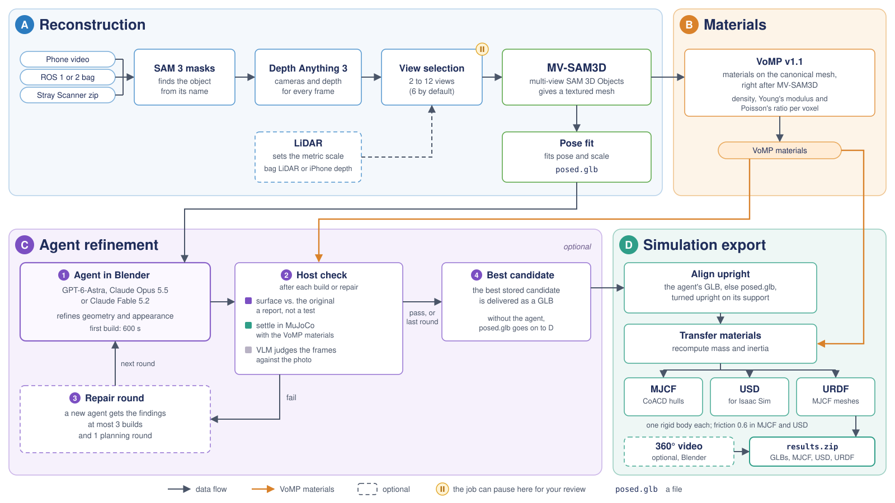

# HARPOR

HARPOR turns a short video of an object into a 3D model you can drop into a simulator. It started as a
re-implementation of GATOR (arXiv 2610.11215).

You give it a phone video, a rosbag or a Stray Scanner export. You get back a textured mesh and MJCF, USD and URDF
files with mass and materials filled in. If the object has moving parts, like a lid or a drawer, HARPOR splits them
out and an AI agent adds the joints. It then tests the joints in MuJoCo and gives the agent another try when a test
fails. A part can also be soft, like a seat cushion, so it dents in MuJoCo.



HARPOR finds the object in the video and builds a mesh in the right pose (A). It splits an object with parts into
pieces (B). An optional agent working in Blender cleans up the mesh or adds the joints, and a check sends it back
when something fails (C). Last, HARPOR estimates the materials and writes the simulation files (D).

The soft parts and the repair rounds have only run in tests so far, not on a real object.

## Try it

Run jobs through the local web app or CLI on your GPU machine, using an SSH tunnel for remote access.
A standalone static demo gallery can be built separately; see [docs/public_site.md](docs/public_site.md).

You can also try the interface on a laptop without a GPU. In fake mode, each stage runs a quick stand-in:

```bash
git clone https://github.com/lunarlab-gatech/HARPOR.git && cd HARPOR
python3.12 -m venv .venv && .venv/bin/pip install fastapi uvicorn httpx numpy scipy pillow av rosbags pyyaml trimesh
.venv/bin/python -m harpor.webapp --fake --runs ./runs --host 127.0.0.1 --port 8765
```

Open the link it prints, then add a short video. The Help page explains every setting.

## Real runs

You need Linux, an NVIDIA GPU, Apptainer, and Hugging Face access to `facebook/sam3` and `facebook/sam-3d-objects`.
The agent also needs an OpenAI or Anthropic key. [docs/build_plan.md](docs/build_plan.md) explains how to set up the
environments, and `setup/mvsam3d.sh`, `setup/vomp11.sh` and `setup/mujoco.sh` build some of them for you.

Set `HARPOR_ROOT` to the folder that holds your environments and models (by default `~/scratch/gator`). Then start the
web app from the repo with the Python of `envs/web`:

```bash
python -m harpor.webapp
```

If you'd rather skip the browser, you can run a whole job from the terminal:

```bash
python -m harpor.webapp.run cup.mp4 --prompt mug --agent opus
```

`python -m harpor.webapp.run --help` lists every option and explains what to do when a job stops to ask you something.

## More

- [docs/build_plan.md](docs/build_plan.md) explains how HARPOR works, and [docs/research.md](docs/research.md) has the
  research notes.
- To run the tests: `.venv/bin/pip install pytest "anthropic==1.15.0" rtree && .venv/bin/python -m pytest -q tests`.
  Tests that need a package you don't have are skipped.
- HARPOR's code is MIT licensed ([LICENSE](LICENSE)). SAM 3, SAM 3D Objects and MV-SAM3D keep their own SAM License.
