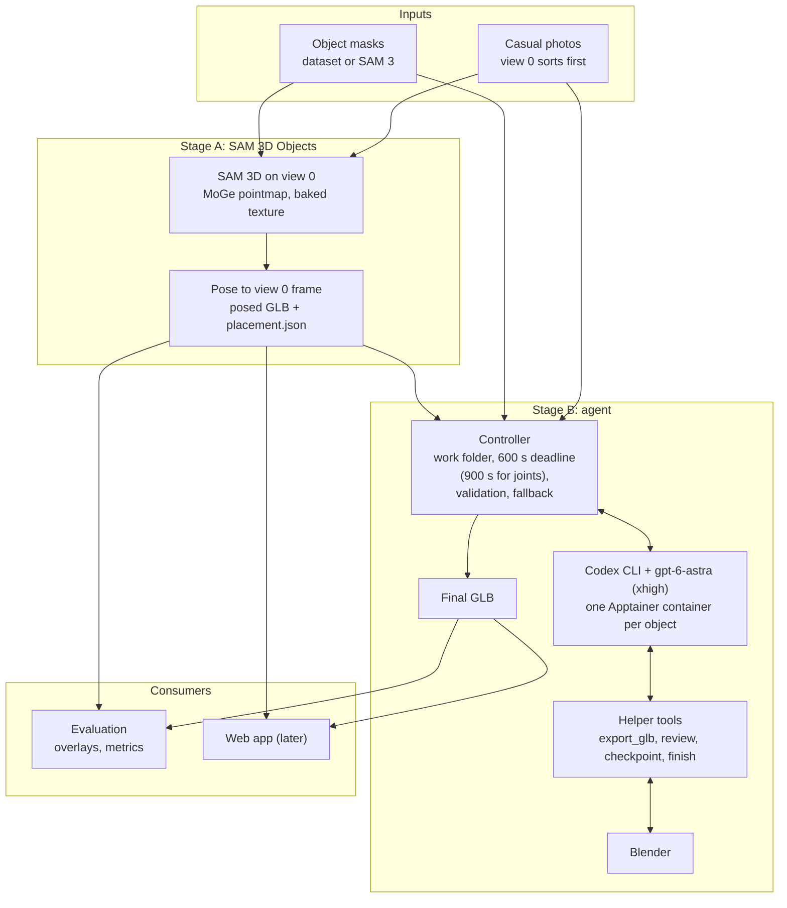

# GATOR build plan

Read the Overview first. It explains the whole project, and the sections after it give build detail.

## Overview (read this first)

### What we are building

GATOR is a method from NVIDIA and SFU (arXiv 2610.11215v1, October 2026). It turns one or more
casual photos of an object into a complete textured mesh, placed in the frame of the photos.
Stage A is a pose-aware generative model. Stage B is an LLM agent that repairs the mesh in Blender
for up to ten minutes. The authors released no code.

Our first goal is a simplified version that works end to end. Stage A is single-view SAM 3D
Objects: one photo and its mask give a textured mesh and its pose in that photo's camera.
MV-SAM3D, which fuses several views, replaces it after the first end-to-end run. Stage B keeps
the paper's agentic refinement strategy with the paper's agent, GPT-6-Astra through the Codex CLI
at extra-high reasoning effort. Everything runs on PACE ICE. The full GATOR generator is
deferred. Its design is kept in `research.md` section 5.

### How one reconstruction runs

1. **Inputs.** The user gives one or more photos of the object and a mask of the object in each
   photo. Masks come from the dataset or from SAM 3. The photo that sorts first is view 0.
2. **Stage A, SAM 3D Objects.** SAM 3D runs on view 0 and its mask. Its MoGe depth model gives a
   pointmap of the photo. The output is a canonical mesh with a baked texture and the object's
   pose relative to view 0's camera (note 4).
3. **Posed GLB.** We apply the pose, write the mesh in the frame of view 0, and save the pose in
   `placement.json`. With one view, the agent gets one camera, whose K comes from the pointmap.
4. **Stage B, agent.** A controller prepares a work folder with the GLB, the photos, previews and
   a camera manifest. GPT-6-Astra, run through the Codex CLI at extra-high reasoning effort, writes
   Blender scripts that repair missing parts, broken topology and bad textures. After each edit, a
   review tool renders the original and the edited mesh from the same cameras, and the agent keeps
   or reverts the edit. The controller enforces 600 s per object (900 s when the agent sets the
   joints of an articulated object, note 11), validates the final GLB and falls back to an earlier
   version if it is invalid.

### How we measure it

First we check that the posed mesh overlays the input photo, and we compare renders before and
after the agent on a few objects. Then we score a small set of HANDAL and LM-O objects with the
paper's metrics (note 6). The paper has no single-view SAM 3D rows, so its MV-SAM3D rows are a
loose reference for our Stage A, and its GATOR rows are the target for the whole pipeline.

### Decisions so far

- **Stage A:** single-view SAM 3D Objects first (2026-10-14), MV-SAM3D after the first
  end-to-end run. No custom generator (2026-10-13).
- **Masks:** SAM 3 makes the masks from a text prompt (2026-10-15), through Hugging Face
  transformers rather than Meta's `sam3` package (note 3). Hand-made masks still work.
- **Web app:** a local web app, HARPOR (High-fidelity Articulated sim-Ready Object Reconstruction),
  runs the whole pipeline from a phone video (2026-10-15, note 10). It runs inside the user's ICE
  job and is opened on the Mac through the `cm-ice` SSH socket. One object per job, one build at a
  time, and the user brings their own key for the agent they pick.
- **Agent:** GPT-6-Astra through the Codex CLI, the paper's setup, is the default agent. Claude
  Opus 5.5 through our own Messages API loop is the alternative (2026-10-17, user decision; note
  5); the user picks per session or per web-app job. Gemini 4 Argon through the Gemini CLI came
  first, but on 2026-10-14 two Argon sessions on the teddy ran out of time before a first export
  (API turns of 30 to 76 s), and Astra finished a refinement in 475 s. Gemini support was removed
  on 2026-10-15 (user decision).
- **Compute:** PACE ICE only (2026-10-14), in an Interactive Desktop or VS Code session on an
  L40S node. The user runs every command. Environments live natively in `~/scratch`
  (micromamba), and Apptainer replaces Docker. lunarL40S is not used, because its GPUs are shared
  and another user's job could cause an out-of-memory failure.
- **Licenses:** SAM 3D Objects, MV-SAM3D and SAM 3 use the SAM License, and the Depth Anything 3 model we
  use is CC BY-NC 4.0. So this version is research-only.
- **Articulated objects:** an optional per-job toggle (2026-10-20, user decision; note 11). The job's
  VLM, or the user, lists the moving parts. A SAM 3 face vote splits the one MV-SAM3D mesh into parts.
  The agent sets the joints within a 900 s budget. Physics exports the links and joints to MJCF, USD
  and URDF.
- **Metric scale:** an optional LiDAR input per job sets the metric scale (2026-10-21, user decision;
  note 12). The LiDAR data comes from one of two sources. The first is a LiDAR topic in the job's
  rosbag, with its transform from the bag's TF or from an uploaded calibration file. The second is
  the depth of an iPhone capture that Stray Scanner exported. Shape supervision from LiDAR comes
  later.

### Status

As of 2026-10-21:
- Stage A runs on ICE (2026-10-14): the SAM 3D env, the weights and the smoke test (kids-room
  teddy, mask 14) all work. The first run took 4m26s including the MoGe and DINOv2 downloads and
  the nvdiffrast build; SAM 3D itself took 150 s at a 25.6 GB peak. The textured GLB looks right.
- `gator/frames.py`, the metrics and the agent controller exist with passing tests. The
  controller runs the Codex CLI in Apptainer, with the helpers served from the host (note 5).
  GPT-6-Astra refined the teddy in 475 s.
- SAM 3 masks (2026-10-15): `gator/stage_a/sam3_masks.py` makes masks from a text prompt in
  `envs/sam3seg` on ICE (note 3).
- Web app (2026-10-16): `gator/webapp/` runs the whole pipeline from a phone video or a rosbag
  (note 10). It ran end to end on ICE on `table.MOV`, with the agent turned off. The rosbag path is
  covered by `tests/test_webapp_rosbag.py` and `tests/test_webapp_server.py`; no end-to-end rosbag
  run is recorded here.
- Claude Opus 5.5 runs as the alternative agent (2026-10-17, `gator/agent/claude_agent.py`, note 5).
- `gator/stage_a/sam3d.py` runs single-view SAM 3D with a baked texture, and
  `gator/stage_a/place.py` writes the posed GLB, `placement.json` and an overlay (note 2).
- The generator modules from the full plan (`gator/inference/anchor.py`, `realign.py` and
  `gator/models/`) are parked for the deferred generator.
- Physical properties (2026-10-14 to 15): VoMP v1.1 runs on ICE on the agent's GLB after a gravity
  alignment. The table, the chair and five tabletop objects have per-voxel E, nu and rho plus a
  rigid-body mass from the agent's GLB, and the plate has them from its Stage A mesh (note 9).
- Articulated objects (2026-10-20, note 11): `gator/parts/`, the agent's articulation mode and the
  link export are built and tested. On ICE, the user's office chair went through the stages from
  the command line: two parts (the chair base, and the seat and backrest), a swivel joint set by
  Opus 5.5 in 208 s, and MJCF, USD and URDF models with two links. No articulated job has run
  through the web app on ICE yet.
- Metric scale from LiDAR (2026-10-21, note 12): `gator/stage_a/lidar_scale.py`, the `lidar` stage,
  the Stray Scanner input and the UI are built and tested, and the UI was checked in fake mode. On ICE,
  the phase 0 check found MV-SAM3D exactly scale-equivariant. The code is not on ICE `$G/gator_clone`
  yet. No real rosbag with a LiDAR and no real Stray capture has run yet.

Known gaps in existing code:

- `camera_similarity` can return a negative scale when the cameras disagree with the rotations.

### Files

| File | Content |
|---|---|
| `docs/build_plan.md` | This file: overview, design and build notes |
| `docs/research.md` | Research findings with sources: the paper and every results table, MV-SAM3D and SAM 3D, the agent harness, datasets, baselines and metrics, and the deferred generator design |
| `paper/gator_2610.11215v1.pdf` | The paper. Its text layer is garbled, so read the rendered pages or the arXiv HTML (https://arxiv.org/html/2610.11215v1). `research.md` section 1 maps PDF table numbers to HTML numbers. |

## Component diagram



## Dependencies

| Component | Where | License and access | Used for |
|---|---|---|---|
| SAM 3D Objects | github.com/facebookresearch/sam-3d-objects (`f91db41`), HF `facebook/sam-3d-objects` | SAM License, gated (access granted) | Stage A |
| MoGe | HF `Ruicheng/moge-vitl`, loaded by SAM 3D | MIT | pointmap of the photo |
| nvdiffrast | github.com/NVlabs/nvdiffrast `v0.3.3` | NVIDIA source code license | texture baking |
| MV-SAM3D | github.com/devinli123/MV-SAM3D (HEAD `abb04b5`) | SAM License | Stage A later |
| Depth Anything 3 | github.com/ByteDance-Seed/Depth-Anything-3, HF `depth-anything/DA3NESTED-GIANT-LARGE-1.1` | code Apache-2.0, weights CC BY-NC 4.0 | cameras and depth for MV-SAM3D, later |
| SAM 3 | HF `facebook/sam3` through transformers 5.20.0 (`Sam3Model`) | SAM License, gated (access granted) | masks from a text prompt, when the dataset has none (note 3), and the part masks (note 11) |
| GPT-6-Astra | OpenAI API, model `gpt-6-astra` | API key | the default agent, and the VLM that lists the parts (note 11) |
| Codex CLI 0.162.1 | npm `@openai/codex@0.162.1` | Apache-2.0 | runs GPT-6-Astra |
| Claude Opus 5.5 | Anthropic API, model `claude-opus-5-5` ($4 / $20 per MTok, cache reads $0.20) | API key | the alternative agent, and the VLM that lists the parts (note 11) |
| anthropic 1.15.0 | pip, in `envs/sam3d` and `envs/web` | MIT | runs Claude Opus 5.5 (`gator/agent/claude_agent.py`), the part list of `propose` (note 11) and the web app's key check |
| Blender 5.2.2 LTS | blender.org | GPL | agent workspace and review renders |
| trimesh, scipy | pip | open source | GLB handling and metrics |
| PyAV 19.0.1, rosbags 0.11.8 (with ruamel.yaml 0.19.1), FastAPI 0.143.2, uvicorn 0.54.0 | pip | BSD (the PyAV wheel bundles FFmpeg, LGPL), Apache-2.0, MIT, BSD | the web app: video and rosbag decoding, the calibration file (note 12), the server (note 10) |
| Stray Scanner | iPhone app | free, open source | the iPhone LiDAR capture for the metric scale (note 12) |
| model-viewer 4.4.0 | Google CDN, loaded by the browser | Apache-2.0 | the web app's GLB viewers |

`research.md` sections 2 to 4 give the details and sources.

## Notes

### 1. Why single-view SAM 3D first

- SAM 3D Objects already works with baked textures (note 4), so the agent stage can be built on
  real meshes now.
- MV-SAM3D is a copy of the SAM 3D code with multi-view fusion added. Its pose has the same form
  and comes from view 0 only, so notes 2 and 3 carry over when we switch.
- With one view, the hidden sides are generated, and the pose comes from MoGe's pointmap, which is
  not guaranteed to be metric. MV-SAM3D facts are in `research.md` section 2.

### 2. Coordinate frames (`gator/frames.py`)

- The world frame W is the OpenCV frame of input view 0 (x right, y down, z forward), in meters.
- SAM 3D's pose (`pose.json` from note 4) and MV-SAM3D's `params.npz` give the pose from the
  canonical frame to view 0's camera, in PyTorch3D camera axes and in the pointmap's units. To get W: undo the
  GLB rotation (`v = V @ A.T` with A = [[1, 0, 0], [0, 0, -1], [0, 1, 0]]), apply scale, rotation
  (quaternion w, x, y, z) and translation as PyTorch3D row vectors, then multiply by (-1, -1, 1).
  `research.md` section 2.5 has the code. It mirrors MV-SAM3D's `merge_glb_with_da3_aligned`.
- `gator/stage_a/place.py` applies this pose, writes `posed.glb` and `placement.json`, and checks
  the result against SAM 3D's own camera: K is fitted to `pointmap.npy`, which shares SAM 3D's
  camera. On the ICE teddy smoke test (2026-10-14), the posed silhouette matches the mask with IoU
  0.86. The masked pointmap lies a median 1.7% of the mesh diagonal from the surface, and 54% of it
  lies within 2%. The fitted K has fx = 7659 px for the 6720 px wide photo, a principal point at the
  image center, and 6.9 px RMS. The convention holds. The pose is relative to SAM 3D's camera, so
  the check uses that camera and not the photo's true K.
- The agent's GLB uses the paper's Prompt 2 convention: (x, y, z)_W = (x, -z, y)_glTF, which is
  also Blender's stock glTF import. So we write `frames.w_to_gltf(x_W)` as the GLB vertices.
- The pose is baked into the vertices. `placement.json` stores the SAM 3D pose and the frame. For
  MV-SAM3D runs, `placement.json["pose"]` is the fitted pose (scale, then shift, size and a small
  rotation), and `pose_mvsam3d` (like `pose.json`) keeps MV-SAM3D's own pose (note 4b).
- SAM 3D and MV-SAM3D users report misaligned results, so the first run must check the overlay of the posed
  mesh on view 0.

### 3. Inputs (`gator/stage_a/`)

- A scene folder holds `images/` with the photos (PNG or JPG) and one mask folder per object. The
  mask of photo `<name>` is `<folder>/<name>_mask.png` or `<folder>/<name>.png`, at the photo's
  size; `prep` tries `_mask.png` first. Single-view `sam3d.py` takes one photo and one mask path.
- Every step reads photos as stored, without the EXIF rotation, so masks line up pixel for pixel.
- `load_mask` (`sam3d.py`) takes the object from the alpha channel when alpha varies (SAM 3D's and
  MV-SAM3D's RGBA masks). Otherwise it takes the brightest channel above 127 (above 0 for a 0/1
  mask), as in the SAM 3 web demo's opaque white-on-black export.
- **SAM 3 masks** (`gator/stage_a/sam3_masks.py`, env `envs/sam3seg`) make the masks from a text
  prompt. Each prompt gets a folder `DIR/sam3_<prompt>/` with `<name>.png` (L mode, 0/255) for
  every photo where SAM 3 finds the object, one `sam3.json` (every instance's score, box and pixel
  count) and `check/<name>.jpg` for every photo (the mask in green, other instances outlined in
  red). In the folder name, the prompt is in lower case, and each run of characters other than
  letters and digits becomes one `_` ("Coffee cup" gives `sam3_coffee_cup`). Then run
  `mvsam3d prep --mask-prompt sam3_<prompt>`, or `sam3d.py --mask DIR/sam3_<prompt>/<name>.png`.

  ```bash
  module purge; G=$(readlink -f ~/scratch)/gator; export HF_HOME=$G/.cache/huggingface
  cd $G/gator_clone && $G/envs/sam3seg/bin/python -m gator.stage_a.sam3_masks \
    --scene DIR --prompt plate --prompt "coffee cup"
  # to fix one photo, rerun that prompt alone: --prompt plate --pick NAME=K --overwrite
  ```

  - The step uses transformers, not Meta's own `sam3` package, which needs a GPU to build the
    model and does not declare all its dependencies (`research.md` section 4.1).
  - Instances are numbered by score, and the mask is instance 0. `--pick NAME=K` takes instance K
    in photo NAME, `NAME=K,L` takes the union of K and L, and `NAME=none` writes no mask (the
    object is not in that photo). `NAME=0` goes back to the top score. A rerun keeps the earlier
    picks of the photos its `--pick` does not name; an earlier pick of an instance that is gone
    falls back to the top score with a warning. A photo with no instance above `--threshold` (0.5)
    gets no mask file, so `prep` skips it.
  - The step replaces an earlier run's files only with `--overwrite` and only after every photo is
    done; each file is written under a temporary name and then renamed. A hand-made
    `<name>_mask.png` in the folder stays, and `prep` prefers it. The step warns when two prompts
    of one run give masks that overlap with IoU above 0.5.
  - The step adds one padding box (label -10) so that the prompt gets the CLS token that Meta's
    code appends (`research.md` section 4.1).
  - Setup, once (the torch build is the one `envs/da3` runs on ICE's driver):

    ```bash
    module purge; G=$(readlink -f ~/scratch)/gator; cd $G
    export MAMBA_ROOT_PREFIX=$G/micromamba PIP_CACHE_DIR=$G/.cache/pip PIP_CONFIG_FILE=/dev/null
    tools/micromamba create -y -p $G/envs/sam3seg -c conda-forge python=3.12 pip
    envs/sam3seg/bin/pip install torch==2.14.1 torchvision==0.29.1 --index-url https://download.pytorch.org/whl/cu130
    envs/sam3seg/bin/pip install transformers==5.20.0 scipy pillow
    ```

    The first run downloads the weights into `$HF_HOME`. The token there must belong to the
    Hugging Face account that has access to `facebook/sam3`.
  - Check on ICE (2026-10-15, `runs/sam3_check/`, weights revision `3c879f3`): the tabletop (2
    photos; plate, knife, fork, pan, coffee cup, glass). The masks agree closely with the user's
    web-demo masks, and instance 0 is always the right object. Meta's own code (`7f473cf`, in
    bf16; `research.md` section 4.1) agrees with the demo masks about as well, so the gap to the
    demo masks does not come from the transformers port.
  - Against Meta's code on the same photos, the top scores are much closer to Meta's with the CLS
    box than without it. With the CLS box, the masks agree closely with Meta's.
  - In tabletop photo 1, "plate" gets no instance above 0.5 (Meta's code finds none above 0.3).
    "saucer" finds the same object at 0.97. When a photo gets no mask, try another noun first.
  - Times on the tabletop: 14 s to load the model, then 0.5 s per photo for six prompts.

### 4. Stage A: SAM 3D Objects on ICE (`gator/stage_a/sam3d.py`)

Everything lives under `G=$(readlink -f ~/scratch)/gator`. Run the steps in a terminal of an ICE
L40S session. The GPU is needed only for step 4, but SAM 3D's setup guide expects the build on a
GPU node.

1. **Copy the code.** From the laptop, on the GT network or VPN:
   `rsync -a --exclude __pycache__ ~/lunar_lab_research/gator_clone/ ali497@login-ice.pace.gatech.edu:scratch/gator/gator_clone/`
2. **Environment** (about 1 h). This is the recipe that worked on lunarL40S on 2026-10-13, with
   the build for both L40S (8.9) and H100/H200 (9.0):

   ```bash
   module purge   # PACE's default modules break the conda C++ compiler (see below)
   G=$(readlink -f ~/scratch)/gator; mkdir -p $G/tools $G/envs $G/.cache && cd $G
   export MAMBA_ROOT_PREFIX=$G/micromamba PIP_CACHE_DIR=$G/.cache/pip
   curl -Ls https://micro.mamba.pm/api/micromamba/linux-64/latest | tar -xj -C tools --strip-components=1 bin/micromamba
   git clone https://github.com/facebookresearch/sam-3d-objects.git && git -C sam-3d-objects checkout f91db411c50efee93d8db7aeb323885650f6f722
   tools/micromamba create -y -p $G/envs/sam3d -f sam-3d-objects/environments/default.yml
   eval "$(tools/micromamba shell hook -s bash)"; micromamba activate $G/envs/sam3d
   export CUDA_HOME=$CONDA_PREFIX TORCH_CUDA_ARCH_LIST="8.9;9.0" FORCE_CUDA=1 MAX_JOBS=16
   export PIP_EXTRA_INDEX_URL="https://download.pytorch.org/whl/cu121"
   cd sam-3d-objects
   pip install -e '.[dev]' && pip install -e '.[p3d]'
   PIP_FIND_LINKS="https://nvidia-kaolin.s3.us-east-2.amazonaws.com/torch-2.5.1_cu121.html" pip install -e '.[inference]'
   ./patching/hydra
   pip install 'huggingface-hub[cli]<1.0'
   pip install --no-build-isolation "git+https://github.com/NVlabs/nvdiffrast.git@v0.3.3"
   python -c "import torch, pytorch3d, kaolin, gsplat, nvdiffrast, flash_attn; print(torch.__version__, torch.version.cuda)"
   ```

   `doc/setup.md` also lists `pypi.ngc.nvidia.com`, which did not resolve from lunarL40S and is
   not needed.

   On ICE (2026-10-14), with the default PACE modules loaded, the conda C++ compiler failed with
   "cannot execute 'cc1plus'", so pytorch3d, flash_attn and gsplat did not build. The C compiler
   and `cc1plus` itself were fine. After `module purge` and a re-activation of the env (purge also
   clears conda's `CC` and `CXX`), the same `pip install` steps built everything. The check printed
   `2.5.1+cu121 12.1`, and Warp found the L40S (ICE driver 13.4).
3. **Weights** (13.2 GB, about a minute). Paste a Read token when asked, and answer n to the git
   credential question:

   ```bash
   export HF_HOME=$G/.cache/huggingface; hf auth login; chmod 600 $HF_HOME/token $HF_HOME/stored_tokens
   hf download --repo-type model --local-dir checkpoints/hf-download --max-workers 4 facebook/sam-3d-objects
   mv checkpoints/hf-download/checkpoints checkpoints/hf && rm -rf checkpoints/hf-download
   ```
4. **Run** on one photo (smoke test: the repo's kids-room image, mask 14). Start from a clean
   shell, because nvdiffrast compiles C++ on its first run:

   ```bash
   module purge; G=$(readlink -f ~/scratch)/gator
   eval "$($G/tools/micromamba shell hook -s bash)"; micromamba activate $G/envs/sam3d
   export CONDA_PREFIX=$G/envs/sam3d HF_HOME=$G/.cache/huggingface TORCH_HOME=$G/.cache/torch \
     TORCH_EXTENSIONS_DIR=$G/.cache/torch_extensions TORCH_CUDA_ARCH_LIST="8.9;9.0" OMP_NUM_THREADS=16 \
     CPATH=$G/envs/sam3d/targets/x86_64-linux/include \
     LIBRARY_PATH=$G/envs/sam3d/targets/x86_64-linux/lib:$G/envs/sam3d/lib
   K=$G/sam-3d-objects/notebook/images/shutterstock_stylish_kidsroom_1640806567
   cd $G/gator_clone && python -m gator.stage_a.sam3d --sam3d-root $G/sam-3d-objects \
     --image $K/image.png --mask $K/14.png --out $G/runs/smoke_kidsroom14
   ```

What the run needs and why:
- `notebook/inference.py` reads `CONDA_PREFIX` at import, so it must be set.
- The wrapper in `notebook/inference.py` turns texture baking off and writes vertex colours only.
  `sam3d.py` calls `_pipeline.run` with mesh postprocessing and baking on and sets
  `rendering_engine = "nvdiffrast"`.
- nvdiffrast compiles its plugin on first use. It needs `CPATH` and `LIBRARY_PATH` pointing at the
  conda CUDA headers and libraries (on lunarL40S it failed with "cuda_runtime.h: No such file"
  without them). `TORCH_EXTENSIONS_DIR` keeps the build out of the 30 GB home.
- The bake renders 100 views of the Gaussians with backend `inria`, whose
  `diff_gaussian_rasterization` SAM 3D does not install. `sam3d.py` switches it to the `gsplat`
  backend.
- The first run downloads MoGe and DINOv2 into the caches.
- Outputs: `canonical.glb` (unit box, y up, 1024 px texture), `splat.ply`, `pose.json` and
  `pointmap.npy`. Peak GPU memory was 25 GB on lunarL40S.

### 4b. Stage A, multi-view: MV-SAM3D on ICE (`gator/stage_a/mvsam3d.py`)

MV-SAM3D (`devinli123/MV-SAM3D` at abb04b5) fuses several photos of one object into one SAM 3D
generation. It needs a pointmap per view, all in one frame, which Depth Anything 3 (DA3, at
3d835ec, model `DA3NESTED-GIANT-LARGE-1.1`, metric) gives together with every view's camera.

Setup (`runs/mvsam3d_setup/cmd.sh`, about 10 min):
- MV-SAM3D reuses `envs/sam3d` and the SAM 3D weights. Its requirement files are the same as SAM
  3D's. `mvsam3d.py` puts the MV-SAM3D clone first on `sys.path` and checks that `sam3d_objects`
  was imported from it.
- DA3 gets its own venv, `envs/da3` (torch 2.14.1+cu130, numpy 1.26.4), because its unpinned
  dependencies could replace torch in `envs/sam3d`. It runs as its own step.
- The DA3 weights are 6.76 GB in the HF hub cache. The files under `snapshots/` are symlinks, so
  `du` on that folder shows 35 KB.
- On ICE, `~/.config/pip/pip.conf` (written by NVIDIA PyIndex) adds `pypi.ngc.nvidia.com`, which
  does not resolve, and pip retries it on every package. The installs set
  `PIP_CONFIG_FILE=/dev/null`. The user's file is left as it is.

The run has four steps, each in its own process, writing into one folder (see the module
docstring). `runs/mvsam3d_example/cmd.sh` runs them on MV-SAM3D's example: 8 photos of a stuffed
toy, with masks. `STEPS="sam3d place"` reruns only those steps.
- `prep` downscales the photos and masks to 1024 px and writes the RGBA inputs MV-SAM3D's loader
  needs. View 0 is the first name in natural order, as in MV-SAM3D's loader. Views of different
  sizes are cropped to the median aspect and resized to the median size, because DA3 center-crops
  a batch of mixed sizes to the smallest, which `cameras()` does not model. `da3` refuses views of
  different sizes.
- `da3` writes depth, pointmaps and cameras. DA3's world frame is its own reference view, not view
  0, so `cameras()` takes every camera relative to view 0 (`w2c = E_i @ inv(E_0)`) and scales K
  from DA3's 504 px to the image size.
- `sam3d` calls `pipe.run_multi_view` with MV-SAM3D's entropy weighting (the settings in its
  README), texture baking, the nvdiffrast engine and the gsplat bake backend, as in note 4.
- `place` fits the mesh to the masks of all views (see the fixes below): `--fit pose` (default)
  fits the scale and then shift, size and a small rotation; `--fit scale` fits only the scale;
  `--fit none` (or `--no-fit-scale`) keeps MV-SAM3D's pose. It then writes `posed.glb` in frame W
  (view 0's OpenCV camera, DA3 meters, or LiDAR-scaled meters when the web app's `select` applied a
  LiDAR scale, note 12),
  `cameras.json` for the agent's manifest (`session_views()`), and `placement.json` with the fit
  and the mask IoU of every view.

Results on the example (2026-10-14, ICE L40S):
- `da3` took 70.5 s at 14 GB RAM. `sam3d` took 294 s (MV-SAM3D's own time 273 s) at 18.7 GiB
  allocated, 21.5 GB on the whole GPU. `place` took 5 s.
- The first try failed at texture baking with "Ninja is required to load C++ extensions", because
  `envs/sam3d/bin` was not on PATH. The run script now adds it.
- The mesh's shape and rotation match all 8 views, but its silhouette is about 10% larger than
  the mask in every view. Mask IoU is 0.72 to 0.80, mean 0.753. In view 0, the median distance from
  DA3's masked points to the mesh is 2.1% of the mesh diagonal, and 48% of the points are within
  2%.
- A scale scan (`runs/mvsam3d_example/scale_scan.py`, read-only) scaled the posed mesh about its
  center and about view 0's camera. Scaling by 0.90 about the center, at the same depth, raises the
  mean IoU over the 8 views from 0.750 to 0.889 (each view 0.873 to 0.901). The best scale about
  the camera is 1.00. So MV-SAM3D's predicted scale is about 11% too large, and the cameras and
  depth are right.
- The fix (2026-10-14): `place` now fits the scale about the mesh's box center to the masks of all
  views (`fit_scale`, at 384 px). The search takes steps of 0.05 over 0.7 to 1.3, grows that range
  while the best value sits at an edge (up to 0.3 to 3.0), then refines with steps of 0.01 and
  0.0025. Ties go to the scale closest to 1. The fit is applied only if the mean IoU gains at
  least 0.005. `placement.json` keeps MV-SAM3D's own pose as `pose_mvsam3d` and writes the fitted
  pose as `pose`, which reproduces `posed.glb` through `canonical_glb_to_w`. `scale_fit` records
  `applied`, the `scale` used (1.0 when not applied), the `candidate_scale` and its
  `candidate_mean_iou`, `at_limit`, and a `warning` when the mesh overlaps no mask or the scale
  stops at a limit. A review (3 subagents) found the edge, tie and key-error cases, now covered
  by tests. silhouette() fills boundary pixels, so the fit runs about 0.5% small. On the example
  the fit chose 0.895.
  Mean IoU at 512 px went from 0.753 to 0.888 (each view 0.875 to 0.900). The view-0 check also
  improved, although it is not part of the fit: the median distance from DA3's points to the mesh
  went from 2.1% to 0.89% of the diagonal, and the share within 2% from 48% to 80%. The toy is now
  0.25 × 0.28 × 0.20 m. `place` took 40 s with the scale fit alone. The unfitted outputs are in
  `runs/mvsam3d_example/unfitted/`.
- Plain single-view SAM 3D on view 1 of the same toy (`runs/sam3d_view1_example`) took 89 s and
  has IoU 0.828 in view 1 under a camera fitted to its own pointmap. It makes the toy 0.72 × 0.76 ×
  0.52 m at 1.08 m, while MV-SAM3D makes it 0.28 × 0.31 × 0.22 m at 0.42 m. Both match the photo:
  one photo cannot separate size from distance, and MoGe's guess is 2.5 times too large for a desk
  toy. In the 360° video (`runs/videos/toy_sam3d_vs_mvsam3d.mp4`, each mesh framed to its own size
  with `same_scale: false`), MV-SAM3D shows the sitting pose and the black cloth tag on the back,
  which the other photos see. Single-view SAM 3D guesses a smooth back.

Round table (`runs/table_mv/` and `runs/table_mv2/`, 2026-10-14): 5 frames of the user's 16 s
video `table.MOV` at 1920 x 1080 (prep: 1024 x 576), SAM 3 web-demo masks.
- First photo set (`table_mv`; in 3 of the 5 photos a leg runs off the bottom edge): DA3 316 s,
  `sam3d` 532 s. MV-SAM3D's shape is right: in view 1, DA3 measures a top about 1.04 m across with
  the legs 0.79 m below it, and the mesh has the same proportions (0.76) at about 12% larger. But
  its tabletop sat 17 cm from DA3's (12 cm to the side, 12 cm farther, 8 cm low) and was tilted 8
  degrees, so the mean mask IoU was 0.26, and the scale fit, which cannot move the mesh, raised it
  only to 0.28. The run's `pipeline.sh` starts Astra only if the mean mask IoU is at least 0.5
  (the guard), so it skipped Astra.
- Fix 2 (2026-10-14): `fit_pose` adds shift, size and a small rotation about the box center after
  `fit_scale`. Coordinate descent over log scale, shift (in box diagonals) and an axis-angle
  rotation (degrees); steps 0.05, 0.05 and 5, halving while at or above 0.003, 0.003 and 0.3;
  bounds 0.5 to 2 times, 0.25 diagonals and 20 degrees per axis; at most 400 evaluations. It runs
  twice, first with the rotation held at 0 and then with it free, and keeps the rotation only if
  it gains 0.005 mean IoU, because a one-pass search traded a missing shift for a false rotation
  (found by a 3-agent review). The whole fit is applied only if it gains `min_gain` (0.005).
  `placement.json` gets `pose_fit` with the applied `scale`, `shift_W` and `rotation_deg` (1 and
  zeros when not applied), the `candidate_*` values, the IoUs, `evaluations` and `at_bound`.
  `similar_pose` writes the pose that reproduces `posed.glb`. `place` now takes 2 to 4 min. With
  only three 160 x 120 masks of a box, the true pose scores about 0.965 and poses a few degrees or
  percent off score as well, so the tests check the fit to that precision; 160 tests pass.
- `table_mv` with the pose fit: mean IoU 0.278 to 0.753 (0.73 to 0.80 per view); scale 0.877 on
  top of the scale fit's 0.905, shift 0.12 diagonals, rotation (-8.4, 3.8, 0.9) degrees. The view-1
  depth check, which is not part of the fit, went from a 4.1% to a 0.49% median gap and from 24% to
  94% of points within 2%. Extent about 1.02 x 1.05 x 1.06 m in W.
- Second photo set (`table_mv2`, the whole table in every photo): mean IoU 0.19 with MV-SAM3D's
  pose, 0.21 after the scale fit and 0.48 after the pose fit, split by view: photos 2 and 4 reach
  0.77 and 0.82, photos 1, 3 and 5 only 0.16 to 0.34. Photos 2 and 4 are nearly the same view
  (DA3 puts their cameras about 8 cm apart), and the overlays of 1, 3 and 5 show the legs off to
  one side. DA3's cameras for this set do not agree with each other; a round table looks the same
  from every side, so DA3 has to register the views by the background alone.

### 5. Stage B: agent (`gator/agent/`)

The default agent is GPT-6-Astra through the Codex CLI (Decisions). Claude Opus 5.5 through our own
Messages API loop is the alternative (`prepare_session(..., agent="claude")`; see the end of this
note). Everything below that is not marked Claude applies to both.

The controller (`gator/agent/controller.py`) keeps the watchdog, the GLB checks and the fallback
order. `run_container_session` runs the agent once per object in its own Apptainer container on
the ICE node, with `session/prompt.txt` on stdin and the JSONL events in `session/codex.jsonl`:

```bash
apptainer exec --nv --containall --no-mount /scratch --no-mount /storage \
  --bind <root>/work:/work --bind <root>/session:/session \
  --bind gator/agent/bin:/opt/gator/bin:ro --bind <socket dir>:/opt/gator/sock:ro \
  --env-file ~/.config/gator/openai.env --env CODEX_HOME=/session/codex_home \
  --env GATOR_SOCKET=/opt/gator/sock/tools.sock --env PREPEND_PATH=/opt/gator/bin \
  --pwd /work gator-agent.sif \
  sh -c 'export CODEX_API_KEY="$OPENAI_API_KEY"; unset OPENAI_API_KEY; exec "$@"' codex \
  codex exec --dangerously-bypass-approvals-and-sandbox --skip-git-repo-check --strict-config \
    -C /work -m gpt-6-astra -c 'model_reasoning_effort="xhigh"' --json -o /session/last_message.txt -
```

- `prepare_session` writes `session/codex_home/config.toml` from `gator/agent/codex/config.toml`
  and copies `gator/agent/codex/AGENTS.md` to `work/AGENTS.md`. `AGENTS.md` has the folder layout
  and the helper syntax only, because the paper's prompts name the helpers but not their
  arguments. It tells the agent to look at PNGs with `view_image`.
- Facts from the Codex CLI 0.162.1 source: `codex exec` reads the key only from `CODEX_API_KEY`, so
  the shell above copies it from `OPENAI_API_KEY`; by default Codex passes key variables to the
  agent's commands and turns on live web search without a sandbox, so the config sets
  `ignore_default_excludes = false` and `web_search = "disabled"`; gpt-6-astra defaults to low
  effort, so `xhigh` is set explicitly (the paper's "extra-high"); the built-in provider uses
  WebSocket and ignores `OPENAI_BASE_URL`, so `codex_base_url` adds a custom HTTP provider for the
  logging proxy (`gator/agent/pilot/logproxy.py`).
- `result.json` records the CLI exit code by name in `cli_exit`. Codex exits 1 on SIGINT, so a stop
  after `finish` shows as `error_or_interrupted`.
- The helpers (`export_glb`, `review`, `checkpoint`, `finish`) run on the host, not in the agent's
  container. All but `finish` end their output with the seconds left before the deadline. The commands on the agent's PATH are a small client (`gator/agent/bin/`) that sends the
  command line over a Unix socket to the controller's tool server (`gator/agent/server.py`), which
  runs `tools.py` with `root/control/`. That folder is never mounted. It holds the clock record, a
  copy of the manifest and `events.jsonl`, the record of every export, review, checkpoint and
  finish with the GLB's sha256. The deadline and the deliverable come only from these events, and
  a GLB must still match its logged hash. A hand-written `finish.json`, receipt or GLB in `work/`
  is never delivered. Blender for the helpers runs in a second container that sees only the work
  folder (at its host path and at `/work`) and the Blender scripts, with auto-run of scripts in the
  `.blend` off. When the session ends, the server stops and kills a running helper and its Blender
  before the deliverable is picked.
- The helpers run on the host but act on a folder the agent controls, so they never follow
  symlinks there: output folders must be real folders, new files are created exclusively, and reads
  take regular files only. Every `export_started` gets an `export_done`, also on failure. Only the
  newest unfinished export can pause the clock, and export time moves the deadline by at most 600 s
  in total.
- In refinement, the controller builds `candidate.blend` from the original with the stock glTF
  importer before the clock starts. `export_glb` exports the visible objects only.
- On ICE we cannot limit the container's network, because users cannot set network rules. Codex's
  web search is off, but the agent's shell commands can reach the internet (teddy run 2 below).
  `result.json` lists shell commands that look like network use in `network_commands`: package
  installs (`pip`, `conda`, `apt`, `npm`, `uv`, `poetry` with `install` or `add`), `curl` and
  `wget` with a flag or URL, `git clone/fetch/pull`, and Python fetch calls (`urllib.request`,
  `urlopen(`, `requests.get(`). A bare tool name or URL is not enough, because ordinary Blender
  scripts contain them (`pip` as a point-in-polygon mask, `curl` of a vector field, URLs in comments
  and XML namespaces). The list only records these commands. Nothing blocks them.
- Real isolation is possible: `apptainer exec --net --network none` works without root on ICE
  (no route to the internet, loopback works; tested 2026-10-14). The CLI would then reach the API
  through a small forwarder in the container and a host proxy on a Unix socket, which could also
  add the key so the container never holds it. Not built yet.
- The API key is in the container's environment. The CLI removes it from shell commands, but the
  agent could still read it from `/proc`. After each session the controller lists the files that
  contain the key in `key_found_in`, and those files must not be shared. A host proxy that adds
  the key is not an option, because other users on a shared node could reach its port. Use a
  separate key with a low spend cap for agent runs.
- An independent review of the port (three reviewers, each checked by a verifier, 2026-10-14)
  confirmed 11 of 12 findings, among them symlink following in the helpers, stacked export events,
  no cap on excluded time, trust in agent-written files for the deliverable, a crash on dangling
  links, the missing `/work` bind for the helpers' Blender and the key exposure. All are fixed or
  handled as above, with tests.
- Launcher check (2026-10-14, `runs/agent_port_check/`, a scripted agent instead of the CLI, on
  the teddy): `/storage` and `/scratch` are missing inside, the helper folder is read-only, and no
  events file is reachable. `export_glb` took 5.5 s and moved the deadline by that much, and a
  second call returned the cached export. `review` took 21 s and gave mask IoU 0.87 (`place.py`:
  0.865). The controller ended the session 3 s after `finish`, and a background process that the
  agent had started with `setsid` was gone. After the review fixes, the rerun gave the same GLB
  byte for byte, with `candidate.blend` built by the controller and a hidden 50 m cube that the
  agent added left out of the export.
- The prompts are in `gator/agent/prompts/`: `refinement_prompt.md` (Prompt 1) and
  `scratch_prompt.md` (Prompt 2), copied byte for byte from the data links in the arXiv HTML (the
  paper is CC BY 4.0; the attribution is in the folder's README). `prompts.load(mode)` applies the
  recorded `CHANGES`, and `prepare_session` uses it when no prompt is given. The only changes are
  paths: the CLI runs inside the work folder, so `work/run_budget.json` and `work/candidate.blend`
  become `/work/...`.
- What the prompts expect from the helpers is now there. In refinement, the controller renders
  previews of the original (every input camera and 6 orbit views) into `original/previews/`
  before the clock starts. `review --detail X Y Z R DX DY DZ` adds up to 4 shared close-up
  cameras. `review --clay` renders opaque gray.
- The review sheet crops each input view to the object: the mask's box and the projected assets,
  plus 8%, rendered at 768 px on the long side. `review.json` records the window. Orbit and detail
  views are packed side by side, up to the width of a photo row. On the teddy, the window was
  136 x 138 px of the 1008 px photo, and the mask IoU stayed 0.87.
- Astra teddy session (`runs/teddy_astra_01/`, 2026-10-14, one view at 3,360 px, Prompt 1, 600 s):
  the agent called `finish` with `complete` at 475 s of wall time. It made 2 exports, 2 reviews and
  1 checkpoint. 26 requests averaged 16 s, with first bytes within 4 s, and there were no errors.
  It smoothed the faceted surface, re-projected the photographed fleece and cloth detail, added
  short pile (a second mesh; 310,650 triangles) and flattened the paws. Mask IoU went from 0.867 to
  0.884, the center moved by 0.6% of the diagonal, and the extents changed by under 1.5%. The
  review sheet shows the cream fleece of the photo instead of the original's gray. Tokens: 838,617
  input (789,268 cached), 12,904 output (6,370 of them reasoning). The rear keeps the generated
  texture, which the agent named as its one limitation.
- Astra teddy run 2 (`runs/teddy_astra_02/`, 2026-10-14): 2 exports, 2 reviews and 2 checkpoints
  (seams from the photo projection, then dark texture marks on the forehead and shorts). During a
  third edit at 505 s the OpenAI API answered "Quota exceeded. Check your plan and billing
  details.", so Codex exited 1 and the controller delivered checkpoint 2 as `needs_review`. Mask
  IoU stayed 0.872. The agent also made a venv, fetched `get-pip.py` with curl and pip-installed
  numpy, scipy and pillow. `network_commands` caught only the curl command: its pattern needs a
  space or quote right before `pip`, so `/work/venv/bin/pip install` does not match.
- Astra on the MV-SAM3D toy (`runs/toy_mv_astra_01/`, 2026-10-14): the first multi-view session,
  with the scale-fitted mesh, all 8 views at 1024 x 768 and metric units. The agent made the
  fabric non-metallic (the fully metallic setting made the white plush look gray), smoothed the
  faceted surfaces, reshaped the heart's upper lobes from the two frontal photos, closed gaps at
  the heart's attachments and cleaned stray texture. It made 6 exports, 5 reviews and 4
  checkpoints. It never called `finish`: the clock ran out at 633 s (600 s plus 33 s of exports)
  during the 6th review, so the controller delivered checkpoint 4 as `needs_review`, with the
  open defect "Local foot material replacement has visible boundaries". Mean mask IoU over the 8
  views went from 0.888 to 0.890, so the pose and size were kept. With 8 views each review took
  about 37 s, against about 21 s with one view. 39 requests averaged 14.1 s; 1,685,585 input
  tokens (1,574,964 cached) and 16,602 output tokens (7,950 reasoning). No downloads. The agent
  often left `review` running while it worked on; one review client exited 143 after the host had
  already logged that review, and the agent read the result from `reviews/`. Video:
  `runs/videos/toy_mv_astra_progression.mp4`.
- Astra on the round table (`runs/table_mv_astra_01/`, 2026-10-14): the first photo set with the
  pose-fitted mesh (note 4b), 5 views at 1024 x 576. The agent kept the tabletop and pose and
  rebuilt the warped, paper-thin black base from the existing attachment points (straight diagonal
  members, four vertical braces and a central collar), then thickened and darkened it after review
  1 and smoothed the tabletop's faceted shading. 4 exports, 4 reviews (about 28 s each), 3
  checkpoints; it called `finish needs_review` at 556 s with export 3, noting that the tabletop
  still looks too bright under the review lights. Mean mask IoU 0.712 to 0.726. 43 requests
  averaged 11.4 s. No downloads. Video: `runs/videos/table_astra_progression.mp4`.
- Office chair, whole pipeline (`runs/chair_mv/`, `runs/chair_mv_astra_01/`, 2026-10-14): 5 photos at
  1920 x 1080 (prep 1024 x 576), SAM 3 web-demo masks (in photos 4 and 5 they leave holes where the
  table shows through the mesh back). DA3 296 s, `sam3d` 592 s, `place` 73 s; 19.8 GB GPU peak.
  The scale fit chose 0.80 (mean IoU 0.508 to 0.585), and the pose fit added a shift and a 9 degree
  turn (to 0.799; 0.75 to 0.83 per view). View-1 depth check: median gap 0.69% of the diagonal, 91%
  within 2%. Astra kept the pose and the five-spoke base, opened the solid back into a see-through
  woven mesh, gave the seat a charcoal texture and the frame chrome, and restored the end caps.
  3 exports, 3 reviews, 2 checkpoints, `finish complete` at 552 s with export 3. 45 requests
  averaged 11.6 s. No downloads. Video: `runs/videos/chair_astra_progression.mp4`.
- Tabletop scene, 6 objects from the same 2 photos (1920 x 1080, SAM 3 web-demo masks per object;
  `runs/<object>_mv/` and `runs/<object>_mv_astra_01/`, 2026-10-14). Run in parallel on three ICE
  L40S jobs (6267690, 6276585, 6276602) with `runs/tabletop/queue.sh JOBID OBJECT...`, which runs
  each object's `pipeline.sh` (now taking `JOB`) and then `make_video.sh` (turntable of MV-SAM3D's
  posed mesh, the first export and the delivered GLB). All six finished in about 55 minutes.
  Stage A mean IoU after the pose fit / Astra result (mask IoU in the reviews barely moved):
  pan 0.893 / complete at 278 s (smoothed rim and bowl, restored cooking marks, shiny steel);
  knife 0.852 / complete at 368 s (blade thickness and edge, satin steel and matte grip);
  fork 0.791 / complete at 408 s (four connected curved tines, smoothed head);
  coffee cup 0.916 / complete at 294 s (white glazed porcelain, smoothed surfaces and rim);
  glass 0.907 / complete at 215 s (transparent glass, hammered surface relief);
  plate 0.497 / not run (just under the 0.5 guard; the cup hides much of it in both photos).
  No downloads in any run. Videos: `runs/videos/<object>_astra_progression.mp4`.
- Blender bug (fixed 2026-10-14): `--python-exit-code` applies only to scripts that follow it, so
  every helper call (export, review, previews, candidate build) and the `AGENTS.md` example put it
  too late, and a failing Blender script exited 0. The flag now comes before `--python`, and the
  fake Blender in the tests fails if it does not.
- Videos: `gator/agent/blender/turntable.py` renders a 360-degree turntable of one or more GLBs in
  frame W, each asset with its own camera so all panels show the same view, joined with Blender's
  sequencer (6 s, 30 fps, H.264). `python3 gator/agent/loop_trace.py RUN_DIR --turntable-args
  ARGS.json` prints a session's loop in order and writes turntable arguments for the original and
  every export. Videos so far are in `runs/videos/`.
- `python3 gator/agent/session_report.py RUN_DIR` prints a session's commands, errors, model time
  and tokens.

#### Agent setup and pilot checks on ICE

Files: `containers/gator-agent.def` (Ubuntu 24.04, Node.js 24.21.0, Codex CLI 0.162.1, Blender
5.2.2 and Blender's X and GL libraries), `gator/agent/codex/config.toml` and
`gator/agent/pilot/logproxy.py`. `logproxy.py` forwards the CLI's requests to the OpenAI API and
logs, per request, the model, the reasoning settings, the number of image parts, the time to first
byte and a body hash. It logs no headers and no key.
ICE allows unprivileged `--fakeroot` builds (tested 2026-10-14). The ICE `apptainer.conf` binds
`/scratch` and `/storage` into every container, so the agent runs with `--containall` and both
`--no-mount` flags, which keeps the rest of scratch (including other projects' data) out of its
reach.

1. **Build the image** in a terminal of the ICE session:

   ```bash
   module purge; G=$(readlink -f ~/scratch)/gator; mkdir -p $G/sif
   export APPTAINER_TMPDIR=${TMPDIR:-/tmp} APPTAINER_CACHEDIR=${TMPDIR:-/tmp}/apptainer_cache
   apptainer build --fakeroot $G/sif/gator-agent.sif $G/gator_clone/containers/gator-agent.def
   ```
2. **Check the sandbox and the GPU render.** The first line must show that `/storage` and
   `/scratch` do not exist inside, and the second must save a frame rendered with OptiX:

   ```bash
   AG="apptainer exec --nv --containall --no-mount /scratch --no-mount /storage $G/sif/gator-agent.sif"
   $AG bash -c 'ls /storage /scratch 2>&1 | head -2; nvidia-smi -L'
   $AG bash -c 'cd /tmp && blender -b --factory-startup -E CYCLES -o /tmp/smoke_#### -f 1 -- --cycles-device OPTIX 2>&1 | grep -iE "optix|saved|error" | head -5'
   ```

   Result on 2026-10-14: both paths are missing inside, the L40S is visible, and the OptiX frame
   saved in 11 s.
3. **API key.** You create `~/.config/gator/openai.env` with one line, `OPENAI_API_KEY=...`, and
   `chmod 600` it. Apptainer reads it with `--env-file`, so the value must not contain spaces or
   quotes.
4. **Pilot checks** (`runs/pilot_codex/`, 2026-10-14, through `logproxy.py`): every request carried
   `reasoning.effort: xhigh`; the agent read three PNGs with known words through `view_image`; a
   math question (answer 18424) took 20 s, with the first byte after 1.9 s; image turns took 2 to
   5 s.
5. **Long sessions** can be launched with `nohup setsid srun ...` on the login node, so a dropped
   SSH connection does not stop them.

**Claude Opus 5.5** (`gator/agent/claude_agent.py`, 2026-10-17):
- The loop uses the `anthropic` SDK 1.15.0. It runs on the host as the session's agent process,
  with the controller's interpreter, under the same watchdog, tool server, deadline, deliverable
  check and fallback as Codex. `prepare_session` writes `control/agent.json` (agent, model,
  effort, fast), and `run_container_session` starts the agent it names.
- Requests: `claude-opus-5-5`, streamed, 64K max tokens, adaptive thinking with summaries, effort
  `xhigh` from the controller and the web app (the effort of the Astra comparison runs; it was `high`
  until 2026-10-17; `claude_agent` run by hand still defaults to `high`, and Opus 5.5's own default is
  `medium`), server-side refusal fallback
  (`fallbacks: "default"`), and prompt caching on the system prompt and on the conversation.
  `fast=True` turns on fast mode at twice the price. The history is append-only, because Opus 5.5
  ties its thinking blocks to the conversation.
- Tools: `bash` (one persistent shell in an Apptainer container with no network and no key, cwd
  `/work`, 300 s per command), the text editor (run on the host, confined to the work folder), and
  `view_image` (PNG or JPEG under `/work`, downscaled to at most 2576 px, the Opus 5.5 limit; a PNG
  stays lossless while its base64 fits 2.5 MB, a larger image goes as JPEG, and a session shows at
  most 100 images and 24 MB). The system prompt is `gator/agent/claude/SYSTEM.md`, the work-folder
  manual; the paper's prompt is the first user message. `--image-side N` and `--system PATH` (and
  `prepare_session(image_side=, system=)`) change the image cap and the manual for experiments.
- The key stays in the host process's memory. The container never sees it, and the log replaces
  it with `[redacted]`. The log, `session/claude.jsonl`, is outside the container's mounts.
  `result.json` adds the agent, model, turns, tokens and a cost estimate. Exit codes: 0 ended or
  finished, 2 refusal, 3 API error, 130 interrupted.
- A review fix that covers Codex too: the tool server runs the helpers from the repository with
  `PYTHONSAFEPATH=1`, so a `.py` file the agent writes in `/work` cannot replace a module that runs
  on the host.
- Astra vs Opus on the same Stage A meshes (2026-10-17, `runs/<object>_mv_opus_01`, effort `xhigh`
  for both; each Opus session starts from the Astra session's `original.glb`, views and source
  text). Opus: table 203 s, chair 267 s, both `complete`. Astra: table 559 s, chair 555 s (wall times). Table:
  both rebuilt the base; Astra iterated four times (IoU 0.726, `needs_review`), Opus once (0.696,
  `complete`). Chair: Opus fixed the materials and left the mesh back opaque, which it noted; Astra
  opened the woven back. So Opus is faster but stops sooner and calls more results `complete`.
- Harness v2 (2026-10-17). The first harness downscaled images to 1568 px and re-encoded them as
  JPEG, and its manual said "The session ends at the deadline. Your thinking time counts against it
  too." v2 sends images up to 2576 px, PNG lossless when small, and drops those two sentences. The
  first manual is saved as `runs/opus_dig/system_v1.md`. Runs: `runs/<object>_mv_opus_v1b` (a repeat
  of the first harness) and `runs/<object>_mv_opus_v2`, both effort `xhigh` from the same Astra
  `original.glb` (`runs/opus_dig/run.py VARIANT OBJECT...`).
- Photo-match scores (`gator/eval/photo_match.py`, candidate means; `runs/opus_dig/photo_match_round2.json`):

  | Object | Agent | IoU | color ΔE | pixel ΔE | edge | wall s |
  |---|---|---|---|---|---|---|
  | table | Astra | 0.726 | 6.1 | 14.7 | 0.156 | 559 |
  | table | Opus v1 / v1b / v2 | 0.695 / 0.706 / 0.723 | 1.9 / 2.2 / 3.7 | 10.8 / 11.1 / 10.9 | 0.094 / 0.118 / 0.140 | 203 / 202 / 185 |
  | chair | Astra | 0.793 | 4.4 | 10.5 | 0.173 | 555 |
  | chair | Opus v1 / v1b / v2 | 0.794 | 4.4 / 6.1 / 3.3 | 11.7 / 11.6 / 12.9 | 0.247 / 0.244 / 0.228 | 267 / 199 / 253 |

  v2 gave the best Opus colour on the chair (ΔE 3.3) and the best Opus IoU on the table (0.723),
  and the run time changed little.
- Why Opus stops early (from the Opus session logs, `runs/opus_dig/traces/`):
  1. It thinks time is short while much of the budget remains. On the table it finished with 402
     to 421 s unused (Astra 65 s), and it overestimates how long an edit and a review take.
  2. It inspects less. Astra used `review --clay` or `--detail` on the table and the chair, Opus in
     none of its 6 table and chair runs, and only table v1b compared its IoU with the original's.
  3. In most of its table and chair runs it said `complete` while a defect it had named was still
     unfixed.
  4. On the chair it treated a structural defect, the see-through back, as a material one.
  The image size and the manual's time sentences were not the cause.
- Harness v3, time facts (2026-10-17). Every helper but `finish` now ends its output with
  `time left: N s of the 600 s budget`, computed the way the controller counts, also when the
  helper fails (both agents; both manuals say so). The Claude manual also has a "Measured times"
  section with step costs measured in the earlier Opus sessions: a Blender script, `export_glb`
  (not counted), a review render, a model turn, and review to review. The measurement script is
  `runs/opus_dig/measure.py` (it reads copies of the session logs); the manual is saved as
  `runs/opus_dig/system_v3.md` (v2's as `system_v2.md`). Runs: `runs/table_mv_opus_v3{a,b}`
  (`run.py v3a|v3b table`). Criteria set before the run: (a) in each session, Opus fixes every defect
  it named or finishes `needs_review` naming it; (b) median unused time below 250 s.

  | Session | unused s | exports / reviews | IoU | color ΔE | edge | verdict |
  |---|---|---|---|---|---|---|
  | table v3a | 275 | 3 / 2 | 0.714 | 2.2 | 0.124 | complete |
  | table v3b | 328 | 2 / 2 | 0.729 | 2.0 | 0.150 | complete |

  Both criteria failed. (a) Both sessions said `complete` with a defect they had named still open
  (unfilled underside openings on v3a, bars thinner than the photo on v3b). (b) The median unused
  time was 302 s. In the 3 earlier table runs it was 402 to 421 s, and both v3 runs left less time
  unused than any of them, but Astra left 65 s on the table. No session stopped for lack of
  time. The agents never quoted the time-left line, and no session cited the measured times. None
  used `--clay` or `--detail`. Table v3b has the best table IoU of all sessions so far (0.729;
  Astra 0.726). With 1 or 2 runs per variant these score differences are within run-to-run
  spread. So the time facts cut idle time but do not change the finish decision (cause 3), which
  is now the main gap.
- Harness v4, verdict rule restated (2026-10-17). v3 plus one sentence in the Claude manual's
  `finish` entry that quotes the task prompt word for word: "Use needs_review if required work
  remains." and "Never mark unresolved required work complete." It is an experiment file,
  `runs/opus_dig/system_v4.md` (`run.py v4a|v4b`, the `--system` option); the repository manual
  stays at v3. Runs: `runs/table_mv_opus_v4{a,b}`.
  The 4 v3 and v4 table sessions were judged again with one rule that uses only the action record
  (tool calls, helper output, checkpoints, finish; thinking left out): a `complete` session passes
  only if every checkpoint defect got a later edit and review and no limitation names a flaw it
  knows remains. Two judges per session agreed on all 4.

  | Session | unused s | defects fixed / filed | IoU | color ΔE | edge | passes (a) |
  |---|---|---|---|---|---|---|
  | table v4a | 338 | 0 / 1 | 0.727 | 5.4 | 0.165 | no: underside openings |
  | table v4b | 305 | 1 / 1 | 0.735 | 2.5 | 0.132 | yes |

  v4 passes (a) in 1 of 2 sessions (v4b), the same as v3 under this rule (v3b passes on actions;
  the earlier reading of its thinking had failed it). All 4 v3 and v4 sessions said `complete`;
  none used `needs_review`, `--clay` or `--detail`. Median unused time 322 s (v3 302 s). Table v4a
  read `iou_original`, saw lower IoU in all 5 views, and still wrote that the model matches the
  photos. Table v4b has the best table IoU (0.735), within run-to-run spread. So restating the
  rule did not change the verdicts. The planned next test is effort `max` on the v4 harness.
- Harness v5, effort `max` (2026-10-17). v4 at effort `max` (`run.py v5a|v5b`,
  `runs/table_mv_opus_v5{a,b}`). Same rule and two-judge process; the judges agreed on both
  sessions.

  | Session | unused s | defects fixed / filed | IoU | color ΔE | edge | passes (a) |
  |---|---|---|---|---|---|---|
  | table v5a | 320 | 1 / 1 | 0.717 | 3.6 | 0.130 | no: IoU gap named, not checked |
  | table v5b | 239 | 1 / 1 | 0.718 | 2.3 | 0.094 | no: IoU gap named, not checked |

  (b) is not met: the median unused time was 280 s (v4 322 s). (a) passed in neither session (v3
  and v4 1 of 2 each). Both said `complete`, and both wrote the open flaw into a limitation. Both
  read `iou_original`, and neither used `--clay` or `--detail`. Both failures rest on
  limitations that name a measured IoU gap; a reading that accepts those would pass both sessions.
  Scores are close to v4's. By their checkpoint and finish records, Astra's table and chair
  sessions follow the same rule: each defect it filed got a later edit and review, its limitations
  name only estimates, and on the table it chose `needs_review`.
  Summary of the dig: on photo_match the later Opus table sessions match or beat Astra on several
  scores. The gap that remains is in how Opus finishes: it names leftover flaws as limitations and
  still says `complete`, and it does not confirm fixes with `--clay` or `--detail`. On the table,
  time facts and effort `max` cut its unused time from 402 to 421 s to a median of 280 s;
  restating the verdict rule changed nothing. A `finish` check that refuses `complete` while a
  filed defect has no later edit and review would have caught neither v5 table session, because
  both fixed the defect they filed.

### 6. Evaluation (`gator/eval/`)

- The metric code follows paper Appendix C and is already tested: unsquared Chamfer divided by 2D,
  ADD-SB with no fitting, NC, F1 at 0.01 D or 0.02 D, and similarity ICP before CD, NC and F1.
- First set: a few HANDAL and LM-O objects with 4 views, dataset masks and CAD references. The
  benchmark details are in `research.md` section 4.
- Reference numbers: the paper's MV-SAM3D rows (Tables 2, 3 and 6) for Stage A, and its GATOR rows
  for the full pipeline. Our numbers use our own target lists and Depth Anything 3 cameras, so they
  compare only roughly.
- Without a reference mesh, `python -m gator.eval.photo_match ROOT... [--dino] [--json OUT]` scores a
  session's renders against its photos per view: mask IoU, colour ΔE inside the mask, pixel ΔE,
  gradient correlation (edge), and the same two over the photo's background (bg_de, bg_edge; the
  render is composited over the photo with the object area filled from nearby pixels).

### 7. Runtime environments (all on ICE, under `~/scratch/gator`)

| Environment | Contents | Notes |
|---|---|---|
| `envs/sam3d` (micromamba) | SAM 3D Objects, MoGe, nvdiffrast (note 4), anthropic 1.15.0 (note 5) | MV-SAM3D runs here too, with its clone first on `sys.path` (note 4b); so does the agent controller |
| `envs/da3` (venv) | Depth Anything 3, torch 2.14.1+cu130 (note 4b) | Separate so DA3's dependencies cannot change `envs/sam3d` |
| `envs/web` (micromamba) | Python 3.12, fastapi 0.143.2, uvicorn 0.54.0, av 19.0.1, rosbags 0.11.8, anthropic 1.15.0 (note 10) | The web app's server; every stage runs in its own env |
| `envs/sam3seg` (micromamba) | Python 3.12, torch 2.14.1+cu130, transformers 5.20.0 (note 3) | SAM 3 masks; transformers 5.20 needs torch 2.6 or newer, so it cannot go into `envs/sam3d` |
| `sif/gator-agent.sif` (Apptainer) | Node.js 24.21.0, Codex CLI 0.162.1, Blender 5.2.2 (the SIF on ICE also holds the unused Gemini CLI 0.64.0) | Built from `containers/gator-agent.def` with `--fakeroot` (note 5); run with `--nv` for Cycles OptiX |
| `envs/mujoco` (micromamba) | Python 3.11, mujoco 3.16.0, coacd 1.0.14, trimesh 5.1.1 (note 9) | MJCF export; no pytest |
| `envs/vomp11` (micromamba) | VoMP v1.1 (641a22d) in `VoMP/`, Python 3.11, torch 2.4.0+cu121, bpy 4.2.0, kaolin 0.18.0, spconv-cu121 2.3.8 (note 9) | Built by `runs/vomp11_setup/cmd.sh` |
| eval env | Python, numpy, scipy, trimesh, pytest | |

ICE limits that matter: 300 GB of scratch and 1 million files, 30 GB home, and GPU sessions of at
most 16 h. Scratch is not backed up, and files untouched for 120 days are deleted at the end of the
semester.

### 8. Build order

1. Install the SAM 3D env on ICE, download the weights and run the smoke test (note 4).
2. Write the posed GLB and `placement.json`, and check the posed mesh against `pointmap.npy` and
   the photo. Done on the teddy (note 2).
3. Build `gator-agent.sif` and run the Codex pilot checks (note 5).
4. Port the controller to Apptainer, and test the Blender export and review scripts. The port is
   done and checked with a scripted agent (note 5). The paper's prompts, the original's previews,
   the detail rig and the cropped review sheet are in.
5. Run the agent on the teddy (done: Astra `complete` in 475 s), then the full pipeline on a few
   objects.
6. Score a small HANDAL and LM-O set.
7. Switch Stage A to MV-SAM3D for multi-view inputs. `gator/stage_a/mvsam3d.py` runs on
   MV-SAM3D's example and a round table (note 4b), and on an office chair and a tabletop scene
   (note 5), with the pose fitted to the masks. The agent ran on the toy, the table, the chair and
   five tabletop objects.

### 9. Physical properties: VoMP v1.1 (`gator/physics/`)

The agent's GLB is not ready for a simulator. MuJoCo 3.16.0 loads only STL, OBJ and MSH meshes and
PNG textures, and it needs one mass and inertia per body. VoMP v1.1 takes the GLB directly and
predicts Young's modulus E (Pa), Poisson's ratio nu and density rho (kg/m^3) per voxel of a 64^3
grid. VoMP does not predict friction. Sources and the v1.1 changes are in `research.md` section 4.9.

Steps for one object:
1. **Align.** `python -m gator.physics.align --glb IN.glb --out aligned.glb [--up pca|normals | --up-near X,Y,Z] [--x pca|footprint] [--opaque]`
   (in `envs/sam3d`). It writes a copy in frame S: z up, the footprint centred on the origin, the
   bottom at z = 0 and the long side on x. The BIN chunk is copied byte for byte, and the transform
   sits in one new root node. `--up pca` takes the thinnest principal axis of the surface (flat
   objects such as the fork, the knife and the plate). `--up normals` takes the dominant
   near-horizontal plane (the pan, the table and the chair). `--x footprint` takes the long side of
   the minimum-area footprint rectangle; on a near-square footprint the PCA axis can lie on a
   diagonal, which makes the bounding box and the voxels larger. `--up-near X,Y,Z` takes the
   object's own axis closest to a hint in W, such as a table plane fitted to view 0's depth; the
   hint only picks the axis, so an object whose pose is a little off still rests on its base.
   `--opaque` drops transmission, volume and IOR from the materials,
   because VoMP rejects transmissive ones (the glass).
2. **Predict.** `cd $G/VoMP && python $G/gator_clone/gator/physics/vomp_run.py --glb aligned.glb --out RUN`
   (in `envs/vomp11`, on a GPU node). It calls `get_mesh_materials` with
   `query_points="voxel_centers"` and `return_original_scale=True`, and writes `materials.npz`
   (VoMP's `save_materials` format), `voxels.npz` (every occupied voxel with the nearest
   prediction, the transform and the voxel edge) and `summary.json`.
3. **Mass.** `summary.json` holds the mass, the COM and MuJoCo's `fullinertia` (Ixx Iyy Izz Ixy
   Ixz Iyz about the COM), summed over all occupied voxels (`gator/physics/mass.py`). VoMP's
   prediction does not depend on size, but mass does, so the mesh must be in meters.
4. **MJCF.** `python -m gator.physics.mjcf --glb aligned.glb --summary summary.json --out DIR --name NAME`
   (in `envs/mujoco`). It writes `NAME.xml` (one free body with the `<inertial>` from
   `summary.json`, visual meshes that do not collide, and CoACD convex collision meshes),
   `scene.xml` (floor, light and the object; open it with `python -m mujoco.viewer --mjcf DIR/scene.xml`),
   `assets/` and `mjcf.json`, then compiles the scene and checks the body's mass and inertia.
   - MuJoCo reads only STL, OBJ and MSH meshes, only the first object of an OBJ and only PNG
     textures, so each glTF primitive becomes its own OBJ and texture PNG. MuJoCo's OBJ decoder
     flips v, and trimesh's glTF loader flips it too, so the textures come out the right way up
     (the test checks MuJoCo's texcoords against the glTF UVs).
   - Every mesh uses `inertia="shell"` (MuJoCo 3.3 or newer): MuJoCo computes each mesh's volume
     even when it carries no mass, and open meshes fail that check. All geoms have density 0.
   - VoMP gives no friction. `--friction` (default 0.6) goes on the collision geoms and on the
     scene floor, because MuJoCo uses the larger friction of two geoms with equal priority.
   - A review confirmed and fixed five converter defects (floor friction, the name `scene`,
     unwelded CoACD input, degenerate primitives, glTF normals).
5. **USD for Isaac Sim.** `python -m gator.physics.usd --glb aligned.glb --summary summary.json --mjcf MJCF_DIR --out DIR --name NAME`
   (in `envs/mujoco`, which has usd-core 26.8). It writes `NAME.usd` (RigidBodyAPI and MassAPI on the
   default prim; the full inertia as `diagonalInertia` plus `principalAxes`, because MassAPI has no
   full-tensor attribute; UsdPreviewSurface visuals with base-colour and metallicRoughness textures;
   the MJCF's CoACD hulls as `convexHull` colliders with purpose `guide` and a friction material),
   `scene.usda` (PhysicsScene, ground, lights, the asset at the MJCF start height), `textures/` and
   `usd.json`. Isaac Sim 6.x cannot open a GLB as a physics asset (`research.md` section 4.9).
   - A review confirmed one visual defect (the metallicRoughness texture was ignored, so the knife
     grip rendered as metal) and a latent one (no vertex-colour fallback); both are fixed. omni.physx
     re-cooks hulls with more than 64 polygons (most CoACD hulls) into hulls 0.3 to 4 mm smaller, so
     USD and MJCF colliders differ by that much. Normal and occlusion maps are not exported.
6. **Combined scenes.** `python -m gator.physics.combine_mjcf ROOT` lays all objects out on one floor
   (`all_objects.xml`); with `--stack-on table --stack pan,plate,coffeecup,glass,knife,fork` it puts
   the items in one column above the table, 4 cm apart, turned 40 degrees and tilted 8 degrees each, so
   they fall onto each other (`table_stack.xml`, 1 ms timestep, implicitfast). Nothing touches at the
   start. `python -m gator.physics.usd_scene ROOT/<scene>.xml` writes the matching Isaac Sim scene with
   the same body poses and `physxScene:timeStepsPerSecond` from the MuJoCo timestep.

An articulated GLB (joints in its node extras) takes the same steps with links. Note 11 has the details.
- **Align:** the joints move from W to S, and `--links-out DIR` also writes one GLB per link.
- **Predict:** `--links DIR` runs VoMP on each link GLB with the model loaded once, into
  `RUN/vomp/<link>/`, and `RUN/summary.json` describes the whole object.
- **Mass:** `mass.combine` adds the links' rigid bodies into one for the whole object.
- **MJCF:** one body per link, nested under its parent. A link gets a hinge or slide joint, or no
  joint when its joint is fixed or when it is a loose link welded to its holder. `--fixed-base` drops
  the root's free joint.
- **USD:** an articulation root, one rigid body per link and one joint prim per joint.
- **URDF:** `python -m gator.physics.urdf --glb aligned.glb --summary summary.json --mjcf MJCF_DIR --out DIR --name NAME`
  (in `envs/mujoco`) writes `model.urdf` from the MJCF's meshes and inertials. A rigid object gives one
  link.

Setup traps on ICE (`runs/vomp11_setup/cmd.sh`):
- `~/.config/pip/pip.conf` adds the NGC index, which does not resolve on ICE, so every pip call
  retried. The script sets `PIP_CONFIG_FILE=/dev/null`.
- VoMP's `install_env.sh` asks for `spconv-cu120==2.3.8` with CUDA 12.1, but spconv-cu120 stops
  at 2.3.6 on PyPI. We use `spconv-cu121==2.3.8`.
- The renders use Cycles on the GPU with no CPU fallback, so step 2 must run on a GPU node.
  A fresh output folder is needed for each run.

Batch of eight objects (`runs/physics_batch/cmd.sh`, 2026-10-14 to 15; split over the three ICE
jobs, about 5 min per object; outputs in `runs/<name>_vomp11/` and `_vomp10/`, MJCF in `_vomp11/mjcf/`):
- Inputs: the Astra `finish` deliverables of table (export 3, `needs_review`), chair, pan, knife,
  fork, glass and coffee cup. The plate has no Astra run (its Stage A mask IoU was 0.497, just under
  the 0.5 guard), so it uses `runs/plate_mv/posed.glb`.
- Up: pan, knife, fork, glass, coffee cup and plate come from the same two photos, so they share one
  gravity. A RANSAC plane on Depth Anything 3's view-0 pointmap (`runs/_verify/table_up.py`; 56%
  inliers, 3.6 mm RMS) gives up (0.0119, -0.8165, -0.5772) in W, a 35.3 degree camera tilt. Each object
  uses its own axis closest to it: pan normals (2.7 degrees), fork and knife thinnest axis (4.0 and
  11.1), plate thinnest axis (16.6), coffee cup thinnest axis (7.5, through `--up-near`) and glass
  long axis (8.0, through `--up-near`). The normals rule had put the cup about 45 degrees off (its
  renders showed it tipped); those runs are kept in `runs/physics_batch/old_up/`. Table and chair
  (other photos) use normals: table normals and PCA agree within 0.7 degrees; for the chair PCA
  tipped it 76 degrees, while normals gives a 0.96 m tall chair.
- The glass uses `--opaque`. VoMP then sees an opaque textured glass, so its values come from the
  look of an opaque object.
- Medians and rigid-body mass (MJCF from the v1.1 numbers; every MJCF compiles with its summary's mass):

  | object | aligned size (m) | v1.1 E, nu, rho | v1.1 mass | v1.0 E, nu, rho | v1.0 mass | hulls |
  |---|---|---|---|---|---|---|
  | table | 1.03 x 1.02 x 0.77 | 4.1 GPa, 0.30, 980 | 43.4 kg | 62 GPa, 0.33, 3,046 | 119 kg | 26 |
  | chair | 0.69 x 0.58 x 0.96 | 2.3 GPa, 0.32, 1,037 | 20.1 kg | 5.2 GPa, 0.35, 1,208 | 70.5 kg | 39 |
  | pan | 0.57 x 0.32 x 0.09 | 4.1 GPa, 0.32, 1,039 | 2.41 kg | 103 GPa, 0.33, 5,348 | 12.6 kg | 21 |
  | knife | 0.35 x 0.05 x 0.03 | 3.9 GPa, 0.32, 1,028 | 0.208 kg | 19 GPa, 0.36, 2,278 | 0.911 kg | 4 |
  | fork | 0.18 x 0.03 x 0.02 | 4.1 GPa, 0.32, 1,014 | 0.022 kg | 3.4 GPa, 0.36, 930 | 0.020 kg | 3 |
  | glass | 0.10 x 0.10 x 0.16 | 4.2 GPa, 0.21, 1,018 | 0.354 kg | 26 GPa, 0.33, 3,543 | 0.942 kg | 21 |
  | coffee cup | 0.11 x 0.10 x 0.07 | 4.2 GPa, 0.22, 1,012 | 0.111 kg | 32 GPa, 0.33, 3,474 | 0.367 kg | 54 |
  | plate | 0.13 x 0.13 x 0.02 | 4.1 GPa, 0.21, 1,025 | 0.087 kg | 39 GPa, 0.33, 3,346 | 0.287 kg | 26 |

- v1.1 gives almost every object about 4 GPa and 1,000 kg/m^3, a plastic, including the steel
  cutlery, the pan, the ceramics and the glass. v1.0 spreads the values and lands nearer the real
  materials for the pan, glass, cup, plate, knife and table frame, and misses the fork. The masses
  are not reliable either way: the voxel volume of thin parts is too large, and the mesh sizes were
  not checked against the real objects.
- Checks (independent agents): VoMP's renders show every object in its resting pose (cup and glass
  opening up, cutlery, pan and plate flat, chair on its casters, table on its base) with no ground
  patch; an independent recompute from `materials.npz` (`runs/_verify/mass/mass_check.py`) matches
  the mass, COM and inertia of every batch run exactly; every MJCF compiles with its summary's mass
  and inertia (relative difference under 2e-6).
- Copies for the user (private data, on their Mac): `../results/gator_physics/<object>/` with
  `astra.glb` (`stage_a.glb` for the plate, in frame W), `aligned.glb` and `aligned.json`, `mjcf/`,
  `usd/`, and `summary_vomp1.1.json` and `summary_vomp1.0.json`; plus `all_objects.xml`,
  `table_stack.xml` and their `.usda` versions in `../results/gator_physics/`. The user tests the
  MJCFs and USDs themselves; nothing has been simulated here.

### 10. Web app (`gator/webapp/`)

The app, HARPOR (High-fidelity Articulated sim-Ready Object Reconstruction), takes one phone video,
one rosbag or one Stray Scanner capture of one object and runs the whole pipeline: frames, SAM 3
masks, Depth Anything 3, the metric scale from LiDAR (optional, note 12), MV-SAM3D, the placement
fit, the part list and the part split (for an articulated object only, note 11), the agent
(GPT-6-Astra or Claude Opus 5.5), alignment, VoMP v1.1, MJCF, USD and URDF.

**Start it.** Log in to ICE on the Mac so that the `cm-ice` socket is up, start an L40S job, then:

```bash
bash gator/webapp/open_mac.sh JOBID
```

`open_mac.sh` runs `start_ice.sh` on the login node, which starts the server inside the job with
`srun --overlap` in `envs/web`. It then forwards `localhost:8765` to the server's node and port on
the socket and opens the login URL, which sets the login cookie. If the job already runs a
server, `start_ice.sh` reuses it. `python -m gator.webapp --fake` runs every stage with stand-ins, so the UI
works on a Mac without GPUs. For an articulated job, the fake `parts` stage cuts the box at 75% of its
height with `trimesh.intersections.slice_faces_plane` and caps the cut with a fan of triangles, because
trimesh 5.1.1's `slice_mesh_plane` imports shapely even without a cap, and `envs/web` has no shapely.

**Flow.**
1. Upload a video, a rosbag (ROS1 `.bag`, ROS2 `.mcap` or `.db3`) or a Stray Scanner capture (the
   export folder zipped, `.zip`), at most 20 GB. The server needs free space of 1.2 times the upload
   plus 2 GB. A zip needs 2.2 times the upload plus 2 GB, because the `frames` stage unpacks the zip
   next to it. The app reads a Stray capture's `rgb.mp4` without its edit list, and it turns the
   frames upright with the gravity direction from `odometry.csv`. A Stray job starts with LiDAR on
   (note 12). Videos are decoded with PyAV (no ffmpeg on ICE). For a bag, the app lists the image
   topics (Image and CompressedImage) with a preview, count, rate and size, and the user picks one;
   a bag with one image topic skips this. Rectified topics (the name has "rect", or the camera_info
   has zero distortion) come first. Raw lens-distorted topics get a warning, because MV-SAM3D and
   DA3 expect pinhole images; there is no undistortion. Frame times come from the header stamps, or
   from the log time when the stamps are missing or out of order.
2. The app measures the sharpness of every frame (variance of the Laplacian, relative to the
   frames within 0.5 s) and keeps up to 32 candidate frames: the sharpest frame in each time bin.
   In the same decode pass it writes a preview video of the input for the results page,
   `frames/preview.mp4`: H.264 (libx264 through PyAV, yuv420p, crf 28, preset veryfast, a keyframe every
   2 s) in MP4 with the index first. Its long side is at most 640 px, and it keeps every k-th frame, k
   the smallest stride that brings the mean rate to at most 15 fps. Its frames are upright as the
   frames stage turns them (the container's rotation for a video, gravity for a Stray capture). A
   frame's time in it is its time in `meta.json` minus the time of frame 0 (`t0`). A kept frame less
   than 2 ms after the kept frame before it (a burst of messages in a bag timed by log time) moves to
   2 ms after that frame, so a seek 1 ms after a frame's time shows that frame. `meta.json` "preview"
   records the size, fps, stride, frame count, `t0`, the moved frames and bytes, or the reason when
   the encoder failed; the analysis goes on without a preview then.
3. Choose Auto (the app picks N views, default 6) or Manual (click the frames; each click snaps to
   the sharpest frame within 0.25 s). Type the object noun for SAM 3, and pick the agent:
   GPT-6-Astra (asks for an OpenAI key), Claude Opus 5.5 (asks for an Anthropic key, checked with
   the `anthropic` SDK), or none (no key; the agent stage is skipped and physics uses the Stage A
   mesh). For an object with moving parts, tick "Articulated object" and choose who lists the parts:
   "The VLM lists the parts", "The VLM proposes, I edit the list" or "I type the parts". The VLM is
   the agent's model, so in the two VLM modes the `propose` stage takes the agent's key too. With no
   agent there is no VLM, so the user types the parts. The typed list has one line per part as
   `name > parent : joint`. The base comes first and alone on its line, with no parent and no joint.
   `drawer x3` stands for three identical parts.
   For a rosbag or a Stray capture, the box "Use LiDAR for metric scale" turns on the `lidar` stage
   (note 12). It is on by default for a Stray capture. For a bag, the user picks the LiDAR topic,
   sees how TF links it to the camera, and can upload a calibration file (`.yaml`, `.yml` or `.json`,
   at most 64 KB), which replaces the bag's TF. Start checks the LiDAR topic, the TF link or the
   calibration, and the intrinsics, and shows the reason before any GPU stage runs.
4. SAM 3 masks every candidate, `prep` and Depth Anything 3 run on all candidates together, the
   `lidar` stage finds the metric scale on all of them when LiDAR is on (note 12), and
   `views.select` picks the views. Auto mode drops frames without a mask, with a mask under 1% of
   the frame, or whose mask disagrees with the other views' DA3 points (both directions, under
   50%). It then spreads the picks by camera angle around the object (k-center plus swaps, view 0
   = the best untruncated frame) and keeps them at least 15 degrees apart. The DA3 output is
   sliced to the picks, so DA3 does not run again. With LiDAR, `select` also multiplies the picks'
   DA3 depth, pointmaps and camera translations by the scale, and it stops with the reason when the
   scale failed. Time spacing alone gave two near-duplicate views on `table.MOV`, which circles the
   table about 1.07 times.
5. The review page shows the picks with their SAM 3 overlays, every candidate's status and a
   top-down ring of the cameras. The user can lock or exclude frames, choose another SAM 3
   instance or "not in this frame", and set view 0. Then Build.
6. MV-SAM3D and `place`. For an articulated object, `propose` then writes the part list
   (`run/proposal.json`), and `parts` runs the part masks, the face vote, the split in Blender and
   `parts.json` (note 11). A rigid object skips both stages. In the mode "The VLM proposes, I edit the
   list", the job stops after `propose` with the status `review`, whatever the pause setting says, and
   shows the list. "Build with these parts" confirms the list as it is or as edited, and the build
   goes on from `parts`. A retry after a cancel stops at the list again.
7. The agent runs if it is on and the mean mask IoU is at least 0.5. For a rigid object it refines
   `posed.glb`, and when the agent is off or skipped, physics uses `posed.glb`. For an articulated
   object it sets the joints of `parts.glb` within a 900 s budget (note 11). When the agent is off or
   skipped, or gives no usable GLB, physics uses `parts.glb`, and parts without joints become one
   body. `align` takes up from a plane fitted under the object in view 0's DA3 points, or
   from the mean camera up when no plane fits, uses `--x footprint`, and adds `--opaque` when the GLB
   has transmission or alpha. For an articulated object, `align` also writes one GLB per link. Then
   VoMP (once per link for an articulated object), MJCF, USD, URDF and `results.zip`.

**UI** (`static/`, plain HTML, CSS and JS with no build step; reworked 2026-10-17, tabs 2026-10-22):
- Tabs (2026-10-22). A job page shows the header, the status line, the next step, the warnings,
  Retry and Cancel, and the panels that wait for the user (the camera topic, the view review, the
  part list and the LiDAR failure). Under them are four tabs: Results, Inputs (the input's facts,
  its preview video and the views used), Settings (the build settings) and Stages and log.
  - The first tab follows the job's status. A ready job shows Settings. A job in review or
    choose_topic shows Inputs, under its waiting panel. A done job shows Results. Any other job
    (analyzing, queued, running, failed or cancelled) shows Stages and log. After a failure the
    failed stage's log loads by itself.
  - A tab that the user picks stays until the status changes. The statuses of a run (analyzing,
    queued and running) count as one, so a tab picked while the job waits for the GPU stays when
    the job starts. The hash keeps the pick as `#/job/<id>/<tab>`, where the tab is `results`,
    `inputs`, `settings` or `log`, so a reload shows it again. `#/job/<id>` opens the status's own
    tab. The page writes the hash with `history.replaceState`, so the tabs add no steps to the back
    button. `history.state` keeps the status that the tab was picked in. A reload after a change of
    status shows the new status's tab.
  - When a run stops, the event stream's state event changes only the header. The Stages and log
    tab stays while the stream sends the last lines of the log. The refresh after the stream's end
    draws the new tab's panel first, then shows the tab.
  - A tab with nothing to show says so in one sentence, for example "The results appear here when
    the build has made them." While a job runs, Settings says "You can change the settings when the
    job stops."
  - The tabs follow the WAI-ARIA tabs pattern: a roving tabindex, and Left, Right, Home and End. On
    a narrow phone the tab bar scrolls sideways, and the page does not. The bar has no scrollbar,
    and its edge fades where more tabs are off the bar. On a phone the panel joins the tab bar.
  - A hidden Stages and log tab still takes the live log and runs the stage clocks. It reads no
    layout while hidden. When the tab opens, the log is at its end, or where the user left it.
  - When an action hides or disables the focused button (Start, Build, Retry or Cancel), the tab
    shown takes the focus. A refused Start keeps it. When the status changes the tab and the focus
    is on a tab or in the panel that hides, the new tab takes the focus.
- A status line names the next step. While a job runs, a progress bar counts the build stages. The
  header and the tab title show the job's status. Retry names the stage it continues from, and
  Cancel asks first.
- The Settings tab keeps Start in a bar fixed to the bottom of the screen. The frame grid folds
  away. Manual mode shows a pick count and the picks as chips. In review the tab holds the
  "Start over with other settings" form. When the input has warnings (HDR, or a Stray export's
  warnings), the tab says how many, for example "The input has 3 warnings.", and "Show the
  warnings" opens the Inputs tab at the first one.
- The review page shows the ring and the summary side by side and the picked views apart from the
  other candidates, with Build in a fixed bottom bar. Edited cards are marked, there is Discard
  changes, and "Start over in manual mode" opens the Settings tab in manual mode.
- The Results tab puts the downloads first. The viewers show the model size in cm. With the agent
  off and no split parts (a rigid object), one viewer fills the row. A viewer drawn while its tab
  is hidden loads when the tab opens.
- The jobs list shows a thumbnail, the input kind and a short time, and marks jobs that wait for the
  user. It is redrawn only when it changed.
- Uploads show their speed and time left, and can be cancelled.
- The page follows the system dark mode and works at phone width. Tables become cards on a phone.
- Messages are live regions. All controls, frame cells and stage names included, work with the
  keyboard.
- Articulated objects (2026-10-20): the settings form has the "Articulated object" box, which shows
  the three parts modes and, for "I type the parts", the part list (`#partlist`, read by the
  top-level `parseParts()`). A job that waits after `propose` shows the "Check the part list" panel:
  view 0's photo, the VLM's list as editable text, its warnings, "Build with these parts" and "Undo
  my edits". Results add a "Parts (split, before rigging)" viewer, the parts that were not split off,
  the part-mask check images, the links, base and joints from `mjcf.json`, the number of joints
  delivered, the link masses, and the `parts.glb` and `model.urdf` downloads. The agent stage's label
  names its task and budget ("agent sets the joints, 15 min budget").
- Metric scale from LiDAR (2026-10-21, note 12):
  - The upload box takes a Stray Scanner export as a `.zip`, and the jobs list names its kind "Stray
    capture". A Stray job's Inputs tab shows the turn from gravity, the number of depth and
    confidence images, and the export's warnings.
  - The settings form has the box "Use LiDAR for metric scale", which is hidden for a video and on by
    default for a Stray capture. For a bag it shows the LiDAR topic select, the TF link (the TF topic
    and the chain of frames, or "no TF link: upload the calibration") and the calibration upload. An
    uploaded calibration shows its summary (the LiDAR's distance from the camera in cm and its turn in
    degrees), with Replace and Remove.
  - The stage label is "metric scale (LiDAR)".
  - The review page shows the scale, the views used and the spread ("Metric scale from LiDAR: x1.250
    (8 of 8 views, spread 0.0%)"), the warnings, and the check images folded. Each candidate's card
    also shows its own LiDAR scale, its used point count and its status, such as outlier or few
    points. For a bag the page has "Change the calibration", which opens the Settings tab at the
    calibration upload.
    After a calibration change, the page says that Build finds the scale again first and then stops
    in review.
  - When the `lidar` stage fails, the panel "Metric scale from LiDAR" shows the reason, the check
    images and "Go to the LiDAR settings" (in the Settings tab). The status line names the next
    step, for example "Upload a calibration in the Settings tab, then Retry. Or turn LiDAR off there
    and build again." For a Stray capture it says to build again with LiDAR off or with other views.
  - Results add the row "Metric scale": the scale with the LiDAR topic (or "iPhone LiDAR depth"), the
    views used and the spread, or "Depth Anything 3's estimate (no LiDAR)".
- Inputs tab (2026-10-22): once the frames are read, the tab shows the preview video (muted, with
  controls, loading only its metadata first) with the input's name and kind, such as "table.MOV
  (video)" or "scan.bag (rosbag, camera topic /cam/image_rect)", and its size and rate. Under it are
  "Change the camera topic" (a bag that can change it), the HDR warning, a Stray capture's facts,
  and the video facts with the sharpness plot (folded). Once the views are selected (in review,
  during the build and after), "Views used" shows one figure per view in run order: the view's image
  (`run/input/images/<i>.png`, loaded lazily) and a caption such as "view 0, frame 152, 15.2 s" from
  `selection.json`; a star marks view 0. Each view is a button that puts the video at the frame that
  the preview shows for it, paused (it never plays by itself), marks it as current, and says in a
  live region which frame the video shows and at what time in the video (the kept frame before the
  view's frame when the preview skipped it). After `place`, the button "Show the mesh fit" swaps
  every image for place's overlay (`run/overlay_<i>.png`: the posed mesh in red, the mask outline in
  green); it looks pressed while it is on. A job analyzed before previews says "This job has no
  preview video, because its input was read before the app made previews." A job whose preview file
  is gone says so. Before the views are selected, and while a new selection runs, the strip says
  "The views used appear here after the app selects them." The video is drawn once per preview file,
  so a refresh or a new selection does not stop it. The views are drawn once per selection. On a
  running job's page, the event that says `select` is done draws the views, and the event that says
  `place` is done adds the toggle without drawing them again. A portrait preview gets a narrow box,
  without black bars. The video stops when the Inputs tab hides.
  The server serves `frames/preview.mp4` as `video/mp4`, and the run's view images. Starlette's
  `FileResponse` answers Range requests (206 with Content-Range, 416 for a range past the end), so
  the browser can seek; the file route also answers HEAD.
  `GET /api/jobs/{id}` adds "preview" (`server.preview_of`): the record with "seek" (for each view of
  `selection.json`, the frame that the preview shows and its time in the preview), `{"error": ...}`,
  `{"missing": true}`, or null for an older job.
- The 24 node tests in `tests/test_webapp_server.py` load `app.js`. They need `node`, which ICE
  does not have, so run them on the Mac. One more test there checks the tabs and panels of
  `index.html`.

**Security.** The server port on the compute node is open to other ICE users, so every request
needs the login cookie (a random token). The API key lives only in the server's memory. For the
agent stage, and for the `propose` stage when the VLM lists the parts, it is written to a 0600 file
in a 0700 folder under `/dev/shm` and deleted afterwards.
It is never written to `job.json`, logs or argv. Files the controller lists in `key_found_in` are
never served or zipped, and the key is scrubbed from the agent's result. The key travels unencrypted
between the login node and the compute node.

**Files.** Each job lives in `$G/webapp_runs/<job id>/`: `job.json`, the video, `frames/`
(thumbnails, metrics and `preview.mp4`, the input's preview video), `scene/` (candidate frames
and SAM 3 masks), `pool/` (prep and DA3 on
the candidates), `selection.json`, `run/` (the MV-SAM3D run of the picks), `agent/`, `physics/`,
`logs/` and `results.zip`. An articulated job adds `run/proposal.json`, `run/parts/` (the part masks
in `sam3/`, `faces.npz`, `vote.json`, `split_report.json` and `split.log`), `run/parts.glb`,
`run/parts.json`, `physics/links/` (one GLB per link) and `physics/vomp/<link>/` (VoMP per link).
Every job gets `physics/urdf/`. A rosbag job's `frames/` adds `stamps.json` (every frame's header
stamp and log time in ns). A Stray job unpacks its zip into `video/stray/` (`export/` and
`.unpacked.json`). A job with LiDAR adds `pool/lidar.json` (the scale, note 12) and `lidar/`:
`samples.npz` and `samples.json` (the samples cache, which a rerun of the stage keeps),
`check/<view>.jpg` (the check images) and, for a bag with an uploaded calibration,
`calibration/<name>` (the uploaded file, mode 0600). `results.zip` adds `urdf/` for every job, `parts.glb` and `parts.json` for an articulated job,
and `lidar.json` for a job with LiDAR.

**Check on ICE** (2026-10-16, job 6308026, agent turned off, so no API use):
- `table.MOV`, prompt "table": 6 picks at least 53 degrees apart. Mean mask IoU 0.66: the legs
  match, but MV-SAM3D made the tabletop too wide in every view. View 0's DA3 points lie a median
  0.28% of the diagonal from the mesh (97.5% within 2%). Upright extent 1.07 x 1.04 x 0.80 m.
  36 min in total.

### 11. Articulated objects (`gator/parts/`)

Until 2026-10-20 the pipeline treated an object as one rigid body: SAM 3 masked the whole object,
MV-SAM3D fused one mesh, the agent refined it, and physics exported one body. Doors, drawers and lids
came out welded shut. URDF-Anything+ (arXiv 2603.14010v2) trains an end-to-end model on 16 A800 GPUs
and releases no code that we can use. So we follow the paper's "Path 1": we add parts and joints to
our own stack.

Decisions (2026-10-20, user):
- The part meshes come from splitting the one MV-SAM3D mesh by a face vote. There are no MV-SAM3D
  runs per part, and hidden interiors are left to the agent.
- The job's VLM lists the parts: GPT-6-Astra through the OpenAI Responses API, or Claude Opus 5.5
  through the Anthropic API. The web app offers "The VLM lists the parts" or "The VLM proposes, I edit
  the list". With agent none there is no VLM, so the user types the parts.
- The export is MJCF and USD with links and joints, plus a URDF.
- VoMP runs once per part, with the model loaded once. A rigid job keeps the single whole-object run.
- The agent's budget for an articulated session is 900 s. Refinement keeps 600 s.
- Articulation is an optional toggle per job. With it off, every stage and output stays as it was,
  except that every job now also gets a URDF.

**Formats.**
- `job.json`: `articulated` (true or false; an older job lacks it, which means false) and
  `parts: {"mode": "vlm"|"vlm_edit"|"user", "list": [...], "confirmed": true|false}`. `confirmed` is
  false for a new job, turns true when the user confirms the list, and turns false again when
  `propose` runs.
- `run/proposal.json` (stage `propose`): `{source: vlm|user, agent, model, noun, base, parts: [{name,
  parent, joint, count, axis_hint}], warnings, seconds, mode}`. A VLM's proposal adds `attempts` and
  `answer`, and a list that the user confirmed adds `confirmed` and `edited`.
  `gator.parts.propose.validate` checks every list: 1 to 12 entries with the base included (so at most
  11 moving parts), unique slugs (`sam3_masks.slug`) that differ from the noun's and from `world`,
  every parent in the list, exactly one part without a parent (the base), and no loops. `joint` is
  revolute, prismatic, fixed or unknown. `count` (1 to 8) is the number of identical parts that one
  name covers. Before the check, a VLM's answer is normalised. A part without a parent hangs from the
  base. A base named like the noun becomes "<noun> body", a part that repeats the base is left out,
  and a list of more than 11 moving parts is cut to the first 11. Each of these three changes adds a
  warning.
- `run/parts/sam3/` (stage `parts`): `<slug>/<view>_<k>.png` for every SAM 3 instance of every part in
  every view, numbered by score with 0 for the highest; `part_masks.json` with the score, box, pixel
  count and file of each instance, and `not_found` for the parts with no instance in any view (not an
  error); and `check/<view>.jpg`, the photo with every instance tinted and labelled with its slug,
  number and score.
- `run/parts/faces.npz`: `part` (the part id of every face of `run/posed.glb` as trimesh loads it with
  `force="mesh"`), `names` (the base first), `centroids` (each face's centroid in W) and `score` (the
  probability of the face's part, 0 for a face that no view sees). `run/parts/vote.json`: the clusters
  with their status (`found`, `not_found`, `dropped_small` or `unconfirmed`; the last two have a
  `why`), the instances per view, a confidence per part (the area-weighted mean `score` of its faces),
  the visibility per view, the dropped instances with the reason, and the counts of every step.
- `run/parts.glb` and `run/parts.json` (the stage's done marker, written last). `parts.glb` has one
  flat root node per found part, without a transform, with the textures kept and the cuts capped.
  Each node has the part's name in `faces.npz`: the prompt's slug, or `<slug>_1`, `<slug>_2` and so on
  when one prompt gives more than one part. `parts.json` has per part: name, role, prompt, parent,
  joint_guess, axis_hint, faces, area_share, confidence, status, `aabb` and `obb` in W, visibility per
  view, views, cap_faces and open_seam_edges. Parts that were not found or were dropped come last,
  with the name null, their status and the `why` from `vote.json` (null for `not_found`). `seams[]`
  has one entry per pair of parts that touch: edges, length, center, the mean normal
  of each side, and up to 4 straight lines fitted to the cut (`p0`, `p1`, `direction`, `length`,
  `inlier_share`, and the normals of each side along the line). The lines are the candidates for
  hinge axes.
- The joint spec is `extras.gator_joint` on the child's glTF node, a JSON string:
  `{"version": 1, "frame": "W"|"S", "parent": name|"world", "type": "revolute"|"prismatic"|"fixed",
  "origin": [x, y, z], "axis": [unit], "lower": l, "upper": u}`. The mesh as it is is the pose q = 0,
  so `lower <= 0 <= upper` (rad or m), and a moving joint needs `lower < upper`. A fixed joint may
  leave out the origin, axis and range. `parent: "world"` with type fixed on the root marks a fixed
  base. A link other than the root without a joint is loose: physics welds it to its nearest glTF
  ancestor that holds a mesh, or else to the root. The spec is a string because Blender exports string
  custom properties as extras reliably; readers accept a dict too. `gator/parts/joints.py` reads,
  writes, checks and moves the joints. The joints live inside the GLB, so the receipts, checkpoints,
  `finish`, the deliverable and `results.zip` still deal with one GLB and one sha256.
- Frames: every step up to the agent works in W, which is Blender's world after the stock glTF import.
  Only `gator.physics.align` moves the joints to S, with `T_s_from_w`, and marks them `frame: "S"`.
  `gator.physics.mjcf` refuses joints in W.

**Steps.** Each command runs from `$G/gator_clone`, with `G=$(readlink -f ~/scratch)/gator` and `J` the
job folder (`job.json`, and `run/` with the MV-SAM3D run). The web app runs step 1 as the stage
`propose`, steps 2 to 5 as the stage `parts`, and step 6 as its agent stage.

1. **Propose** (`envs/sam3d`): `python -m gator.parts.stage propose --job "$J" [--key-file F] [--agent astra|opus|none]`
   writes `run/proposal.json`. `--agent` defaults to the job's agent. In the mode user, or with agent
   none, it checks the typed list.
   Otherwise the VLM gets view 0's photo as a JPEG of at most 1024 px and a prompt that asks for one
   JSON object `{base, parts}`. Opus 5.5 runs at effort high. Astra runs at effort high through
   `POST /v1/responses` with urllib, because no openai SDK is installed. An answer that does not parse
   or validate is asked again once, with the reason. The prompt asks for whole rigid pieces (an office
   chair's seat, backrest and armrests are one part, "seat and backrest"), for a base name that SAM 3
   can find apart from the parts ("chair base"), for one joint per part (its main motion), and to
   leave out small parts (casters, levers, small buttons) unless nothing larger moves. The key goes
   from the key file into memory only. Every answer, output and error message passes through
   `agent_step.scrub` with every key of the file, and an API error reports only its kind or HTTP
   status.
2. **Part masks** (`envs/sam3seg`, with `export HF_HOME=$G/.cache/huggingface`):
   `python -m gator.stage_a.part_masks --run "$J/run" --proposal "$J/run/proposal.json" --out "$J/run/parts/sam3"`.
   It runs on the selected views in `run/input/images` (at most 12), not on the 32 candidates, and
   encodes each photo once for all prompts. The prompts are the part names. When the list has another
   part, the base is segmented too, first, because the vote uses the base masks. The lowest instance
   score is 0.4 (`--threshold`). There is no pick: the vote uses every instance. A rerun replaces the
   folder only after every photo is done.
3. **Vote** (`envs/sam3d`): `python -m gator.parts.stage vote --job "$J"` writes `faces.npz` and
   `vote.json` (`gator/parts/vote.py`). The rules, in short:
   - Every view gets a face-id map of the posed mesh (`gator/parts/render.py`, painter's algorithm, at
     most 768 px on the long side). The face ids are 0-based, and -1 means no face. Only pixels inside
     the object mask, dilated by 1% of the long side, count.
   - Every SAM 3 instance is clipped to that mask. A base instance that covers more than 80% of the
     object is dropped, and the union of the kept ones is the view's base mask. A part instance that
     holds at least 80% of the base mask is the whole object and is dropped (`WHOLE`). In a view
     without a base mask, a part instance that covers more than 80% of the object is dropped. Within
     one view and prompt, an instance that holds at least half of each of two or more other instances
     is dropped as their union. Then an instance that has at least half of its pixels inside a kept
     instance of a higher score is dropped as a duplicate.
   - Instances of one prompt are clustered across views. Two instances join when, on the faces that
     both views see, they share at least 10% of the smaller one's area and their IoU is at least 0.5.
     A cluster never takes two instances of one view. A cluster under 0.3% of the surface is
     `dropped_small`. A cluster is `unconfirmed` when fewer than half of the views that see its faces
     well and found its prompt hold it. A view sees a cluster's faces well when it shows at least 25%
     as many of their pixels as the best view does.
   - A face's share of a part is the share of its pixels inside the part's instances, counted only in
     the views where SAM 3 found that prompt. The base's share comes from the base masks. Of the
     clusters of one prompt, only the one with the highest share keeps a face's share. The shares then
     become probabilities, least area first: the label whose masks hold the least area takes its share,
     the next one takes its share of what is left, and so on. What is left at the end goes to the base.
   - Faces that no view sees take the majority label of their neighbours, ring by ring. An unseen face
     may take a part's label only when its centroid lies inside the oriented box of the seen faces that
     the vote gives that part. The box grows on each side by 10% of its extent along that axis, or by
     2% of the object's diagonal when that is more. An unseen face may always take the base, and a seen
     face may take any label.
   - A graph cut (alpha-expansion over the face adjacency of the welded mesh) then sets the labels with
     the least cost. The cost is the area of each face times one minus the probability of its label,
     plus the length of every edge between two labels times 0.4% of the object's diagonal (`SMOOTH`).
     An unseen face costs nothing for the labels that may reach it. The cut uses
     `scipy.sparse.csgraph.maximum_flow` on int32 capacities, scaled so that they sum to 2^30.
   - A cleanup then gives each piece of a part that is not its largest and holds less than 10% of its
     area to the neighbour it shares the most edges with. A part left with less than 0.3% of the
     surface is `dropped_small`, and its faces go to their neighbours.
4. **Split** (`envs/sam3d`; Blender 5.2.2 runs in the agent's SIF):
   `python -m gator.parts.stage split --job "$J" --sif $G/sif/gator-agent.sif` runs
   `gator/agent/blender/split_parts.py` in a container that sees only `$J/run` and the Blender scripts
   (read-only), for at most 600 s, with the log in `run/parts/split.log`. The script imports
   `posed.glb`, bakes the transforms and joins the meshes. Each polygon gets its part by order when the
   polygon centers match the centroids in `faces.npz` in order, within 1e-4 of the centroids' diagonal.
   Otherwise each polygon takes the part of the nearest centroid, a polygon farther than that from
   every centroid goes to the base, and a warning gives the count. The script clears custom normals,
   welds coincident vertices and marks the edges between parts. For each part it deletes the other
   faces and fills every hole bounded by marked edges: `edgeloop_fill` first, then `holes_fill`, then a
   fan from the loop's centre. Each cap is turned to face the same way as its neighbours and gets
   material slot 0, flat shading and the mean UV of the corners around it. A cap with more than 3
   corners is then fanned from its centre with `bmesh.ops.poke`. Blender's `mesh.validate` runs on
   each part, and a correction is reported as a warning. The script exports with the exporter call of
   `export_glb.py` (`export_extras=True`), imports the GLB again, checks the node names and writes
   `run/parts/split_report.json`.
5. **Finish** (`envs/sam3d`): `python -m gator.parts.stage finish --job "$J"` checks `parts.glb` with
   `controller.check_glb`, and checks that its mesh nodes are the found parts as flat root nodes
   without transforms. It computes the boxes and the seams (`gator/parts/geometry.py`: up to 4 lines
   per seam, by greedy RANSAC on the cut edges) and writes `parts.json` last. A part's parent is the
   part that its proposal names. When that name was found more than once (two drawers), the parent is
   the one with the longest seam to the part. When that name was not found, the parent is the named
   part's own parent, and so on up to the base.
6. **Agent, articulation mode** (`envs/sam3d`):
   `python -m gator.webapp.agent_step --job "$J" --sif $G/sif/gator-agent.sif --key-file F --agent astra|opus`.
   `agent_step` picks the mode `articulation` when the job is articulated and `run/parts.glb` exists.
   The original is `parts.glb`, `run/parts.json` becomes `work/input/parts.json`, and the budget is
   900 s (`agent_step.BUDGET_S`). Export time still moves the deadline by at most 600 s in total. The
   prompt, `gator/agent/prompts/articulation_prompt.md`, is our own and has no recorded `CHANGES`. It
   tells the agent to compute every origin and axis in Python from the seam lines and the boxes, and
   never from an image. A door turns about the seam line on its hinged side, a lid about its back seam
   line, and a drawer slides along the thinnest axis of its obb. The agent chooses the sign of the axis
   so that the part opens away from the body. A base gets `--parent world --type fixed` only when the
   object is fixed in place. A drawer gets a cavity in the body and a tray with five faces. An object
   parented to a part moves with that part.
   - `set_joint --child N --parent N|world --type revolute|prismatic|fixed [--origin X Y Z --axis X Y Z --lower L --upper U]`
     and `set_joint --child N --remove`. The host checks the arguments first: finite numbers, an axis
     within 0.001 of unit length (then normalized), `lower <= 0 <= upper` with `lower < upper`, a
     revolute range of at most 2 pi rad each way, and the parent `world` only for a fixed joint. Then
     `blender/set_joint.py` opens `candidate.blend` with `--disable-autoexec`, sets or deletes the
     object's `gator_joint`, packs and saves the .blend (so `export_glb` exports again) and writes
     `work/set_joint/<NNN>.json` and `.log`. The host runs `joints.validate` on the whole scene. A
     change that adds a problem, such as a cycle or a second root, is refused and undone by a second
     Blender run. Problems from before the change do not block it. The helper writes
     `work/joints.json` (the joints, links, holders and problems, and the root, `fixed_base` and the
     welded loose links when the tree is valid) and logs a `joint` event. Each Blender run has a 120 s
     limit.
   - `review_articulation [--states K] [--clay]`, with K from 2 to 5 (default 3), exports the scene and
     reads the joints from the GLB. It stops when the GLB has no joint, when its joints are not a valid
     tree, or when every joint is fixed. When no joint moves, the agent runs `review` and finishes with
     that receipt. The receipt is `a<NNN>-<sha12>`, with the folder
     `work/reviews_articulation/<receipt>/`. Every joint moves from lower to upper in K steps, all
     joints at once. `blender/review_articulation.py` renders each state under every input view,
     cropped as in `review`, and from 2 orbit views (45 degrees to each side of the front, 25 degrees
     up). `sheet.png` has one row per view. The penetration check runs on the host with trimesh. It
     takes 2,000 surface samples per moving link and per link that it carries (fixed children and
     welded links), moves them into each other link's rest frame, tests them with ray parity
     (`contains`) and measures their depth with `closest_point`. A sample counts only when it lies
     deeper than that other link's tolerance: 0.5% of the object's diagonal, but at most a quarter of
     that link's thinnest obb extent. So cut faces that touch at rest do not count, and a part that
     moves into a thin link (a link whose obb is thin) still counts. A part that passes through a thin
     wall of a larger link may show only in the renders. `report.json` has, per joint and state,
     `inside_share`, `max_depth` and `worst_other_link`. The helper counts against the clock, like
     `review`, except its export.
   - `checkpoint` and `finish` take `r...` and `a...` receipts. The verdicts are `articulated`,
     `unchanged` and `needs_review`. `finish --verdict articulated` needs a GLB with a valid joint tree
     that `review_articulation` reviewed. `unchanged` delivers the controller's own copy of `parts.glb`
     at the session root (`agent/s/original.glb` in a web-app job), without joints.
     `controller.check_glb` checks the joint tree of every GLB that has joints. `result.json` counts
     `joints` (the accepted `set_joint` changes; refused ones are not counted) and
     `articulation_reviews`, and `joints_delivered` is the number of joints in the delivered GLB.

**Physics with links.** These are the steps of note 9 for a GLB with joints.
- **Align** (`envs/sam3d`): `python -m gator.physics.align --glb IN.glb --out aligned.glb ... --links-out DIR`
  checks the joints, which must be in W, and moves them to S. `aligned.json` adds `joints` (in S),
  `links` and `fixed_base`. `--links-out` writes `DIR/<link>.glb` per mesh node: the aligned GLB with
  only that node's mesh, no joint and the same BIN chunk, so VoMP sees the textures. The web app
  passes `--links-out "$J/physics/links"` for an articulated job.
- **VoMP** (`envs/vomp11`):
  `cd $G/VoMP && python $G/gator_clone/gator/physics/vomp_run.py --glb aligned.glb --out RUN --links DIR`
  loads the model once and runs on every link GLB, each on its own 64^3 grid, into `RUN/vomp/<link>/`
  (the files of note 9). `RUN/summary.json` describes the whole object. Its `rigid_body` comes from
  `mass.combine` over the links that VoMP gave a result, and `rigid_body_covers` names those links.
  `median` and `p05_p95` are over all the links' voxels, weighted by the voxel volume. `links` holds
  each link's median, p05_p95, rigid_body, voxels_occupied, voxel_edge_m and seconds.
  `links_skipped` gives the reason for each link that VoMP failed on (for example, a thin lid with no
  occupied voxel). A skipped link is missing from `rigid_body`, and the MJCF gives it a hull inertial.
- **Mass**: `mass.combine` adds the masses, weights the COM by mass and moves each inertia to the
  common COM (parallel axis theorem).
- **MJCF** (`envs/mujoco`): `python -m gator.physics.mjcf ... [--fixed-base]`. The root link is the
  body `<name>`, with a free joint unless the GLB has a fixed base or `--fixed-base` is given. Every
  other link is the body `<name>_<link>`, nested under its parent at pos 0 (all links share frame S),
  with a `hinge` or `slide` joint at the joint's origin and axis, limited to [lower, upper], or with
  no joint (fixed). A loose link is welded, with a warning. CoACD runs per link
  (`assets/collision_<link>_<j>.obj`). Each link's inertial is its VoMP rigid body. A link without one
  gets its collision hulls filled at the object's median density (`source: hull`), with a warning.
  `<contact>` excludes each link with a hinge or slide joint, together with the links fixed or welded
  to it, from the links of its parent's body. It also excludes two links whose hulls touch at rest
  (within 1 mm), with a warning. `mjcf.json` adds `links`, `joints`, `root`, `fixed_base`, `loose`,
  `welded`, `excluded_pairs` and `warnings`, and its inertial is the sum of the links. The check adds
  every body's mass, `njnt`, the joints, the bodies in contact at rest, and a forward-kinematics probe:
  each hinge or slide alone at its upper limit, with the largest move of a vertex of its body.
- **USD** (`envs/mujoco`): `/NAME` gets `ArticulationRootAPI`. Each link is an Xform
  `/NAME/links/<link>` with `RigidBodyAPI`, `MassAPI` (the MJCF's inertial of that link) and its own
  visuals and collisions. Each joint is `/NAME/joints/<child>`: a `PhysicsRevoluteJoint` (limits in
  degrees), a `PhysicsPrismaticJoint` (limits in m) or a `PhysicsFixedJoint`, with `localPos0` and
  `localPos1` at the joint's origin and the joint's x axis turned onto its axis. A loose link gets a
  fixed joint to the link that the MJCF welds it to. A fixed base is `/NAME/joints/world`, at the
  MJCF's start height. Every pair in `excluded_pairs` gets `FilteredPairsAPI`.
- **URDF** (`envs/mujoco`, `gator/physics/urdf.py`):
  `python -m gator.physics.urdf --glb aligned.glb --summary summary.json --mjcf MJCF_DIR --out DIR --name NAME`
  writes `model.urdf`, `meshes/` (one OBJ per link with its MTL and textures, and the MJCF's collision
  OBJs) and `urdf.json` with `checked`. It reuses the MJCF's meshes and per-link inertials. Each part
  is a link. A part with a revolute or prismatic joint gets the joint `<child>_joint` with `<axis>`
  and `<limit lower upper effort="100" velocity="1"/>`. A part with a fixed joint gets a fixed
  `<child>_joint`. A part without a joint gets a fixed `<child>_joint` to the link that the MJCF
  welds it to. Every link's geometry is in S, so the root's frame is S, and a child's frame sits at
  its joint's origin. A fixed base adds the link `world` and the
  joint `world_joint` at the MJCF's start height. URDF has no contact filter, so `urdf.json` only
  lists the excluded pairs. The check parses the XML, counts the links and joints, and checks that
  every mesh file exists. It loads the model with `yourdfpy` only when that is installed. A rigid
  object gives one link.

**Web app.** The toggle "Articulated object", the three parts modes, the key for `propose`, the pause
after `propose` and the stages `propose`, `parts` and `urdf` are described in note 10.

**Checks on ICE** (2026-10-20):
- Software (job 6420894, test tree `$G/gator_dev`). In the SIF, Blender 5.2.2's `export_scene.gltf`
  has `export_extras` and `export_animations`, `bmesh.ops` has `holes_fill`, `edgeloop_fill`,
  `edgenet_fill`, `triangulate`, `poke` and `delete`, and numpy is 2.3.4. `envs/sam3d` has trimesh
  5.1.1, rtree, networkx, scipy, PIL and anthropic 1.15.0, but no shapely, manifold3d or embree.
- Synthetic split: `runs/chair_mv/posed.glb` (10,268 faces) with a made-up assignment of two parts
  (the top 40% by height in W). In the first run, `holes_fill` and `edgenet_fill` left the top part's
  cut loop of 109 edges open, and `edgeloop_fill` closed it. BEAUTY triangulation of the bent 109-gon
  made zero-area slivers (trimesh found 6 to 18 edges not used twice). After the fix of step 4 the
  split took 6 s, the faces matched by order, and both parts were watertight with consistent winding.
  Their volumes, 0.00419 m^3 and 0.00534 m^3, add up to the posed mesh's 0.00953 m^3.
- Synthetic physics on that split, with a test hinge placed by hand on the top part (origin at its
  bottom back edge, axis x in W, range 0 to 0.4 rad). Align with `--links-out` took 1 s.
  `vomp_run --links` took 582 s in all. Of that time, the model load took 3.8 s, the predict for the
  base 235 s on 9,744 voxels, and the predict for the top 85 s on 12,278 voxels. The base got 9.0 kg
  (E 3.74 GPa, rho 1,078 kg/m^3), the top 10.5 kg (E 1.58 GPa, rho 895 kg/m^3), and the whole object
  19.5 kg. The `mjcf` step took 88 s (CoACD 38 and 32 hulls), `usd` 21 s and `urdf` 1 s (72 mesh
  files: 2 visual OBJs and 70 hulls, none missing; yourdfpy is not installed). MuJoCo counts 3 bodies
  (the world and the 2 links) and 2 joints (free and hinge). The MJCF excludes the pair base and top.
  The probe moves a vertex of the top by up to 0.30 m at q = 0.4 rad, and 4 s of simulation stayed
  stable. The user found the video "pretty bad", because the split and the hinge were synthetic.
- Real chair, first pass (`$G/dev_tests/chair_real/v1`, the old prompt and vote). The run folder comes
  from an MV-SAM3D run of the user's office chair video: 5 views (`img1` to `img5`), part-mask photos
  at 1024 x 576 px, vote maps at 768 x 432 px and a posed mesh of 10,268 faces. Opus 5.5 proposed in
  97.2 s: the base "star base", and the parts gas cylinder (prismatic, on the star base), seat
  (revolute, on the gas cylinder), height lever (revolute, on the seat), caster x5 (revolute) and
  caster wheel x5 (revolute, on the caster). SAM 3's top "seat" instance was the whole chair in all 5
  views (97 to 101% of the object mask), and the 80% cover rule dropped it. So only fragments voted:
  the seat cluster took only the seat pan (30% of the surface, confidence 0.58), and the backrest
  stayed with the base. The gas cylinder and the height lever were not found. The casters and the
  wheels were `dropped_small` (about 0.2% of the surface each).
- A probe of SAM 3 prompts on the same 5 photos:

  | Prompt | SAM 3's result |
  |---|---|
  | "chair base" | one clean instance per view, score 0.88 to 0.95, 8.5 to 12.6% of the object mask |
  | "star base" | no instance |
  | "seat and backrest" | the top instance covers 80 to 89% of the object and none of the "chair base" mask |
  | "seat" | the top instance covers 97 to 101% of the object and about all of the base mask |
  | "backrest" | 37 to 49% of the object |

- A trap found while debugging: `render.face_ids` is 0-based, with -1 for no face. An overlay script
  that reads the map as 1-based colours each face with a neighbour's label and shows false speckle.
- The fixes, in the code now:
  1. `part_masks.py` segments the base too, first, when the list has another part.
  2. `vote.py`: the whole-object rule uses the base mask (`WHOLE`); the old 80% cover rule applies
     only in a view without a base mask.
  3. `vote.py`: the base's share comes from the base masks, and the shares become probabilities,
     least area first.
  4. `vote.py`: the graph cut replaces the two-pass majority filter.
  5. `vote.py`: only face-id pixels inside the dilated object mask count, so the mesh's rims past the
     object are unseen there.
  6. `propose.py`: the prompt asks for whole rigid pieces, a base that SAM 3 can find apart from the
     parts, one joint per part, and no small parts unless nothing larger moves.
  7. `stage.py`: the vote printout has one line per lost prompt, with counts per status.

  471 tests passed on the Mac after these fixes, and 485 after the web-app phase.
- Real chair, second pass (`$G/dev_tests/chair_real`):
  - Propose: Opus 5.5 took 80.9 s. It listed the base "chair base" and one part, "seat and backrest",
    revolute, on the chair base, with the axis hint "vertical axis through gas cylinder, seat swivels
    around".
  - Part masks: 40.9 s for 2 prompts on 5 photos at 1024 x 576 px, without the model load (`seconds`
    in `part_masks.json`), with a GPU memory peak of 3.8 GiB.
  - Vote: 1.6 s. Of the 10,268 faces, no view sees 4,414 (43%), the graph cut relabelled 636 and the
    cleanup moved 925. chair_base has 4,818 faces, 21.0% of the surface, confidence 0.54.
    seat_and_backrest has 5,450 faces, 79.0% of the surface, confidence 0.71. Two "seat and backrest"
    instances (img4 index 6 and img5 index 7) were the whole chair and were dropped for holding 100%
    of the base. The other clusters of "seat and backrest" ended as 8 `dropped_small` and 1
    `unconfirmed`. The overlay shows the seat and backrest as one solid part, and the legs, casters
    and column as the base.
  - Split: 10 s in all. Blender itself took 1.0 s, and the rest is the Apptainer start. Each part got
    16 cap faces in 1 hole (`edgeloop_fill`), the faces matched by order, and there were no warnings.
  - Finish: `parts.json` has 2 parts and 1 seam. The seam has 16 edges and is 0.126 m long (a ring
    around the gas column), with 4 lines. The first line that RANSAC found (the best fit) is 0.046 m
    long and holds 37% of the seam's length.
  - Agent: Opus 5.5, effort xhigh, mode articulation, 900 s budget, run with
    `python -m gator.webapp.agent_step --agent opus`. It finished `articulated` after 208 s of wall
    time, in 8 turns, for about $0.24 (4,871 output tokens and 104,459 cache-read tokens). The first
    model turn ended 86 s after the session's clock started. A Blender script that inspected the scene
    took 4.3 s. `set_joint` at 138 s took 4.9 s. `review_articulation --states 5` took 53.3 s for 35
    renders (5 states under 5 input views and 2 orbit views). Its export, the only export of the
    session, took 5.4 s of that time, which the agent's clock does not count. `finish` took 0.3 s, at
    207 s. The joint is revolute, seat_and_backrest on chair_base, with the origin and axis fitted to
    the seam loop and the range -pi to pi rad. The penetration share was 0 in all 5 states.
    The agent wrote two limitations: the range is -pi to pi rad, while a real chair turns without
    limit, and the gas-lift height is not modelled (one joint per part).
  - Physics ran through a scratch script that chains the steps. Align used `--up normals`, because the
    up hint of `physics_auto` looks for the web app's view name `0`, and this run names its views
    `img1` to `img5`. Align took 1 s: camera tilt 35.3 degrees, extent 0.69 x 0.58 x 0.96 m, and the
    joint in S has the axis (0.026, -0.072, 0.997), 4.3 degrees from vertical, with its origin 0.38 m up.
    `vomp_run --links` took 562 s in all (predict 212 s for chair_base on 5,686 voxels and 82 s for
    seat_and_backrest on 11,619 voxels). chair_base: 5.30 kg, E 3.9 GPa, nu 0.34, rho 1,088 kg/m^3.
    seat_and_backrest: 15.28 kg, E 1.0 GPa, nu 0.32, rho 1,055 kg/m^3. The whole chair is 20.59 kg
    (the single-body v1.1 chair of note 9: 20.1 kg). The `mjcf` step took 46 s (CoACD 28 and 25 hulls;
    2 link bodies plus the world body, and 2 joints, free and hinge; the probe moves a vertex of the
    seat by up to 0.84 m at q = pi rad). `usd` took 22 s, and `urdf` under 1 s (2 links, 1 revolute
    joint, 55 mesh files: 2 visual OBJs and 53 hulls).
  - Video: a 12 s sweep of the swivel through its range with the base held, then 3 s of free physics.
    The largest |qvel| at the end was 0.12 (MuJoCo units, m/s or rad/s), because the swivel has no
    damping and the seat keeps turning slowly.
  - On the user's Mac: `results/chair_articulated/chair_articulated.mp4` and
    `results/chair_articulated/office_chair_physics.zip` (`mjcf/`, `urdf/`, `usd/`). `results/` is
    gitignored.
- Tests: on the Mac, 485 passed and 2 were skipped, node tests included, with the two torch-only test
  files left out. On ICE, `envs/web` ran the web-app test files: 112 passed and 12 were skipped (among
  them the 8 node tests, because ICE has no `node`). `envs/sam3d` passed 233 (parts, propose, joints,
  agent). The physics and URDF tests did not run on ICE, because `envs/mujoco` has no pytest. They
  pass on the Mac, and the chair run used that code. The code is synced to `$G/gator_clone` and
  `$G/gator_dev` on ICE.

Measured times on ICE for the real chair (5 views, 10,268 faces, 2 parts):

| Stage or helper | Time |
|---|---|
| `propose`, Opus 5.5 | 80.9 s (97.2 s in the first pass) |
| part masks, 2 prompts on 5 photos, without the model load | 40.9 s |
| `vote` | 1.6 s |
| `split` | 10 s, of which Blender 1.0 s |
| agent session, Opus 5.5 at xhigh, 8 turns | 208 s |
| `set_joint` | 4.9 s |
| `review_articulation --states 5` | 53.3 s, 35 renders; its export 5.4 s, not counted against the budget |
| align with `--links-out` | 1 s |
| `vomp_run --links`, 2 links | 562 s (predicts 212 s and 82 s) |
| `mjcf`, 2 links | 46 s |
| `usd` | 22 s |
| `urdf` | under 1 s |

**Open issues.**
- The prompt's examples come from an office chair ("seat and backrest", "chair base"), so the chair
  result does not show that the prompt and the vote work for other objects.
- With agent none, when the agent stage is skipped, or when the session delivers no joints (verdict
  `unchanged`, `fallback_original` or `invalid`), the parts get no joints, and physics makes them one
  body.
- A part has one joint. A part that both turns and slides gets only its main motion: the chair's
  gas-lift height is not modelled.
- The swivel's range is -pi to pi rad, while a real office chair turns without limit. The joint spec
  has no continuous joint.
- The up hint of `physics_auto` needs the web app's view names (view 0 is `0`). A run with other view
  names needs `--up normals` or `--up-near` by hand.
- The physics and URDF tests did not run on ICE, because `envs/mujoco` has no pytest.
- No real articulated job has run through the web app on ICE yet. The chair went through the stages
  from the command line.
- No drawer, door or laptop has been tested yet, so the prompt's rules for drawers (the cavity and the
  tray), doors and lids have not met real data.

### 12. Metric scale from LiDAR (`gator/stage_a/lidar_scale.py`, `gator/webapp/lidar.py`)

The reconstruction's size comes from Depth Anything 3 Nested. DA3 Nested estimates metric depth, but
it does not measure it. VoMP's masses grow with the size cubed, and its inertias grow with the size
to the fifth power. So a 5% size error gives about a 16% mass error and about a 28% inertia error.
A job can now take an optional LiDAR. The LiDAR gives one metric scale factor `s`, and with `s`
applied every stage after `select` works in meters. A job without LiDAR runs as before, and its
`lidar` stage shows as skipped ("turned off: no LiDAR").

Decisions (2026-10-21, user):
- LiDAR supervises the metric scale only. Shape supervision from LiDAR comes later.
- There are two sources. The first is a LiDAR topic in the same rosbag as the camera topic:
  `sensor_msgs/msg/PointCloud2`, or the Livox `CustomMsg` of `livox_ros_driver2`, `livox_ros_driver`
  or `livox_interfaces`. The second is an iPhone LiDAR capture exported by Stray Scanner, uploaded as
  the zipped export folder. We chose Stray Scanner over Record3D because it is free and open source,
  and it writes its depth as plain PNG files.
- For a bag, the LiDAR-to-camera transform comes from the bag's `/tf_static` (or `/tf`). An uploaded
  calibration file replaces it.
- After the phase 0 check below, the scale is applied before MV-SAM3D, in `select`, as planned.

**Where the scale enters.**
- The new stage `lidar` runs between `da3` and `select`, in `envs/web` on the CPU. It runs on every
  pool view, not only on the picks. More views give a better estimate, and the review page can show
  the scale before Build.
- The stage writes `pool/lidar.json` and leaves `pool/da3_output.npz` raw.
- `select` (`views.build_run`) multiplies `depth`, `pointmaps`, `pointmaps_sam3d` and the extrinsics'
  translations by `s` when it writes `run/da3_output.npz`. The intrinsics and the confidences stay as
  they are. `run/da3_output.npz` and `run/prep.json` record `metric_scale` as the number s.
  `selection.json` records it as `{s, views_used, spread_rel}`. Without LiDAR, the two JSON files
  record null, and the npz has no `metric_scale`. `build_run` rebuilds `run/` from the raw pool every
  time, so `s` is applied exactly once.
- With LiDAR on, `select` stops before it removes anything when `pool/lidar.json` is missing or not
  ok.
- `mvsam3d.place` writes `metric_scale` and `units` in `placement.json`. The units are "meters (LiDAR
  scale applied in select)" or "DA3 units (meters)".
- Why this spot is safe:
  - Every later stage is built from `run/da3_output.npz`: MV-SAM3D's input, `cameras.json`, the
    checks of `place` and the up hint of `align`.
  - The `lidar` stage sits before `select`, so no build can skip a missing or stale scale. Build from
    review resumes at `sam3d`, but `Runner.resume` starts from `lidar` when that stage is not done (it
    failed, was cancelled, or ran with another calibration).
  - Phase 0 on ICE (2026-10-21, job 6432672, `$G/dev_tests/scale_eq`) ran MV-SAM3D and `place` on
    copies of the user's office chair run (5 views) with DA3's output scaled by s = 1, 1.25 and 2.
    `lidar_scale scale-run` made the copies. MV-SAM3D took about 170 s per run.
  - MV-SAM3D is exactly scale-equivariant. At s = 2, the pose translation and scale ratios were both
    2.0000, and the rotation changed by 0.000 deg. At s = 1.25, the ratios were 1.2498 and 1.2501, and
    the rotation changed by 0.008 deg.
  - `place` is deterministic: a rerun on the same input gives identical numbers. Its mask-IoU size fit
    still moves with tiny input differences. The placed extent ratios were 0.954 to 0.983 times s.
    `scale_fit` was 0.7775 at s = 1 and 1.25, and 0.795 at s = 2. The placed rotation of the two
    scaled copies differed from the s = 1 copy's by 1.3 deg in one copy and 2.1 deg in the other.
    The original chair run and its s = 1 copy differed by up to 2.9% in extent and 1.2 deg in
    rotation.
  - So the fit of `place` limits the final metric size to a few percent, and the LiDAR scale does
    not. The fit has a flat IoU optimum, steps of 0.0025 and ties. `place` has no thresholds that
    depend on units, only guards of 1e-6 and 1e-9.

**Rosbag source** (`gator/webapp/rosbag.py`, and the stage's part in `lidar.py`):
1. **Types.** `rosbag.typestore()` is ROS 2 Humble plus the Livox `CustomMsg` and `CustomPoint` of the
   three Livox packages. A bag without its own message definitions is read with it. `open_bag` also
   adds the types that a bag lacks, so a db3 bag that defines Image but not Livox still decodes Livox.
2. **Listing.** The `topics` stage lists the LiDAR topics in `frames/topics.json` under `lidar`, from
   the first message of each: type, `frame_id`, points, fields, `point_time` (per-point times found),
   count and `rate_hz` (from the log times of the first 11 messages). A topic that cannot be used goes
   under `lidar_skipped` with the reason. `tf` lists the links of every `/tf_static` message and of
   the `/tf` messages in the bag's first 5 s. Each camera topic gains `frame_id`, `camera_axes` and
   `tf_links` (`static`, `dynamic` or null for each LiDAR topic). LiDAR and TF problems never fail the
   listing. A bag listed by an older version, whose `frames/topics.json` has no `lidar` key, is
   listed again when the user chooses its camera topic. A job in review or done cannot choose a
   topic, so its bag must be uploaded again. Choosing another camera topic deletes the calibration,
   because its `T_cam_lidar` and `K` belong to the other camera.
3. **Decoders.** `decode_pointcloud2` reads any field layout (offsets, `point_step`, `row_step`,
   `height`, `is_bigendian`). It keeps the finite points that are not at the origin. Per-point times
   come from a `t` field (uint32, ns after the stamp), a `time` field (float32, s after the stamp) or a
   `timestamp` field (float64, absolute, in s or ns). The decoder uses them only when every time lies
   within 0.2 s of the stamp. `decode_livox` keeps the points whose `tag & 0x30` is 0x00 or 0x10 and
   drops the points at the origin. A point's time is `timebase + offset_time`. When `timebase` lies
   more than 0.2 s from a set header stamp, the time is the header stamp plus `offset_time`.
4. **TF chain.** `rosbag.transforms` reads every `/tf_static` message and the `/tf` messages within
   the frames' read windows. Namespaced TF topics such as `/robot/tf` count too. `tf_chain` finds the
   shortest path from the camera topic's `frame_id` to the LiDAR's `frame_id` by a breadth-first
   search, and it inverts the edges that it walks backwards. A path of static links wins. For a
   dynamic link, each frame takes the `/tf` value nearest its camera stamp, from the values logged in
   its own read windows (step 8). A frame whose windows hold no value of the link takes the nearest
   value from all the windows. When the nearest value of a frame lies more than 0.3 s from its stamp, a
   warning counts those frames and gives the largest gap in s.
5. **The optical-axes fix.** `T_cam_lidar` maps LiDAR points to the camera's optical axes (x right,
   y down, z forward). The code takes the axes from the frame's name. A camera frame whose name has
   "optical" is taken to have those axes. Any other name is taken to have body axes (x forward, y
   left, z up), so `camera_to_lidar` puts `R_OPT_LINK` on the left of the TF transform. A frame that
   has optical axes without "optical" in its name gets a wrong `T_cam_lidar`. For such a frame,
   upload the calibration.
6. **Intrinsics.** The calibration's `K`, `D` and `distortion_model` come first. That `K` is for the
   calibration's `image_size`, or for the frames' size when the file gives none, and it is scaled to
   the frames when the aspect ratios agree within 1%. A calibration `K` for another aspect ratio
   fails. Without a `K` in the calibration, `rosbag.camera_model` reads the first message of the
   camera topic's `camera_info`:
   - A topic with a "rect" segment in its name (`image_rect`, `rect_color`) uses `P`'s left 3x3 and
     no distortion, or `K` when `P` is unusable and `D` is all zero. With `P`, the `camera_info`'s
     `R` (the stereo rectification) then turns the points after `T_cam_lidar`.
   - A raw topic with an all-zero `D` uses `K` (or `P` when `K` is unusable) and no distortion.
   - Any other raw topic uses `K`, `D` and the model: plumb_bob, rational_polynomial or equidistant.
     An unknown model fails with "use a rectified topic or give K and D in the calibration".
   - A matrix is unusable when fx or fy is under 0.1 times the long side of the `camera_info`'s
     image, the principal point lies outside that image, or the last row is not [0, 0, 1]. Without a
     usable matrix, the stage fails with "give K (and D) in the calibration".
   - The matrix follows the `roi` and the binning. A `camera_info` for another image size with the
     same aspect ratio (within 1%) is scaled to the images. Another aspect ratio fails.
   - When the intrinsics come from the `camera_info`, the stage turns the points by `R` after
     `T_cam_lidar`. That `R` is the identity unless `P` is used. So a `T_cam_lidar` from TF or from
     the calibration must then go to the camera topic's unrectified optical frame, as TF's does. A
     calibration that gives `T_cam_lidar` but no `K`, on a topic whose `R` is not the identity, gets
     a warning.
7. **Projection.** `lidar_scale.project` applies the exact forward distortion, as OpenCV and ROS do.
   Far outside the calibrated field, the distortion polynomial folds points back into the image, so
   two guards come first. For plumb_bob and rational_polynomial, the undistorted pixel must lie inside
   the image grown by 20% on each side, and the radius must lie below the fold, where `r` times the
   radial factor stops increasing. For equidistant, the angle from the axis must lie below the fold
   within 0 to 90 deg. Points whose depth z along the optical axis is 0.1 m or less are dropped.
8. **Time base and window.** The frames' stamps come from `frames/stamps.json`, which `video analyze`
   writes for a bag: every frame's header stamp and log time in ns. The stage reads scans only within
   ±0.3 s of each frame's log time. When `time_offset_s` is not zero, it also reads the scans within
   ±0.3 s of that time plus `time_offset_s`. While the stage reads, each scan keeps only the points
   that land in the image of a frame whose window holds the scan, so a 360 degree LiDAR does not fill
   the memory.
   - The time base is the header stamps when three things hold: the camera's header stamps are
     usable, every scan has a header stamp, and either `time_offset_s` is not zero or the camera's
     and the LiDAR's log-minus-header offsets agree within 0.2 s. A `time_offset_s` of 0 s counts as
     no offset. Otherwise frames and scans are matched by log time, the recorder's one clock, with a
     warning. The log base never uses `time_offset_s`.
   - `time_offset_s` is the LiDAR clock minus the camera clock: t_lidar = t_cam + `time_offset_s`.
   - With per-point times, a frame takes the points within ±50 ms of its stamp. Without them (a
     PointCloud2 without a time field), a frame takes every point of the nearest scan within one scan
     period. The period is the median step between the scans read, else the topic's `rate_hz`, else
     100 ms.
9. **Samples cache.** The stage samples every frame that `extract` wrote, not only the pool views, and
   writes `lidar/samples.npz` with `lidar/samples.json`. The cache key holds the version
   (`CACHE_VERSION` 2), the input file (name, bytes, `mtime_ns`), the camera and LiDAR topics, the
   calibration's sha256 and the ±50 ms point window (`window_ms`). A rerun with the same key, for
   example after a mask change, reads no scans.

**Stray Scanner source** (`gator/webapp/stray.py`):
1. **The export.** Stray Scanner writes one folder per capture:
   - `rgb.mp4`: the color video (HEVC, 1920 x 1440 px on most phones), stored as the sensor sees it,
     in landscape whichever way the phone was held.
   - `depth/NNNNNN.png`: z-depth in mm (uint16, 256 x 192 px), aligned with the color camera.
   - `confidence/NNNNNN.png`: ARKit's confidence of each depth pixel, 0, 1 or 2.
   - `odometry.csv`: one row per frame with timestamp, frame, x, y, z, qx, qy, qz and qw (the
     camera-to-world pose in OpenCV camera axes, in ARKit's world with +y up). Newer versions add fx,
     fy, cx and cy.
   - `camera_matrix.csv`: the intrinsics of the last frame (older versions). `imu.csv`: the IMU log.
     The stage uses neither file.

   The user zips the folder. A `.zip` upload has the input kind `stray`. The zip is unpacked into
   `J/video/stray/export/`.
2. **Unpack safety.** `stray.unpack` treats the zip as untrusted:
   - It checks the zip's central directory before `zipfile` reads it: at most 64 MB and 200,000
     entries.
   - It refuses an entry with an absolute path, "..", a backslash, a drive letter or a NUL byte, and
     any symlink. It skips `__MACOSX/` and `._*` files.
   - The zip must hold exactly one `rgb.mp4`, and its folder is the export's root. Only `rgb.mp4`,
     `odometry.csv`, `camera_matrix.csv`, `imu.csv`, `depth/NNNNNN.png` and `confidence/NNNNNN.png`
     under that root are extracted.
   - Those members must be stored or deflated, unencrypted, and present once each. A member may
     unpack to at most 200 times its compressed size, and the whole export to at most the smaller of
     4 times the zip plus 1 GB and 40 GB.
   - Each member is streamed into a new file (mode 0600) in `.tmp/`, counting its real bytes. The
     folder is renamed to `export/` when every member is there. `.unpacked.json` (the zip's bytes and
     `mtime_ns`, and the members) is written last, so a second call with the same zip returns at once.
3. **Pairing.** Frame i of `rgb.mp4`, `depth/NNNNNN.png` with NNNNNN = i (six digits) and the
   odometry row with frame i are one moment, so each depth image is paired with its frame by file
   name. `stray.probe` refuses an export that cannot be paired frame by frame: no `odometry.csv`, a
   frame count that differs from the odometry rows, a frame column that is not 0 to N - 1, no depth
   image, a depth image past the last frame, depth images for fewer than half of the frames, or a
   first depth image of more than 2^20 px. A later depth image of more than 2^20 px fails the `lidar`
   stage.
4. **The edit-list trap.** Stray writes frame 0 one tick before the writer's start time, so the mp4's
   edit list hides it. A reader that follows the edit list gets N - 1 frames that start at saved
   frame 1, and it pairs every color frame with the next frame's depth and pose. So `stray.probe` and
   `stray.frames` read `rgb.mp4` with FFmpeg's `ignore_editlist` option (`stray.OPEN`), and `probe`
   checks that the frame count equals the odometry rows. A review of the Stray code found this.
5. **Rotation from gravity.** `rgb.mp4` stores each frame as the sensor sees it, in landscape, so a
   portrait capture is stored turned by a quarter turn. The file has no rotation tag, so nothing turns
   it back. ARKit's world has +y up, so the up direction in the camera is R_wc^T (0, 1, 0), and its x
   and y give the direction of up in the image. `stray.upright_turns` averages that direction over
   the frames and picks one number k of counterclockwise quarter turns for the whole capture. A frame
   that looks straight up or down does not vote. A warning appears when more than 20% of the voting
   frames give another k (the phone turned during the capture), or when no frame votes (then k is
   0). `video.frames(..., turns=k)` replaces the container's rotation, so no frame is turned twice.
6. **Depth samples.** `stray.depth_samples` keeps the depth pixels with confidence 2 (ARKit's high
   confidence) and z from 0.1 m to 5 m. It moves each pixel from the depth image's size to the frame's
   stored size, `(u_d + 0.5) * W / w_d - 0.5`, and then turns it by k. The depth itself is not
   resampled. A Stray capture needs no extrinsic, no intrinsics and no time matching. Without
   `confidence/` images, every depth pixel from 0.1 m to 5 m is used, with a warning. A frame without
   a depth image, or with a depth image but no confidence image, gets no samples, with a warning. The
   cache key holds the input file, k, the frames' sizes and the depth filters.

**Calibration file.** The user uploads it for a bag (`PUT /api/jobs/{id}/calibration`, note 10).
`lidar_scale.read_calibration` reads JSON for a `.json` file and YAML for the others. YAML goes
through ruamel.yaml, which rosbags already brings, or else PyYAML. An example (the numbers are made
up):

```yaml
T_cam_lidar:           # 4x4, meters: x_cam = T_cam_lidar x_lidar
  - [0.0, -1.0,  0.0,  0.05]
  - [0.0,  0.0, -1.0, -0.10]
  - [1.0,  0.0,  0.0, -0.02]
  - [0.0,  0.0,  0.0,  1.0]
camera_axes: optical   # or body (x forward, y left, z up)
time_offset_s: 0.0     # t_lidar = t_cam + time_offset_s
K: [600.0, 600.0, 320.0, 240.0]   # optional: fx, fy, cx, cy (or 3x3)
D: [0.1, -0.05, 0.0, 0.0, 0.0]    # optional, with distortion_model
distortion_model: plumb_bob
image_size: [640, 480]            # [width, height] that K is for
```

- `T_cam_lidar` is a nested 4x4 list, 16 numbers or OpenCV's `{rows, cols, data}`. Its last row must
  be [0, 0, 0, 1].
- Aliases in place of `T_cam_lidar`: `T_lidar_cam` (inverted on reading), or FAST-LIVO2's `Rcl` (9
  numbers) and `Pcl` (3 numbers), at the top level or under `extrin_calib`. A file gives exactly one
  of the three.
- `K` is a 3x3 matrix, 9 numbers, or fx, fy, cx and cy. `distortion_model` is plumb_bob,
  rational_polynomial or equidistant, or one of the aliases radtan, radial-tangential, fisheye,
  kannala_brandt and kannala-brandt. `D` holds k1, k2, p1, p2, k3, k4, k5 and k6 (missing ones are 0),
  or k1 to k4 for equidistant. Terms after k6 (thin prism and tilt) must be 0.
- Other layouts that work: a ROS 2 parameter file (one node with `ros__parameters`) is read from
  inside that node. ROS camera_info's `camera_matrix`, `distortion_coefficients`, `image_width` and
  `image_height` work as `K`, `D` and `image_size`. The file still needs `T_cam_lidar` or one of its
  aliases. An OpenCV FileStorage file (a `%YAML:1.0` header, `!!opencv-matrix` tags) works too. When
  such a file has no `distortion_model`, 4 or 5 numbers in its `distortion_coefficients` mean
  plumb_bob, and 8, 12 or 14 numbers mean rational_polynomial. A `D` key is never guessed.
- Kalibr's `intrinsics` and `distortion_coeffs` are refused, with a reason that names `K` and `D`.
- Checks, each with a plain reason (the upload answers 400 with it):
  - The rotation must be orthonormal within 1e-3 (`|R R^T - I|`). It is then re-orthonormalized by
    SVD.
  - `det R` must be positive. A reflection fails.
  - The translation must be at most 2 m. A longer one fails with "is it in millimeters?".
  - `camera_axes` is optical (the default) or body. Body axes get `R_OPT_LINK` on the left, so the
    stored `T_cam_lidar` always goes to the optical axes.
  - `K` must have positive fx, fy, cx and cy and the last row [0, 0, 1]. `image_size` must be two
    positive integers.
  - A `D` with nonzero coefficients needs a `distortion_model`, and a `distortion_model` needs `D`.

The server takes only `.yaml`, `.yml` and `.json` files (else it answers 415) of at most 64 KB (else
413).

**Estimator** (`lidar_scale.estimate`, on the pool after `da3`). The samples are one (N, 3) array
`[u, v, z]` per pool frame: pixels of the upright full-size frame (`scene/images/<name>.png`, pixel
centers at integers), and z, the depth in meters along the camera's optical axis. The estimator does
not turn them. For a Stray capture, `stray.depth_samples` has already turned them upright with
`lidar_scale.rot90_points`.
1. **Map to the DA3 grid.** Each sample goes through prep's crop box (`pool/prep.json`) to DA3's grid,
   with the half-pixel convention of `mvsam3d.cameras()`: `(u + 0.5 - x0) * w / (x1 - x0) - 0.5`.
   Here x0 and x1 are the crop box's left and right edges in px, and w is DA3's grid width in px. v
   uses y0, y1 and h the same way. Points that land outside the grid are dropped.
2. **Z-buffer.** On the DA3 grid, a LiDAR point stays when its z is at most 1.03 times the smallest
   LiDAR z in its 3 x 3 px neighborhood. A LiDAR beside the camera sees surfaces that the camera
   cannot see, and their points land among the foreground's.
3. **Mask erosion.** The pool mask is resized to DA3's grid. The erosion starts at 1% of the grid's
   diagonal, rounded, and at least 1 px. It shrinks by 1 px at a time, down to 0 px, while the eroded
   mask keeps under 30% of the mask's pixels.
4. **Conf.** DA3's depth must be finite and positive at the point. DA3's `conf` there must be finite
   and at least the 30th percentile of `conf` inside the whole mask (not the eroded one).
5. **Per-view ratio.** Each used point gives `r = z / depth`. The view's scale `s_i` is the median of
   r, and `iqr_rel` is the IQR of r over `s_i`. The view's status is `no_mask`, `no_samples`,
   `few_points` (under 30 used points), `scattered` (`iqr_rel` over 25%) or `candidate`.
6. **Combination.** The stage takes the weighted median m of `ln s_i` over the candidates, with the
   weights `sqrt(min(points_used, 2000))`. MAD is the weighted median of |ln s_i - m|. A candidate
   farther than max(3 x 1.4826 x MAD, ln 1.05) from m is an `outlier`, and the other candidates are
   `used`. `s` is e to the weighted median of the used views' `ln s_i`. `spread_rel` is exp(RMS) - 1,
   where RMS is the weighted RMS of the used views' `ln s_i` about `ln s`.
7. **Failure checks.** A failed check fails the stage with the reason. The stage still writes the
   check images and then `pool/lidar.json` with `ok: false`.

   | Check | Fails when | The reason points to |
   |---|---|---|
   | coverage | fewer than 3 views have at least 30 used points (`candidate` or `scattered`) | the object outside the LiDAR's view, the time window or `T_cam_lidar` |
   | agreement | the used views number fewer than 3, or fewer than half of the `candidate` and `scattered` views | wrong masks, a time offset or a wrong `T_cam_lidar` |
   | spread | `spread_rel` is over 8% | a time offset or wrong masks |
   | range | `s` lies outside 0.5 to 2 | `T_cam_lidar` given as `T_lidar_cam`, or the units |

   `lidar_scale estimate`, run alone, also reports when no sample's frame name is a pool view (the
   samples were made for another pool). That reason replaces the coverage reason. The stage never
   sees this case, because it passes only the pool views' samples.

   When the samples cannot be made at all, the record has `ok: false` and the reason, but no views
   and no check images. Examples are no TF link and no calibration, no intrinsics, no scans within
   0.3 s of the frames, and a Stray export that cannot be read.
8. **Check images.** `lidar/check/<view>.jpg` shows the prep image dimmed, with a long side of 640 px,
   the mask outline in green, and the points colored by `r / s`. A point is blue where the LiDAR is
   nearer than DA3's depth times s, white where they agree, and red where the LiDAR is farther. The
   colors saturate at r / s = 0.8 and 1.25. Used points are 3 x 3 px dots, and the others are 2 x 2 px.
   Without a combined s, each view uses its own s. A view without its own s shows its points in
   white. Points without a valid DA3 depth are not drawn. The JPEG keeps full color resolution
   (quality 90, no chroma subsampling). The images help to spot calibration and timing errors.

**`pool/lidar.json`** (version 1). The stage writes it last. With `ok: true` and the job's current
calibration (see the last bullet), it is the stage's done marker.
- `ok`, `s` and `reason`.
- `source`: for a bag `{kind, file, camera_topic, topic, type, frame_id, scans, cache}`, and for a
  Stray capture `{kind, file, depth_size, frames, cache}`. `cache` is `hit` or `miss`.
- `extrinsic`: `{source, file, calibration_sha256, chain, link, camera_axes, T_cam_lidar}`, with the
  source `calibration` or `tf`. A Stray capture has only `source` and `calibration_sha256` (null).
- `intrinsics`: `{source, K, D, model, R, size, frame_size}`, and for a Stray capture `{source,
  depth_size, frame_size, turns, min_confidence, z_range_m}`.
- `time`: `{base, window_ms, offset_ms, log_minus_header_ms {camera, lidar}, scan_period_ms,
  scan_period_from, point_times}`, with the base `header` or `log`. A Stray capture has
  `{base: "frame index"}`.
- `views`: per view `name`, `frame`, the point counts after each step (`points`, `points_grid`,
  `points_visible`, `points_mask`, `points_used`), `erode_px`, `conf_min`, `s`, `iqr_rel` and
  `status`.
- `combine`: the view counts (`views`, `views_with_points`, `candidates`, `views_used`, `outliers`,
  `scattered`, `few_points`, `no_mask`, `no_samples`), `spread_rel`, `mad_rel`, `cut_rel` and
  `thresholds` (every threshold by name).
- `da3` (`process_res`, `grid`), `warnings` and `seconds`.
- `steps.done("lidar")` is true only when `ok` is true and `extrinsic.calibration_sha256` equals the
  sha256 of the job's calibration (both are null without one). So an upload or a delete of the
  calibration makes the record stale.

**Steps** (`envs/web`, from `$G/gator_clone`). On ICE these commands work only after the code is
synced to `$G/gator_clone` (see "Checks so far"). On the Mac, run them from the `gator_clone` root.
1. **Stage:** `python -m gator.webapp.lidar scale --job "$J"` gathers the samples (from the cache
   first), runs the estimate, writes the check images and then `pool/lidar.json`, and prints one line
   per view. It exits 1 with the reason when the record is not ok.
2. **Estimate alone:** `python -m gator.stage_a.lidar_scale estimate --pool P --samples S.npz --out F [--check DIR]`.
3. **Phase 0 tools:** `python -m gator.stage_a.lidar_scale scale-run --run R --s 2 --out O` copies a
   run with its DA3 output scaled by s. `python -m gator.stage_a.lidar_scale compare-runs --a A --b B --s 2`
   compares two placed runs.

**Web app** (details in note 10):
- The settings form has the box "Use LiDAR for metric scale" for a bag or a Stray capture. Start
  checks the LiDAR topic, the TF link or the calibration, and the intrinsics, and answers 400 with the
  reason before any GPU stage runs.
- `PUT` and `DELETE /api/jobs/{id}/calibration` save or remove a bag's calibration. They answer 409
  for a video or a Stray capture, and while the job is analyzing, queued or running. A change makes
  the scale stale, so the next Build or Retry starts from `lidar`. A job that was in review, or that
  pauses for review, then stops in review again and shows the new scale.
- The review page shows the scale, the views used, the spread and the check images. `/selection` adds
  the record in short (`lidar_compact`).
- When `lidar` fails, a panel shows the reason, the check images and the button "Go to the LiDAR
  settings". The status line names the next step: upload or replace the calibration and Retry, or
  Build again with LiDAR off. For a Stray capture, it says to build again with LiDAR off or with
  other views.
- Results show the row "Metric scale", and `results.zip` adds `lidar.json`.

**Fake mode.** `python -m gator.webapp --fake` runs the real `lidar` stage. For a job with LiDAR, the
fake `da3` multiplies the depth, the pointmaps and the camera translations by 0.8
(`FAKE_DA3_SCALE`), so the stage must find 1.25. The fake `place` sizes the box in the run's DA3 units
(`run_scale`). So a scale that `select` did not apply shows as 0.8 times the size in `placement.json`
and in `physics/aligned.json`.

**Checks so far** (2026-10-21):
- Phase 0 on ICE: see "Where the scale enters".
- Tests: `tests/test_lidar_scale.py`, `tests/test_webapp_lidar.py` and `tests/test_webapp_stray.py` are
  new. `tests/test_webapp_rosbag.py` gains LiDAR, Livox and TF cases on synthetic ROS1, MCAP and db3
  bags. `tests/test_webapp_views.py` gains three cases for the scale in `select`, and
  `tests/test_mvsam3d.py` gains one for `metric_scale` in `placement.json`.
  `tests/test_webapp_video.py` gains a Stray job. The jobs, server and node tests gain LiDAR and
  Stray cases. All test data is synthetic. On the
  Mac, 619 passed and 2 were skipped, node tests included, with the two torch-only test files left
  out. On ICE, `envs/web` (Python 3.12.15, rosbags 0.11.8, ruamel 0.19.1) passed the tests of phases 0
  to 2 (143 passed, 1 skipped), before phases 3 to 5 were built.
- Fake mode: the stage found 1.25 for a rosbag with a PointCloud2 and `/tf_static`, and for a
  synthetic Stray capture in landscape and in portrait. In the browser, the start form showed the
  LiDAR topic, the TF chain and the calibration upload. The review page showed "Metric scale from
  LiDAR: x1.250 (8 of 8 views, spread 0.0%)" with the check images, and a results page showed
  "x1.250 from LiDAR (/lidar/points, 16 views, spread 0.0%)".
- On ICE (2026-10-21), `envs/web` passed the LiDAR, Stray and web-app tests: 238 passed and 19 were
  skipped (among them the node tests, because ICE has no `node`). The code is synced to `$G/gator_clone`
  and `$G/gator_dev`.

**Open issues.**
- No real rosbag with a LiDAR and no real Stray capture has run yet. The next check needs one bag from
  the user's camera and LiDAR, which stays out of the repo, and a Stray capture of a box with taped
  dimensions, in portrait and in landscape.
- The fit of `place` limits the final size to a few percent (phase 0), however exact the LiDAR scale
  is.
- There is no motion compensation. A frame uses its points as they are: the points within ±50 ms
  of its stamp, or the whole nearest scan when the points have no times.
- A Livox Mid-360 sees from -7 to 52 degrees vertically, so a low object near the sensor may get no
  points. The stage then fails with the coverage reason.
- The listing reads `/tf` only in the bag's first 5 s. A dynamic TF link that starts later shows as no
  link, and Start then asks for a calibration.

