# HARPOR build plan

## Overview (read this first)

### What we are building

HARPOR (High-fidelity Articulated sim-Ready Object Reconstruction) turns one phone video, rosbag or
Stray Scanner capture of one object into a textured GLB and MJCF, USD and URDF models. It follows the
two stages of GATOR (arXiv 2610.11215v1): Stage A generates a posed mesh from several views (here
MV-SAM3D; we do not build GATOR's own generator), and Stage B is an LLM agent
that repairs the mesh in Blender. VoMP predicts materials before agent refinement: after MV-SAM3D for rigid objects, or per part after splitting. The web app runs
every stage on PACE ICE or on a user's own GPU machine (note 10, Flow).

### Decisions

- **Stage A:** MV-SAM3D with Depth Anything 3 cameras and depth (note 4b).
- **Masks:** SAM 3 from a text prompt, through Hugging Face transformers rather than Meta's `sam3`
  package (note 3).
- **Agent:** GPT-6-Astra through the Codex CLI (the paper's setup) by default, or Claude Opus 5.5
  through our own Messages API loop (note 5). The user picks one per job and brings its key.
- **Web app:** one object per job, in the user's ICE job through the SSH tunnel, or on the user's own
  GPU machine through an SSH tunnel (note 10).
- **Environments:** micromamba envs and venvs, and Apptainer for the agent and Blender (note 7).
- **Licenses:** SAM 3D Objects, MV-SAM3D and SAM 3 use the SAM License, and the Depth Anything 3 model we
  use is CC BY-NC 4.0. So this version is research-only.
- **Articulated objects:** an optional toggle per job; the agent sets the joints of the mesh split
  into parts (note 11). A part can also be soft. When the part list says what the parts must do, the
  host checks the agent's GLB in MuJoCo, and the agent gets repair rounds (note 11, after PhysAg3D).
- **Metric scale:** an optional LiDAR per job, from a rosbag topic or a Stray Scanner capture, sets the
  scale only (note 12).

### Status

What works (the notes hold the main results; git history holds the run logs):
- The web app runs the whole pipeline from a video on ICE (note 10). A separate static demo gallery is available (`docs/public_site.md`).
- Stage A: SAM 3 masks, Depth Anything 3 and MV-SAM3D with the pose fitted to the masks (notes 3
  and 4b).
- Stage B: GPT-6-Astra and Claude Opus 5.5 refine meshes under the controller's deadline (note 5).
- Physics: VoMP v1.1 materials and MJCF, USD and URDF models (note 9).
- Articulated objects: the office chair went through the stages from the command line (note 11).
- Soft parts, requirements, repair rounds and the surface check (note 11): built, and they pass their
  tests on the Mac. MuJoCo ran for real there, but Blender and the agent were the fake ones.
- Metric scale: MV-SAM3D is scale-equivariant, and the `lidar` stage works in fake mode (note 12).

Not verified yet:
- No rosbag job is recorded end to end.
- No articulated job has run through the web app (note 11).
- Soft parts, requirements, repair rounds, the surface check and the soft-part video have not run on
  ICE, in real Blender or with a real agent. Milestones 11 and 12 in note 11 list what is left.
- No real rosbag with a LiDAR and no real Stray capture has run (note 12).
- The 360 video has not run on ICE (note 10).

### Files

| File | Content |
|---|---|
| `LICENSE` | MIT, for HARPOR's own code. Third-party models and the vendored web libraries keep their own licenses (the Licenses bullet above, and `harpor/webapp/static/vendor/licenses/`) |
| `docs/build_plan.md` | This file: overview, design and build notes |
| `docs/public_site.md` | The standalone static demo gallery |
| `docs/research.md` | Research findings with sources: the paper and every results table, MV-SAM3D and SAM 3D, Blender, SAM 3, VoMP and the simulators |

## Component diagram

```mermaid
flowchart TB
  subgraph WEB["Web app (note 10): the local UI through an SSH tunnel"]
    input["Upload: phone video, rosbag or Stray Scanner capture"]
    analyze["topics (a bag), frames, extract, masks (SAM 3), prep, da3 (Depth Anything 3)"]
    lidar["lidar: metric scale (optional, note 12)"]
    select["select: the views, then the review"]
    stageA["sam3d, vomp (rigid), place (notes 2 and 4b)"]
    parts["propose and parts (articulated only, note 11)"]
    agent["agent: GPT-6-Astra or Claude Opus 5.5 in Blender (note 5)"]
    physics["align, transfer materials, mjcf, usd, urdf (note 9)"]
    package["turntable (optional 360 video), softvideo (a soft part only), then package: results.zip"]
  end
  input --> analyze --> lidar --> select --> stageA --> parts --> agent --> physics --> package
```



## Dependencies

| Component | Where | License and access | Used for |
|---|---|---|---|
| SAM 3D Objects | github.com/facebookresearch/sam-3d-objects (`f91db41`), HF `facebook/sam-3d-objects` | SAM License, gated (access granted) | Stage A |
| MoGe | HF `Ruicheng/moge-vitl`, loaded by SAM 3D | MIT | pointmap of the photo |
| nvdiffrast | github.com/NVlabs/nvdiffrast `v0.3.3` | NVIDIA source code license | texture baking |
| MV-SAM3D | github.com/devinli123/MV-SAM3D (HEAD `abb04b5`) | SAM License | Stage A |
| Depth Anything 3 | github.com/ByteDance-Seed/Depth-Anything-3, HF `depth-anything/DA3NESTED-GIANT-LARGE-1.1` | code Apache-2.0, weights CC BY-NC 4.0 | cameras and depth for MV-SAM3D |
| SAM 3 | HF `facebook/sam3` through transformers 5.20.0 (`Sam3Model`) | SAM License, gated (access granted) | masks from a text prompt, when the dataset has none (note 3), and the part masks (note 11) |
| GPT-6-Astra | OpenAI API, model `gpt-6-astra` | API key | the default agent, and the VLM that lists the parts (note 11) |
| Codex CLI 0.162.1 | npm `@openai/codex@0.162.1` | Apache-2.0 | runs GPT-6-Astra |
| Claude Opus 5.5 | Anthropic API, model `claude-opus-5-5` | API key | the alternative agent, and the VLM that lists the parts (note 11) |
| anthropic 1.15.0 | pip, in `envs/sam3d` and `envs/web` | MIT | runs Claude Opus 5.5 (`harpor/agent/claude_agent.py`), the part list of `propose` (note 11) and the web app's key check |
| Blender 5.2.2 LTS | blender.org | GPL | agent workspace and review renders |
| trimesh, scipy | pip | open source | GLB handling and the part vote |
| PyAV 19.0.1, rosbags 0.11.8 (with ruamel.yaml 0.19.1), FastAPI 0.143.2, uvicorn 0.54.0 | pip | BSD (the PyAV wheel bundles FFmpeg, LGPL), Apache-2.0, MIT, BSD | the web app: video and rosbag decoding, the calibration file (note 12), the server (note 10) |
| Stray Scanner | iPhone app | free, open source | the iPhone LiDAR capture for the metric scale (note 12) |
| model-viewer 4.4.0 | Google CDN locally, vendored copy on the public site (`site.py`) | Apache-2.0 | the web app's GLB viewers |

`research.md` sections 2 to 4 give the details and sources.

## Notes

### 2. Coordinate frames (`harpor/frames.py`)

- The world frame W is the OpenCV frame of input view 0 (x right, y down, z forward), in meters.
- SAM 3D's pose (`pose.json` from note 4) and MV-SAM3D's `params.npz` give the pose from the
  canonical frame to view 0's camera, in PyTorch3D camera axes and in the pointmap's units. To get W: undo the
  GLB rotation (`v = V @ A.T` with A = [[1, 0, 0], [0, 0, -1], [0, 1, 0]]), apply scale, rotation
  (quaternion w, x, y, z) and translation as PyTorch3D row vectors, then multiply by (-1, -1, 1).
  `research.md` section 2.5 has the code. It mirrors MV-SAM3D's `merge_glb_with_da3_aligned`.
- The convention was checked on the ICE teddy smoke test (2026-10-14) under SAM 3D's own camera, with
  K fitted to `pointmap.npy`: the posed silhouette matches the mask with IoU 0.86, and the masked
  pointmap lies a median 1.7% of the mesh diagonal from the surface (54% within 2%).
- The agent's GLB uses the paper's Prompt 2 convention: (x, y, z)_W = (x, -z, y)_glTF, which is
  also Blender's stock glTF import. So we write `frames.w_to_gltf(x_W)` as the GLB vertices.
- The pose is baked into the vertices. `placement.json` stores the SAM 3D pose and the frame. For
  MV-SAM3D runs, `placement.json["pose"]` is the fitted pose (scale, then shift, size and a small
  rotation), and `pose_mvsam3d` (like `pose.json`) keeps MV-SAM3D's own pose (note 4b).
- SAM 3D and MV-SAM3D users report misaligned results, so the first run must check the overlay of the posed
  mesh on view 0.

### 3. Inputs (`harpor/stage_a/`)

- A scene folder holds `images/` with the photos (PNG or JPG) and one mask folder per object. The
  mask of photo `<name>` is `<folder>/<name>_mask.png` or `<folder>/<name>.png`, at the photo's
  size; `prep` tries `_mask.png` first. Single-view `sam3d.py` takes one photo and one mask path.
- Every step reads photos as stored, without the EXIF rotation, so masks line up pixel for pixel.
- `load_mask` (`sam3d.py`) takes the object from the alpha channel when alpha varies (SAM 3D's and
  MV-SAM3D's RGBA masks). Otherwise it takes the brightest channel above 127 (above 0 for a 0/1
  mask), as in the SAM 3 web demo's opaque white-on-black export.
- **SAM 3 masks** (`harpor/stage_a/sam3_masks.py`, env `envs/sam3seg`) make the masks from a text
  prompt. Each prompt gets a folder `DIR/sam3_<prompt>/` with `<name>.png` (L mode, 0/255) for
  every photo where SAM 3 finds the object, one `sam3.json` (every instance's score, box and pixel
  count) and `check/<name>.jpg` for every photo (the mask in green, other instances outlined in
  red). In the folder name, the prompt is in lower case, and each run of characters other than
  letters and digits becomes one `_` ("Coffee cup" gives `sam3_coffee_cup`). Then run
  `mvsam3d prep --mask-prompt sam3_<prompt>`, or `sam3d.py --mask DIR/sam3_<prompt>/<name>.png`.

  ```bash
  module purge; G=$(readlink -f ~/scratch)/gator; export HF_HOME=$G/.cache/huggingface
  cd $G/gator_clone && $G/envs/sam3seg/bin/python -m harpor.stage_a.sam3_masks \
    --scene DIR --prompt plate --prompt "coffee cup"
  # to fix one photo, rerun that prompt alone: --prompt plate --pick NAME=K --overwrite
  ```

  - The step uses transformers, not Meta's own `sam3` package, which needs a GPU to build the
    model and does not declare all its dependencies (`research.md` section 4.1).
  - Instances are numbered by score, and the mask is instance 0. `--pick NAME=K` takes instance K
    in photo NAME, `NAME=K,L` takes the union of K and L, and `NAME=none` writes no mask (the
    object is not in that photo). `NAME=0` goes back to the top score. A rerun keeps the earlier
    picks of the photos its `--pick` does not name; an earlier pick of an instance that is gone
    falls back to the top score with a warning. A photo with no instance above `--threshold` (0.5)
    gets no mask file, so `prep` skips it.
  - The step replaces an earlier run's files only with `--overwrite` and only after every photo is
    done; each file is written under a temporary name and then renamed. A hand-made
    `<name>_mask.png` in the folder stays, and `prep` prefers it. The step warns when two prompts
    of one run give masks that overlap with IoU above 0.5.
  - The step adds one padding box (label -10) so that the prompt gets the CLS token that Meta's
    code appends (`research.md` section 4.1).
  - Setup, once (the torch build is the one `envs/da3` runs on ICE's driver):

    ```bash
    module purge; G=$(readlink -f ~/scratch)/gator; cd $G
    export MAMBA_ROOT_PREFIX=$G/micromamba PIP_CACHE_DIR=$G/.cache/pip PIP_CONFIG_FILE=/dev/null
    tools/micromamba create -y -p $G/envs/sam3seg -c conda-forge python=3.12 pip
    envs/sam3seg/bin/pip install torch==2.14.1 torchvision==0.29.1 --index-url https://download.pytorch.org/whl/cu130
    envs/sam3seg/bin/pip install transformers==5.20.0 scipy pillow
    ```

    The first run downloads the weights into `$HF_HOME`. The token there must belong to the
    Hugging Face account that has access to `facebook/sam3`.
  - On real photos, the top scores are much closer to those of Meta's code with the padding box than
    without it, and with it the masks agree closely with Meta's.
  - With weights revision `3c879f3`, "plate" gets no instance above 0.5 in one tabletop photo (Meta's
    code finds none above 0.3), and "saucer" finds the same object at 0.97. When a photo gets no
    mask, try another noun first.

### 4. Stage A: SAM 3D Objects on ICE (`harpor/stage_a/sam3d.py`)

Everything lives under `G=$(readlink -f ~/scratch)/gator`. Run the steps in a terminal of an ICE
L40S session. The GPU is needed only for step 4, but SAM 3D's setup guide expects the build on a
GPU node.

1. **Copy the code.** From the repo root on the laptop, on the GT network or VPN:
   `rsync -a --exclude .git --filter=':- .gitignore' ./ <user>@<login node>:scratch/gator/gator_clone/`
   (the filter skips what `.gitignore` names: caches, `results/`, `site/` and the media files).
2. **Environment** (about 1 h). The recipe builds for both L40S (8.9) and H100/H200 (9.0):

   ```bash
   module purge   # PACE's default modules break the conda C++ compiler (see below)
   G=$(readlink -f ~/scratch)/gator; mkdir -p $G/tools $G/envs $G/.cache && cd $G
   export MAMBA_ROOT_PREFIX=$G/micromamba PIP_CACHE_DIR=$G/.cache/pip
   curl -Ls https://micro.mamba.pm/api/micromamba/linux-64/latest | tar -xj -C tools --strip-components=1 bin/micromamba
   git clone https://github.com/facebookresearch/sam-3d-objects.git && git -C sam-3d-objects checkout f91db411c50efee93d8db7aeb323885650f6f722
   tools/micromamba create -y -p $G/envs/sam3d -f sam-3d-objects/environments/default.yml
   eval "$(tools/micromamba shell hook -s bash)"; micromamba activate $G/envs/sam3d
   export CUDA_HOME=$CONDA_PREFIX TORCH_CUDA_ARCH_LIST="8.9;9.0" FORCE_CUDA=1 MAX_JOBS=16
   export PIP_EXTRA_INDEX_URL="https://download.pytorch.org/whl/cu121"
   cd sam-3d-objects
   pip install -e '.[dev]' && pip install -e '.[p3d]'
   PIP_FIND_LINKS="https://nvidia-kaolin.s3.us-east-2.amazonaws.com/torch-2.5.1_cu121.html" pip install -e '.[inference]'
   ./patching/hydra
   pip install 'huggingface-hub[cli]<1.0'
   pip install --no-build-isolation "git+https://github.com/NVlabs/nvdiffrast.git@v0.3.3"
   python -c "import torch, pytorch3d, kaolin, gsplat, nvdiffrast, flash_attn; print(torch.__version__, torch.version.cuda)"
   ```

   `TORCH_CUDA_ARCH_LIST` sets the GPUs that pytorch3d, flash_attn and gsplat are built for. `8.9;9.0`
   is ICE's mix of L40S and H100/H200. On another machine, set it to the output of
   `nvidia-smi --query-gpu=compute_cap --format=csv,noheader` before this build, such as `8.6` for an
   RTX 30xx. A build for the wrong GPU does not run, and changing the value means building the env
   again. torch 2.5.1 accepts no value above 9.0, so a newer card such as an RTX 50xx does not fit
   this recipe (not tested).

   `doc/setup.md` also lists `pypi.ngc.nvidia.com`, which did not resolve from lunarL40S and is
   not needed.

   On ICE (2026-10-14), with the default PACE modules loaded, the conda C++ compiler failed with
   "cannot execute 'cc1plus'", so pytorch3d, flash_attn and gsplat did not build. The C compiler
   and `cc1plus` itself were fine. After `module purge` and a re-activation of the env (purge also
   clears conda's `CC` and `CXX`), the same `pip install` steps built everything. The check printed
   `2.5.1+cu121 12.1`, and Warp found the L40S (ICE driver 13.4).
3. **Weights** (13.2 GB, about a minute). Paste a Read token when asked, and answer n to the git
   credential question:

   ```bash
   export HF_HOME=$G/.cache/huggingface; hf auth login; chmod 600 $HF_HOME/token $HF_HOME/stored_tokens
   hf download --repo-type model --local-dir checkpoints/hf-download --max-workers 4 facebook/sam-3d-objects
   mv checkpoints/hf-download/checkpoints checkpoints/hf && rm -rf checkpoints/hf-download
   ```
4. **Run** on one photo (smoke test: the repo's kids-room image, mask 14). Start from a clean
   shell, because nvdiffrast compiles C++ on its first run:

   ```bash
   module purge; G=$(readlink -f ~/scratch)/gator
   eval "$($G/tools/micromamba shell hook -s bash)"; micromamba activate $G/envs/sam3d
   export CONDA_PREFIX=$G/envs/sam3d HF_HOME=$G/.cache/huggingface TORCH_HOME=$G/.cache/torch \
     TORCH_EXTENSIONS_DIR=$G/.cache/torch_extensions OMP_NUM_THREADS=16 \
     CPATH=$G/envs/sam3d/targets/x86_64-linux/include \
     LIBRARY_PATH=$G/envs/sam3d/targets/x86_64-linux/lib:$G/envs/sam3d/lib
   K=$G/sam-3d-objects/notebook/images/shutterstock_stylish_kidsroom_1640806567
   cd $G/gator_clone && python -m harpor.stage_a.sam3d --sam3d-root $G/sam-3d-objects \
     --image $K/image.png --mask $K/14.png --out $G/runs/smoke_kidsroom14
   ```

What the run needs and why:
- `notebook/inference.py` reads `CONDA_PREFIX` at import, so it must be set.
- The wrapper in `notebook/inference.py` turns texture baking off and writes vertex colours only.
  `sam3d.py` calls `_pipeline.run` with mesh postprocessing and baking on and sets
  `rendering_engine = "nvdiffrast"`.
- nvdiffrast compiles its plugin on first use. It needs `CPATH` and `LIBRARY_PATH` pointing at the
  conda CUDA headers and libraries (on lunarL40S it failed with "cuda_runtime.h: No such file"
  without them). `TORCH_EXTENSIONS_DIR` keeps the build out of the 30 GB home. nvdiffrast clears
  `TORCH_CUDA_ARCH_LIST` before this build, so torch builds for the visible GPUs with PTX, and the
  stages do not set the variable.
- The bake renders 100 views of the Gaussians with backend `inria`, whose
  `diff_gaussian_rasterization` SAM 3D does not install. `sam3d.py` switches it to the `gsplat`
  backend.
- The first run downloads MoGe and DINOv2 into the caches.
- Outputs: `canonical.glb` (unit box, y up, 1024 px texture), `splat.ply`, `pose.json` and
  `pointmap.npy`. Peak GPU memory was 25 GB on lunarL40S.
- On ICE (2026-10-14), the first run took 4m26s, including the MoGe and DINOv2 downloads and the
  nvdiffrast build. SAM 3D itself took 150 s at a 25.6 GB peak, and the textured GLB looks right.

### 4b. Stage A, multi-view: MV-SAM3D on ICE (`harpor/stage_a/mvsam3d.py`)

MV-SAM3D (`devinli123/MV-SAM3D` at abb04b5) fuses several photos of one object into one SAM 3D
generation. It needs a pointmap per view, all in one frame, which Depth Anything 3 (DA3, at
3d835ec, model `DA3NESTED-GIANT-LARGE-1.1`, metric) gives together with every view's camera.

Setup (`setup/mvsam3d.sh`, about 10 min):
- MV-SAM3D reuses `envs/sam3d` and the SAM 3D weights. Its requirement files are the same as SAM
  3D's. `mvsam3d.py` puts the MV-SAM3D clone first on `sys.path` and checks that `sam3d_objects`
  was imported from it.
- DA3 gets its own venv, `envs/da3` (torch 2.14.1+cu130, numpy 1.26.4), because its unpinned
  dependencies could replace torch in `envs/sam3d`. It runs as its own step.
- The DA3 weights are 6.76 GB in the HF hub cache. The files under `snapshots/` are symlinks, so
  `du` on that folder shows 35 KB.

The run has four steps, each in its own process, writing into one folder (see the module
docstring). `runs/mvsam3d_example/cmd.sh` runs them on MV-SAM3D's example: 8 photos of a stuffed
toy, with masks. `STEPS="sam3d place"` reruns only those steps.
- `prep` downscales the photos and masks to 1024 px and writes the RGBA inputs MV-SAM3D's loader
  needs. View 0 is the first name in natural order, as in MV-SAM3D's loader. Views of different
  sizes are cropped to the median aspect and resized to the median size, because DA3 center-crops
  a batch of mixed sizes to the smallest, which `cameras()` does not model. `da3` refuses views of
  different sizes.
- `da3` writes depth, pointmaps and cameras. DA3's world frame is its own reference view, not view
  0, so `cameras()` takes every camera relative to view 0 (`w2c = E_i @ inv(E_0)`) and scales K
  from DA3's 504 px to the image size.
- `sam3d` calls `pipe.run_multi_view` with MV-SAM3D's entropy weighting (the settings in its
  README), texture baking, the nvdiffrast engine and the gsplat bake backend, as in note 4.
- `place` fits the mesh to the masks of all views (see below): `--fit pose` (default)
  fits the scale and then shift, size and a small rotation; `--fit none` keeps MV-SAM3D's pose.
  It then writes `posed.glb` in frame W
  (view 0's OpenCV camera, DA3 meters, or LiDAR-scaled meters when the web app's `select` applied a
  LiDAR scale, note 12),
  `cameras.json` for the agent's manifest (`session_views()`), and `placement.json` with the fit
  and the mask IoU of every view.

`placement.json` keeps MV-SAM3D's own pose as `pose_mvsam3d` and writes the fitted pose as `pose`,
which reproduces `posed.glb` through `canonical_glb_to_w`. `fit_scale` and `fit_pose` are applied
only if the mean IoU gains at least `min_gain` (0.005). Their docstrings give the searches.
- `scale_fit` records `applied`, the `scale` used (1.0 when not applied), the `candidate_scale` and
  its `candidate_mean_iou`, `at_limit`, and a `warning` when the mesh overlaps no mask or the scale
  stops at a limit.
- `pose_fit` records the applied `scale`, `shift_W` and `rotation_deg` (1 and zeros when not
  applied), the `candidate_*` values, the IoUs, `evaluations` and `at_bound`.

Results on ICE (L40S):
- On MV-SAM3D's example, 8 views took 294 s for `sam3d`, at 18.7 GiB allocated. MV-SAM3D's scale was
  11% too large, while the cameras and depth were right. The scale fit raised the mean IoU from 0.753
  to 0.888.
- `place` takes 2 to 4 min with the pose fit.
- On a round table, MV-SAM3D's tabletop sat 17 cm from DA3's. The scale fit cannot move the mesh, so
  `fit_pose` adds the shift and a small rotation.
- DA3 could not register a round table's views by the background alone. The table looks the same
  from every side, and in one photo set DA3's cameras did not agree with each other.

Views and proportions, tested on the box job 20261030-115120-5529a9 (one object, 2026-11-01):
- A view that looks straight at one side shows that side's length but not the depth behind it, and
  MV-SAM3D makes the hidden side about as long as the one it sees. The real box has long/short 1.5.
  Its six mostly face-on manual picks gave 1.03 to 1.22 in Stage 1 over 5 seeds. Four corner views
  gave 1.29 to 1.69 and six corner views 1.31 to 1.69, each over 8 seeds. Full rebuilds with corner
  views came within about 3% on the walls, with a mean mask IoU of 0.91 to 0.93 over all pool frames,
  against 0.81.
- Sets that mixed corner and face-on views collapsed to a square at about one seed in three, so
  `views.select` leaves face-on views out instead of only preferring corner views. The rule applies
  when the object's footprint is at least 1.2 times as long as it is wide and the cameras leave no
  gap over 120 degrees. A view within 25 degrees of a side's normal counts as face-on. I took the 25
  from this one pool, and no test separates it from 20.
- A frame that cuts the object off does the same harm. One such frame in place of a whole corner view
  collapsed the six corner views at 2 seeds of 5 (1.08 to 1.71), so `select` leaves those frames out
  of a long object too.
- Of the five jobs on ICE on 2026-11-01, the rule changes only the box. The pallet and the tables have
  footprints of 1.01 to 1.09, and the globe's capture leaves a gap.
- The entropy weights are not the cause, and they help on corner views. View 0's pose does not reach
  the shape: putting another view first changed no voxel. A face-on view 0 can put the pose a
  quarter turn off, which `fit_pose` cannot repair, so `select` warns about it.

### 5. Stage B: agent (`harpor/agent/`)

The default agent is GPT-6-Astra through the Codex CLI (Decisions). Claude Opus 5.5 through our own
Messages API loop is the alternative (`prepare_session(..., agent="claude")`; see the end of this
note). Everything below that is not marked Claude applies to both.

The controller (`harpor/agent/controller.py`) keeps the watchdog, the GLB checks and the fallback
order. `run_container_session` runs the agent once per object in its own Apptainer container on
the ICE node, with `session/prompt.txt` on stdin and the JSONL events in `session/codex.jsonl`:

```bash
apptainer exec --nv --containall --no-mount bind-paths \
  --bind <root>/work:/work --bind <root>/session:/session \
  --bind harpor/agent/bin:/opt/gator/bin:ro --bind <socket dir>:/opt/gator/sock:ro \
  --bind /etc/resolv.conf:/etc/resolv.conf:ro --bind /etc/hosts:/etc/hosts:ro \
  --env-file ~/.config/harpor/openai.env --env CODEX_HOME=/session/codex_home \
  --env GATOR_SOCKET=/opt/gator/sock/tools.sock --env PREPEND_PATH=/opt/gator/bin \
  --pwd /work harpor-agent.sif \
  sh -c 'export CODEX_API_KEY="$OPENAI_API_KEY"; unset OPENAI_API_KEY; exec "$@"' codex \
  codex exec --dangerously-bypass-approvals-and-sandbox --skip-git-repo-check --strict-config \
    -C /work -m gpt-6-astra -c 'model_reasoning_effort="xhigh"' --json -o /session/last_message.txt -
```

- `prepare_session` writes `session/codex_home/config.toml` from `harpor/agent/codex/config.toml`
  and copies `harpor/agent/codex/AGENTS.md` to `work/AGENTS.md`. `AGENTS.md` has the folder layout
  and the helper syntax only, because the paper's prompts name the helpers but not their
  arguments. It tells the agent to look at PNGs with `view_image`.
- Facts from the Codex CLI 0.162.1 source: `codex exec` reads the key only from `CODEX_API_KEY`, so
  the shell above copies it from `OPENAI_API_KEY`; by default Codex passes key variables to the
  agent's commands and turns on live web search without a sandbox, so the config sets
  `ignore_default_excludes = false` and `web_search = "disabled"`; gpt-6-astra defaults to low
  effort, so `xhigh` is set explicitly (the paper's "extra-high").
- `result.json` records the CLI exit code by name in `cli_exit`. Codex exits 1 on SIGINT, so a stop
  after `finish` shows as `error_or_interrupted`.
- The helpers (`export_glb`, `review`, `checkpoint`, `finish`) run on the host, not in the agent's
  container. All but `finish` end their output with the seconds left before the deadline. The commands on the agent's PATH are a small client (`harpor/agent/bin/`) that sends the
  command line over a Unix socket to the controller's tool server (`harpor/agent/server.py`), which
  runs `tools.py` with `root/control/`. The agent's containers never mount that folder. It holds the
  clock record, a copy of the manifest, the host's copy of every export in `exports/`, and
  `events.jsonl`, the record of every export, review, checkpoint and finish with the GLB's sha256. The deadline and the deliverable come only from these events, and
  a GLB must still match its logged hash. A hand-written `finish.json`, receipt or GLB in `work/`
  is never delivered. A GLB whose box grew more than 2 times on every side, or shrank below 0.5
  times on every side, against `root/original.glb` is not delivered either (`controller.check_size`,
  `SIZE_RATIO`). A unit slip in Blender (2.54 or more) changes every side by the same factor. A
  repair seldom changes every side that much: in synthetic tests with view tilts up to 30 deg, legs
  under a desk or stool top, splayed stool legs and a long pan handle changed the shortest side by at
  most 1.4 times. A narrower window refused those repairs. The check misses a slip whose GLB also
  has a repair that lengthens a side by more than the slip's inverse, and a rescale under 2 times.
  `finish` refuses such a GLB, so the agent sees the reason while it can still fix it. `result.json`
  lists one under `rejected`, and the fallback order goes on. Blender for the helpers runs in a second container that sees only the work
  folder (at its host path and at `/work`), `control/staging` and `control/exports` (read-only), both
  at their host paths, and the Blender scripts, with auto-run of scripts in the `.blend` off. The
  tool server passes this command to the helpers as `GATOR_BLENDER`. The helpers resolve
  `GATOR_WORK` and `GATOR_CONTROL` as this command binds them, so a session root reached through a
  symlink (such as `~/scratch` on ICE) still works. When the session ends, the server stops and
  kills a running helper and its Blender before the deliverable is picked.
- Exports. `blender/export_glb.py` writes the GLB, imports it again to check it and only then
  writes its report. Blender writes both into `control/staging/`, not into `work/`. After Blender
  exits, the host reads each file once, hashes the GLB, moves both into `control/exports/` and only
  then gives the agent its copies in `work/exports/`. So `export_done` logs the sha256 of the bytes
  that Blender wrote, also when the agent renames its own file over `exports/NNN.glb` during the
  export (an earlier version logged such a file as a checked export, and it could be delivered).
  Blender writes through any link that the agent puts in `work/`, such as a review's `sheet.png`, so
  its container sees `control/exports/` read-only: no Blender run can change the host's copies. A
  file that such a run leaves at an export's names in `control/staging/` is removed before that
  export runs. Each copy is
  written under a new name and moved over its own with `os.replace`, through a descriptor of
  `work/exports/` that is opened without following a link. A file or link that the agent put at
  those names is replaced, never written through. The names are the host's (numbered from its
  events), and the export is already good, so the host replaces the file and does not fail the
  export. A folder that the agent swaps for a link while Blender runs gets nothing, and that export
  fails. The export's log and the files of a review's receipt folder are also written through
  descriptors of their folders, so a folder swapped for a link during the export or the render gets
  nothing either. `review`, `review_articulation` and `simulate` hash, render and check the host's
  copy. `checkpoint`, `finish` and the controller read the agent's copy once and compare it with the
  logged sha256, because that copy is the one that is delivered. An unchanged scene reuses the last
  export only while both copies are intact. Known limit: the `.blend` stays in `work/`, because
  Blender resolves the agent's relative `//` paths against its folder. So the agent can still swap
  the `.blend` between its hash and Blender's open. That only makes the agent's own export cache
  stale. The export's bytes are still Blender's.
- Agent text. `finish` stores its reason and each limitation, and `checkpoint` stores its defect, as
  one line of printable text (`tools.printable`). Tabs and line breaks become spaces. Control
  characters (ESC with them, so no OSC 52 clipboard write, OSC 0 title or CSI sequence), format
  characters such as bidi overrides, surrogates and unassigned code points are dropped. Letters of any
  script stay. `agent_step.py`, `run.py`, `loop_trace.py` and the stdout of `claude_agent.py` clean the
  agent's text again when they print it, so an older result prints cleanly too. `agent_step.py`
  replaces the keys again after that cleaning, since a key split by a dropped character is whole
  only then. `loop_trace.py` skips lines and review files of another shape, and reads the files that
  the agent can write without following a link or opening a FIFO. `session/claude.jsonl` is ASCII:
  JSON escapes the model's control, bidi and zero-width characters. The tool server already caps
  each argument at 4096 characters.
- The helpers run on the host but act on a folder the agent controls, so they never follow
  symlinks there: output folders must be real folders, new files are created exclusively, and reads
  take regular files only. Every `export_started` gets an `export_done`, also on failure. Only the
  newest unfinished export can pause the clock, and export time moves the deadline by at most 600 s
  in total. In the articulation mode the `simulate` helper runs off the clock too, within the same
  600 s (note 11). A session in rounds has the 600 s once per round.
- In refinement, the controller builds `candidate.blend` from the original with the stock glTF
  importer before the clock starts. `export_glb` exports the visible objects only.
- On ICE we cannot limit the container's network, because users cannot set network rules. Codex's
  web search is off, but the agent's shell commands can reach the internet (one teddy session fetched
  `get-pip.py` with curl and pip-installed numpy, scipy and pillow).
  `result.json` lists shell commands that look like network use in `network_commands`: package
  installs (`pip`, `conda`, `apt`, `npm`, `uv`, `poetry` with `install` or `add`), `curl` and
  `wget` with a flag or URL, `git clone/fetch/pull`, and Python fetch calls (`urllib.request`,
  `urlopen(`, `requests.get(`). A bare tool name or URL is not enough, because ordinary Blender
  scripts contain them (`pip` as a point-in-polygon mask, `curl` of a vector field, URLs in comments
  and XML namespaces). The pattern needs a space, quote or shell operator right before the tool name,
  so `/work/venv/bin/pip install` does not match. The list only records these commands. Nothing
  blocks them.
- Real isolation is possible: `apptainer exec --net --network none` works without root on ICE
  (no route to the internet, loopback works; tested 2026-10-14). The CLI would then reach the API
  through a small forwarder in the container and a host proxy on a Unix socket, which could also
  add the key so the container never holds it. Not built yet.
- The API key is in the container's environment. The CLI removes it from shell commands, but the
  agent could still read it from `/proc`. After each session the controller lists the files that
  contain the key in `key_found_in`, and those files must not be shared. A host proxy that adds
  the key is not an option, because other users on a shared node could reach its port. Use a
  separate key with a low spend cap for agent runs.
- The launcher check, with a scripted agent on the teddy, showed that `/storage` and `/scratch` are
  missing inside, the helper folder is read-only, no events file is reachable, `export_glb` moves
  the deadline by its own time, the controller ends the session and the agent's background processes
  after `finish`, and the review's mask IoU (0.87) matches `place.py`'s (0.865).
- The prompts are in `harpor/agent/prompts/`, whose README gives the source, the license and the
  recorded edits. `prepare_session` uses `prompts.load(mode)` when no prompt is given.
- What the prompts expect from the helpers is now there. In refinement, the controller renders
  previews of the original (every input camera and 6 orbit views) into `original/previews/`
  before the clock starts. `review --detail X Y Z R DX DY DZ` adds up to 4 shared close-up
  cameras. `review --clay` renders opaque gray.
- The review sheet crops each input view to the object: the mask's box and the projected assets,
  plus 8%, rendered at 768 px on the long side. `review.json` records the window. Orbit and detail
  views are packed side by side, up to the width of a photo row. On the teddy, the window was
  136 x 138 px of the 1008 px photo, and the mask IoU stayed 0.87.
- Astra sessions on the teddy, the MV-SAM3D toy, the round table, the office chair and five tabletop
  objects took 215 to 633 s of wall time. On the teddy, the extents changed by under 1.5%. Mean mask
  IoU moved by at most about 0.02.
- Rounds. An articulation whose `parts.json` has a requirement of a found part runs in rounds
  (`controller.run_rounds`, note 11). Every other session is one round, as before. Each round is a
  new agent process with its own tool server, budget and deadline. The `round_start` event begins a
  round. The deadline, the `finish` that ends a round and the round's deliverable come only from the
  events since then (`tools.round_events`). So a `finish` of round 1 does not end round 2, for Codex
  or for Claude (the one change in `claude_agent.py`). `run_budget.json` adds `round` and `kind`.
  When a round starts, the last round's logs and `prompt.txt` move to `session/rounds/NN/`. Then
  `session/prompt.txt`, `work/AGENTS.md` and `codex_home/config.toml` are written again, so an edit
  that an agent made to them does not reach the next agent. `result.json` stays flat: `exit`,
  `returncode` and `cli_exit` are the last round's, and `timings`, `network_commands` and the Claude
  usage cover every round. `loop_trace.py` prints the last round and says which one it is.
- Videos: `harpor/agent/blender/turntable.py` renders a 360-degree turntable of one GLB in frame W
  into the PNG frames of `frames_dir`. The asset's optional `matrix` (4x4, row-major) maps the GLB's
  Blender world into W first, and `elevation` lifts the camera (degrees above the horizontal). The web
  app's 360 video encodes these frames (note 10). With `soft`, the same script renders the soft-part
  video instead: the asset does not turn, the camera frames the soft part, and each frame moves the
  part's vertices to the positions of a MuJoCo press (note 11). `python3 harpor/agent/loop_trace.py RUN_DIR` prints
  a session's loop in order.

#### Agent setup and pilot checks on ICE

Files: `containers/harpor-agent.def` (Ubuntu 24.04, Node.js 24.21.0, Codex CLI 0.162.1, Blender
5.2.2 and Blender's X and GL libraries) and `harpor/agent/codex/config.toml`.
ICE allows unprivileged `--fakeroot` builds (tested 2026-10-14). The ICE `apptainer.conf` binds
`/scratch` and `/storage` into every container, so every container here runs with `--containall`
and `--no-mount bind-paths`. That flag turns off every `bind path` in `apptainer.conf`, which keeps
the rest of scratch (including other projects' data) out of the agent's reach. The Codex container
is the only one that needs the network, so only it binds `/etc/resolv.conf` and `/etc/hosts`,
read-only. The Claude shell (`--net --network none`) and the Blender containers do not.

1. **Build the image** in a terminal of the ICE session:

   ```bash
   module purge; G=$(readlink -f ~/scratch)/gator; mkdir -p $G/sif
   export APPTAINER_TMPDIR=${TMPDIR:-/tmp} APPTAINER_CACHEDIR=${TMPDIR:-/tmp}/apptainer_cache
   apptainer build --fakeroot $G/sif/harpor-agent.sif $G/gator_clone/containers/harpor-agent.def
   ```
2. **Check the sandbox and the GPU render.** The first line must show that `/storage` and
   `/scratch` do not exist inside, and the second must save a frame rendered with OptiX:

   ```bash
   AG="apptainer exec --nv --containall --no-mount bind-paths $G/sif/harpor-agent.sif"
   $AG bash -c 'ls /storage /scratch 2>&1 | head -2; nvidia-smi -L'
   $AG bash -c 'cd /tmp && blender -b --factory-startup -E CYCLES -o /tmp/smoke_#### -f 1 -- --cycles-device OPTIX 2>&1 | grep -iE "optix|saved|error" | head -5'
   ```

   Result on 2026-10-14: both paths are missing inside, the L40S is visible, and the OptiX frame
   saved in 11 s. ICE job 6710815 repeated the checks with `--no-mount bind-paths`: both paths are
   missing, the GPU and OptiX work, an HTTPS request gets a 401 reply, and explicit `--bind` and
   `--network none` still work. The container clock reads UTC.
3. **API key.** You create `~/.config/harpor/openai.env` with one line, `OPENAI_API_KEY=...`, and
   `chmod 600` it. Apptainer reads it with `--env-file`, so the value must not contain spaces or
   quotes.
4. **Long sessions** can be launched with `nohup setsid srun ...` on the login node, so a dropped
   SSH connection does not stop them.

**Claude Opus 5.5** (`harpor/agent/claude_agent.py`, 2026-10-17):
- The loop uses the `anthropic` SDK 1.15.0. It runs on the host as the session's agent process,
  with the controller's interpreter, under the same watchdog, tool server, deadline, deliverable
  check and fallback as Codex. `prepare_session` writes `control/agent.json` (agent, model
  and effort), and `run_container_session` starts the agent it names.
- Requests: `claude-opus-5-5`, streamed, 64K max tokens, adaptive thinking with summaries, effort
  `xhigh` from the controller and the web app (the effort of the Astra comparison runs; it was
  `high` until 2026-10-17; `claude_agent` run by hand still defaults to `high`, and Opus 5.5's own
  default is `medium`), server-side refusal fallback (`fallbacks: "default"`), and prompt caching on
  the system prompt and on the conversation. The history is append-only, because Opus 5.5 ties its
  thinking blocks to the conversation.
- Tools: `bash` (one persistent shell in an Apptainer container with no network and no key, cwd
  `/work`, 300 s per command), the text editor (run on the host, confined to the work folder), and
  `view_image` (PNG or JPEG under `/work`, downscaled to at most 2576 px, the Opus 5.5 limit; a PNG
  stays lossless while its base64 fits 2.5 MB, a larger image goes as JPEG, and a session shows at
  most 100 images and 24 MB). The system prompt is `harpor/agent/claude/SYSTEM.md`, the work-folder
  manual; the paper's prompt is the first user message.
- The key stays in the host process's memory. The container never sees it, and the log replaces
  it with `[redacted]`. The log, `session/claude.jsonl`, is outside the container's mounts.
  `result.json` adds the agent, model, turns, tokens and a cost estimate. Exit codes: 0 ended or
  finished, 2 refusal, 3 API error, 130 interrupted.
- For both agents, the tool server runs the helpers from the repository with
  `PYTHONSAFEPATH=1`, so a `.py` file the agent writes in `/work` cannot replace a module that runs
  on the host.
- Every helper except `finish` ends its output with `time left: N s of the 600 s budget` (both
  agents). The Claude manual's Measured times come from the Opus sessions of 2026-10-17.
- Opus is faster than Astra on the same Stage A meshes, stops sooner and calls more results
  `complete`. In the photo-match comparison (note 6), the later Opus table sessions match or beat
  Astra on several scores. The gap that remains is in how Opus finishes: it names leftover flaws as
  limitations and still says `complete`, and it does not confirm fixes with `--clay` or `--detail`.
  On the table, the time-left lines, the Measured times and effort `max` cut its unused time from 402
  to 421 s to a median of 280 s, while restating the verdict rule changed nothing. A `finish` check
  that refuses `complete` while a filed defect has no later edit and review would have caught neither
  table session at effort `max`, because both fixed the defect they filed.

### 6. Evaluation

The photo-match scores were removed. `harpor/eval/photo_match.py` is in commit 91003c9.

### 7. Runtime environments (all on ICE, under `~/scratch/gator`)

| Environment | Contents | Notes |
|---|---|---|
| `envs/sam3d` (micromamba) | SAM 3D Objects, MoGe, nvdiffrast (note 4), anthropic 1.15.0 (note 5) | MV-SAM3D runs here too, with its clone first on `sys.path` (note 4b); so does the agent controller |
| `envs/da3` (venv) | Depth Anything 3, torch 2.14.1+cu130 (note 4b) | Separate so DA3's dependencies cannot change `envs/sam3d`. Built by `setup/mvsam3d.sh` |
| `envs/web` (micromamba) | Python 3.12, fastapi 0.143.2, uvicorn 0.54.0, av 19.0.1, rosbags 0.11.8, anthropic 1.15.0 (note 10) | The web app's server; every stage runs in its own env |
| `envs/sam3seg` (micromamba) | Python 3.12, torch 2.14.1+cu130, transformers 5.20.0 (note 3) | SAM 3 masks; transformers 5.20 needs torch 2.6 or newer, so it cannot go into `envs/sam3d` |
| `sif/harpor-agent.sif` (Apptainer) | Node.js 24.21.0, Codex CLI 0.162.1, Blender 5.2.2 | Built from `containers/harpor-agent.def` with `--fakeroot` (note 5); run with `--nv` for Cycles OptiX |
| `envs/mujoco` (micromamba) | Python 3.11, mujoco 3.16.0, coacd 1.0.14, trimesh 5.1.1 (note 9) | MJCF export, the host's MuJoCo check of the agent's rounds and the soft-part press (note 11); no pytest. Built by `setup/mujoco.sh`, which has not been run as a recipe (note 9) |
| `envs/vomp11` (micromamba) | VoMP v1.1 (641a22d) in `VoMP/`, Python 3.11, torch 2.4.0+cu121, bpy 4.2.0, kaolin 0.18.0, spconv-cu121 2.3.8 (note 9) | Built by `setup/vomp11.sh` |

`setup/mvsam3d.sh` builds `envs/da3`, `setup/vomp11.sh` builds `envs/vomp11` and `setup/mujoco.sh` builds
`envs/mujoco`, and they fetch the code and weights that go with them. Run them with `bash`. `setup/mvsam3d.sh` needs
`envs/sam3d` from note 4 first, and the other two need nothing from it. They work under `$HARPOR_ROOT`, by default
`~/scratch/gator`, and they are not tied to ICE. `setup/common.sh`, which they all source, runs `module purge` only
where the `module` command exists, and it fetches micromamba when `tools/` has none.

ICE limits that matter: 300 GB of scratch and 1 million files, 30 GB home, and GPU sessions of at
most 16 h. Scratch is not backed up, and files untouched for 120 days are deleted at the end of the
semester. `~/.config/pip/pip.conf` (written by NVIDIA PyIndex) adds `pypi.ngc.nvidia.com`, which does
not resolve, and pip retries it on every package, so the installs set `PIP_CONFIG_FILE=/dev/null` and
leave the user's file as it is.

### 9. Physical properties: VoMP v1.1 (`harpor/physics/`)

Current job order (2026-11-06): a rigid object runs `sam3d → vomp → place → agent`.
An object with parts runs `sam3d → place → propose → parts → vomp_parts → agent`.
The two VoMP stages are mutually exclusive. Rigid predictions use `run/canonical.glb`, with
an opaque input copy, and live in `run/vomp/`. Per-part predictions use an upright copy of
`run/parts.glb`, load the model once, and live in `run/vomp_parts/vomp/<link>/`.
Their preparation transform is recorded in `run/vomp_parts/aligned.json`.

`material_transfer.py` moves predictions into the placed world frame and then into the
candidate or export frame. Final geometry is voxelized on the CPU, and each voxel inherits
its nearest predicted material (restricted to its own link when possible). Mass, COM and
inertia are recomputed. This spatial transfer is approximate for newly created geometry.
Stage D does not run VoMP: `align` writes `physics/summary.json` through this transfer.
Rerunning the agent or final exports preserves early material predictions; rerunning a
split invalidates its per-part predictions.

All web-app agent sessions now have physics supervision and can enter repair rounds,
including rigid objects and multipart objects without moving-part requirements.
`agent/physics_review.py` snapshots the predictions into host-owned session files and
provides their summary to the agent. Existing joint checks use these inertials instead of
placeholder density. `physics/supervise.py` makes a gravity-and-floor settling test plus
joint/soft tests, records GIF clips and contact sheets, and supplies material estimates,
measurements and reference photos to the job's VLM. A failed judgment feeds repair;
unavailable simulation or VLM evidence is inconclusive, never a pass. Mechanical failures
cannot be overridden by the visual judgment. Candidate hashes bind the judgment to the
mesh that was tested. Soft parts retain the selected material-table parameters, shown to
the judge alongside VoMP's estimates. These checks establish plausibility, not measured
real-world mass or stiffness. Linux headless rendering uses `MUJOCO_GL=egl` by default.

The commands below also remain available for standalone prediction and export workflows.

The agent's GLB is not ready for a simulator. MuJoCo 3.16.0 loads only STL, OBJ and MSH meshes and
PNG textures, and it needs one mass and inertia per body. VoMP v1.1 takes the GLB directly and
predicts Young's modulus E (Pa), Poisson's ratio nu and density rho (kg/m^3) per voxel of a 64^3
grid. VoMP does not predict friction. Sources and the v1.1 changes are in `research.md` section 4.6.

Steps for one object:
1. **Align.** `python -m harpor.physics.align --glb IN.glb --out aligned.glb [--up pca|normals | --up-near X,Y,Z] [--x pca|footprint] [--opaque]`
   (in `envs/sam3d`). It writes a copy in frame S: z up, the footprint centred on the origin, the
   bottom at z = 0 and the long side on x. The BIN chunk is copied byte for byte, and the transform
   sits in one new root node. `--up pca` takes the thinnest principal axis of the surface (flat
   objects such as the fork, the knife and the plate). `--up normals` takes the dominant
   near-horizontal plane (the pan, the table and the chair). `--x footprint` takes the long side of
   the minimum-area footprint rectangle; on a near-square footprint the PCA axis can lie on a
   diagonal, which makes the bounding box and the voxels larger. `--up-near X,Y,Z` takes the
   object's own axis closest to a hint in W, such as a table plane fitted to view 0's depth; the
   hint only picks the axis, so an object whose pose is a little off still rests on its base.
   `--opaque` drops transmission, volume and IOR from the materials,
   because VoMP rejects transmissive ones (the glass).
2. **Predict.** `cd $G/VoMP && python $G/gator_clone/harpor/physics/vomp_run.py --glb aligned.glb --out RUN`
   (in `envs/vomp11`, on a GPU node). It calls `get_mesh_materials` with
   `query_points="voxel_centers"` and `return_original_scale=True`, and writes `materials.npz`
   (VoMP's `save_materials` format), `voxels.npz` (every occupied voxel with the nearest
   prediction, the transform and the voxel edge) and `summary.json`.
3. **Mass.** `summary.json` holds the mass, the COM and MuJoCo's `fullinertia` (Ixx Iyy Izz Ixy
   Ixz Iyz about the COM), summed over all occupied voxels (`harpor/physics/mass.py`). VoMP's
   prediction does not depend on size, but mass does, so the mesh must be in meters.
4. **MJCF.** `python -m harpor.physics.mjcf --glb aligned.glb --summary summary.json --out DIR --name NAME`
   (in `envs/mujoco`). It writes `NAME.xml` (one free body with the `<inertial>` from
   `summary.json`, visual meshes that do not collide, and CoACD convex collision meshes),
   `scene.xml` (floor, light and the object; open it with `python -m mujoco.viewer --mjcf DIR/scene.xml`),
   `assets/` and `mjcf.json`, then compiles the scene and checks the body's mass and inertia.
   - MuJoCo reads only STL, OBJ and MSH meshes, only the first object of an OBJ and only PNG
     textures, so each glTF primitive becomes its own OBJ and texture PNG. MuJoCo's OBJ decoder
     flips v, and trimesh's glTF loader flips it too, so the textures come out the right way up
     (the test checks MuJoCo's texcoords against the glTF UVs).
   - Every mesh uses `inertia="shell"` (MuJoCo 3.3 or newer): MuJoCo computes each mesh's volume
     even when it carries no mass, and open meshes fail that check. All geoms have density 0.
   - VoMP gives no friction. `--friction` (default 0.6) goes on the collision geoms and on the
     scene floor, because MuJoCo uses the larger friction of two geoms with equal priority.
   - CoACD gets the welded mesh, a primitive with under 4 distinct vertices or no area is skipped,
     and the visual OBJs keep the glTF normals.
5. **USD for Isaac Sim.** `python -m harpor.physics.usd --glb aligned.glb --summary summary.json --mjcf MJCF_DIR --out DIR --name NAME`
   (in `envs/mujoco`, which has usd-core 26.8). It writes `NAME.usd` (RigidBodyAPI and MassAPI on the
   default prim; the full inertia as `diagonalInertia` plus `principalAxes`, because MassAPI has no
   full-tensor attribute; UsdPreviewSurface visuals with base-colour and metallicRoughness textures;
   the MJCF's CoACD hulls as `convexHull` colliders with purpose `guide` and a friction material),
   `scene.usda` (PhysicsScene, ground, lights, the asset at the MJCF start height), `textures/` and
   `usd.json`. Isaac Sim 6.x cannot open a GLB as a physics asset (`research.md` section 4.6).
   - The visuals read metallic and roughness from the metallicRoughness texture, and a primitive
     without a texture gets the mean vertex colour. omni.physx re-cooks hulls with more than 64
     polygons (most CoACD hulls) into hulls 0.3 to 4 mm smaller, so USD and MJCF colliders differ by
     that much. Normal and occlusion maps are not exported.

An articulated GLB (joints in its node extras) takes the same steps with links. Note 11 has the details.
- **Align:** the joints move from W to S, and `--links-out DIR` also writes one GLB per link.
- **Predict:** `--links DIR` runs VoMP on each link GLB with the model loaded once, into
  `RUN/vomp/<link>/`, and `RUN/summary.json` describes the whole object.
- **Mass:** `mass.combine` adds the links' rigid bodies into one for the whole object.
- **MJCF:** one body per link, nested under its parent. A link gets a hinge or slide joint, or no
  joint when its joint is fixed or when it is a loose link welded to its holder. A world joint on the
  root or `--fixed-base` drops the root's free joint. Each hinge and slide also gets joint damping and
  a position actuator. A soft link is a MuJoCo flex, a soft mesh pinned to its parent's body.
- **USD:** an articulation root, one rigid body per link and one joint prim per joint. A soft link is
  a rigid link with a fixed joint, and `usd.json` names it in `soft_as_rigid`.
- **URDF:** `python -m harpor.physics.urdf --glb aligned.glb --summary summary.json --mjcf MJCF_DIR --out DIR --name NAME`
  (in `envs/mujoco`) writes `model.urdf` from the MJCF's meshes and inertials. A rigid object gives one
  link. A soft link gets a fixed joint, with an XML comment, and `urdf.json` names it in
  `soft_as_rigid`. URDF has no soft bodies.

Setup traps (`setup/vomp11.sh` builds `envs/vomp11`, and `setup/mujoco.sh` builds `envs/mujoco`):
- `setup/vomp11.sh` builds the CUDA extensions for the GPUs in `TORCH_CUDA_ARCH_LIST` (note 4). It takes
  the list from the environment, or else from `nvidia-smi --query-gpu=compute_cap --format=csv,noheader`.
  `nvidia-smi` lists only the GPUs of the machine that runs the script, so on a cluster with mixed GPUs
  set the whole list by hand. On ICE, run `TORCH_CUDA_ARCH_LIST="8.9;9.0" bash setup/vomp11.sh`.
- VoMP's `install_env.sh` installs the X and GL libraries with sudo apt. `setup/vomp11.sh` skips those
  steps, so a machine without the libraries needs them first. ICE nodes have them.
- `setup/mujoco.sh` was rebuilt on 2026-11-01 from the installed versions in `envs/mujoco`, and it has
  not been run as a recipe. It pins the packages that HARPOR imports, and pip picks their dependencies.
  Its last check compiles a small `<flexcomp>` with `integrator="discrete"` and `solver="CG"`, steps
  it 100 times and fails on a MuJoCo warning, because another MuJoCo version can change how a soft
  part behaves (note 11). The soft parts need no new package. Run the script once with
  `HARPOR_ROOT` set to a scratch folder before you run it on the real root.
- `envs/mujoco` also runs the host's MuJoCo check of the agent's rounds (`harpor.physics.sim_check`)
  and the press of the soft-part video (`harpor.webapp.softvideo motion`). Both are in note 11.
- VoMP's `install_env.sh` asks for `spconv-cu120==2.3.8` with CUDA 12.1, but spconv-cu120 stops
  at 2.3.6 on PyPI. We use `spconv-cu121==2.3.8`.
- The renders use Cycles on the GPU with no CPU fallback, so step 2 must run on a GPU node.
  A fresh output folder is needed for each run.

Batch of eight objects (table, chair, pan, knife, fork, glass, coffee cup and plate):
- VoMP v1.1 gives almost every object about 4 GPa and 1,000 kg/m^3, a plastic, including the steel
  cutlery, the pan, the ceramics and the glass. v1.0 lands nearer the real materials for most of
  these objects.
- The masses are not reliable either way: the voxel volume of thin parts is too large, and the mesh
  sizes were not checked against the real objects.
- The batch models were never run in a simulator.

### 10. Web app (`harpor/webapp/`)

The app, HARPOR (High-fidelity Articulated sim-Ready Object Reconstruction), takes one phone video,
one rosbag or one Stray Scanner capture of one object and runs the whole pipeline: frames, SAM 3
masks, Depth Anything 3, the metric scale from LiDAR (optional, note 12), MV-SAM3D, the placement
fit, the part list and the part split (for an articulated object only, note 11), the agent
(GPT-6-Astra or Claude Opus 5.5), alignment and transfer of the earlier VoMP predictions, MJCF, USD and URDF.

**Start it.** Run `export HARPOR_SSH_HOST=<user>@<login node>` once in the Mac's shell profile.
`HARPOR_SSH_SOCKET` (default `~/.ssh/cm-ice`) and `HARPOR_REMOTE_CODE` (default `~/scratch/gator/gator_clone`) are
optional. Log in to ICE on the Mac so that the socket is up, start an L40S job, then:

```bash
bash harpor/webapp/open_mac.sh JOBID
```

`open_mac.sh` runs `start_ice.sh` on the login node, which starts the server inside the job with
`srun --overlap` in `envs/web`. It then forwards `localhost:8765` to the server's node and port on
the socket and opens the login URL, which sets the login cookie. If the job already runs a
server, `start_ice.sh` reuses it. `python -m harpor.webapp --fake` runs every stage with stand-ins, so the UI
works on a Mac without GPUs. For an articulated job, the fake `parts` stage cuts the box at 75% of its
height with `trimesh.intersections.slice_faces_plane` and caps the cut with a fan of triangles, because
trimesh 5.1.1's `slice_mesh_plane` imports shapely even without a cap, and `envs/web` has no shapely.

**Flow.**
1. Upload a video, a rosbag (ROS1 `.bag`, ROS2 `.mcap` or `.db3`) or a Stray Scanner capture (the
   export folder zipped, `.zip`), at most 20 GB. The server needs free space of 1.2 times the upload
   plus 2 GB. A zip needs 2.2 times the upload plus 2 GB, because the `frames` stage unpacks the zip
   next to it. The app reads a Stray capture's `rgb.mp4` without its edit list, and it turns the
   frames upright with the gravity direction from `odometry.csv`. A Stray job starts with LiDAR on
   (note 12). Videos are decoded with PyAV (no ffmpeg on ICE). For a bag, the app lists the image
   topics (Image and CompressedImage) with a preview, count, rate and size, and the user picks one;
   a bag with one image topic skips this. Rectified topics (the name has "rect", or the camera_info
   has zero distortion) come first. Raw lens-distorted topics get a warning, because MV-SAM3D and
   DA3 expect pinhole images; there is no undistortion. Frame times come from the header stamps, or
   from the log time when the stamps are missing or out of order.
2. The app measures the sharpness of every frame (variance of the Laplacian, relative to the
   frames within 0.5 s) and keeps up to 32 candidate frames: the sharpest frame in each time bin.
   In the same decode pass it writes `frames/preview.mp4`, a small H.264 preview of the input for the
   results page; the `harpor/webapp/video.py` docstring gives its format, its frame times and the
   `meta.json` "preview" record. When the encoder fails, the analysis goes on without a preview.
3. Choose Auto (the app picks N views, default 6) or Manual (click the frames; each click snaps to
   the sharpest frame within 0.25 s). Type the object noun for SAM 3, and pick the agent:
   GPT-6-Astra (asks for an OpenAI key), Claude Opus 5.5 (asks for an Anthropic key, checked with
   the `anthropic` SDK), or none (no key; the agent stage is skipped and physics uses the Stage A
   mesh). For an object with moving parts, tick "Articulated (has moving parts)" and choose who lists
   the parts under "Part list": "VLM", "VLM, then I check" or "I type them". The VLM is
   the agent's model, so in the two VLM modes the `propose` stage takes the agent's key too. With no
   agent there is no VLM, so the user types the parts. The typed list has one line per part as
   `name > parent : joint`. The base comes first and alone on its line, with no parent and no joint.
   `drawer x3` stands for three identical parts.
   For a rosbag or a Stray capture, the box "Use LiDAR for metric scale" turns on the `lidar` stage
   (note 12). It is on by default for a Stray capture. For a bag, the user picks the LiDAR topic,
   sees how TF links it to the camera, and can upload a calibration file (`.yaml`, `.yml` or `.json`,
   at most 64 KB), which replaces the bag's TF. Start checks the LiDAR topic, the TF link or the
   calibration, and the intrinsics, and answers 400 with the reason before any GPU stage runs.
   `PUT` and `DELETE /api/jobs/{id}/calibration` save or remove a bag's calibration. They answer 409
   for a video or a Stray capture, while the job is analyzing, queued or running, and while a job with
   LiDAR waits for its part list. In that last case a new scale would block the list's confirmation, so
   the user confirms the list or cancels the job first. A job without LiDAR has no scale to block it.
   The idle check and the change of the files run in one step under the runner's lock (the file is
   parsed before), so a Start or a second upload cannot come between them. Start checks the bag before
   it takes the lock, and `submit_build` refuses a calibration that changed since then ("the
   calibration changed while the job was starting; press Start again"), since the check ran on the old
   one. Build, Retry and Select again check outside the lock too (`server.lidar_check`), and
   `Runner.resume` refuses a calibration that changed since then in the same way ("the calibration
   changed while the run was starting; try again").
   The page sends the chosen LiDAR topic with the upload (`?lidar_topic=`, empty when none is chosen).
   The server checks that it is one of the bag's LiDAR topics and stores
   it in job.json `calibration.lidar_topic` (null when none was given). Start then refuses another
   LiDAR topic, and the reason names both topics. The lidar stage refuses it too, so a retry or a run
   from lidar cannot use it either. A calibration with a null `lidar_topic` is not checked.
   With LiDAR,
   `/selection` adds the record in short (`lidar_compact`) for the review page.
   The box "Make a 360 video" (off by default; job.json "turntable") adds the `turntable` stage at the
   end of the build.
4. SAM 3 masks every candidate, `prep` and Depth Anything 3 run on all candidates together, the
   `lidar` stage finds the metric scale on all of them when LiDAR is on (note 12), and
   `views.select` picks the views. Auto mode drops frames without a mask, with a mask under 1% of
   the frame, or whose mask disagrees with the other views' DA3 points (both directions, under
   50%). For a long object it also drops the frames that look straight at one side or cut the object
   off (note 4b, Views and proportions). It then spreads the picks by camera angle around the object (k-center plus
   swaps, view 0 = the best untruncated frame) and keeps them at least 15 degrees apart. Manual mode
   keeps the user's picks and warns about those frames. The DA3 output is
   sliced to the picks, so DA3 does not run again. With LiDAR, `select` also multiplies the picks'
   DA3 depth, pointmaps and camera translations by the scale, and it stops with the reason when the
   scale failed. Time spacing alone gave two near-duplicate views on `table.MOV`, which circles the
   table about 1.07 times.
5. The review page shows the picks with their SAM 3 overlays, every candidate's status and a
   top-down ring of the cameras. The user can lock or exclude frames, choose another SAM 3
   instance or "not in frame", and set view 0. Then Build.
6. MV-SAM3D, then `vomp` for a rigid object, then `place`. For an articulated object, `propose` then writes the part list
   (`run/proposal.json`), and `parts` runs the part masks, the face vote, the split in Blender and
   `parts.json` (note 11), followed by `vomp_parts` on each part. A rigid object skips these part stages. In the mode "VLM, then I check", the job
   stops after `propose` with the status `review`, whatever the pause setting says, and shows the list.
   Its "Build" confirms the list as it is or as edited, and the build goes on from `parts`. A retry
   after a cancel stops at the list again.
7. The agent runs if it is on and the mean mask IoU is at least 0.5. For a rigid object it refines
   `posed.glb`, and when the agent is off or skipped, physics uses `posed.glb`. For an articulated
   object it sets the joints of `parts.glb` within a 900 s budget, with repair rounds when the part
   list has requirements (note 11). When the agent is off or
   skipped, or gives no usable GLB, physics uses `parts.glb`, and parts without joints become one
   body. Physics also uses `posed.glb` or `parts.glb` when the agent's GLB does not keep the size of
   the GLB it started from (`physics_auto.pick_glb`, `controller.check_size`). `physics/up.json`
   "glb_rule" gives the reason. `results.zip` still holds the agent's GLB as `refined.glb`. `align` takes up from a plane fitted under the object in view 0's DA3 points, or
   from the mean camera up when no plane fits, uses `--x footprint`, and adds `--opaque` when the GLB
   has transmission or alpha. For an articulated object, `align` also writes one GLB per link. Then
   material transfer recomputes final mass and inertia without rerunning VoMP, then MJCF, USD, URDF, then the 360 video when the job
   asked for one (the `turntable` stage; a failure warns), then the soft-part video when the MuJoCo
   model has a soft part (the `softvideo` stage, note 11; a failure warns), then `results.zip`.
8. The 360 video (`harpor/webapp/turntable.py`): the GLB that physics used
   (`physics/up.json` "glb"), turned upright with `aligned.json` "T_s_from_w", so it shows aligned.glb's
   object and pose with all parts and the GLB's own materials. Blender renders `turntable.FRAMES` frames
   of `SIDE` x `SIDE` px (Cycles, `SAMPLES` samples, denoised) in the agent's SIF, one turn seen from
   `ELEVATION_DEG` above, into `turntable/frames/`; the container sees only `turntable/`, the GLB and the
   scripts. `envs/web` then encodes them with PyAV as the preview is encoded (libx264, yuv420p, crf `CRF`,
   preset veryfast, a keyframe every 2 s, index first, `FPS` fps: one turn that loops) into
   `turntable/turntable.mp4`, deletes the frames and writes `turntable/turntable.json` last. The stage runs on the GPU (`steps.GPU`) and is optional
   (`steps.OPTIONAL`): when it fails, its record says failed, job.json "warnings" gets
   "360 video: <why>", and the build goes on to `results.zip`, which then has no `turntable.mp4`. Retry
   from turntable (shown on a done job whose video failed) runs it and `package` again (`Runner.resume`).
   The render has `RENDER_TIMEOUT_S`. Fake mode runs the real stage with the fake Blender, whose frames are the GLB's
   outline. `tests/test_webapp_turntable.py` checks the upright turn, the binds, the render with the fake
   Blender, the encode, and `blender/turntable.py` itself on stand-ins for `bpy`. Not checked on ICE yet: the upright turn, the render time and the file size.

**UI** (`static/`, plain HTML, CSS and JS with no build step). What users see: `static/help.html`.
- Tabs. A job page shows the header, the status line, the next step, the warnings,
  Retry and Cancel, and the panels that wait for the user (the camera topic, the view review, the
  part list and the LiDAR failure). Under them are five tabs: Results, Downloads (the files, by
  group), Inputs (the input's facts, its preview video, the views used and their LiDAR points),
  Settings (the build settings) and Log.
  - The first tab follows the job's status (help.html's status table lists it). After a failure the
    failed stage's log loads by itself.
  - A tab that the user picks stays until the status changes. The statuses of a run (analyzing,
    queued and running) count as one, so a tab picked while the job waits for the GPU stays when
    the job starts. The hash keeps the pick as `#/job/<id>/<tab>`, where the tab is `results`,
    `downloads`, `inputs`, `settings` or `log`, so a reload shows it again. `#/job/<id>` opens the status's own
    tab. The page writes the hash with `history.replaceState`, so the tabs add no steps to the back
    button. `history.state` keeps the status that the tab was picked in. A reload after a change of
    status shows the new status's tab.
  - When a run stops, the event stream's state event changes only the header. The Log tab stays
    while the stream sends the last lines of the log. The refresh after the stream's end
    draws the new tab's panel first, then shows the tab.
  - A tab with nothing to show says so in a few words, for example "No results yet." While a job
    runs, Settings says "Locked while the job runs." and Downloads says "Files show when the build
    stops." After a failed or cancelled job, Results says "Job stopped before any results." and an
    empty Downloads tab "Job stopped before any files."
  - The tabs follow the WAI-ARIA tabs pattern: a roving tabindex, and Left, Right, Home and End. On
    a narrow phone the tab bar scrolls sideways, and the page does not. The bar has no scrollbar,
    and its edge fades where more tabs are off the bar. On a phone the panel joins the tab bar.
  - A hidden Log tab still takes the live log and runs the stage clocks. It reads no
    layout while hidden. When the tab opens, the log is at its end, or where the user left it.
  - When an action hides or disables the focused button (Start, Build, Retry or Cancel), the tab
    shown takes the focus. A refused Start keeps it. When the status changes the tab and the focus
    is on a tab or in the panel that hides, the new tab takes the focus.
- A status line names the next step. While a job runs, a progress bar counts the build stages. The
  tab title shows the job's status; the header shows only the job's name. Retry names the stage it continues from, and
  Cancel asks first.
- The Settings tab keeps Start in a bar fixed to the bottom of the screen. The frame grid folds
  away. Manual mode shows a pick count and the picks as chips. In review the tab holds the form
  again, with "Start over". Its heading, "Settings", is for screen readers and the focus only. When
  the input has warnings (HDR, or a Stray export's warnings), the tab says how many, for example
  "3 input warnings", and "Show" opens the Inputs tab at the first one.
- The review page shows the ring and the summary side by side and the picked views apart from the
  other candidates, with Build in a fixed bottom bar. The legend under the ring names only the dot,
  the star and the object ("Top view: ● picked, ★ view 0, + object"), and help.html has the full
  legend; a hidden sentence says the same to a screen reader. A locked pick's card says "locked", and its
  badge mark is a hollow square. Only a pick, or a view set to "always use", offers view 0. An added
  view that holds view 0 and is set back to "auto" gives view 0 back to the saved choice. An edited
  card says what Select again does to it: "Added when you select again.", "Left out when you select
  again." (its image greys) or "Changed. Select again to apply it." While edits wait, "Select again"
  is the primary button and Build is off. Discard changes undoes the edits, and "Pick frames
  manually" opens the Settings tab in manual mode. Build, Select again and the part list's Build
  scroll the page back to the job's head, since the waiting panel closes.
- The Results tab shows the 360 video (when the job asked for one), the viewers and the facts (plain
  label and value rows). The video is drawn once per file, so a refresh does not start it again, and
  it plays only while the Results tab shows. The viewers show the model size in cm; until a mesh
  shows, its viewer says "Loading the mesh" and its caption says "loading" where the size goes. When
  model-viewer's own script has not loaded after 10 s (`MV_WAIT_MS`), the viewer offers its file, as
  when the mesh does not load. With the agent off and no split parts (a rigid object), there is one
  viewer, and from 1100 px up the facts sit beside it. With the agent off, the facts' Agent row says
  so, and no line under the viewers repeats it. A viewer drawn while its tab is hidden loads when
  the tab opens. A result file that does not parse (a cut write after a kill or a full disk) gives
  "Could not read the results: ..." in the facts; the Downloads and Inputs tabs still draw.
- Downloads tab: every output file of `server.OUTPUTS` that exists (all of them are in `ALLOW`), in
  five groups (help.html lists them), each under an h3 heading. The agent's result is not served
  alone. Each row is the file name as a download link and its size. The download arrow is decoration
  with empty alternative text. A group without files is left out. When the tab lists files but not
  `results.zip`, a line above the groups says why: in review (or before a build) "More files after
  the build.", and after a failed or cancelled build "Build stopped before results.zip." While a
  build runs the tab lists no files, because the build replaces them as it goes. A done job has no
  next step. `GET /api/jobs/{id}` adds "sizes" (`server.sizes_of`): the bytes of each file in
  "files", from one stat each.
- The jobs list shows a thumbnail, the input kind, the status, a short time and a trash can button (named
  "Delete <file>" for screen readers), and marks jobs that wait for the user. It is redrawn only when it changed.
- Uploads show the bytes sent and the time left, and can be cancelled.
- The page follows the system dark mode and works at phone width. On a phone, each job of the jobs table is one
  compact block with a rule under it.
- The look is a plain lab tool: hairline rules instead of cards, near-black text on near-white
  (graphite in dark mode), one ink accent for links and focus, a near-black primary button, status as a small
  square mark and a word, and mono for file names, ids, sizes and times. The stylesheet uses system fonts only.
  The job's status line says its state once ("Done"), and the object noun follows the input's name in the title
  in a muted color.
- Messages are live regions. All controls, frame cells and stage names included, work with the
  keyboard.
- Articulated objects: the settings form has the "Articulated (has moving parts)" box,
  which shows the three parts modes and, for "I type them", the part list (`#partlist`, read by the
  top-level `parseParts()`). A job that waits after `propose` shows the "Part list" panel:
  view 0's photo, the VLM's list as editable text, its warnings, "Build" and "Undo edits". Results
  add a "Split parts" viewer, the parts that were not split off,
  the part-mask check images, the links, base and joints from `mjcf.json`, the number of joints
  delivered and the link masses. The Downloads tab adds `parts.glb` and `parts.json`. The agent stage's label
  names its task ("agent sets the joints").
- Metric scale from LiDAR (note 12):
  - The upload box takes a Stray Scanner export as a `.zip`, and the jobs list names its kind "Stray
    capture". A Stray job's Inputs tab shows the turn from gravity, the number of depth and
    confidence images, and the export's warnings.
  - The settings form has the box "Use LiDAR for metric scale", which is hidden for a video and on by
    default for a Stray capture. For a bag it shows the LiDAR topic select, the link line and the
    calibration upload. The link line gives the TF topic and the chain of frames; or "Linked by the
    calibration <file>", with "(it replaces /tf_static: ...)" when TF links the topics too; or a
    warning when the calibration was made for another LiDAR topic; or "No TF link: upload a
    calibration". An uploaded calibration shows its summary (the LiDAR's distance from the camera in
    cm and its turn in degrees, and the time offset when the file gives one, 0 included), with
    Replace and Remove.
  - The stage label is "metric scale (LiDAR)".
  - The review page shows the scale, the views used and the spread ("LiDAR scale ×1.250 (8/8 views,
    spread 0.0%)"), the warnings, and the check images folded. Each candidate's card
    also shows its own LiDAR scale, its used point count and its status, such as outlier or few
    points. For a bag the page has "Change the calibration", which opens the Settings tab at the
    calibration upload.
    After a calibration change, the page says that Build finds the scale again first and then stops
    in review. For a record of an older estimator it says "The app now finds the scale in a new way.
    Build finds the scale again, then stops here." A job that waits for its part list with a stale scale
    cannot confirm the list (409), so the Part list panel's first warning says so: "The app now finds the
    scale in a new way, so Build cannot confirm this list. Cancel the job, then press Retry from lidar.
    The job finds the scale again, and the VLM lists the parts again."
  - A done job whose calibration changed after the build (GET /api/jobs/{id} `lidar_current` is
    false) shows the warning "The calibration changed after this build, so the scale and the masses
    are out of date." When an older estimator found the scale (`lidar_stale` is `estimator`), the job
    shows "The app now finds the LiDAR scale in a new way, so this build's scale and masses are
    out of date." instead. It also shows the button "Run lidar and later stages again". The button asks
    first, since it replaces the results. It posts `/continue {from: "lidar"}` with the API key
    field, since the agent stage runs again. It reruns lidar and every stage after it, GPU stages
    included, and stops in review when "Review views before building" is on.
  - `POST /continue` checks two things before a run that clears stages. A run from select or earlier
    (or from lidar, when the scale is stale) runs every later stage again, so it needs the API key
    when the agent stage is done: a finished job has dropped its key. A run that includes the lidar
    stage first checks that the bag is still on the server, the job's LiDAR topic, its TF link or
    calibration, and the intrinsics (the calibration's K, else the bag's camera_info)
    (`jobs.lidar_settings`),
    and answers 400 with the reason when one of these checks fails, because `Runner.resume` deletes the
    results before the stage runs. `POST /overrides` (Select again) makes the same LiDAR check when its
    run includes the lidar stage (from masks, or from lidar when the scale is stale). The checks cannot
    tell whether the scale will be found: a calibration that passes them but fails the estimate (such as
    T_lidar_cam given as T_cam_lidar) leaves the job failed without its old results. From sam3d on, the
    stages that are done are skipped, so no key is needed.
  - When the `lidar` stage fails, the status line gives the reason, and the stage list and the panel
    "LiDAR scale failed" do not repeat it. The panel shows the warnings, the check images and
    "LiDAR settings" (in the Settings tab). The status line names the next step.
  - Results add the row "Metric scale": the scale with the LiDAR topic (or "iPhone LiDAR depth"), the
    views used and the spread, or "Depth Anything 3's estimate (no LiDAR)".
- Inputs tab: once the frames are read, the tab shows the preview video (muted, with controls,
  loading only its metadata first) with the input's name and kind, such as "table.MOV (video)" or
  "scan.bag (rosbag, camera topic /cam/image_rect)". Under it are "Change topic" (a bag that can
  change it), the HDR warning, a Stray capture's facts, and the video facts with the sharpness plot
  (folded). Once the views are selected (in review, during the build and after), "Views used" shows
  one figure per view in run order: the view's image (`run/input/images/<i>.png`, loaded lazily) and
  a caption such as "view 0, frame 152, 15.2 s" from `selection.json`; a star marks view 0. Each
  view is a button that puts the video at the frame that the preview shows for it, paused (it never
  plays by itself), marks it as current, and says in a live region which frame the video shows and
  at what time in the video (the kept frame before the view's frame when the preview skipped it).
  After `place`, the button "Mesh fit" swaps every image for place's overlay
  (`run/overlay_<i>.png`); it looks pressed while it is on, and the hint names the colors. A job
  whose preview file is gone says "Preview video missing." Before the views are selected, and while
  a new selection runs, the strip says "No views selected yet." The video is drawn once per preview
  file, so a refresh or a new selection
  does not stop it. The views are drawn once per selection. On a running job's page, the event that
  says `select` is done draws the views, and the event that says `place` is done adds the toggle
  without drawing them again. A portrait preview gets a narrow box, without black bars. The video
  stops when the Inputs tab hides. The server serves `frames/preview.mp4` as `video/mp4`, and the
  run's view images. Starlette's `FileResponse` answers Range requests (206 with Content-Range, 416
  for a range past the end), so the browser can seek; the file route also answers HEAD.
  `GET /api/jobs/{id}` adds "preview" (`server.preview_of`): the record with "seek" (for each view of
  `selection.json`, the frame that the preview shows and its time in the preview), `{"error": ...}`,
  `{"missing": true}`, or null before the frames stage ran.
- LiDAR points: a job with LiDAR shows "LiDAR points" under the views, once they are selected
  (`app.js` `renderCloud`). A picker ("view 0", "view 2", ...) lists the views that have a file,
  view 0 first; Reset goes back to the start. The canvas draws the view's whole scan, the camera and
  the points that the scale used. It starts at the view's camera, looking at the median of the used
  points, so it looks like the photo; the field is 50 degrees up and down, wider on a canvas
  narrower than the frame (`fieldOf`, a phone), so the camera's frame always shows whole. The canvas
  has role application and the name "3D view", its legend describes it, and it also works with the
  keyboard. The legend gives "Whole scan (41,203)" and "Used for the scale: ×1.05 (280 pts)", the
  view's scale and status from `pool/lidar.json` as the review gives them (`lidarViewText`), or the
  used points' count without a record. When the scale failed (no views used), the picker lists the
  pool's views by frame name instead (`lidar/cloud/<view>.glb`, `server.pool_clouds`; note 12).
  WebGL1, hand-written, with no library; it draws only on a change, and the context is freed when
  the section draws again or another job opens. A view's file is fetched once (`readCloud` parses
  it), and only when the canvas first has a size, so a hidden tab loads nothing. A LiDAR job without
  files says "No LiDAR points to show."; without WebGL, or for a file that does not parse, a line
  offers the file. `GET /api/jobs/{id}` lists `run/lidar/<i>.glb` in "files" after the outputs, with
  their sizes, and the file route serves them as `model/gltf-binary`. Help explains the colors and the controls.
- Help: the UI keeps its words short, and what the items mean and how they are found is in one
  static page, `static/help.html` (served at `/help.html`, also without the login cookie, so its
  troubleshooting reads when the cookie is stale). The app, the help page and the demos page have
  one header: the brand (back to the app), Demos and Help. The link to the page itself is marked as
  current. From the app, Demos and
  Help open in a new tab, so an upload or an edited list keeps going; on the other pages they open in
  the same tab. The local help page's troubleshooting says that the app and Demos need the login. The
  app's Help section follows the screen (`HELP_AT` in `app.js`): the jobs list, a waiting panel, else
  the tab shown. A failed job's error ends with a Help link to the troubleshooting section.
  `tests/test_help_page.py` checks the page's numbers against the code.
- Demos: from the app, the header's Demos link opens `demos.html` in a new tab, a gallery of the finished jobs
  that the owner picked (`harpor/webapp/demos.py`). The server takes the demos folder from `--demos DIR` or
  `WEBAPP_DEMOS` and serves `/demos.html` and `/demos/<name>/<file>`; `docs/public_site.md` (Demos) has the rest.
- The node tests in `tests/test_webapp_server.py` and `tests/test_webapp_demos.py` load `app.js`.
  They need `node`, which ICE does not have, so run them on the Mac. Other tests there check the tabs
  and panels of `index.html` and the styles in `style.css`.

**Static demo gallery:** `docs/public_site.md`.

**Security.** The server port on the compute node is open to other ICE users, so every request
needs the login cookie (a random token), except the help page and its stylesheet, which hold no
job data. The API key lives only in the server's memory. For the
agent stage, and for the `propose` stage when the VLM lists the parts, it is written to a 0600 file
in a 0700 folder under `/dev/shm` and deleted afterwards.
It is never written to `job.json`, logs or argv. Files the controller lists in `key_found_in` are
never served or zipped, and the key is scrubbed from the agent's result. The key travels unencrypted
between the login node and the compute node.

**Files.** Each job lives in `$G/webapp_runs/<job id>/`: `job.json`, the video, `frames/`
(thumbnails, metrics and `preview.mp4`, the input's preview video), `scene/` (candidate frames
and SAM 3 masks), `pool/` (prep and DA3 on
the candidates), `selection.json`, `run/` (the MV-SAM3D run of the picks), `agent/`, `physics/`,
`logs/` and `results.zip`. An articulated job adds `run/proposal.json`, `run/parts/` (the part masks
in `sam3/`, `faces.npz`, `vote.json`, `split_report.json` and `split.log`), `run/parts.glb`,
`run/parts.json`, `physics/links/` (one GLB per link) and `run/vomp_parts/vomp/<link>/` (VoMP per link), with transferred final records in `physics/vomp/<link>/`.
Every job gets `physics/urdf/`. A rosbag job's `frames/` adds `stamps.json` (every frame's header
stamp and log time in ns). A Stray job unpacks its zip into `video/stray/` (`export/` and
`.unpacked.json`). A job with LiDAR adds `pool/lidar.json` (the scale, note 12) and `lidar/`:
`samples.npz`, `clouds.npz` and `samples.json` (the samples cache, which a rerun of the stage keeps),
`check/<view>.jpg` (the check images), `cloud/<view>.glb` (each view's LiDAR points) and, for a bag
with an uploaded calibration, `calibration/<name>` (the uploaded file, mode 0600); `run/lidar/<i>.glb`
holds the points of the views used. A job that asked for the 360 video adds `turntable/`:
`turntable.mp4`, `turntable.json` (the done marker), `render.json`, `args.json` and `blender.log`.
A job whose MuJoCo model has a soft part adds `softvideo/` (note 11), and an articulation in rounds
adds `agent/evidence.json` (note 11).
`results.zip` adds `urdf/` for every job, `parts.glb` and `parts.json` for an articulated job,
`lidar.json` for a job with LiDAR, `turntable.mp4` for a job with the 360 video, `softvideo.mp4` for
a job with the soft-part video, and `evidence.json` for an articulation in rounds.

### 11. Articulated objects (`harpor/parts/`)

Until 2026-10-20 the pipeline treated an object as one rigid body: SAM 3 masked the whole object,
MV-SAM3D fused one mesh, the agent refined it, and physics exported one body. Doors, drawers and lids
came out welded shut. URDF-Anything+ (arXiv 2603.14010v2) trains an end-to-end model on 16 A800 GPUs
and releases no code that we can use. So we follow the paper's "Path 1": we add parts and joints to
our own stack.

Decisions (2026-10-20, user):
- The part meshes come from splitting the one MV-SAM3D mesh by a face vote. There are no MV-SAM3D
  runs per part, and hidden interiors are left to the agent.
- The job's VLM lists the parts: GPT-6-Astra through the OpenAI Responses API, or Claude Opus 5.5
  through the Anthropic API. The web app offers "VLM" or "VLM, then I check". With agent none there
  is no VLM, so the user types the parts.
- The export is MJCF and USD with links and joints, plus a URDF.
- VoMP runs once per part after the split and before the agent, with the model loaded once. A rigid job runs once immediately after MV-SAM3D.
- The agent's budget for an articulated session is 900 s. Refinement keeps 600 s.
- Articulation is an optional toggle per job. With it off, every stage and output stays as it was,
  except that every job now also gets a URDF.

Since 2026-11-02 the articulated path also follows PhysAg3D (arXiv 2610.39924v1). A part can be soft,
such as a seat cushion, and the MuJoCo model makes it a soft mesh that dents. Each moving or soft part
gets a requirement, which says what the built model must do. The host checks each GLB that the agent
hands off against the requirements, with a clearance sweep and MuJoCo. While the check finds something
an agent can fix, a new agent gets a repair round. **Requirements and rounds** below has the details,
and its *Tested so far* says what ran where.

**Formats.**
- `job.json`: `articulated` (true or false) and
  `parts: {"mode": "vlm"|"vlm_edit"|"user", "list": [...], "confirmed": true|false}`. `confirmed` is
  false for a new job, turns true when the user confirms the list, and turns false again when
  `propose` runs.
- `run/proposal.json` (stage `propose`): `{source: vlm|user, agent, model, noun, base, parts: [{name,
  parent, joint, count, axis_hint}], requirements, warnings, seconds, mode}`. A VLM's proposal adds
  `attempts` and `answer`, and a list that the user confirmed adds `confirmed` and `edited`.
  `harpor.parts.propose.validate` checks every list: 1 to 12 entries with the base included (so at most
  11 moving parts), unique slugs (`sam3_masks.slug`) that differ from the noun's and from `world`,
  every parent in the list, exactly one part without a parent (the base), no loops, and no part that
  hangs from a soft part. `joint` is
  revolute, prismatic, fixed, soft or unknown. `count` (1 to 8) is the number of identical parts that one
  name covers. Before the check, a VLM's answer is normalised. A part without a parent hangs from the
  base. A base named like the noun becomes "<noun> body", a part that repeats the base is left out,
  and a list of more than 11 moving parts is cut to the first 11. Each of these three changes adds a
  warning. `requirements` has one entry for each part that is not fixed, so the base has none:
  `{part, joint, text, range or material, source}`. `text` is a few words on the motion. `range` (not
  for a soft part) is the full travel in degrees (revolute) or cm (prismatic), or null. `material` (a
  soft part only) is foam, gel or rubber. `source` is `vlm` or `default`.
- `run/parts/sam3/` (stage `parts`): `<slug>/<view>_<k>.png` for every SAM 3 instance of every part in
  every view, numbered by score with 0 for the highest; `part_masks.json` with the score, box, pixel
  count and file of each instance, and `not_found` for the parts with no instance in any view (not an
  error); and `check/<view>.jpg`, the photo with every instance tinted and labelled with its slug,
  number and score.
- `run/parts/faces.npz`: `part` (the part id of every face of `run/posed.glb` as trimesh loads it with
  `force="mesh"`), `names` (the base first), `centroids` (each face's centroid in W) and `score` (the
  probability of the face's part, 0 for a face that no view sees). `run/parts/vote.json`: the clusters
  with their status (`found`, `not_found`, `dropped_small` or `unconfirmed`; the last two have a
  `why`), the instances per view, a confidence per part (the area-weighted mean `score` of its faces),
  the visibility per view, the dropped instances with the reason, and the counts of every step.
- `run/parts.glb` and `run/parts.json` (the stage's done marker, written last). `parts.glb` has one
  flat root node per found part, without a transform, with the textures kept and the cuts capped.
  Each node has the part's name in `faces.npz`: the prompt's slug, or `<slug>_1`, `<slug>_2` and so on
  when one prompt gives more than one part. `parts.json` has per part: name, role, prompt, parent,
  joint_guess, axis_hint, faces, area_share, confidence, status, `aabb` and `obb` in W, visibility per
  view, views, cap_faces and open_seam_edges. Parts that were not found or were dropped come last,
  with the name null, their status and the `why` from `vote.json` (null for `not_found`). `seams[]`
  has one entry per pair of parts that touch: edges, length, center, the mean normal
  of each side, and up to 4 straight lines fitted to the cut (`p0`, `p1`, `direction`, `length`,
  `inlier_share`, and the normals of each side along the line). The lines are the candidates for
  hinge axes. The top-level `requirements` are described under **Requirements and rounds**.
- The joint spec is `extras.gator_joint` on the child's glTF node, a JSON string:
  `{"version": 1, "frame": "W"|"S", "parent": name|"world", "type": "revolute"|"prismatic"|"fixed"|"soft",
  "origin": [x, y, z], "axis": [unit], "lower": l, "upper": u}`. The mesh as it is is the pose q = 0,
  so `lower <= 0 <= upper` (rad or m), and a moving joint needs `lower < upper`. A fixed joint may
  leave out the origin, axis and range. `parent: "world"` with type fixed on the root marks a fixed
  base. A soft joint holds a part that dents under a press and springs back. Like a fixed joint it has
  no joint coordinate (`joints.STATIC`), so it may leave out the same keys. It adds `material`,
  `young` (Pa), `poisson`, `density` (kg/m^3) and `"support": "parent"`. `joints.SOFT_MATERIALS` has
  three materials, each with Poisson's ratio 0.3: foam (30 kPa, 120 kg/m^3), gel (100 kPa,
  900 kg/m^3) and rubber (1 MPa, 1,100 kg/m^3). `joints.validate` needs one of them, a Young's modulus
  from 1 kPa to 1 MPa, a Poisson's ratio from 0 to 0.45, a positive density and support `parent`. No
  part may hang from a soft part, and only a fixed joint takes the parent `world`. A link other than the root without a joint is loose: physics welds it to its nearest glTF
  ancestor that holds a mesh, or else to the root. The spec is a string because Blender exports string
  custom properties as extras reliably; readers accept a dict too. `harpor/parts/joints.py` reads,
  writes, checks and moves the joints. The joints live inside the GLB, so the receipts, checkpoints,
  `finish`, the deliverable and `results.zip` still deal with one GLB and one sha256.
- Frames: every step up to the agent works in W, which is Blender's world after the stock glTF import.
  Only `harpor.physics.align` moves the joints to S, with `T_s_from_w`, and marks them `frame: "S"`.
  `harpor.physics.mjcf` refuses joints in W.

**Steps.** Each command runs from the repo root, with `G` the root folder (`$HARPOR_ROOT`, by default
`$(readlink -f ~/scratch)/gator`) and `J` the job folder (`job.json`, and `run/` with the MV-SAM3D run). The web app runs step 1 as the stage
`propose`, steps 2 to 5 as the stage `parts`, and step 6 as its agent stage.

1. **Propose** (`envs/sam3d`): `python -m harpor.parts.stage propose --job "$J" [--key-file F] [--agent astra|opus|none]`
   writes `run/proposal.json`. `--agent` defaults to the job's agent. In the mode user, or with agent
   none, it checks the typed list.
   Otherwise the VLM gets view 0's photo as a JPEG of at most 1024 px and a prompt that asks for one
   JSON object `{base, parts}`. Opus 5.5 runs at effort high. Astra runs at effort high through
   `POST /v1/responses` with urllib, because no openai SDK is installed. An answer that does not parse
   or validate is asked again once, with the reason. The prompt asks for whole rigid pieces (an office
   chair's seat, backrest and armrests are one part, "seat and backrest"), for a base name that SAM 3
   can find apart from the parts ("chair base"), for one joint per part (its main motion), and to
   leave out small parts (casters, levers, small buttons) unless nothing larger moves. It also asks
   for each soft part as a part of its own with joint soft, even when the soft part is fixed to a
   moving part. The parent of a soft part is the part it sits on: an office chair's seat cushion hangs
   from "seat and backrest". For each part the VLM also gives `motion` (a few words), `range` and
   `material`. `requirements_from` keeps a range only when it is a finite number above 0 and at most
   720, and a material only when it is foam, gel or rubber (else foam). A typed list gets
   `default_requirements`: the default text, no range and foam. When the user confirms an edited list,
   a part with the same name (by slug) and the same joint keeps its requirement, and every other part
   gets the default (`reconcile`). The key goes
   from the key file into memory only. Every answer, output and error message passes through
   `agent_step.scrub` with every key of the file, and an API error reports only its kind or HTTP
   status.
2. **Part masks** (`envs/sam3seg`, with `export HF_HOME=$G/.cache/huggingface`):
   `python -m harpor.stage_a.part_masks --run "$J/run" --proposal "$J/run/proposal.json" --out "$J/run/parts/sam3"`.
   It runs on the selected views in `run/input/images` (at most 12), not on the 32 candidates, and
   encodes each photo once for all prompts. The prompts are the part names. When the list has another
   part, the base is segmented too, first, because the vote uses the base masks. The lowest instance
   score is 0.4 (`--threshold`). There is no pick: the vote uses every instance. A rerun replaces the
   folder only after every photo is done.
3. **Vote** (`envs/sam3d`): `python -m harpor.parts.stage vote --job "$J"` writes `faces.npz` and
   `vote.json` (`harpor/parts/vote.py`) and prints one line per lost prompt, with counts per status.
   The rules, in short:
   - Every view gets a face-id map of the posed mesh (`harpor/parts/render.py`, painter's algorithm, at
     most 768 px on the long side). The face ids are 0-based, and -1 means no face. Only pixels inside
     the object mask, dilated by 1% of the long side, count.
   - Every SAM 3 instance is clipped to that mask. A base instance that covers more than 80% of the
     object is dropped, and the union of the kept ones is the view's base mask. A part instance that
     holds at least 80% of the base mask is the whole object and is dropped (`WHOLE`; SAM 3 can take
     the whole chair for "seat"). In a view without a base mask, a part instance that covers more than
     80% of the object is dropped. So a part that is most of the object, such as a chair's seat and
     backrest above its base, is kept. Within one view and prompt, an instance that holds at least half
     of each of two or more other instances is dropped as their union (SAM 3 can take a stack of drawers
     as one). Then an instance that has at least half of its pixels inside a kept
     instance of a higher score is dropped as a duplicate.
   - Instances of one prompt are clustered across views. Two instances join when, on the faces that
     both views see, they share at least 10% of the smaller one's area and their IoU is at least 0.5.
     A cluster never takes two instances of one view. A cluster under 0.3% of the surface is
     `dropped_small`. A cluster is `unconfirmed` when fewer than half of the views that see its faces
     well and found its prompt hold it. A view sees a cluster's faces well when it shows at least 25%
     as many of their pixels as the best view does.
   - A face's share of a part is the share of its pixels inside the part's instances, counted only in
     the views where SAM 3 found that prompt. The base's share comes from the base masks. Of the
     clusters of one prompt, only the one with the highest share keeps a face's share (on a tie, the one
     with more views). The shares then
     become probabilities, least area first: the label whose masks hold the least area takes its share,
     the next one takes its share of what is left, and so on. What is left at the end goes to the base.
   - Faces that no view sees take the majority label of their neighbours, ring by ring. An unseen face
     may take a part's label only when its centroid lies inside the oriented box of the seen faces that
     the vote gives that part. The box grows on each side by 10% of its extent along that axis, or by
     2% of the object's diagonal when that is more. An unseen face may always take the base, and a seen
     face may take any label.
   - A graph cut (alpha-expansion over the face adjacency of the welded mesh) then sets the labels with
     the least cost. The cost is the area of each face times one minus the probability of its label,
     plus the length of every edge between two labels times 0.4% of the object's diagonal (`SMOOTH`).
     A patch survives when its votes outweigh its border: a disc of radius r goes when r < 2 x 0.4% of
     the diagonal / the difference of the probabilities. So SAM 3's ragged masks give whole regions, not
     speckle. An unseen face costs nothing for the labels that may reach it. The cut uses
     `scipy.sparse.csgraph.maximum_flow` on int32 capacities, scaled so that they sum to 2^30.
   - A cleanup then gives each piece of a part that is not its largest and holds less than 10% of its
     area to the neighbour it shares the most edges with. A part left with less than 0.3% of the
     surface is `dropped_small`, and its faces go to their neighbours.
4. **Split** (`envs/sam3d`; Blender 5.2.2 runs in the agent's SIF):
   `python -m harpor.parts.stage split --job "$J" --sif $G/sif/harpor-agent.sif` runs
   `harpor/agent/blender/split_parts.py` in a container that sees only `$J/run` and the Blender scripts
   (read-only), for at most 600 s, with the log in `run/parts/split.log`. The script imports
   `posed.glb`, bakes the transforms and joins the meshes. Each polygon gets its part by order when the
   polygon centers match the centroids in `faces.npz` in order, within 1e-4 of the centroids' diagonal.
   Otherwise each polygon takes the part of the nearest centroid, a polygon farther than that from
   every centroid goes to the base, and a warning gives the count. The script clears custom normals
   (or the caps would copy their neighbours' normals) and shades the faces smooth. It welds coincident
   vertices, which texture seams split (the UVs are per corner, so they survive the weld), and marks the
   edges between parts, also as sharp. For each part it deletes the other
   faces and fills every hole bounded by marked edges: `edgeloop_fill` first, then `holes_fill`, then a
   fan from the loop's centre. Each cap is turned to face the same way as its neighbours and gets
   material slot 0, flat shading and the mean UV of the corners around it. A cap with more than 3
   corners is then fanned from its centre with `bmesh.ops.poke`. Blender's `mesh.validate` runs on
   each part, and a correction is reported as a warning. Each part's object and its mesh take the
   part's name. The script exports with the exporter call of
   `export_glb.py` (`export_extras=True`), imports the GLB again, checks the node names and writes
   `run/parts/split_report.json`.
5. **Finish** (`envs/sam3d`): `python -m harpor.parts.stage finish --job "$J"` checks `parts.glb` with
   `controller.check_glb`, and checks that its mesh nodes are the found parts as flat root nodes
   without transforms. It computes the boxes and the seams (`harpor/parts/geometry.py`: up to 4 lines
   per seam, by greedy RANSAC on the cut edges) and writes `parts.json` last, with the requirements
   (see **Requirements and rounds**). A part's parent is the
   part that its proposal names. When that name was found more than once (two drawers), the parent is
   the one with the longest seam to the part. When that name was not found, the parent is the named
   part's own parent, and so on up to the base.
6. **Agent, articulation mode** (`envs/sam3d`):
   `python -m harpor.webapp.agent_step --job "$J" --sif $G/sif/harpor-agent.sif --key-file F --agent astra|opus`.
   `agent_step` picks the mode `articulation` when the job is articulated and `run/parts.glb` exists.
   The original is `parts.glb`, `run/parts.json` becomes `work/input/parts.json`, and the budget is
   900 s (`agent_step.BUDGET_S`). Export and `simulate` time still moves the deadline by at most
   600 s in total. When `parts.json` has a requirement of a found part, the session runs in rounds
   (see **Requirements and rounds**). The
   prompt, `harpor/agent/prompts/articulation_prompt.md`, is our own and has no recorded `CHANGES`. It
   tells the agent to compute every origin and axis in Python from the seam lines and the boxes, and
   never from an image. A door turns about the seam line on its hinged side, a lid about its back seam
   line, and a drawer slides along the thinnest axis of its obb. The agent chooses the sign of the axis
   so that the part opens away from the body. A base gets `--parent world --type fixed` only when the
   object is fixed in place. A drawer gets a cavity in the body and a tray with five faces. An object
   parented to a part moves with that part. A soft part gets a soft joint to the part it sits on. The
   prompt's Requirements section names the requirements in `input/parts.json` and asks the agent to
   run `simulate` before `finish`.
   - `set_joint --child N --parent N|world --type revolute|prismatic|fixed [--origin X Y Z --axis X Y Z --lower L --upper U]`,
     `set_joint --child N --parent N --type soft --material foam|gel|rubber` and
     `set_joint --child N --remove`. A soft joint takes no origin, axis or range, and only a soft joint
     takes `--material`. The host checks the arguments first: finite numbers, an axis
     within 0.001 of unit length (then normalized), `lower <= 0 <= upper` with `lower < upper`, a
     revolute range of at most 2 pi rad each way, and the parent `world` only for a fixed joint. Then
     `blender/set_joint.py` opens `candidate.blend` with `--disable-autoexec`, sets or deletes the
     object's `gator_joint`, packs and saves the .blend (so `export_glb` exports again) and writes
     `work/set_joint/<NNN>.json` and `.log`. The host runs `joints.validate` on the whole scene. A
     change that adds a problem, such as a cycle or a second root, is refused and undone by a second
     Blender run. Problems from before the change do not block it. The helper writes
     `work/joints.json` (the joints, links, holders and problems, and the root, `fixed_base` and the
     welded loose links when the tree is valid) and logs a `joint` event. Each Blender run has a 120 s
     limit.
   - `review_articulation [--states K] [--clay]`, with K from 2 to 5 (default 3), exports the scene and
     reads the joints from the host's copy of the GLB in `control/exports/`, which it also checks and
     renders (see *Exports* in note 5). It stops when the GLB has no joint, when its joints are not a valid
     tree, or when every joint is fixed. A soft joint counts as one that it reviews. When no joint
     moves and none is soft, the agent runs `review` and finishes with that receipt. The receipt is
     `a<NNN>-<sha12>`, with the folder
     `work/reviews_articulation/<receipt>/`. Every joint moves from lower to upper in K steps, all
     joints at once. `blender/review_articulation.py` renders each state under every input view,
     cropped as in `review`, and from 2 orbit views (45 degrees to each side of the front, 25 degrees
     up). `sheet.png` has one row per view. The penetration check runs on the host with trimesh. It
     takes 2,000 surface samples per moving link and per link that it carries (fixed children and
     welded links), moves them into each other link's rest frame, tests them with ray parity
     (`contains`) and measures their depth with `closest_point`. A sample counts only when it lies
     deeper than that other link's tolerance: 0.5% of the object's diagonal, but at most a quarter of
     that link's thinnest obb extent. So cut faces that touch at rest do not count, and a part that
     moves into a thin link (a link whose obb is thin) still counts. A part that passes through a thin
     wall of a larger link may show only in the renders. `report.json` has, per joint and state,
     `inside_share`, `max_depth` and `worst_other_link`. The helper counts against the clock, like
     `review`, except its export.
   - `checkpoint` and `finish` take `r...` and `a...` receipts. The verdicts are `articulated`,
     `unchanged` and `needs_review`. `finish --verdict articulated` needs a GLB with a valid joint tree
     that `review_articulation` reviewed. When `parts.json` has a found requirement, it also needs a
     GLB that the surface check does not block (see *Surface check* under **Requirements and
     rounds**). `unchanged` delivers the controller's own copy of `parts.glb` at the session root
     (`agent/s/original.glb` in a web-app job), without joints.
     `controller.check_glb` checks the joint tree of every GLB that has joints. It also refuses a GLB
     whose nodes form a cycle (`joints.parents`) and one with an image larger than 8192 x 8192 pixels
     (`surface.large_image`, which reads only the image's header). `result.json` counts
     `joints` (the accepted `set_joint` changes; refused ones are not counted) and
     `articulation_reviews`, and `joints_delivered` is the number of joints in the delivered GLB.
     `simulations` is the number of `simulate` runs that gave a report.
   - `simulate` exports the scene and runs the host's check on the host's copy of the export in
     `control/exports/`, which the agent cannot change during the check (see *The host's check* under
     **Requirements and rounds**). It runs off the clock, like `export_glb`. The check gets
     270 s less the export's time, and at least 30 s, so the whole helper stays under the 300 s limit
     of the Claude shell. The check's time, at most 270 s, moves the deadline, and its export counts
     as an export. The helper prints the outcome and scope, one line per requirement (at most 8), the
     surface shares and the top findings (at most 6). It copies the report to
     `work/simulate/sNNN-<sha12>/report.json`. A `simulate` never writes `control/ranges.json`, so a
     draft does not set a reference.

**Physics with links.** These are the steps of note 9 for a GLB with joints.
- **Align** (`envs/sam3d`): `python -m harpor.physics.align --glb IN.glb --out aligned.glb ... --links-out DIR`
  checks the joints, which must be in W, and moves them to S. `aligned.json` adds `joints` (in S),
  `links` and `fixed_base`. `--links-out` writes `DIR/<link>.glb` per mesh node: the aligned GLB with
  only that node's mesh, no joint and the same BIN chunk, so VoMP sees the textures. The web app
  passes `--links-out "$J/physics/links"` for an articulated job.
- **VoMP** (`envs/vomp11`):
  `cd $G/VoMP && python $G/gator_clone/harpor/physics/vomp_run.py --glb aligned.glb --out RUN --links DIR`
  loads the model once and runs on every link GLB, each on its own 64^3 grid, into `RUN/vomp/<link>/`
  (the files of note 9). `RUN/summary.json` describes the whole object. Its `rigid_body` comes from
  `mass.combine` over the links that VoMP gave a result, and `rigid_body_covers` names those links.
  `median` and `p05_p95` are over all the links' voxels, weighted by the voxel volume. `links` holds
  each link's median, p05_p95, rigid_body, voxels_occupied, voxel_edge_m and seconds.
  `links_skipped` gives the reason for each link that VoMP failed on (for example, a thin lid with no
  occupied voxel). A skipped link is missing from `rigid_body`, and the MJCF gives it a hull inertial.
- **Mass**: `mass.combine` adds the masses, weights the COM by mass and moves each inertia to the
  common COM (parallel axis theorem).
- **MJCF** (`envs/mujoco`): `python -m harpor.physics.mjcf ... [--fixed-base]`. The root link is the
  body `<name>`, with a free joint unless the GLB has a fixed base or `--fixed-base` is given. Every
  other link is the body `<name>_<link>`, nested under its parent at pos 0 (all links share frame S),
  with a `hinge` or `slide` joint at the joint's origin and axis, limited to [lower, upper], or with
  no joint (fixed). A loose link is welded, with a warning. CoACD runs per link
  (`assets/collision_<link>_<j>.obj`). Each link's inertial is its VoMP rigid body. A link without one
  gets its collision hulls filled at the object's median density (`source: hull`), with a warning.
  `<contact>` excludes each link with a hinge or slide joint, together with the links fixed or welded
  to it, from the links of its parent's body. It also excludes two links whose hulls touch at rest
  (within 1 mm), with a warning. `mjcf.json` adds `links`, `joints`, `root`, `fixed_base`, `loose`,
  `welded`, `excluded_pairs` and `warnings`, and its inertial is the sum of the links. The check adds
  every body's mass, `njnt`, the joints, the bodies in contact at rest, and a forward-kinematics probe:
  each hinge or slide alone at its upper limit, with the largest move of a vertex of its body.
  - Actuators: each hinge and slide has joint damping and a position actuator of the same name, with
    `ctrl` limited to the joint's range. The gains scale with I, the inertia about the axis line of the
    links that move with the joint (the mass for a slide): kp = w^2 I, kv = 2 w I and damping 0.2 kv,
    with w = 2 pi 5 rad/s. So a joint of any size tracks alike, and at ctrl 0 the actuator holds the
    joint at rest. `mjcf.json` adds `actuators`.
  - Soft links: a soft link has no body. It is a `<flexcomp>` `<name>_<link>_flex` inside its
    parent's body (`harpor/physics/soft.py`). The link is voxelized in its own oriented box, so a tilted
    pad gets clean layers. The pitch starts at half the box's thinnest side and grows by 1.25 while the
    mesh has over 800 nodes and the next pitch still gives 2 layers. Over 2000 nodes or under 2 layers
    is no usable mesh. Each voxel splits into 5 tetrahedra. The pins are the nodes within 1 pitch of the
    parent's surface and on the parent's side of it. A link with no pin, with over 70% of its nodes
    pinned, or with a voxel island that has no pin has no usable support. The flex has radius 0.002,
    edge damping 0.01 and no self-collision. The link's own mesh is one `<skin>` per visual on the
    nodes, and the flex stays in group 3, so a viewer shows the textured surface.
    `soft/<link>.npz` holds the binding (each visible vertex's tetrahedron and weights, PhysAg3D's Eq. 4),
    and `check_binding` tests it.
  - A model with a soft link sets `integrator="discrete"` and `solver="CG"`, which a scene that
    includes the model must keep. `<exclude>` has no effect on a flex, so contact bits do the work.
    Links collide with each other, the flex does not touch its own object, and both collide with
    anything else in a scene. So a neighbouring part can pass through the soft part under load. That
    is accepted, since the hex mesh is a proxy.
  - A soft link's hulls, visual OBJs and inertial stay for URDF and USD. Its inertial is the hulls
    filled at the material's density (`source: soft_table`), not VoMP's, which would make a cushion a
    solid block. A part held by a soft link is welded to the soft link's parent, with a warning. A soft
    link with no usable mesh stays a rigid link fixed to its parent, with a warning, in `mjcf.json`
    `soft_rigid`. `mjcf.json` adds `soft` (file, nodes, tets, pinned, pitch, material, Young's
    modulus, Poisson's ratio, density and mass per link) and `soft_excluded_pairs`, and the check adds
    each flex's compiled mass (`soft_mass`), which is less than the declared mass because pinned nodes
    drop their share.
- **USD** (`envs/mujoco`): `/NAME` gets `ArticulationRootAPI`. Each link is an Xform
  `/NAME/links/<link>` with `RigidBodyAPI`, `MassAPI` (the MJCF's inertial of that link) and its own
  visuals and collisions. Each joint is `/NAME/joints/<child>`: a `PhysicsRevoluteJoint` (limits in
  degrees), a `PhysicsPrismaticJoint` (limits in m) or a `PhysicsFixedJoint`, with `localPos0` and
  `localPos1` at the joint's origin and the joint's x axis turned onto its axis. A loose link gets a
  fixed joint to the link that the MJCF welds it to. A fixed base is `/NAME/joints/world`, at the
  MJCF's start height. Every pair in `excluded_pairs` gets `FilteredPairsAPI`. A soft link gets a
  `PhysicsFixedJoint` and `customData` `harpor:soft_as_rigid` on its prim, and the pairs of
  `soft_excluded_pairs` get `FilteredPairsAPI` too, because a soft link collides here.
- **URDF** (`envs/mujoco`, `harpor/physics/urdf.py`):
  `python -m harpor.physics.urdf --glb aligned.glb --summary summary.json --mjcf MJCF_DIR --out DIR --name NAME`
  writes `model.urdf`, `meshes/` (one OBJ per link with its MTL and textures, and the MJCF's collision
  OBJs) and `urdf.json` with `checked`. It reuses the MJCF's meshes and per-link inertials. Each part
  is a link. A part with a revolute or prismatic joint gets the joint `<child>_joint` with `<axis>`
  and `<limit lower upper effort="100" velocity="1"/>`. A part with a fixed joint gets a fixed
  `<child>_joint`. A soft part gets a fixed `<child>_joint` with an XML comment before it, and
  `urdf.json` names it in `soft_as_rigid`. A part without a joint gets a fixed `<child>_joint` to the link that the MJCF
  welds it to. Every link's geometry is in S, so the root's frame is S, and a child's frame sits at
  its joint's origin. A fixed base adds the link `world` and the
  joint `world_joint` at the MJCF's start height. URDF has no contact filter, so `urdf.json` only
  lists the excluded pairs, with `soft_excluded_pairs`. The check parses the XML, counts the links and joints, and checks that
  every mesh file exists. It loads the model with `yourdfpy` only when that is installed. A rigid
  object gives one link.

**Requirements and rounds** (after PhysAg3D, arXiv 2610.39924v1).

*Requirements.* `stage finish` writes the top-level `requirements` of `parts.json` from the proposal's
(`harpor/parts/stage.py`). A proposal older than them gets `propose.default_requirements`. Each
proposal requirement makes max(count, found) records, `r1`, `r2` and so on. There is one record per
found link of its part, in the vote's order, then one with status `not_found` and part null for each
missing link. The first `count` records are required. A found link beyond the count is not required,
so an agent that joins a fragment to its part does not miss a required link. A cluster that was not
found makes no record. The fields follow PhysAg3D's Eq. 2: `part` and `parent` are U, `action` is a,
`observe` is O, `test` is psi and `scope` is D. A revolute part's range becomes its test `min_span`,
in radians. A prismatic part's range goes only into `text`, because a length depends on the scale,
which is an estimate without LiDAR. A joint `unknown` takes either moving type.

```json
{"id": "r1", "part": "seat_and_backrest", "prompt": "seat and backrest", "parent": "chair_base",
 "kind": "joint", "joint": "revolute", "text": "turns all the way round on the base",
 "action": {"type": "sweep", "directions": ["lower", "upper"]},
 "observe": {"type": "joint_range", "relative_to": "parent"}, "test": {"min_span": 6.283},
 "scope": {"start": "mesh pose, every joint at 0", "base": "fixed", "gravity": false},
 "source": "vlm", "status": "found", "required": true}
```

A soft part's record has `kind` and `joint` soft and its `material`. Its action is a press toward the
support, its observe the node and visible residual after a rigid alignment, and its test
`{"min_response_diag": 0.001, "recovery": true}`. `prepare_session` copies `parts.json` to
`work/input/parts.json` and to `control/parts.json`. The host's checks read only the control copy.

*The host's check* (`harpor/agent/validate.py`, in `envs/sam3d`). `validate.check(glb, control,
original, timeout)` runs in two places: during a round through the `simulate` helper, and after each
build or repair round. It reads the GLB once without following a link, hashes it and copies it to
`control/validate/<sha16>/candidate.glb`. Every later step reads only that copy, because the agent is
alive while `simulate` runs. The steps:
1. The surface check against `root/original.glb` (see *Surface check*).
2. Joints. `J.validate`'s problems, and joints in a frame other than W, are `invalid_joints`, and then
   the clearance and MuJoCo steps do not run. Link names must be file names (`align.safe_links`:
   letters, digits, spaces, `_`, `.` and `-`, with no leading dot), else `bad_link_name`, since `mjcf`
   makes files and XML of them. MuJoCo does not run on such names.
3. Clearance in W on the link meshes, one hinge or slide at a time with every other joint at 0. The
   reference interval [l0, h0] is the joint's limits, each side widened to the entry `<link>|<type>`
   of `control/ranges.json`. Only the check at a round's end writes that file. So the reference stays
   across repairs, and a narrower range does not lower it. At rest the moving links must not lie in
   another link (`rest_collision`), and every other link must be closed (`clearance_missing`). Either
   one ends the search. Then the interval [l0, h0] (2/3)^n, for n = 0, 1 and 2, is swept with 4 states
   each way from rest until one passes. A state fails when a surface sample lies deeper than the
   tolerance inside another link (0.5% of the diagonal, at most a quarter of that link's thinnest
   side, as in `review_articulation`). A reduced interval must keep 20% of h0 - l0, and 10 degrees for
   a hinge. No interval passing is `axis_blocked`, and one passing after a reduction is
   `range_blocked`. A span under that floor, or one that the joint's limits cut, is `range_short`.
4. MuJoCo. `model.glb` is the copy with its joints marked S but with W's numbers. The command is
   `GATOR_MUJOCO -m harpor.physics.sim_check` (below), from the repository with `PYTHONSAFEPATH=1`.
   It builds the model with a fixed base, zero gravity and no floor, so up does not matter. It gets
   the time that the other steps left. A GLB without a hinge, slide or soft joint is not simulated.
5. `assess` gives each requirement a record, findings and an outcome.

The report is cached at `control/validate/<sha16>/report.json`, so the check at a round's end reuses
a `simulate` of the same bytes, unless a reference changed since. A report with a failed step is never
cached. The check at a round's end has 600 s (`HOST_CHECK_TIMEOUT_S`).

*The MuJoCo check* (`harpor/physics/sim_check.py`, in `envs/mujoco`; it imports nothing from
`harpor.agent`). D is the asset's diagonal.
- Each hinge and slide runs over the interval that the clearance search achieved, within its limits.
  The ctrl of its position actuator ramps from rest to the upper end, to the lower end and back to
  rest. Each leg takes 1 s and holds 0.25 s, and a state is recorded every 0.25 s. A leg that ends
  further than 5 degrees (hinge) or 0.005 D (slide) from its target is `tracking`. A state that is not
  finite, a MuJoCo warning, or q past a limit by more than that is `unstable`.
- Each soft link is pressed on its binding. The model settles for 0.25 s, and the nodes then are P0.
  A force pushes the press nodes toward the parent. It ramps over 1 s to at most 0.08 E h^2 per node
  (E the Young's modulus, h the pitch), and it stops rising once the largest residual reaches
  3 x 0.001 D. The press holds 0.25 s, releases over 0.25 s, and the part settles for 1.5 s. The
  residual is the node displacement left after a rigid fit onto P0 (Kabsch), and dmax is its largest
  value. The visible dmax is the residual carried to the skin by Eq. 4.
- The soft response needs dmax, the largest change of a distance between two nodes, and the visible
  dmax all at least 0.001 D, else `soft_no_response`. When the force reached the cap before the
  target, the finding is `soft_untestable` instead, because the cap scales with E and no other
  material can help. Recovery needs a residual of at most max(0.001 D, 0.35 dmax) after the settle,
  else `soft_no_recovery`. A failed binding check is `binding_mismatch`.
- The report carries the candidate's sha256 (`--asset-sha`), so its states name the asset they came
  from. A requirement passes only with at least 3 states of this sha256 for its link.

*Findings and outcomes.* `validate.SCOPE` gives each finding a scope (PhysAg3D, section A.3):

| Scope | Findings |
|---|---|
| structural | `link_missing`, `joint_type_mismatch`, `parent_mismatch`, `invalid_joints`, `rest_collision`, `axis_blocked`, `surface_identity`, `soft_no_support`, `soft_no_response`, `soft_no_recovery` |
| local | `no_candidate`, `not_finished`, `bad_link_name`, `joint_missing`, `range_blocked`, `range_short`, `clearance_missing`, `tracking`, `unstable`, `compile_error`, `sim_timeout`, `binding_mismatch`, `surface_uv`, `surface_material`, `surface_deleted`, `surface_flipped`, `surface_error`, `surface_assignment`, `validation_error` |
| none (no agent can help) | `soft_untestable`, `sim_unavailable` |

A round is structural with a structural finding, else local with a local one, else none.
`sim_unavailable` (`GATOR_MUJOCO` unset or not starting, or `sim_check` without its modules) makes the
scope none. A requirement fails with a finding that is not in `INCONCLUSIVE`. It is inconclusive with
only such findings (`compile_error`, `sim_timeout`, `sim_unavailable`, `clearance_missing`,
`soft_untestable`, `validation_error`) or without a trajectory of 3 states. Otherwise it passes. A part
that the split did not find is unassessed, and it does not block a pass. A round passes only when the
agent's verdict is `articulated`, every required found requirement passes, the surface does not
block, and no finding is structural. `validate.feedback` turns the report into at most 6000
characters for the next prompt, structural findings first. Requirement text and the agent's text
appear in it only as JSON, which `json.dumps` keeps ASCII.

*Rounds* (`controller.run_rounds`). A session runs in rounds when `control/parts.json` has a
requirement of status found. Every other session is one round, as before. Each round is a new agent
with no memory of the others, so its prompt carries the whole task:
- build: the caller's budget, 900 s for an articulation, with the articulation prompt.
- repair: 450 s. The prompt is the articulation prompt with its budget set to 450 s, then
  `repair_prompt.md` with the last check's feedback, the path of its report and the best stored
  candidate so far.
- replan: 300 s. The prompt is `replan_prompt.md` alone. The agent writes `/work/plan.md` and stops.
  `tools.main` refuses every helper in this round, so it makes no export, receipt or off-clock time.
  The next repair's prompt says to follow the plan. The host never reads `plan.md`.

`next_round` picks the next round. There is none after a passing round or a round of scope none. A
session has at most 3 builds (the build and 2 repairs) and 1 replan, and a replan is not a build. A
replan comes once, after a structural round, while builds are left, and a repair always follows it.
Any other failure gets a repair. The worst case is 900 + 300 + 450 + 450 = 2100 s of agent time.
After each build or repair, `check_round` stores the round's pick, runs the host's check on it and
writes the report to `work/evidence/round_NN.json` for the next agent. A host step that raises becomes
a `validation_error` finding. A failure of the loop itself keeps the rounds that ran, and Cancel still
ends the session.

*Candidates and selection.* `store_candidate` copies the pick of each build or repair round
(`select_deliverable` on the round's events) to `control/candidates/vNN/candidate.glb`, read-only,
with `report.json`. Every round gets its own version, also with the bytes of an earlier one, so each
keeps its own verdict. An `unchanged` or `fallback_original` pick is not stored. At the end,
`select_candidate` delivers the best eligible candidate. A candidate is eligible when its copy still
has its sha256, passes `check_glb` and `check_size`, and has no `surface_identity` finding that
counts (see *Surface check*).
The rank, highest first, is `controller.RANK`: the round passed, the surface does not block, the number
of required requirements that pass, the GLB did not come from an export, and then the later version. So a
passing round always wins, even over a later reviewed failure. The verdict is `articulated` only when
the chosen candidate's round passed, and then it keeps the agent's reason and limitations. Otherwise
it is `needs_review`, and the host writes the reason (the unmet requirements and open finding codes)
and the limitations, without the agent's text. With no eligible candidate the session gives
`fallback_original`, or `unchanged` when the last pick was unchanged. `source` keeps its value, so
physics finds the GLB as before.

`result.json` adds `rounds` (round, kind, budget_s, exit, wall_s, candidate, outcome, scope, and
findings with only code, requirement, link, measured and expected), `candidate` (the stored candidate
delivered, and why), `requirements` (`{pass, fail, inconclusive, unassessed}` of that candidate's
check, or of the last round's without one) and `surface`. `counts` keeps its keys. A refinement result
adds only `surface`.

*Evidence* (`harpor/agent/evidence.py`). `control/evidence.json` is written after every round and once
more with the choice, so a session that stops keeps it. It holds `version`, `object`, `diagonal_m`,
`requirements` (S), `candidates`, `rounds` and `selected` (the choice, its rank and the requirements
left open). Each candidate holds the agent's verdict, reason and limitations, MuJoCo's `runtime`,
`mechanisms` (K), `entities` (X), `gamma` (each requirement's mechanism and link), `surface` (rho),
`records` (E), and its findings, errors, scope and outcome. It holds no trajectory. `agent_step`
publishes it to `J/agent/evidence.json` in a `finally`, scrubbed of the key and with every number
that is not finite as null. The web app serves it, and `results.zip` holds it as `evidence.json`,
except when the controller found the key in `control/evidence.json`.

*Surface check* (`harpor/agent/surface.py`, in `envs/sam3d`). `compare(glb, original)` measures how
much of the original's surface a candidate keeps (PhysAg3D's source map rho). It never raises: a
failure is `{"error": ...}`, which is `surface_error`. D is the original's diagonal. Each candidate vertex maps
to an original vertex within 1e-5 D (a KD-tree), and a face matches on the same three vertices. A
matched face is retained when its UVs (within 1e-4), winding and material are the same, else
modified. An unmatched original face is modified when its centroid and edge midpoints lie within
0.005 D of the candidate's surface, else deleted. Original faces without UV area are the split's caps
and are not native. Added faces never block, because the prompt asks for cavities and trays. Materials
compare their factors and their decoded images in 16 x 16 tiles, and a mean difference above 6/255
in a tile is a change. The limits, as shares of the native area, are: deleted above 2%
(`surface_deleted`), other UVs above 1% (`surface_uv`), another material above 1%
(`surface_material`), flipped above 1% (`surface_flipped`), and present under 50%
(`surface_identity`). `validate` adds `surface_assignment` when a requirement's link keeps under half
of its own native area. The limits come from reasoning, not from paired data. So `surface.ENFORCE` is
False, and every surface finding is report-only. It shows in the report, in `simulate`'s output and in
the feedback, and it decides nothing. While `ENFORCE` is False, `finish articulated` never refuses on
the surface, the rank's surface term is the same for every candidate, and `surface_identity` makes no
candidate ineligible. A refinement session records `compare` of its deliverable as `result.json`
`surface`, which never blocks either.

*Soft-part video* (`harpor/webapp/softvideo.py`, stage `softvideo`). The stage runs after
`turntable`, on the GPU, and it is optional (`steps.OPTIONAL`, "soft-part video"). It is skipped ("no
soft part") unless `physics/mjcf/mjcf.json` has `soft`, which the runner reads when the stage starts.
No job setting asks for it. It has three steps:
1. `motion` (`envs/mujoco`) loads `physics/mjcf/<name>.xml` through `MjSpec`. It deletes the root's
   free joint, welds every hinge and slide (deleting each joint and its actuator) and sets gravity to
   0. Under gravity the free root drops and tilts by more than the dent, and a hinged parent would turn
   under the press. It runs `sim_check.press` on the first soft link, to a visible dent of
   min(12 mm, 0.2 t), with t the part's depth along the press, and a cap of 0.3 E h^2 per node. That
   is deeper than the test press (3 x 0.001 D), so the dent shows at true scale. It writes `motion.npz` (the
   rest vertices in S and 90 frames of their displacement by Eq. 4) and `motion.json`. The step count
   is fixed, so it needs no timeout.
2. `render` (`envs/sam3d`, Blender in the agent's SIF) runs `blender/turntable.py` with `soft` on the
   360 video's GLB and matrix, for at most 1200 s (`turntable.RENDER_TIMEOUT_S`). The container sees
   only `J/softvideo`, the GLB and the Blender scripts.
3. `encode` (`envs/web`) writes `softvideo/softvideo.mp4` as the 360 video is encoded: 90 frames at
   30 fps, 3 s, which loops. It deletes the frames and writes `softvideo/softvideo.json` last, the
   stage's marker.

A failure warns ("soft-part video: <why>"), and the job goes on to `results.zip`. A job folder from
before this stage gets its record as skipped, "older than this stage" (`Runner._recover`).

*ICE setup.*
- `steps.command` exports `GATOR_MUJOCO=$G/envs/mujoco/bin/python` for the agent stage. The variable
  is split like a shell, as `GATOR_BLENDER` is. Without it, every check is `sim_unavailable`. So
  `agent_step` stops before the session runs when an articulation has rounds and `GATOR_MUJOCO`
  does not name a python that exists.
- `envs/mujoco` needs no new package. Run `setup/mujoco.sh` once in a scratch root first (note 9).
- `envs/sam3d` needs rtree and scipy for the clearance and surface checks. The ICE check of
  2026-10-20 listed both.
- The SIF needs no rebuild, because `harpor/agent/bin/` binds at run time. `bin/simulate` must keep
  mode 755 in git.
- A worst-case job takes about 95 minutes in the agent stage: 2100 s of agent time, up to 600 s off
  the clock in each build or repair, and up to 600 s of host check after each of them. Reserve at least two hours in the Slurm allocation before starting such a build.

*Tested so far.* On the Mac, the tests pass in a venv with Python 3.12, numpy 2.5.4, MuJoCo 3.16.0
and CoACD.
- Real code on synthetic test objects: the soft mesh, the flex export, the skin and binding checks,
  `sim_check`'s execution and press, `validate.check` with the clearance sweep and a real
  `sim_check` run, the surface check, and the soft-part video's press.
- Fake only: Blender and the agent. Every Blender step runs as the fake Blender of
  `harpor.agent.fake_agent`, and the soft branch of `blender/turntable.py` runs on stand-ins for
  `bpy` and `mathutils`. The agents are `fake_agent` scripts with a list per round. The round tests
  use `fake_agent --sim` in place of MuJoCo, with outcomes from `GATOR_FAKE_SIM`. One web-app test
  runs the real `agent_step.run` with requirements, `fake_agent` rounds and the fake `--sim`.
- Fake mode (`python -m harpor.webapp --fake`): `propose` and `parts` write requirements, and the
  fake agent stage writes the result keys and `agent/evidence.json` of a session in rounds without
  running the round code. A typed list `body / pad > body : soft` gives a soft part, and the
  `softvideo` stage then runs for real with the fake Blender (with a synthetic dent where MuJoCo is
  not installed).

Not run anywhere yet: a real agent in rounds (Opus or Astra, the repair and replan prompts, repeated
`codex exec` on one `codex_home`); real Blender (whether the original's vertices, UVs and images
survive the round trip within the surface limits, and the soft-part render under Cycles); `envs/mujoco`
on ICE (Python 3.11, numpy 2.4.6); `bin/simulate` and `GATOR_MUJOCO` through the containers; the time
of `sim_check` with CoACD on ICE against the 270 s and 600 s limits; SAM 3 and the vote on a soft part
(whether "seat cushion" separates from "seat and backrest"); the VLM's soft parts and span targets.

*Still to do.*
- Milestone 11, on ICE. Do the setup above. Run a real Opus job on the office chair while the surface
  check only reports. Calibrate the surface limits from that run, set `surface.ENFORCE` to True, and
  run the job again. The milestone is done when the evidence shows the outcomes of the swivel and the
  cushion, and a real surface block is seen or ruled out.
- Milestone 12: before-and-after runs by hand on 3 to 5 objects, with the results in this note. The
  "before" run of each object uses the code without rounds. It needs no new evaluation code.

**Web app.** The toggle "Articulated object", the three parts modes, the key for `propose`, the pause
after `propose` and the stages `propose`, `parts` and `urdf` are described in note 10. The Results tab
adds the rows Rounds, Requirements (met of total, and one row per requirement), Surface retained and
Soft part, and the soft-part video beside the 360 video. The Downloads tab adds `softvideo.mp4` and
`evidence.json`. `help.html` explains each of them.

**Checks on ICE** (2026-10-20):
- `envs/sam3d` has no shapely, manifold3d or embree.
- SAM 3 takes "seat" as the whole chair, while "seat and backrest" and "chair base" separate cleanly.
- `holes_fill` and `edgenet_fill` left a cut loop of 109 edges open, so `split` uses `edgeloop_fill`
  first.

Measured times on ICE for the real chair (5 views, 10,268 faces, 2 parts):

| Stage or helper | Time |
|---|---|
| `propose`, Opus 5.5 | 80.9 s |
| part masks, 2 prompts on 5 photos, without the model load | 40.9 s |
| `vote` | 1.6 s |
| `split` | 10 s, of which Blender 1.0 s |
| agent session, Opus 5.5 at xhigh, 8 turns | 208 s |
| `set_joint` | 4.9 s |
| `review_articulation --states 5` | 53.3 s, 35 renders; its export 5.4 s, not counted against the budget |
| align with `--links-out` | 1 s |
| `vomp_run --links`, 2 links | 562 s (predicts 212 s and 82 s) |
| `mjcf`, 2 links | 46 s |
| `usd` | 22 s |
| `urdf` | under 1 s |

**Open issues.**
- The prompt's examples come from an office chair ("seat and backrest", "chair base"), so the chair
  result does not show that the prompt and the vote work for other objects.
- With agent none, when the agent stage is skipped, or when the session delivers no joints (verdict
  `unchanged` or `fallback_original`), the parts get no joints, and physics makes them one body.
- A part has one joint. A part that both turns and slides gets only its main motion: the chair's
  gas-lift height is not modelled.
- The swivel's range is -pi to pi rad, while a real office chair turns without limit. The joint spec
  has no continuous joint.
- The up hint of `physics_auto` needs the web app's view names (view 0 is `0`). A run with other view
  names needs `--up normals` or `--up-near` by hand.
- The physics, URDF and `sim_check` tests did not run on ICE, because `envs/mujoco` has no pytest.
- No real articulated job has run through the web app on ICE yet. The chair went through the stages
  from the command line, before the soft parts and the rounds.
- No drawer, door or laptop has been tested yet, so the prompt's rules for drawers (the cavity and the
  tray), doors and lids have not met real data.
- The surface limits come from reasoning, not from paired data, so the surface check only reports
  until milestone 11 calibrates the limits.
- The pin and press rules of a soft part were tested only on synthetic objects. A neighbouring part can
  pass through a soft part under load, because the hex mesh is a proxy.
- Defaults that a real run should confirm. A part that the split did not find is unassessed, not
  failed. A joint type unlike the requirement's fails it (`joint_type_mismatch`, structural), though
  the VLM's type is a guess and the agent cannot change it. A link that is not closed gives
  `clearance_missing`: the requirement is inconclusive, and a repair is asked for. The soft-part video
  shows the dent at true scale, at most 12 mm.

### 12. Metric scale from LiDAR (`harpor/stage_a/lidar_scale.py`, `harpor/webapp/lidar.py`)

The reconstruction's size comes from Depth Anything 3 Nested. DA3 Nested estimates metric depth, but
it does not measure it. VoMP's masses grow with the size cubed, and its inertias grow with the size
to the fifth power. So a 5% size error gives about a 16% mass error and about a 28% inertia error.
A job can now take an optional LiDAR. The LiDAR gives one metric scale factor `s`, and with `s`
applied every stage after `select` works in meters. A job without LiDAR runs as before, and its
`lidar` stage shows as skipped ("turned off: no LiDAR").

Decisions (2026-10-21, user):
- LiDAR supervises the metric scale only. Shape supervision from LiDAR comes later.
- There are two sources. The first is a LiDAR topic in the same rosbag as the camera topic:
  `sensor_msgs/msg/PointCloud2`, or the Livox `CustomMsg` of `livox_ros_driver2`, `livox_ros_driver`
  or `livox_interfaces`. The second is an iPhone LiDAR capture exported by Stray Scanner, uploaded as
  the zipped export folder. We chose Stray Scanner over Record3D because it is free and open source,
  and it writes its depth as plain PNG files.
- For a bag, the LiDAR-to-camera transform comes from the bag's `/tf_static` (or `/tf`). An uploaded
  calibration file replaces it.
- After the phase 0 check below, the scale is applied before MV-SAM3D, in `select`, as planned.

**Where the scale enters.**
- The new stage `lidar` runs between `da3` and `select`, in `envs/web` on the CPU. It runs on every
  pool view, not only on the picks. More views give a better estimate, and the review page can show
  the scale before Build.
- The stage writes `pool/lidar.json` and leaves `pool/da3_output.npz` raw.
- `select` (`views.build_run`) multiplies `depth`, `pointmaps`, `pointmaps_sam3d` and the extrinsics'
  translations by `s` when it writes `run/da3_output.npz`. The intrinsics and the confidences stay as
  they are. `run/da3_output.npz` and `run/prep.json` record `metric_scale` as the number s.
  `selection.json` records it as `{s, views_used, spread_rel}`. Without LiDAR, the two JSON files
  record null, and the npz has no `metric_scale`. `build_run` rebuilds `run/` from the raw pool every
  time, so `s` is applied exactly once.
- With LiDAR on, `select` stops before it removes anything when `pool/lidar.json` is missing or not
  ok.
- `mvsam3d.place` writes `metric_scale` and `units` in `placement.json`. The units are "meters (LiDAR
  scale applied in select)" or "DA3 units (meters)". `mvsam3d.sam3d` ends the `frame` of `run/pose.json`
  with the same units.
- Why this spot is safe:
  - Every later stage is built from `run/da3_output.npz`: MV-SAM3D's input, `cameras.json`, the
    checks of `place` and the up hint of `align`.
  - The `lidar` stage sits before `select`, so no build can skip a missing or stale scale. Build from
    review resumes at `sam3d`, but `Runner.resume` starts from `lidar` when that stage is not done (it
    failed, was cancelled, ran with another calibration, or an older estimator made its record).
  - Phase 0 on ICE (2026-10-21, job 6432672, `$G/dev_tests/scale_eq`) ran MV-SAM3D and `place` on
    copies of the user's office chair run (5 views) with DA3's output scaled by s = 1, 1.25 and 2.
    MV-SAM3D took about 170 s per run.
  - MV-SAM3D is exactly scale-equivariant. At s = 2, the pose translation and scale ratios were both
    2.0000, and the rotation changed by 0.000 deg. At s = 1.25, the ratios were 1.2498 and 1.2501, and
    the rotation changed by 0.008 deg.
  - `place` is deterministic: a rerun on the same input gives identical numbers. Its mask-IoU size fit
    still moves with tiny input differences. The placed extent ratios were 0.954 to 0.983 times s.
    `scale_fit` was 0.7775 at s = 1 and 1.25, and 0.795 at s = 2. The placed rotation of the two
    scaled copies differed from the s = 1 copy's by 1.3 deg in one copy and 2.1 deg in the other.
    The original chair run and its s = 1 copy differed by up to 2.9% in extent and 1.2 deg in
    rotation.
  - So the fit of `place` limits the final metric size to a few percent, and the LiDAR scale does
    not. The fit has a flat IoU optimum, steps of 0.0025 and ties. `place` has no thresholds that
    depend on units, only guards of 1e-6 and 1e-9.

**Rosbag source** (`harpor/webapp/rosbag.py`, and the stage's part in `lidar.py`):
1. **Types.** `rosbag.typestore()` is ROS 2 Humble plus the Livox `CustomMsg` and `CustomPoint` of the
   three Livox packages. A bag without its own message definitions is read with it. `open_bag` also
   adds the types that a bag lacks, so a db3 bag that defines Image but not Livox still decodes Livox.
2. **Listing.** The `topics` stage lists the LiDAR topics in `frames/topics.json` under `lidar`, from
   the first message of each: type, `frame_id`, points, fields, `point_time` (per-point times found),
   count and `rate_hz` (from the log times of the first 11 messages). A topic that cannot be used goes
   under `lidar_skipped` with the reason. `tf` lists the links of every `/tf_static` and `/tf`
   message. The listing reads them in the same pass as the camera topics, and it keeps one value of each
   link: the last value of a static link and the first value of a dynamic link. The stage reads all of
   `/tf` when the frames' windows hold no path (step 4), so the listing reads all of it too, and the two
   agree. On a synthetic bag, 20,000 `/tf` messages of 2 links added about 0.5 s to the listing. Each
   camera topic gains `frame_id`, `camera_axes`, `camera_axes_from` (the rule that decided the axes,
   step 5) and `tf_links` (`static`, `dynamic` or null for each LiDAR topic). LiDAR and TF problems never fail the
   listing. Choosing another camera topic deletes the calibration, because its `T_cam_lidar` and `K`
   belong to the other camera.
3. **Decoders.** `decode_pointcloud2` reads any field layout (offsets, `point_step`, `row_step`,
   `height`, `is_bigendian`). It keeps the finite points that are not at the origin. Per-point times
   come from a `t` field (uint32, ns after the stamp), a `time` field (float32, s after the stamp) or a
   `timestamp` field (float64, absolute, in s or ns). The decoder uses a field when more than half of
   its times lie within 0.5 s of the stamp, which covers one sweep of a LiDAR of 2 Hz or more. It then
   drops the points whose time is not finite or lies farther, so one bad time does not remove the
   times of the whole scan. `decode_livox` keeps the points whose `tag & 0x30` is 0x00 or 0x10 and
   drops the points at the origin. A point's time is `timebase + offset_time`. When `timebase` lies
   more than 0.2 s from a set header stamp, the time is the header stamp plus `offset_time`.
4. **TF chain.** `rosbag.transforms` reads every `/tf_static` message and the `/tf` messages within
   the frames' read windows. Namespaced TF topics such as `/robot/tf` count too. `tf_chain` finds the
   shortest path from the camera topic's `frame_id` to the LiDAR's `frame_id` by a breadth-first
   search, and it inverts the edges that it walks backwards. A path of static links wins. A camera and a LiDAR with one `frame_id` need no TF: the link is the
   identity, in the listing and in the stage. When no TF lies near the frames, the stage then decides
   the camera's axes from all of `/tf`, as the listing does. For a
   dynamic link, each frame takes the `/tf` value nearest its camera stamp, from the values logged in
   its own read windows (step 8). A frame whose windows hold no value of the link takes the nearest
   value from all the windows. When no window holds a path, the stage reads all of `/tf`, as the
   listing does, and each frame takes the nearest value. When the nearest value of a frame lies more
   than 0.4 s from its stamp, a warning counts those frames and gives the largest gap in s.
5. **The camera's axes.** `T_cam_lidar` maps LiDAR points to the camera's optical axes (x right,
   y down, z forward). `rosbag.camera_axes_from` decides the axes of the camera's frame by three rules,
   in this order. `frames/topics.json` and `pool/lidar.json` record the rule as `camera_axes_from`.
   - `name`: the frame's name has "optical". The frame has optical axes.
   - `tf`: one of the frame's TF links, to its parent or to a child, is the standard body-to-optical
     rotation (`R_OPT_LINK`) within 20 deg (`AXES_TOL_DEG`). A Kalibr or EuRoC `cam0` under
     `base_link` is such a frame. Or the frame hangs by a static link within 20 deg of no turn from
     a frame with optical axes by its name or by such a static link, as Kalibr's `cam1` under `cam0`
     does. That is one step only, and on static links only: the values of a moving link, such as
     `odom` to `base_link`, say nothing about a mount. A sibling sensor mounted at exactly
     `R_OPT_LINK` from the camera's parent still makes a body camera optical. The 20 deg let a tilted
     camera pass. Every other turn between axis conventions is 90 deg or more from that rotation.
   - `default`: neither rule applies. The frame has body axes (x forward, y left, z up).
   For body axes, `camera_to_lidar` puts `R_OPT_LINK` on the left of the TF transform. The stage
   decides the axes once, from the edges it takes the path from (the frames' windows; or all of `/tf`
   when those hold no path, or for a camera and a LiDAR in one frame whose name does not give its
   axes), and that decision holds for every frame. A calibration's `camera_axes` replaces all three
   rules, and the record then says `calibration`. A frame with optical axes that no rule finds still gets a wrong `T_cam_lidar`. An
   example is a camera that looks backward and has no "optical" in its name. For such a frame, upload
   the calibration.
6. **Intrinsics.** The calibration's `K`, `D` and `distortion_model` come first. That `K` is for the
   calibration's `image_size`, or for the frames' size when the file gives none, and it is scaled to
   the frames when the aspect ratios agree within 1%. A calibration `K` for another aspect ratio
   fails. Without a `K` in the calibration, `rosbag.camera_model` reads the first message of the
   camera topic's `camera_info`:
   - A topic with a "rect" segment in its name (`image_rect`, `rect_color`) uses `P`'s left 3x3 and
     no distortion, or `K` when `P` is unusable and `D` is all zero. With `P`, the `camera_info`'s
     `R` (the stereo rectification) then turns the points after `T_cam_lidar`.
   - A raw topic with an all-zero `D` uses `K` (or `P` when `K` is unusable) and no distortion.
   - Any other raw topic uses `K`, `D` and the model: plumb_bob, rational_polynomial or equidistant.
     An unknown model fails with "use a rectified topic or give K and D in the calibration".
   - A matrix is unusable when fx or fy is under 0.1 times the long side of the `camera_info`'s
     image, the principal point lies outside that image, or the last row is not [0, 0, 1]. Without a
     usable matrix, the stage fails with "give K (and D) in the calibration".
   - The matrix follows the `roi` and the binning. A `camera_info` for another image size with the
     same aspect ratio (within 1%) is scaled to the images. Another aspect ratio fails.
   - When the intrinsics come from the `camera_info`, the stage turns the points by `R` after
     `T_cam_lidar`. That `R` is the identity unless `P` is used. So a `T_cam_lidar` from TF or from
     the calibration must then go to the camera topic's unrectified optical frame, as TF's does. A
     calibration that gives `T_cam_lidar` but no `K`, on a topic whose `R` is not the identity, gets
     a warning.
7. **Projection.** `lidar_scale.project` applies the exact forward distortion, as OpenCV and ROS do.
   Far outside the calibrated field, the distortion polynomial folds points back into the image, so
   two guards come first. For plumb_bob and rational_polynomial, the undistorted pixel must lie inside
   the image grown by 20% on each side, and the radius must lie below the fold, where `r` times the
   radial factor stops increasing. For equidistant, the angle from the axis must lie below the fold
   within 0 to 90 deg. Points whose depth z along the optical axis is 0.1 m or less are dropped.
8. **Time base and window.** The frames' stamps come from `frames/stamps.json`, which `video analyze`
   writes for a bag: every frame's header stamp and log time in ns. The stage reads scans only within a span of each frame's log time. When `time_offset_s` is given
   and not zero, it also reads the scans within that span of that time plus `time_offset_s`. The span
   is the point window below, plus one scan period, plus the 0.2 s of extra delay that the clock check
   accepts, and at least 0.4 s: 0.4 s at 10 Hz, 0.5 s at 5 Hz and 0.8 s at 2 Hz. A period over 0.5 s counts as
   0.5 s, the slowest sweep whose point times the decoder keeps, so a wrong `rate_hz` cannot make every
   read long. A scan with points in
   the window can be logged that far from the frame: a live recorder logs a scan once it is swept, and
   a bag whose log times copy the header stamps logs it at its stamp, which may be its first point.
   The stage takes the period from the topic's `rate_hz` first. When the scans read show a period more
   than 10% longer, it reads the rest of the longer span too. A fixed ±0.4 s lost the end of the
   window at 5 Hz when the LiDAR's scans reached the recorder 0.1 to 0.2 s later than the camera's
   frames, and at 2.5 Hz with equal delays (synthetic). While the stage reads, each scan keeps only the points that land in the image of a frame
   whose window holds the scan, so a 360 degree LiDAR does not fill the memory.
   - The time base is the header stamps when three things hold: the camera's header stamps are
     usable, every scan has a header stamp, and either the calibration gives `time_offset_s` (0 s
     too) or the two clocks agree. The clocks agree when a log-minus-stamp offset of the LiDAR lies
     within 0.2 s of the camera's. The camera's offset is its log time minus its header stamp. The
     LiDAR has two: its log time minus its header stamp, and, when the points have times, its log time
     minus the time of the scan's last point. A live recorder logs a scan once it is swept, so a driver
     that stamps the sweep's start (livox_ros_driver2) fits the last point. A bag whose log times copy
     the header stamps fits the header stamp. Either one is enough. Without per-point times, a stamp at
     the sweep's start puts the LiDAR's offset up to one scan period later, and a clock offset would
     look the same. Then the log base is the safe choice, because it takes such a scan at the middle
     of its sweep (below). Otherwise frames and scans are matched by log time, the recorder's one
     clock, with a warning. The warning names the clocks' gap by the last points when there are some,
     since the header stamps also hold the sweep. The log base never uses `time_offset_s`.
   - `time_offset_s` is the LiDAR clock minus the camera clock: t_lidar = t_cam + `time_offset_s`. A
     file without it gives no offset. A `time_offset_s` of 0 s says that the two header clocks are one,
     so the header base holds even when the log times disagree (with a warning). A live bag on one
     clock with a wrong `time_offset_s` has the same log times as a bag whose log times copy the header
     stamps. So when only that reading fits a nonzero `time_offset_s`, a warning names both: the log
     times copy the header stamps, or `time_offset_s` is wrong.
   - With per-point times, a frame takes the points within a window around its stamp. The window is
     half the scan period on each side, at least 50 ms and at most 100 ms. A spinning LiDAR sweeps the
     camera's view once per period, so a 5 Hz LiDAR needs ±100 ms. A fixed ±50 ms missed the view in
     about 1 frame in 5 at 5 Hz (synthetic). In the log base, a point's time goes to the log clock by
     its scan's last point. The last point is the latest time that lies no further past the 99th
     percentile of the scan's times than the 1st percentile lies before it. For a normal sweep it is the
     latest time. One bad time far past the sweep, which the decoder keeps when it lies within 0.5 s of
     the stamp, is left out, so it does not move every point of the scan. The old rule used the header stamp, which a driver such as
     livox_ros_driver2 sets at the first point, so every point landed one scan period late. Without
     per-point times (a PointCloud2 without a time field), a frame takes every point of the nearest
     scan within one scan period. In the log base a scan counts at its log time minus half a period,
     the middle of its sweep. The period is the median step between the scans read, else the topic's
     `rate_hz`, else 100 ms.
9. **Samples cache.** The stage samples every frame that `extract` wrote, not only the pool views,
   and writes `lidar/samples.npz` and `lidar/clouds.npz` (the points for the Inputs tab, below) with
   `lidar/samples.json`, the key, last. The cache key holds the version (`CACHE_VERSIONS["rosbag"]` 7), the
   input file (name, bytes, `mtime_ns`), the camera and LiDAR topics, the calibration's sha256 and
   the point window's bounds in ms (`window_ms`: [50, 100]). Version 4 came with the last-point rule
   of the log base and the window that follows the scan period. Version 5 came with the TF rule for the
   camera's axes (step 5). That decision depends only on the bag and the code, so the input file and the
   version hold it. Version 6 came with the read span that follows the scan period and the last-point
   rule that leaves out one bad time (step 8). Version 7 came with each frame's LiDAR origin in the
   camera frame and the frame's size in the info (`info.rays`), for the estimator's rays (Estimator,
   step 6). A Stray capture's key stays at version 6. A rerun with the same key, for
   example after a mask change, reads no scans. A cache without `clouds.npz`, or without a frame
   that `samples.json` lists in it, is a miss.

**Stray Scanner source** (`harpor/webapp/stray.py`):
1. **The export.** Stray Scanner writes one folder per capture:
   - `rgb.mp4`: the color video (HEVC, 1920 x 1440 px on most phones), stored as the sensor sees it,
     in landscape whichever way the phone was held.
   - `depth/NNNNNN.png`: z-depth in mm (uint16, 256 x 192 px), aligned with the color camera.
   - `confidence/NNNNNN.png`: ARKit's confidence of each depth pixel, 0, 1 or 2.
   - `odometry.csv`: one row per frame with timestamp, frame, x, y, z, qx, qy, qz and qw (the
     camera-to-world pose in OpenCV camera axes, in ARKit's world with +y up). Newer versions add fx,
     fy, cx and cy.
   - `camera_matrix.csv`: the intrinsics of the last frame. `imu.csv`: the IMU log. The scale uses
     neither file. The points of the Inputs tab take K from `odometry.csv`'s fx, fy, cx and cy,
     else from `camera_matrix.csv` (below).

   The user zips the folder. A `.zip` upload has the input kind `stray`. The zip is unpacked into
   `J/video/stray/export/`.
2. **Unpack safety.** `stray.unpack` treats the zip as untrusted:
   - It checks the zip's central directory before `zipfile` reads it: at most 64 MB and 200,000
     entries.
   - It refuses an entry with an absolute path, "..", a backslash, a drive letter or a NUL byte, and
     any symlink. It skips `__MACOSX/` and `._*` files.
   - The zip must hold exactly one `rgb.mp4`, and its folder is the export's root. Only `rgb.mp4`,
     `odometry.csv`, `camera_matrix.csv`, `imu.csv`, `depth/NNNNNN.png` and `confidence/NNNNNN.png`
     under that root are extracted.
   - Those members must be stored or deflated, unencrypted, and present once each. A member may
     unpack to at most 200 times its compressed size, and the whole export to at most the smaller of
     4 times the zip plus 1 GB and 40 GB.
   - Each member is streamed into a new file (mode 0600) in `.tmp/`, counting its real bytes. The
     folder is renamed to `export/` when every member is there. `.unpacked.json` (the zip's bytes and
     `mtime_ns`, and the members) is written last, so a second call with the same zip returns at once.
3. **Pairing.** Frame i of `rgb.mp4`, `depth/NNNNNN.png` with NNNNNN = i (six digits) and the
   odometry row with frame i are one moment, so each depth image is paired with its frame by file
   name. `stray.probe` refuses an export that cannot be paired frame by frame: no `odometry.csv`, a
   frame count that differs from the odometry rows, a frame column that is not 0 to N - 1, no depth
   image, a depth image past the last frame, depth images for fewer than half of the frames, or a
   first depth image of more than 2^20 px. A later depth image of more than 2^20 px gets no samples in
   the `lidar` stage, with a warning (6 below).
4. **The edit-list trap.** Stray writes frame 0 one tick before the writer's start time, so the mp4's
   edit list hides it. A reader that follows the edit list gets N - 1 frames that start at saved
   frame 1, and it pairs every color frame with the next frame's depth and pose. So `stray.probe` and
   `stray.frames` read `rgb.mp4` with FFmpeg's `ignore_editlist` option (`stray.OPEN`), and `probe`
   checks that the frame count equals the odometry rows.
5. **Rotation from gravity.** `rgb.mp4` stores each frame as the sensor sees it, in landscape, so a
   portrait capture is stored turned by a quarter turn. The file has no rotation tag, so nothing turns
   it back. ARKit's world has +y up, so the up direction in the camera is R_wc^T (0, 1, 0), and its x
   and y give the direction of up in the image. `stray.upright_turns` takes the circular mean of that
   direction over the frames and picks, for the whole capture, the one number k of counterclockwise
   quarter turns that brings it closest to (0, -1), the top of the image. A frame
   that looks straight up or down does not vote. A warning appears when more than 20% of the voting
   frames give another k (the phone turned during the capture), or when no frame votes (then k is
   0). `video.frames(..., turns=k)` replaces the container's rotation, so no frame is turned twice.
6. **Depth samples.** `stray.depth_points` keeps the depth pixels with confidence 2 (ARKit's high
   confidence) and z from 0.1 m to 5 m. It moves each pixel from the depth image's size to the frame's
   stored size, `(u_d + 0.5) * W / w_d - 0.5`, and then turns it by k. The depth itself is not
   resampled. The scale of a Stray capture needs no extrinsic, no intrinsics and no time matching. Without
   `confidence/` images, every depth pixel from 0.1 m to 5 m is used, with a warning. A frame without
   a depth image, or with a depth image but no confidence image, gets no samples, with a warning. So does
   a frame whose depth or confidence image cannot be used: Pillow cannot decode it (also a PNG with a
   broken chunk, for which Pillow raises SyntaxError), or it is not one channel (16-bit for depth), or it
   is larger than a phone's. The warning names the frames and gives the first error. Then the samples are
   not cached, so the next run reads those frames again. When such frames leave fewer than 3 pool views,
   the stage fails with a reason that says so. The cache key holds the version
   (`CACHE_VERSIONS["stray"]` 6), the input file, k, the frames' sizes and the depth filters.

**Calibration file.** The user uploads it for a bag (`PUT /api/jobs/{id}/calibration`, note 10).
`lidar_scale.read_calibration` reads JSON for a `.json` file and YAML for the others. YAML goes
through ruamel.yaml, which rosbags already brings, or else PyYAML. An example (the numbers are made
up):

```yaml
T_cam_lidar:           # 4x4, meters: x_cam = T_cam_lidar x_lidar
  - [0.0, -1.0,  0.0,  0.05]
  - [0.0,  0.0, -1.0, -0.10]
  - [1.0,  0.0,  0.0, -0.02]
  - [0.0,  0.0,  0.0,  1.0]
camera_axes: optical   # or body (x forward, y left, z up)
time_offset_s: 0.0     # t_lidar = t_cam + time_offset_s
K: [600.0, 600.0, 320.0, 240.0]   # optional: fx, fy, cx, cy (or 3x3)
D: [0.1, -0.05, 0.0, 0.0, 0.0]    # optional, with distortion_model
distortion_model: plumb_bob
image_size: [640, 480]            # [width, height] that K is for
```

- `T_cam_lidar` is a nested 4x4 list, 16 numbers or OpenCV's `{rows, cols, data}`. Its last row must
  be [0, 0, 0, 1].
- Aliases in place of `T_cam_lidar`: `T_lidar_cam` (inverted on reading), or FAST-LIVO2's `Rcl` (9
  numbers) and `Pcl` (3 numbers), at the top level or under `extrin_calib`. A file gives exactly one
  of the three.
- `K` is a 3x3 matrix, 9 numbers, or fx, fy, cx and cy. `distortion_model` is plumb_bob,
  rational_polynomial or equidistant, or one of the aliases radtan, radial-tangential, fisheye,
  kannala_brandt and kannala-brandt. `D` holds k1, k2, p1, p2, k3, k4, k5 and k6 (missing ones are 0),
  or k1 to k4 for equidistant. Terms after k6 (thin prism and tilt) must be 0.
- Other layouts that work: a ROS 2 parameter file (one node with `ros__parameters`) is read from
  inside that node. ROS camera_info's `camera_matrix`, `distortion_coefficients`, `image_width` and
  `image_height` work as `K`, `D` and `image_size`. The file still needs `T_cam_lidar` or one of its
  aliases. An OpenCV FileStorage file (a `%YAML:1.0` header, `!!opencv-matrix` tags) works too. When
  such a file has no `distortion_model`, 4 or 5 numbers in its `distortion_coefficients` mean
  plumb_bob, and 8, 12 or 14 numbers mean rational_polynomial. A `D` key is never guessed.
- Kalibr's `intrinsics` and `distortion_coeffs` are refused, with a reason that names `K` and `D`.
- Checks, each with a plain reason (the upload answers 400 with it):
  - The rotation must be orthonormal within 1e-3 (`|R R^T - I|`). It is then re-orthonormalized by
    SVD.
  - `det R` must be positive. A reflection fails.
  - The translation must be at most 2 m. A longer one fails with "is it in millimeters?".
  - `camera_axes` is optical (the default) or body. Body axes get `R_OPT_LINK` on the left, so the
    stored `T_cam_lidar` always goes to the optical axes.
  - `K` must have positive fx, fy, cx and cy and the last row [0, 0, 1]. `image_size` must be two
    positive integers.
  - A `D` with nonzero coefficients needs a `distortion_model`, and a `distortion_model` needs `D`.

The server takes only `.yaml`, `.yml` and `.json` files (else it answers 415) of at most 64 KB (else
413).

**Estimator** (`lidar_scale.estimate`, on the pool after `da3`). The samples are one (N, 3) array
`[u, v, z]` per pool frame: pixels of the upright full-size frame (`scene/images/<name>.png`, pixel
centers at integers), and z, the depth in meters along the camera's optical axis. The estimator does
not turn them. For a Stray capture, `stray.depth_points` has already turned them upright with
`lidar_scale.rot90_points`.
1. **Map to the DA3 grid.** Each sample goes through prep's crop box (`pool/prep.json`) to DA3's grid,
   with the half-pixel convention of `mvsam3d.cameras()`: `(u + 0.5 - x0) * w / (x1 - x0) - 0.5`.
   Here x0 and x1 are the crop box's left and right edges in px, and w is DA3's grid width in px. v
   uses y0, y1 and h the same way. Points that land outside the grid are dropped.
2. **Z-buffer.** On the DA3 grid, a LiDAR point stays when its z is at most 1.03 times the smallest
   LiDAR z in its 3 x 3 px neighborhood, plus 9 cm. A LiDAR beside the camera sees surfaces that the
   camera cannot see, and their points land among the foreground's. The 9 cm lets range noise pass.
   With the 3% alone, the nearest noisy point of each window decided, and the points kept lay nearer
   than the surface. For a 128-row spinning LiDAR with 3 cm of noise, s came out 1.0% low at 1 m and
   4.0% low at 0.4 m (synthetic). With the 9 cm term and the trim of step 5, it is 0.02% to 0.13% low.
3. **Mask erosion.** The pool mask is resized to DA3's grid. The erosion starts at 1% of the grid's
   diagonal, rounded, and at least 1 px. It shrinks by 1 px at a time, down to 0 px, while the eroded
   mask keeps under 30% of the mask's pixels.
4. **Conf.** DA3's depth must be finite and positive at the point. DA3's `conf` there must be finite
   and at least the 30th percentile of `conf` inside the whole mask (not the eroded one).
5. **Per-view ratio.** Each valid point gives `r = z / depth`. A trim then drops the points whose
   `ln r` lies farther than max(3 x 1.4826 x MAD, ln 1.02) from the median `ln r`; the rest are the
   used points. A sparse LiDAR such as a Mid-360 often has no foreground point next to a hidden one,
   so the z-buffer cannot drop it. With a 10 to 15 cm baseline, 3 cm of noise and an object at 0.4 m,
   those hidden points moved s up by 1.2% to 2.3% (synthetic). With the trim, hidden points far behind the object, such as a wall, move s by at most 0.16%.
   Two effects remain at close range with a LiDAR beside the camera; step 6 handles them for a bag.
   The view's scale `s_i` is the median of the used points' r, and `iqr_rel` is the IQR of the used
   points' r over `s_i`. The view's status is `no_mask`, `no_samples`, `few_points` (under 30
   valid points, counted before the trim, so that the trim cannot turn a scattered view into one that
   the combination leaves out of its counts), `scattered` or `candidate`. A view is `scattered` when
   `iqr_rel` is over 25%, when the trim drops more than 40% of the valid points (two groups of about the
   same size, and the median could lie in either), or when it drops more than 10% of them below their
   median r. Hidden points always lie farther, so the trim may drop them, and the view keeps its s.
   The old rule took the IQR of all valid points before the trim. In the case above (a 30 x 20 x 20 cm
   box at 0.4 m before a wall at 2 m, 15 cm baseline, 3 cm noise, about 3,500 beams per sr), about 30%
   of each view's valid points were hidden. All 9 views of an orbit were then scattered and the stage
   failed. Now all 9 are used. Without the rays of step 6, s is 0.5% to 1.1% high (0.78% on average over
   12 seeds, synthetic).
6. **Rays (a bag only).** A LiDAR beside the camera measures range along its own rays. Two effects then
   move s up at close range. The numbers come from a synthetic 9-view orbit of a 30 x 20 x 20 cm box at
   0.4 m before a wall at 2 m, a sparse LiDAR (about 3,500 beams per sr) 15 cm beside the camera, and 3 cm
   of range noise, over 12 seeds.
   - Range noise lies along the LiDAR's ray. With a baseline b, it moves a point's pixel along the
     epipolar line by about f x noise x b / z^2. That is about 11 DA3 px at 0.4 m. Steps 3 to 5 then read
     the mask and DA3's depth at the wrong pixel. This is most of the bias: with each point at the pixel of
     its noise-free position, s was 0.12% high instead of 0.78%.
   - The LiDAR sees faces of the object that the camera cannot see. Those points lie 0 to 15 cm behind the
     visible face, so the z-buffer and the trim keep them. The views at yaw +10 and +20 deg came out 1.5%
     and 2.1% high, mostly from those points.

   So for a bag, `estimate(rays=...)` gets each view's camera points (row for row with the samples) and
   the LiDAR's origin in the camera frame. Each view with an s_i from step 5 then runs steps 3 to 5 again
   along the rays (`lidar_scale.follow_rays` and `ray_hits`):
   - A ray runs from the LiDAR's origin through its point. It is sampled where the true range can be,
     within ±25% of the measured range, evenly in range. It takes as many steps (64 to 512) as make the
     span's length on DA3's grid 0.5 px per step. The pixels move faster at the span's near end, so the
     samples there lie farther apart, by the ratio of the span's far z to its near z in the camera frame:
     1.7 times for a LiDAR in the camera's z = 0 plane, more for one behind the camera (1.9 times at 5 cm
     behind) or with pincushion distortion. A ray held to 512 steps is sampled more coarsely. Each ray
     has its own steps, so its result does not
     depend on the rays traced with it. When each chunk's rays all took the steps of its longest ray, 207
     of 3,515 rays of a near view with 2% DA3 noise changed between hit and no hit when the chunks
     changed. At each sample, the gap is the sample's z minus s_i times DA3's depth there (bilinear). The
     gap is below 0 in front of the surface.
   - The ray meets the surface at its first sample past it. If DA3's depth changes there faster than on
     a surface that the camera sees 84 deg from face-on, plus 0.5% of the depth, the ray crossed an edge.
     It came from behind the object as the camera sees it, so its point is dropped. So is a ray that
     starts behind the surface or meets none in its span. The view's record counts them as
     `points_hidden`.
   - This test takes the place of the z-buffer of step 2, which drops no point along the rays (it only
     limits the rays that `front_rel` counts, below). The z-buffer works at the noisy pixel. On a dense scan, the points measured short land on pixels where
     the surface is farther, and they hid the points measured long there. With 10,000 points on a slanted
     40 x 30 cm card at 0.5 m (about 2 per DA3 px) and a 12 cm baseline, s came out 0.56% to 0.65% low
     along the rays (5 sets of 4 seeds). Without the z-buffer, it is within 0.03% on average.
   - The crossing is where a line fit to the gap is 0, over the samples within 3 DA3 px of the first
     crossing with no edge between them. With noisy DA3 depth, the first sample past the surface comes
     early. With 1% of noise in DA3's depth at each pixel, a first version that took the first sample
     made the views 1.2% high on average, and the combination failed. With 2% of noise, a fit over 2 px
     used 6 to 9 of the 9 views (all 9 in 3 of 30 seed sets). The fit over 3 px uses all 9 in all 30.
   - The mask, conf and DA3's depth are read at the crossing, not at the point's own pixel. r is the scale
     that would put the crossing at the measured range: s_i + (range - crossing) x slope / depth, where
     slope is the fitted gap's slope along the ray. r is linear in the range noise, so the trim of step 5
     is on r, not on ln r. With the trim on ln r, s was 0.10% high instead of 0.03% high, and the views at
     yaw +35 deg were 0.6% high on average.
   - A point stays only when its twin, the point mirrored about its crossing along its ray, also lands in
     the image and on DA3's grid. The samples hold only the points whose noisy pixel is in the image
     (Rosbag source), so where the image's edge cuts the object on the LiDAR's side, the points measured
     short were gone, and the others made s high. With the box 11 to 35 cm right of the axis (8 seeds), s
     was 0.35% to 0.71% high before this rule and is now within 0.03%. The same holds at the edge of
     prep's crop: with a 1:1 crop of the 4:3 frame, a twin that only had to land in the image left s
     0.52% high, and the rule gives +0.16%. The view's record counts the hits it drops as `points_twin`.
   - A point whose ray stays in front of the surface over its whole span lies in free space as the camera
     sees it, which no occlusion explains. `front_rel` is the share of such rays among the rays from the
     eroded mask (by the point's own pixel) of the points that the z-buffer of step 2 keeps. The record
     gives that share as `front_rel` and the number of those rays as `rays_mask`. Over 10%, the view is
     `scattered`. Without this rule, the rays could confirm a wrong scale. Before a wall close behind a
     small object, a view without rays is scattered with about the wall's s. Along the rays at that s, the
     wall's points meet the surface and the object's points stay in front of it. A 6 cm box at 0.2 m, 16
     cm before a wall, with a 15 cm baseline and DA3's scale 0.9, then gave a scale 98% high, where the
     estimator without rays failed. The z-buffer limits the count because the wall's points that the
     LiDAR sees past the object's edge also meet the surface at the wall's scale. Counted too, they made a
     lock look clean: on a dense scan (40,000 beams per sr) of a dark box that returns 15% of its beams,
     combine took the wall's scale in 11 of 13 seed sets. With the z-buffer's count it fails in all 13.
   - In that lock scene, locked views have `front_rel` 0.34 to 0.50 (10 seed sets). Correct views of the
     near case have at most 0.006 with sharp DA3 edges, and at most 0.039, 0.070 and 0.097 with the edges
     blurred by a Gaussian of 4, 6 and 8 px (4 seed sets at 3,500 beams per sr). On a dense scan (40,000
     per sr), 8 px gives 0.102, and one view per orbit is scattered. Thin objects and the image's edge
     can go over 0.1 (open issues).
   - The rule comes before `few_points` when `rays_mask` is at least 30. A locked view has few hits,
     since its rays miss the surface. With a sparser LiDAR (500 beams per sr), the lock above made most
     views `few_points`, and the reason blamed the coverage. Now each locked view with 30 rays or more
     (`front_rel` 0.17 or more) is `scattered`. Views whose rays find the box's scale keep 0.09 or less
     and stay `few_points`. The reason names the disagreement in 53 of 60 seed sets. In the other 7, only
     1 or 2 views are scattered, and the rest are `few_points` (under 30 rays, or `front_rel` at most 0.1).
   - Each pass traces the rays at the s_i of the pass before, at most 3 passes. The passes stop when s_i
     changes by less than 0.01%. Over 20 seed sets of 9 views, the second pass moves s_i by up to 0.17%
     and the third by up to 0.07% (0.41% and 0.19% with 1% DA3 noise). The view's record gives `passes`
     (0 for a view without an s_i from step 5).

   Without a baseline (the origin at the camera), r is z over DA3's depth at the point, as in step 5. A
   Stray capture has no rays, since its depth is aligned with the color camera.

   Results over 12 seeds (synthetic; DA3's depth is exact unless noted):

   | Baseline, noise at 0.4 m | s before | s with rays | Worst view before | Worst view with rays |
   |---|---|---|---|---|
   | 15 cm, 3 cm | +0.78% (+0.49% to +1.10%) | +0.03% (-0.20% to +0.13%) | +2.6% | 0.79% |
   | 15 cm, 2 cm | +0.41% | +0.02% | +1.4% | 0.53% |
   | 10 cm, 3 cm | +0.47% | +0.02% | +1.3% | 0.94% |
   | 10 cm, 2 cm | +0.24% | +0.01% | +0.8% | 0.63% |

   Over 6 seeds with a 15 cm baseline and 3 cm of noise, s with rays stays within 0.1%: with 1% of noise
   in DA3's depth at each pixel (+0.05%), with a floor under the box and DA3's edges blurred over 5 px
   (+0.08%), and with the wall 40 cm behind the box and the edges blurred over 9 px (+0.08%). Before, s was
   0.75%, 1.01% and 0.85% high. At 0.6 m, s is -0.04% (before: +0.12%). From 0.7 m to 2 m, s is within
   0.05% of the truth, as before. Without a baseline, s is -0.06% (before: +0.03%). The test's scene
   (`test_the_rays_remove_the_near_field_bias`, another LiDAR model) over 30 seed sets: s is 0.06% low on
   average (sd 0.11%, -0.28% to +0.17%), and 0.11% low with 1% DA3 noise (sd 0.11%, -0.28% to +0.19%).
   Without rays it is 0.7% high. The mass follows s cubed.
7. **Combination.** The stage takes the weighted median m of `ln s_i` over the candidates, with the
   weights `sqrt(min(points_used, 2000))`, and no view weighs more than the median view. Without that
   cap, one dense view (a near view of a bag) could hold more than half the weight. It was then the
   median alone, MAD was 0, and every other view became an outlier. One point more in five agreeing
   views flipped the result from failed to ok and moved s by 6% (synthetic). MAD is the weighted median
   of |ln s_i - m|. A candidate
   farther than max(3 x 1.4826 x MAD, ln 1.05) from m is an `outlier`, and the other candidates are
   `used`. `s` is e to the weighted median of the used views' `ln s_i`. `spread_rel` is exp(RMS) - 1,
   where RMS is the weighted RMS of the used views' `ln s_i` about `ln s`.
8. **Failure checks.** A failed check fails the stage with the reason. The stage still writes the
   check images and then `pool/lidar.json` with `ok: false`.

   | Check | Fails when | The reason points to (bag) | The reason points to (Stray capture) |
   |---|---|---|---|
   | coverage | fewer than 3 views have at least 30 valid points (`candidate` or `scattered`) | the object outside the LiDAR's view, the time window or `T_cam_lidar` | low confidence of the phone's depth on the object, a small or far object, or masks that miss it |
   | agreement | the used views number fewer than 3, or fewer than half of the `candidate` and `scattered` views | wrong masks, a time offset or a wrong `T_cam_lidar` | wrong masks, or a shiny or dark object whose depth the phone gets wrong |
   | spread | `spread_rel` is over 8% | a time offset or wrong masks | wrong masks, or a shiny or dark object |
   | range | `s` lies outside 0.5 to 2 | `T_cam_lidar` given as `T_lidar_cam`, or the units | depth images that do not hold millimeters |

   The texts are `lidar_scale.CAUSES`. The stage passes its source kind to `estimate(..., source=)`. A Stray capture's depth is aligned with the color camera and paired with its frame by name, so its reasons name no time window and no `T_cam_lidar`.

   `lidar_scale estimate`, run alone, also reports when no sample's frame name is a pool view (the
   samples were made for another pool). That reason replaces the coverage reason. The stage never
   sees this case, because it passes only the pool views' samples.

   When the samples cannot be made at all, the record has `ok: false` and the reason, but no views
   and no check images. Examples are no TF link and no calibration, no intrinsics, no scans within
   the read span of the frames (Rosbag source 8), and a Stray export that cannot be read.
9. **Check images.** `lidar/check/<view>.jpg` shows the prep image dimmed, with a long side of 640 px,
   the mask outline in green, and the points colored by `r / s`. A point is blue where the LiDAR is
   nearer than DA3's depth times s, white where they agree, and red where the LiDAR is farther. The
   colors saturate at r / s = 0.8 and 1.25. Used points are 3 x 3 px dots, and the others are 2 x 2 px.
   Without a combined s, each view uses its own s. A view without its own s shows its points in
   white. Points without a valid DA3 depth are not drawn. The JPEG keeps full color resolution
   (quality 90, no chroma subsampling). The images help to spot calibration and timing errors.

**`pool/lidar.json`** (version 3 for a bag, 2 for a Stray capture: `lidar_scale.VERSIONS`). The stage
writes it last. With `ok: true`, the current version and
the job's current calibration (see the last bullet), it is the stage's done marker.
- `ok`, `s` and `reason`.
- `source`: for a bag `{kind, file, camera_topic, topic, type, frame_id, scans, cache}`, and for a
  Stray capture `{kind, file, depth_size, frames, cache}`. `cache` is `hit` or `miss`.
- `extrinsic`: `{source, file, calibration_sha256, chain, link, camera_axes, camera_axes_from,
  T_cam_lidar}`, with the source `calibration` or `tf`. `camera_axes_from` is `name`, `tf` or `default`
  (Rosbag source 5), or `calibration`. A Stray capture has only `source` and `calibration_sha256` (null).
- `intrinsics`: `{source, K, D, model, R, size, frame_size}`, and for a Stray capture `{source,
  depth_size, frame_size, turns, min_confidence, z_range_m, K_from}`. `K_from` is where the points of
  the Inputs tab took K: `odometry.csv`, `camera_matrix.csv` or null.
- `time`: `{base, window_ms, offset_ms, log_minus_header_ms {camera, lidar}, log_minus_last_point_ms,
  scan_period_ms, scan_period_from, point_times}`, with the base `header` or `log`. `window_ms` is the
  half width of the point window. `log_minus_last_point_ms` is the LiDAR's log time minus the time of
  each scan's last point (the median), or null without per-point times. A Stray capture has
  `{base: "frame index"}`.
- `views`: per view `name`, `frame`, the point counts after each step (`points`, `points_grid`,
  `points_visible`, `points_mask`, `points_valid`, `points_used`), `erode_px`, `conf_min`, `s`,
  `iqr_rel` and `status`. For a bag, also `points_hidden`, `points_twin`, `rays_mask`, `front_rel` and
  `passes` (Estimator, step 6). Along the rays the z-buffer drops no point: `points_visible` counts the
  hits whose twins land on the grid, so `points_grid` = `points_visible` + `points_hidden` +
  `points_twin`. `rays_mask` equals the `points_mask` of the pass without rays.
- `combine`: the view counts (`views`, `views_with_points`, `candidates`, `views_used`, `outliers`,
  `scattered`, `few_points`, `no_mask`, `no_samples`), `spread_rel`, `mad_rel`, `cut_rel` and
  `thresholds` (every threshold by name).
- `da3` (`process_res`, `grid`), `warnings` and `seconds`.
- `steps.done("lidar")` is true only when `ok` is true, `version` equals the version of the job's
  LiDAR kind in `lidar_scale.VERSIONS` (3 for a bag, 2 for a Stray capture; a job.json without a known
  kind, or a lidar.json that does not parse or nests too deep, is never done), and `extrinsic.calibration_sha256` equals the sha256 of
  the job's calibration (both are null without
  one). So an upload or a delete of the calibration makes the record stale, and so does a record of an
  older estimator. Version 2 came with the time window and time base of `CACHE_VERSION` 4, the 9 cm
  z-buffer term, the trim, the scatter rule on the used points and the weight cap. Version 3 came with
  the rays (Estimator, step 6), which only a bag has. A Stray capture's scale did not change, so its
  version stays 2, and its done jobs stay current. `lidar_scale estimate` gives the version of the
  estimator that ran: 3 with rays, else 2, so a scale found without rays (the CLI has none) never
  counts as a bag's current one. A record of an older version, or one without a
  version, runs the lidar stage again. GET /api/jobs/{id} gives this value as
  `lidar_current` once the lidar stage is done. It is null before that and for a job without LiDAR.
  `lidar_stale` says why it is false: `calibration` when the calibration's sha256 differs, else
  `estimator`. The selection's `lidar` gives the same as `calibration_changed` and `estimator_changed`.
  The page uses them to tell a stale scale and its cause. A file of the same name with new content
  counts as a change, and a scale of an older estimator never says that the calibration changed.

**Points for the Inputs tab.** The Inputs tab shows each view's LiDAR points in 3D (note
10): the view's whole scan, and the points that the scale used.
- `lidar_scale.view_ratio`'s points gain `index`, each point's row in the samples, and
  `estimate(..., points_out={})` hands every view's points back. The record and the CLI do not change.
- Rosbag: while the scans are read, each scan also keeps a random subset of all its points, at most
  `SCAN_KEEP` (20,000), taken before the in-view filter (`read_scans(..., whole=)`, seeded by the log
  time). A frame's scan is `frame_points` over those subsets, by the same time rule as its samples,
  so for a spinning LiDAR it is a full turn, also the points behind the camera. It is then thinned at
  random to at most `SCAN_POINTS` (60,000; seeded by the frame number, kept in order; a stride would
  draw stripes on an organized cloud). The in-view filter and the samples do not change.
- Stray: `stray.depth_points` reads each depth image once and gives the samples, their camera points
  row for row, and every depth pixel with a depth at any confidence as the scan (49,152 on a phone).
  A pixel at stored (u_s, v_s) is ((u_s - cx) z / fx, (v_s - cy) z / fy, z), then each
  counterclockwise quarter turn maps (x, y) to (y, -x), as `rot90_points` maps the pixels.
  `stray.intrinsics` takes K per frame from `odometry.csv`, else `camera_matrix.csv` (at most 4 KB,
  3 rows of 3 finite numbers, the last row 0 0 1, fx and fy positive); the stage scales it from the
  video's size to the frame's. Without either, there are no points, with the warning "the export has
  no intrinsics ..., so the Inputs tab has no LiDAR points", and the same scale.
- The points are camera points in meters, in the upright frame's OpenCV optical axes. They are cached
  in `lidar/clouds.npz` (`<frame>_xyz`, the samples' points row for row, and `<frame>_scan`), so a
  cache hit writes the same files.
- `lidar.cloud_glb` writes a GLB by hand (struct and json, so `envs/web` needs no trimesh): one node
  per set that has points, `scan` and `used`, each a mesh with one POINTS primitive (mode 0) whose
  float VEC3 POSITION accessor has min and max. Points become (x, -y, -z), glTF's axes: y up, the
  camera at the origin looking down -z, as a glTF camera does. Points that are not finite are left
  out. Blender opens it too.
- Each file also compares the LiDAR with DA3 at the job's s (`lidar.references`: a view's own s only
  when the job has none), in two optional nodes. `diff` holds the points
  with a finite r > 0 in `view_ratio`'s points, also those outside the mask, with a float SCALAR
  attribute `_DIFF`, z (1 - s / r) in meters, and extras {s, median_m, used}. `da3`, only beside
  `diff`, holds DA3's surface at s, its pixels at a fixed stride, at most `DA3_POINTS` (60,000),
  through the crop and the camera model. A Stray capture has no `da3`, since its K stays inside
  `stray_samples`. `scan` and `da3` hold at most about 1.5 MB, and `diff` adds 16 bytes a point. A
  file of the box run holds about 0.9 MB, against 0.2 MB without the comparison.
- The stage removes `lidar/cloud/` first and writes `lidar/cloud/<view>.glb` with the check images,
  also when the record is not ok, before `pool/lidar.json`; a failed source writes none. `used` is
  `view_ratio`'s used rows of the view's camera points. `select` copies the picks' files to
  `run/lidar/<i>.glb` (`build_run(..., clouds=)`, before `da3_output.npz`) when the scale is applied,
  so a build with LiDAR off has none. `run/lidar/` is served by the local server: about 10 MB per job
  with 6 views (20 MB with 12). `lidar/cloud/` is served only while `pool/lidar.json` says ok false
  (`server.pool_clouds`, which `server.resolve` follows): there are no views used then, so the Inputs
  tab shows each pool view's points by frame name, to check the calibration (up to about 55 MB with 32
  views).

**Steps** (`envs/web`, from `$G/gator_clone` on ICE, or from the repo root on the Mac).
1. **Stage:** `python -m harpor.webapp.lidar scale --job "$J"` gathers the samples (from the cache
   first), runs the estimate, writes the check images and then `pool/lidar.json`, and prints one line
   per view. It exits 1 with the reason when the record is not ok.
2. **Estimate alone:** `python -m harpor.stage_a.lidar_scale estimate --pool P --samples S.npz --out F [--check DIR]`.

**Web app:** note 10.

**Fake mode.** `python -m harpor.webapp --fake` runs the real `lidar` stage. For a job with LiDAR, the
fake `da3` multiplies the depth, the pointmaps and the camera translations by 0.8
(`FAKE_DA3_SCALE`), so the stage must find 1.25. The fake `place` sizes the box in the run's DA3 units
(`run_scale`). So a scale that `select` did not apply shows as 0.8 times the size in `placement.json`
and in `physics/aligned.json`.

**Checks so far:**
- Phase 0 on ICE (2026-10-21): see "Where the scale enters".
- All test data is synthetic: ROS1, MCAP and db3 bags and Stray captures.
- Fake mode (2026-10-21): the stage found 1.25 for a rosbag with a PointCloud2 and `/tf_static`, and
  for a synthetic Stray capture in landscape and in portrait. In the browser, the start form showed
  the LiDAR topic, the TF chain and the calibration upload. The review page showed "Metric scale
  from LiDAR: x1.250 (8 of 8 views, spread 0.0%)" with the check images, and a results page showed
  "x1.250 from LiDAR (/lidar/points, 16 views, spread 0.0%)".
- Points for the Inputs tab (2026-10-25, Mac only): in fake mode, a bag with 3,000 points behind the
  camera and a portrait Stray capture showed their points; drag, wheel, arrow keys, Reset and a view
  change worked, in light and dark mode and at 375 px, with no console errors. Not yet run on ICE or on
  a real bag.

**Open issues.**
- No real rosbag with a LiDAR and no real Stray capture has run yet. The next check needs one bag from
  the user's camera and LiDAR, which stays out of the repo, and a Stray capture of a box with taped
  dimensions, in portrait and in landscape.
- The fit of `place` limits the final size to a few percent (phase 0), however exact the LiDAR scale
  is.
- The rays (Estimator, step 6) are checked only on synthetic scenes, where DA3's depth has the true
  shape. They take one LiDAR origin per frame, so a rig that moves during the point window shifts the
  origin of the earlier and later points. With the origin 1 to 3 cm off, s came out up to 0.20% high
  on average and 0.24% at worst (synthetic, 6 seeds). Known limits, all synthetic:
  - The crossing's fit does not hold up to strong noise in DA3's depth. With 2.5% of iid noise at each
    pixel, s along the rays is 0.42% high on average (10 seed sets of the test's scene), against 0.66%
    without rays. With 3%, it is 0.81% high, more than the 0.65% without rays, and 7 to 9 of 9 views
    are used. Under such noise s also depends on the sample spacing: with 2% noise, s is +0.12% at 0.5
    DA3 px per step and -0.37% at 0.25 px (30 seed sets; exact depth gives -0.06% at either). Real DA3
    noise has not been measured on the user's frames.
  - Rays that graze an object's outline stay in front of DA3's blended depth there, so correct views
    can pass the 0.1 limit of `front_rel` and be scattered. With DA3's edges blurred by a Gaussian of
    10 px, 1 of 4 orbits had a correct view at 0.113, and at 12 px every orbit had two, and 1 of 4 runs
    failed (those runs are already 1.5% to 2% low). Thin objects reach it sooner: a 3 cm pole (1.5 cm
    radius) whose axis is 10 cm before a wall had 1 of 12 correct views over 0.1 with sharp edges
    (0.135) and 4 of 10 with 3 px of blur (up to 0.34). A 3 cm chair leg with 4 px of blur had 5 of 36
    correct views over 0.1 (0.10 to 0.135), all scattered. Where the image's edge cuts the object and the
    baseline is 25 cm, 2 of 32 correct views (36 views in all) had 0.14 and 0.16. The combination fails
    when these views and the views that step 5 already scatters reach half of the views: at 12 px, one
    orbit failed with 2 views over 0.1, since step 5 had scattered 4. Otherwise it stays ok, but s moves
    (up to 0.7% at the image's edge).
  - `front_rel` is about the object's share of the mask's rays. When the object returns 15% of its
    points or less (a dark object), a lock on the wall behind it can stay under 0.1, and the rays take
    the wall's scale, as the estimator without rays does (1 of 4 seed sets at 15,000 beams per sr).
  - With DA3's edges blurred over 8 px or more and 1 cm or less of range noise, the near rule of step 5
    scatters most views along the rays (the trim on linear r is tight at low noise), and the
    combination fails where the estimator without rays is ok.
- There is no motion compensation. A frame uses its points as they are: the points within the
  window of its stamp (±50 to ±100 ms), or the whole nearest scan when the points have no times.
- Without per-point times, the header base matches a frame to the scan whose stamp is nearest. A
  driver may stamp a scan at its start or at its end, so the match can be up to half a period off.
  The log base takes the middle of the sweep, but the header base cannot know where the stamp is.
- A Livox Mid-360 sees from -7 to 52 degrees vertically, so a low object near the sensor may get no
  points. The stage then fails with the coverage reason.
- A camera frame with optical axes that neither its name nor its TF links show still needs the
  calibration. An example is a camera that looks backward.

